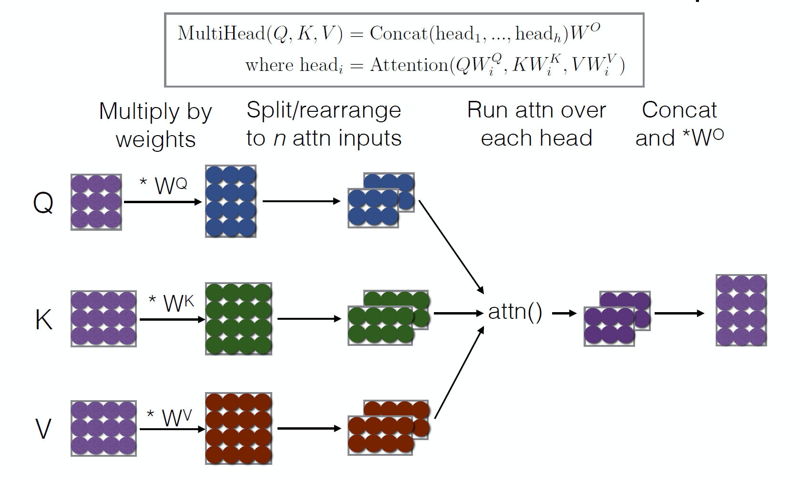
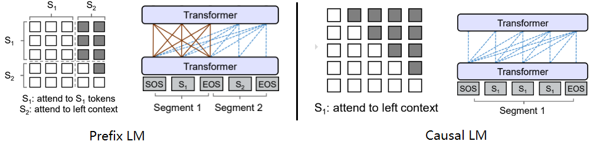
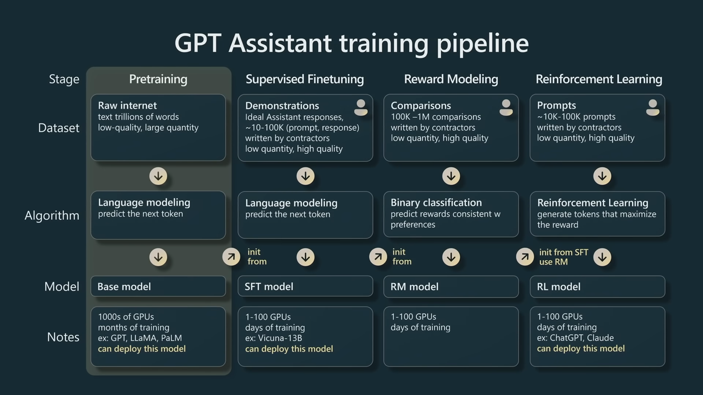

# AI-in-One-Interview-Handbook 

⭐⭐⭐ Welcome! I recently went through the Amazon Applied Scientist Intern interview process and successfully received an offer, with the entire timeline spanning just 25 days. A critical part of my success was a rapid, 12-day review using a handbook I put together covering key areas in ML, DL, NLP, and LLMs.

Preparing this guide was immensely helpful for integrating concepts and solidifying my understanding. Believing in sharing knowledge and resources, I've documented my study materials here. Whether you’re just starting your journey or racing against the clock, my hope is that this guide accelerates your learning, boosts your confidence, and helps you land that dream offer. Good luck!

> I plan to update this repo frequently with new insights and learnings. Don't hesitate to contact me if you find any typos or areas for improvement!

## Table of Contents
- [Statistics](#statistics)
- [Machine Learning](#Machine-Learning)
    - [ML Basic](#ML-Basic)
    - [ML Algorithms](#ML-Algorithms)
        - [Algorithm Categories](#Algorithm-Categories)  
        - [Supervised Learning](#supervised-Learning)  
        - [Unsupervised Learning](#Unsupervised-Learning)  
    - [XAI](#xai)

- [Deep Learning](#Deep-Learning)
    - [DL Basic](#dl-basic)
    - [DL Algorithms](#dl-algorithms)
        - [CNN](#cnn)
        - [RNN](#rnn)
        - [LSTM & GRU](#lstm--gru)
        - [Generative Models](#generative-models-gans--autoencoders)
        - [Transformers](#transformer)

- [Natural Language Processing](#nlp)
    - [Rule-Based Era](#rule-based-era-1960s-1980s)
    - [Statistical & ML Methods Era](#statistical--ml-era)
    - [Embedding & DL Methods Era](#embedding--deeplearning-era)

- [Large Language Models](#Large-Language-Models)
    - [LLM Basic](#llm-basic)
    - [Embedding](#embedding)
    - [Tokenization](#tokenization)
    - [Architecture](#architecture)
    - [Stages](#stages)

- [LLM Engineering](#llm-engineering)
    - [Mixed Precision](#mixed-precision)
    - [Distributed Training](#distributed-training)
    - [Fine-Tuning](#fine-tuning)
    - [Optimization and Efficiency](#optimization-and-efficiency)
    - [Evaluation and Monitoring](#evaluation-and-monitoring)

- [RAG](#rag)
    - [Retrieval](#retrieval)
    - [Embedding Models](#embedding-models)
    - [Chunking and Vectorization](#chunking-and-vectorization)
    - [Re-ranking](#re-ranking)
    - [Generation](#generation)
    
## Star History

[](https://www.star-history.com/#yubol-bobo/AI-in-One-Interview-Handbook&Date)


 

----
## Statistics

### Hypothesis Test
[[Wiki](https://en.wikipedia.org/wiki/Statistical_hypothesis_test)]
A statistical hypothesis test is a method of statistical inference used to decide whether the data provide **sufficient evidence to reject** a particular hypothesis. A statistical hypothesis test typically involves a calculation of a test statistic. Then a decision is made, either by comparing the test statistic to a critical value or equivalently by evaluating a p-value computed from the test statistic.

- The p-value represents the probability of obtaining results at least as extreme as the observed results, assuming the null hypothesis is true. 
    - In simpler terms, it tells you how likely it is that your data could have occurred under the null hypothesis. A low p-value suggests your observed data is unlikely under the null, hinting that your findings are significant.

### MLE
- Definition: Maximum Likelihood Estimation (MLE) is a statistical method used to estimate the parameters of a probability distribution by maximizing a likelihood function. It's a fundamental technique in both statistics and machine learning.
- The basic idea behind MLE is to find the parameter values that make the observed data most probable. Given a set of observations and a statistical model with unknown parameters, MLE selects the parameter values that maximize the likelihood function.
- In everyday conversation, "probability" and "likelihood" mean the same thing. However, in Stats-Land, "likelihood" specifically refers to this situation we've covered here; where you are trying to find the optimal value for the mean or standard deviation for a distribution given a bunch of observed measurements.
----
## Machine Learning

### ML Basic
#### Gradient descent
- (Batch) Gradient descent [[ref](https://machinelearningmastery.com/gradient-descent-for-machine-learning/)] [[B站](https://www.bilibili.com/video/BV1jh4y1q7ua/?spm_id_from=333.337.search-card.all.click&vd_source=c86f14ec33e79f08f7e2278747a071e8)]
    - The gradient $`\left(\nabla_\theta J(\theta)\right)`$ represents the direction of steepest ascent-the direction where the function increases the fastest. Gradient gives the direction of steepest ascend. So to minimize the function, take steps in the opposite direction.
    - Gradient descent is an optimization algorithm used to find the values of parameters (coefficients) of a function (f) that minimizes a cost function (cost).
    - formula: $`\theta = \theta - \alpha \nabla_\theta J(\theta)`$, where $`\theta:`$ Parameters to be optimized. $`\alpha`$ : Learning rate (step size). $`\nabla_\theta J(\theta)`$ : Gradient of the cost function w.r.t. parameters.

- GD Variants
    - (Batch) GD: All data points at once
    - SGD: one data point per iteration
        - Updates parameters using only one randomly chosen training example at each step.
        - Formula: $`\theta_{t+1}=\theta_t-\alpha \nabla J\left(\theta_t\right)`$, where $`\theta_t`$ are the parameters, $`\alpha`$ is the learning rate, and $`\nabla J\left(\theta_t\right)`$ is the gradient.
    - Mini-batch GD: Small subset per iteration.
    - Cons:
        - Sensitivity to learning rate
        - Risk of getting stuck at saddle points
        - Premature convergence in flat regions: local minimum.

All following advanced optimization algorithms improve parameter updates by adjusting both the **gradient calculation (gc)** and the **learning rate strategy (lr)**.

- **Momentum (gc)** enhances standard gradient descent by adding a velocity term that accumulates past gradients. This velocity term smooths the updates, reducing oscillations and accelerating convergence, particularly in scenarios with noisy gradients or ill-conditioned optimization surfaces.
    - $`v_t=\beta v_{t-1}+(1-\beta) \nabla J\left(\theta_t\right)`$
    - $`\theta_{t+1}=\theta_t-\alpha v_t`$
    - Pros: faster, jump out of local minimum, stable training.

- Nesterov Accelerated Gradient
    - Update rule
        - $`\tilde{\theta}_t=\theta_t+\beta v_{t-1} \quad`$ ("look-ahead")
        - $`v_{t}=\beta v_{t-1} + \eta \nabla_\theta \mathcal{L}\left(\tilde{\theta}_t\right)`$
        - $`\theta_{t+1}=\theta_t-v_{t}`$
    - Intuition
        - First take a "momentum step" to peek ahead at where you'd be $`\left(\tilde{\theta}_t\right)`$, then compute the gradient there.
        - This correction reduces lag in the momentum term, leading to more accurate, often faster convergence.


- **Adagrad (lr)** uses adaptive learning rates for each parameter, automatically adjusting LR during training. Larger learning rates for infrequent parameters, smaller rates for frequent parameters.
    - Formula:

      $`G_t=G_{t-1}+\left(\nabla_\theta J(\theta)\right)^2, \quad \theta=\theta-\frac{\alpha}{\sqrt{G_t+\epsilon}} \nabla_\theta J(\theta)`$

- **RMSprop (lr)**: Adagrad adapts the learning rate individually for each parameter, but its main drawback is the continual accumulation of squared gradients. Over time, this causes the learning rate to shrink excessively, sometimes stopping learning prematurely. RMSprop addresses this limitation by introducing an exponential moving average of squared gradients instead of a cumulative sum. This prevents the learning rate from becoming excessively small over time, making RMSprop better at handling non-stationary problems and maintaining stable and efficient convergence.


- **Adam**: Adam combines the advantages of (1)Momentum (first-order moment): Helps smooth updates, and (2) RMSprop (second-order moment): Provides adaptive per-parameter learning rates.
    Step 1: Calculate biased moments
    - First moment estimate (mean of gradients):

        $`m_t=\beta_1 m_{t-1}+\left(1-\beta_1\right) \nabla_\theta J(\theta)`$

    - Second moment estimate (mean of squared gradients):

        $`v_t=\beta_2 v_{t-1}+\left(1-\beta_2\right)\left(\nabla_\theta J(\theta)\right)^2`$


    Step 2: Correct bias (since initial values are zero):
    - $`\hat{m}_t=\frac{m_t}{1-\beta_1^t}, \quad \hat{v}_t=\frac{v_t}{1-\beta_2^t}`$


    Step 3: Parameter update:
    - $`\theta=\theta-\frac{\alpha}{\sqrt{\hat{v}_t}+\epsilon} \hat{m}_t`$


        Typical default values:
        - $`\beta_1=0.9, \beta_2=0.999, \epsilon=10^{-8}`$


- AdamW: Adam combines adaptive learning rates (like RMSprop) with momentum, leading to fast, efficient convergence. However, its implicit handling of weight decay can hurt generalization. AdamW improves upon Adam by explicitly decoupling weight decay from gradient-based updates, resulting in better regularization and improved generalization—making AdamW particularly beneficial for training large, modern models like transformers.

- Muon (Recent): Muon is an optimizer tailored for optimizing the hidden layers of neural networks, specifically focusing on 2D weight matrices (e.g., those in linear and convolutional layers). It operates by applying a Newton-Schulz iteration to the momentum-based gradient updates, effectively orthogonalizing them before applying to the weights. This orthogonalization helps in maintaining diverse directions in the parameter updates, which can lead to better convergence properties. [[GitHub](https://github.com/KellerJordan/Muon?utm_source=chatgpt.com)]

| Method | Adaptive LR | Momentum | Memory | Stability | Typical Use |
|--------|-------------|----------|--------|-----------|-------------|
| SGD | ❌ No | ❌ No | Low | Medium | Fast updates |
| Momentum | ❌ No | ✅ Yes | Low | Medium | Reduces oscillations |
| RMSprop | ✅ Yes | ❌ No | Medium | High | Adaptive LR |
| Adam | ✅ Yes | ✅ Yes | Medium | High | Most popular default |
| AdamW | ✅ Yes | ✅ Yes | Medium | High | Improved regularization |
| Muon | ✅ Yes | ✅ Yes | Low | High | Recent advancement |


#### Black-Box Optimization
- Black-box optimization (BBO) refers to optimizing an objective function without an explicit formula or gradient information for that function. BBO has become increasingly important with the rise of expensive simulations and automated experiments – scenarios where each function evaluation is costly or time-consuming, and derivatives are unavailable.

- [To be reviewed] Random Search

    - **Mechanism:** sample configurations independently from a specified search distribution. Use log-uniform sampling for scale parameters such as learning rate; uniform sampling spends most trials near the upper end of a wide numerical interval.
    - **Example:** if only learning rate and weight decay matter among ten hyperparameters, 50 random trials explore about 50 settings for each relevant coordinate, whereas a Cartesian grid spends trials recombining irrelevant coordinates. Keep the final test set outside the search loop. [Random search paper](https://jmlr.org/papers/v13/bergstra12a.html)

- [To be reviewed] Evolutionary Algorithms

    - Maintain a population, evaluate fitness, and generate new candidates through selection, mutation, and sometimes crossover. Evolution strategies can adapt a continuous search distribution; genetic algorithms also accommodate discrete architectures and rules.
    - **Experimental design:** compare best validation score against equal evaluation or wall-clock budgets, including population initialization. In a noisy simulator, a lucky candidate may survive because of evaluation noise; reevaluate finalists with independent seeds. Evolution is useful when gradients are unavailable, but population search can be expensive. [CMA-ES author's resources](https://cma-es.github.io/)

- [To be reviewed] Bayesian Optimization

    - Fit a probabilistic surrogate to observed configurations and scores, then maximize an acquisition function balancing predicted quality and uncertainty. For maximization, expected improvement is $`\operatorname{EI}(x)=\mathbb{E}[\max(f(x)-f_{\mathrm{best}},0)]`$ under the surrogate posterior.
    - **Example:** when one model evaluation takes two GPU-hours, spend computation choosing the next configuration rather than sampling blindly. Gaussian-process BO is especially attractive for expensive, relatively low-dimensional continuous searches; high-dimensional conditional spaces and strongly nonstationary objectives require different surrogates or search structure. [BO tutorial](https://arxiv.org/abs/1807.02811)

- [To be reviewed] Derivative-Free Optimization Methods (Direct Search and Surrogate Algorithms)

    - Direct-search methods compare function values at candidate points; model-based methods fit a local approximation inside a trust region. Nelder-Mead uses a simplex, while methods such as BOBYQA use local quadratic models. These methods require objective evaluations, rather than analytic gradients.
    - **Example:** tune three continuous simulator parameters with deterministic outputs using a local method from several initial points. A local optimum is not a global-optimality certificate. Noisy evaluations, poor scaling between coordinates, discontinuities, and large dimension can make the comparison unreliable. [SciPy optimization reference](https://docs.scipy.org/doc/scipy/reference/optimize.html)

- [To be reviewed] Reinforcement Learning-based Approaches

    - A controller can sequentially choose design decisions, such as architecture components, and receive validation performance as a terminal reward. A policy-gradient estimator has the form $`\nabla_\phi\mathbb{E}[R(a)]=\mathbb{E}[(R(a)-b)\nabla_\phi\log\pi_\phi(a)]`$, where the baseline reduces variance.
    - **Distinction:** an ordinary hyperparameter trial is not automatically an RL problem. RL becomes useful when decisions have sequential structure or the controller transfers across tasks. Account for controller training and failed trials when comparing against random search. [Neural architecture search with RL](https://arxiv.org/abs/1611.01578)


#### Model evaluation and selection
- Evaluation
    - TP, FP, TN, FN

    - Metrics:
        - Accuracy: Overall correctness
        - Precision ($`\frac{T P}{T P+F P}`$): Out of predicted positives, how many were actually positive?
        - Recall/sensitivity/TPR ($`\frac{T P}{T P+F N}`$): 	Out of actual positives, how many were predicted correctly?
        - Specificity/TNR ($`\frac{T N}{T N+F P}`$): Out of actual negatives, how many were correctly predicted negative?
        - F1-score ($`2 \times \frac{\text { Precision } \times \text { Recall }}{\text { Precision }+ \text { Recall }}`$): Harmonic mean balancing precision and recall. For multi-class problems, use macro or weighted averages.
        - **How to choose**: Accuracy is misleading with imbalanced data. Precision, if avoiding false positives is crucial (e.g., spam detection). Recall (Sensitivity), if missing a positive case is costly (e.g., cancer detection, fraud detection). F1-score, if both precision and recall matter equally. Specificity, if correctly identifying negative cases is essential (medical tests).
        - Precision vs Recall: Precision clearly matters when the cost of a FP is high. (e.g., classifying email as spam—high precision avoids wrongly marking important emails). Recall (TPR) clearly matters when the cost of missing positives (FN) is very high (e.g., disease diagnosis—high recall ensures positive cases aren't missed).

    - ROC (Receiver Operating Characteristic) curve (TPR vs FPR, threshold selection)
        - ROC curve plots TPR (Recall) vs FPR (1 - Specificity) at various threshold levels.Y-axis (TPR/Recall): Correctly identified positives; X-axis (FPR): Incorrectly identified positives (False Alarms). Choose threshold clearly to maximize TPR and minimize FPR.
    - AUC (model comparison)
        - AUC clearly measures the model’s overall capability to distinguish classes irrespective of threshold. Model with higher AUC is generally better at distinguishing classes clearly.
        - Range [0.5, 1]
    - Confusion matrix: Confusion matrix clearly visualizes all predictions vs actual classes:

    <div align="center">
        
    </div>

- Bias/Variance [[ref](https://traintestsplit.com/bias-vs-variance-in-machine-learning/)]
    - Bias: The bias is the simplifying assumption made by the model to make the target function easy to learn. Low bias suggests fewer assumptions made about the form of the target function. High bias suggests more assumptions made about the form of the target data. The smaller the bias error the better the model is. If, however, it is high, this means that the model is **underfitting** the training data. 

    - Variance: Represents the model's sensitivity to small fluctuations in the training data. It measures how much the model's predictions would change if it were trained on a different training dataset drawn from the same distribution. High variance suggests the model is too complex and captures noise in the training data, leading to overfitting and poor generalization to unseen data.

    - If our model is too simple and has very few parameters then it may have high bias and low variance. On the other hand if our model has large number of parameters then it’s going to have high variance and low bias. So we need to find the right/good balance without overfitting and underfitting the data. 

    <div align="center">
        
    </div>

    - Underfitting/overfitting
        - Underfitting occurs when the model is too simple to capture underlying data trends. Solution:Increase model complexity (e.g., add features, use more complex models, reduce regularization).
        - Overfitting occurs when the model captures noise or random fluctuations (memorize every single detail) in training data. Solution: Reduce model complexity (e.g., remove features, apply regularization, use simpler models); Increase training data size; Early stopping.
    - Regularization: Regularization, such as L1 (LASSO) or L2 (Ridge), can be used to control model complexity to prevent overfitting and tackle high variance. They work by adding a penalty term to the magnitude of the coefficients.
        General form of regularized loss function:

        $`\operatorname{Loss}(w)=\operatorname{Loss}_{\text{original}}(w)+\lambda\cdot{R}(w)`$


        - L0 is a technique in ML to encourage sparsity in a model's parameters. It penalizes the number of **non-zero parameters** in a model.

            $`\|\mathbf{w}\|_0=\sum_{i=1}^n \mathbf{1}\left[w_i \neq 0\right]`$

            Use case: Feature Selection: L0 regularization is particularly useful in scenarios where the number of features is large, and only a small subset is expected to be relevant. It helps to automatically select a subset of features that contribute significantly to the model's performance.

        - L1 penalizes **absolute magnitude** of weight: 

            $`R(w)=\sum\left|w_i\right|`$.

            Encourages sparsity through geometry.
        
        - L2 penalizes **square magnitude** of weights:

            $`R(w)=\sum\left(w_i^2\right)`$

            Penalizes large weights heavily, encourges smaller, diffuse weigths. Handles correlated features better.

        - L-infinity penalizes the **largest absolute weight** (maximum norm):

            $`R(w)=\max \left|w_i\right|`$

            It's used when you need to control the model's sensitivity to prevent any one feature from dominating the predictions.

        - When prefer L1 over L2? For explicit feature selection or interpretability
        - When prefer L2 over L1? L2 (Ridge) shrinks correlated features toward each other, effectively managing correlated features.
        - What happens as $`\lambda \rightarrow \infty`$ for L1 and L2?  For both: parameters approach zero; L1 produces exact zeros faster.
        - Is L0 convex? Why does it matter? No, it's non-convex. This matters due to optimization difficulty and computational complexity.


    - Feature selection: Proper Feature Selection removes irrelevant features thereby reducing both bias and variance. It can be done through various methods like backward elimination, forward selection, and recursive feature elimination.
        - Backward Elimination: Start with all features, then iteratively remove the least significant feature.
        - Forward Selection: Start with no features, then teratively add the most significant feature until no improvement.
        - Recursive Feature Elimination (RFE): Iteratively fits a model and removes least important features based on coefficients or importance metrics.
        - Embedded Methods (L1 Regularization / Lasso):
            - Feature selection happens simultaneously with model fitting

- Data
    - Missing data
        - MICE (Multiple Imputation by Chained Equations): It's an iterative method of imputing missing data where each missing feature is repeatedly modeled and filled based on other features. It creates multiple datasets to capture uncertainty properly.
    - Imbalanced data: Imbalanced data occurs when one class significantly outnumbers the other(s), causing biased models toward the majority class.
        - Oversampling: Duplicate minority examples 
            - SMOTE (Synthetic Minority Oversampling Technique): 1. Chooses a random minority instance; 2. Finds k nearest minority neighbors; 3. Creates synthetic points along the line segments joining neighbors.
            - ADASYN (Adaptive Synthetic Sampling): Generates more synthetic data for harder-to-classify minority instances (closer to majority class boundary).
        - Undersampling: Remove majority examples strategically.
            - ENN (Edited Nearest Neighbor): Removes majority samples misclassified by a k-NN classifier (noisy or ambiguous instances).

    - Distribution shifts: A distribution shift happens when the data seen during training differs from the data encountered during deployment or testing. It breaks the core assumption that train and test data come from the same distribution.
        - Covariate Shift (X changed): This occurs when the input distribution $`P(x)`$ changes, but the conditional distribution $`P(y \mid x)`$ stays the same. Example: A spam detection model trained on emails from last year might see different phrasing this year, even if what qualifies as spam hasn’t changed.

        - Label Shift (Y changed): Here, the label distribution $`P(y)`$ changes, but the distribution of features given the label $`P(x \mid y)`$ remains the same. Example: In medical data, the proportion of patients with a certain condition may increase in a new population.
        - Concept Drift (f changed): The conditional distribution $`P(y \mid x)`$ itself changes. Example: A recommendation model may degrade as user preferences evolve.

- Sampling
    - Uniform sampling selects items from a dataset with equal probability for all elements.  Code: random.sample(data,k).  Time Complexity: $`O(k)`$
    - Negative sampling primarily used in recommendation systems and NLP (Word2Vec) to train efficiently on sparse data. It reduce computational cost by sampling a subset of negative examples (items not interacted with or words not co-occurring). (Word2Vec)  Time Complexity: Reduces computation from $`O(N)`$ (all negatives) to $`O(k)`$ (sampled negatives).
    - Reservoir sampling: Technique to uniformly sample $`k`$ items from a stream or large unknown-size dataset in one pass.
        - Use Cases: Sampling from streaming data or very large files/databases.
        - Algorithm: Maintain a reservoir of size $`k`$. For first $`k`$ items: directly fill reservoir. For each subsequent item $`i>k`$ : With probability $`k / i`$, randomly replace an item in the reservoir.
        - Time: $`O(N)`$, single pass.
        - Memory: $`O(k)`$, fixed space.
    - Stratified sampling: Technique where the dataset is divided into distinct subgroups (strata) based on certain attributes (e.g., age, gender, class), and samples are drawn from each subgroup proportionally or with specific representation.
        - Code: df.groupby(stratify_col, group_keys=False).apply(lambda x: x.sample(frac=frac))
    - Questions
        - When would you prefer reservoir sampling over uniform random sampling? If you're sampling tweets from a live Twitter stream (which is continuously updating and has unknown total size), reservoir sampling is the ideal method to guarantee uniformity while using fixed memory.
        - How does stratified sampling reduce variance? If you're conducting a survey on voting preferences and you stratify by age groups (young, middle-aged, elderly), each subgroup's responses tend to be more similar internally than across the entire population. This homogeneity decreases the variance of estimates significantly compared to simple random sampling.


- Model Selection
    - K-fold Cross-validation is a resampling procedure used to evaluate machine learning models and tune hyperparameters.
    - $`K=5`$ or $`K=10`$ are most common.
    - Trade-off (Bias vs. Variance):
        - Large $`K`$ :
            - Pros: Low bias, more accurate estimates.
            - Cons: Higher variance, computationally expensive.
        - Small $`K`$ :
            - Pros: Faster computation, lower variance in estimates.
            - Cons: Higher bias, less stable estimates.
    - How to handle imbalanced datasets in K-fold CV? Use Stratified K-fold, ensuring each fold maintains the proportion of classes from the original dataset.
    - Does K-fold cross-validation prevent overfitting? No, it helps evaluate and select models accurately but doesn't inherently prevent overfitting. Use regularization, early stopping, or simpler models to control overfitting.
    - Whey k-fold CV might not be ideal? Cross-validation isn’t always ideal because it can become computationally expensive, particularly with complex models or very large datasets. It's also unsuitable for time-series data due to temporal dependencies that violate the assumption of independence.

- Hyper-Parameter Tuning
    - Grid search: Exhaustively evaluates all possible combinations of hyper-parameters provided in a predefined grid.
    - Random search: Randomly samples hyper-parameter values within predefined ranges.
    - Bayesian optimization: Uses past evaluation results to model the hyper-parameter space.
        - Popular libraries: `Hyperopt`, `Optuna`, `BayesSearchCV`. 
    - Other autoML packages: `Auto-skearn`, `h2o`.


### ML Algorithms
#### Algorithm Categories [[Super Quick Overview](https://www.youtube.com/watch?v=E0Hmnixke2g)]
- Types by (labeled) data
    - **Supervised Learning** is a type of machine learning where the algorithm is trained on a labeled dataset. Labeled data consists of input-output pairs, meaning the algorithm learns to map input data to corresponding output labels. The goal is for the algorithm to generalize from the training data and make accurate predictions on new, unseen data.
        - Classification: Predicts categorical outputs (e.g., spam detection, image recognition). Algorithms: Logistic regression, Decision tree, RF,KNN, SVM.
            - Loss function [[YouTube](https://www.youtube.com/watch?v=v_ueBW_5dLg)]: These losses measure how correctly and confidently a model classifies examples into categories.
                - logistic loss/ binary cross entropy: Used for binary classification problems. For a predicted probability $`p`$ and ground truth label $`y \in\{0,1\}`$ : $`\mathrm{BCE}=-[y \log (p)+(1-y) \log (1-p)]`$.
                    - Outputs probabilities between 0 and 1.
                    - Penalizes confident but wrong predictions heavily.
                    - Works well when used with sigmoid activation in the output layer.

                - categorial cross entropy: Extends cross-entropy loss to multi-class classification problems. For a ground truth one-hot encoded vector $`\mathbf{y}`$ and a prediction vector $`\hat{\mathbf{y}}`$ : $`\mathrm{CCE}=-\sum_{c=1}^C y_c \log \left(\hat{y}_c\right)`$.
                    - Used together with a softmax activation in the output layer.
                    - Encourages the model to assign high probability to the correct class.

                - [To be reviewed] KL divergence

                    - For discrete distributions, $`D_{\mathrm{KL}}(p\|q)=\sum_i p_i\log(p_i/q_i)`$. It is nonnegative but asymmetric; if $`p_i>0`$ and $`q_i=0`$, the divergence is infinite. Cross-entropy satisfies $`H(p,q)=H(p)+D_{\mathrm{KL}}(p\|q)`$, so minimizing it over $`q`$ with fixed targets minimizes forward KL.
                    - **Example:** knowledge distillation uses the teacher's full soft distribution, preserving distinctions that a one-hot label discards. State the direction of KL explicitly; reversing it changes which distribution supplies the expectation and can change optimization behavior. [Distillation paper](https://arxiv.org/abs/1503.02531)


                - hinge loss: Commonly used for Support Vector Machines (SVMs) and for certain deep learning tasks that involve margin-based classification. For a prediction score $`s`$ and a true label $`y \in\{-1,1\}`$ : $`\text { Hinge Loss }=\max (0,1-y \cdot s)`$.
                    - Focuses on the margin between classes.
                    - Can also be adapted for multi-class classification with variations like multi-class hinge loss.

        - Regression: Predicts continuous numerial outputs. (e.g., house price prediction, stock market forecasting). Algorithms: Linear regression, RF.
            - Loss function:These losses measure how close predicted values are to true values numerically.
                - [To be reviewed] MSE

                    - $`\operatorname{MSE}=n^{-1}\sum_i (y_i-\hat y_i)^2`$. Its population minimizer is the conditional mean when the second moment exists. Squaring residuals makes large errors disproportionately influential.
                    - **Example:** residuals 1 and 10 contribute 1 and 100. MSE is appropriate for expected squared error, but an extreme corrupted label can dominate an otherwise clean batch. Gaussian observation noise with fixed variance gives the same optimum as maximum likelihood. [Regression losses](https://scikit-learn.org/stable/modules/model_evaluation.html#regression-metrics)

                - [To be reviewed] RMSE

                    - $`\operatorname{RMSE}=\sqrt{\operatorname{MSE}}`$ has the target's units. On one fixed evaluation set, it ranks models identically to MSE because the square root is monotone.
                    - **Pitfall:** averaging fold RMSEs is not the same as taking the square root of pooled squared errors. For unequal fold sizes, aggregate squared-error totals and observation counts before taking the square root when the desired estimand is sample-level RMSE. The globally coupled square root also changes gradient scaling if optimized directly.

                - [To be reviewed] MAE

                    - $`\operatorname{MAE}=n^{-1}\sum_i |y_i-\hat y_i|`$. Its population minimizer is a conditional median; its residual gradient has constant magnitude away from zero. A Laplace observation model with fixed scale yields an equivalent maximum-likelihood objective.
                    - **Example:** with targets 0, 0, and 100 for the same features, squared loss prefers the mean 33.33, while absolute loss prefers 0. Choose the loss from the cost of mistakes and the intended conditional statistic, rather than assuming robustness is always desirable.

                - [To be reviewed] Huber Loss

                    - For residual $`r=\hat y-y`$, Huber loss is $`\ell_\delta(r)=r^2/2`$ when $`|r|\leq\delta`$, and $`\delta(|r|-\delta/2)`$ otherwise. It has a quadratic center and linear tails with a continuous first derivative.
                    - **Example:** choose the transition scale relative to standardized target residuals, then tune it on held-out data. A threshold of 1 has completely different meaning for errors measured in dollars and millions of dollars. Huber limits the influence of large residuals but cannot repair systematically biased labels. [Huber loss reference](https://docs.pytorch.org/docs/stable/generated/torch.nn.HuberLoss.html)

                - [To be reviewed] Log-Cosh Loss

                    - $`\ell(r)=\log\cosh(r)`$ behaves like $`r^2/2`$ near zero and $`|r|-\log 2`$ for large magnitude. Its derivative $`\tanh(r)`$ is bounded, providing smooth robust optimization.
                    - **Implementation:** use $`|r|+\log(1+e^{-2|r|})-\log 2`$ to avoid overflow from computing `cosh` directly. An explicit residual scale is needed when units vary. Like other symmetric robust losses, it does not generally estimate the conditional mean under asymmetric noise. [TensorFlow LogCosh reference](https://www.tensorflow.org/api_docs/python/tf/keras/losses/LogCosh)


    - **Unsupervised Learning** is a type of machine learning that learns from data without human supervision. Unlike supervised learning, unsupervised machine learning models are given unlabeled data and allowed to discover patterns and insights without any explicit guidance or instruction. (e.g., Customer segmentation, dimensionality reduction)
        - **Clustering** is a technique for exploring raw, unlabeled data and breaking it down into groups (or clusters) based on similarities or differences. It is used in a variety of applications, including customer segmentation, fraud detection, and image analysis. Clustering algorithms split data into natural groups by finding similar structures or patterns in uncategorized data. 
            - [To be reviewed] K-means

                - Partition observations by nearest centroid and minimize squared Euclidean reconstruction error; choose feature scaling and multiple initializations deliberately. See the detailed K-means section below. Example: grouping customers by annual spend without scaling can effectively ignore a purchase-frequency feature measured on a much smaller numerical scale.

            - [To be reviewed] DBSCAN

                - Identify density-connected regions and label unsupported points as noise. Unlike K-means, DBSCAN does not require a prespecified number of clusters, but its distance metric and density thresholds strongly influence the answer. A single global threshold can struggle when genuine clusters have very different densities. See the detailed DBSCAN section below.

            - [To be reviewed] Hierarchical clustering.

                - Construct a nested grouping represented by a dendrogram, then choose a cut using the task and a stated linkage criterion. The same data can yield different hierarchies under single, complete, average, or Ward linkage; the linkage is part of the model, rather than a plotting option.

        - Association rule mining is a rule-based approach to reveal interesting relationships between data points in large datasets. Unsupervised learning algorithms search for frequent if-then associations—also called rules—to discover correlations and co-occurrences within the data and the different connections between data objects. 
        
        It is most commonly used to analyze retail baskets or transactional datasets to represent how often certain items are purchased together. These algorithms uncover customer purchasing patterns and previously hidden relationships between products that help inform recommendation engines or other cross-selling opportunities. You might be most familiar with these rules from the “Frequently bought together” and “People who bought this item also bought” sections on your favorite online retail shop. 

        Association rules are also often used to organize medical datasets for clinical diagnoses. Using unsupervised machine learning and association rules can help doctors identify the probability of a specific diagnosis by comparing relationships between symptoms from past patient cases. 

        Typically, Apriori algorithms are the most widely used for association rule learning to identify related collections of items or sets of items. However, other types are used, such as Eclat and FP-growth algorithms.

        - Dimensionality  Reduction is an unsupervised learning technique that reduces the number of features, or dimensions, in a dataset. 
            - [To be reviewed] PCA

                - PCA finds orthogonal directions of maximal variance after centering. It is useful for compression and conditioning, but a low-variance direction can still contain the discriminative signal. See the detailed PCA entry under Dimension reduction techniques.

            - [To be reviewed] t-SNE

                - t-SNE is primarily a local-neighborhood visualization method. Use multiple seeds and perplexities; do not infer class counts or quantitative global distances solely from separated islands. See the detailed t-SNE entry under Dimension reduction techniques.

    - **Semi-supervised Learning** falls between unsupervised learning (without any labeled training data) and supervised learning (with completely labeled training data). It combines small amounts of labeled data with large amounts of unlabeled data. Useful when labeling data is expensive or difficult. The model leverages labeled data to guide learning, while also making use of unlabeled data to generalize better and improve performance.
    - **Reinforcement Learning** learn through trial-and-error, reward-based systems. Gaining feedback from interactive environment instead of given data.
    - **Self-supervised Learning** involves creating "pseudo-labels" from the unlabeled data itself. The model learns a meaningful representation of the data by predicting parts of the input or generating transformations of the input. (BERT)

- Parametric vs non-parametric algorithms (if we assume a fixed functional form or not) 

    (Functional form = Mathematical shape or structure that the model assumes to represent how the input relates to the output.)
    - Parametric Algorithms(e.g., Logistic Regression, Naive Bayes, Neural Networks) assume that the dataset comes from a certain function with some set of parameters that should be tuned to reach the optimal performance. For such models, the number of parameters is determined prior to training, thus the degree of freedom is limited and reduces the chances of overfitting. They are computationally efficient and often easier to interpret, but less flexible.

    - Non-parametric methods (e.g., KNN, Decision Trees, Random Forests) don't assume anything about the function from which the dataset was sampled. For these models, the number of parameters is not determined prior to training, thus they are free to generalize the model based on the data. Sometimes these models overfit themselves while generalizing. To generalize they need more data in comparison with Parametric Models. They are relatively more difficult to interpret compared to Parametric Models. Their complexity grows with the data, making them suitable for capturing complex patterns.

- Linear vs Nonlinear algorithms
    - Linear algorithms (Linear Regression, Logistic Regression, Linear SVM) assume a linear relationship and provide simplicity and interpretability.
    - Nonlinear algorithms (Decision Trees, Random Forest, Neural Networks, Kernel SVM) capture more complex patterns and relationships, offering flexibility but potentially at the cost of interpretability and efficiency.


#### Supervised Learning
- K-Nearest Neighbors (KNN) [[Code](https://www.youtube.com/watch?v=ngLyX54e1LU&list=PLqnslRFeH2Upcrywf-u2etjdxxkL8nl7E&index=1)]
    - Nature: non-parametric, instance-based, lazy :smile:. It directly predicts the output for a new instance by identifying the k closest data points in the training set, using a suitable distance metric (typically Euclidean distance for continuous features).
    - Curse of Dimensionality: High-dimensional spaces reduce the discriminative power of distance metrics, often leading to performance degradation unless accompanied by dimensionality reduction techniques.
    - Time Complexity: Prediction requires computing distances to many or all training samples, which can be computationally expensive for large datasets.

- Linear Algorithms
    - **Linear Regression** [[Code](https://www.youtube.com/watch?v=4swNt7PiamQ&list=PLqnslRFeH2Upcrywf-u2etjdxxkL8nl7E&index=2)]  is a supervised statistical model to predict dependent variable quantity based on independent variables. Linear regression is a parametric model and the objective of linear regression is that it has to learn coefficients using the training data and predict the target value given only independent values.
        - Assumptions:
            - Linear relationship between independent and dependent variables.
            - Independence of errors: The residuals (differences between observed and predicted values) should be independent of each other. This assumption is particularly important in time series data, where observations might be related to previous observations.
            - Homoscedasticity: The variance of the residuals should be constant across all levels of the independent variables. This means the spread of residuals should be roughly the same across all predicted values.
            - Normality of residuals: The residuals should follow a normal distribution. This assumption is important for valid hypothesis testing and confidence interval estimation.
            - No multicollinearity: When multiple independent variables are used, they should not be highly correlated with each other. High correlation between predictors makes it difficult to determine the individual effect of each variable.
        - Formulation: Linear regression models the relationship between a dependent variable $`y`$ and one or more independent variables $`X`$ as a linear combination: $`y=X \beta+\epsilon,`$, where $`\beta`$ is a vector of coefficients and $`\epsilon`$ is the error term.
        - Regularization: Extensions such as Ridge (L2) and Lasso (L1) regression add penalty terms to handle multicollinearity and promote sparsity.

    - Logistic Regression
        - Formulation: Logistic regression models the probability of a binary outcome by applying the logistic (sigmoid) function to a linear combination of input features: $`P(y=1 \mid X)=\frac{1}{1+e^{-X \beta}} .`$
        - Estimation: Parameters are typically estimated via Maximum Likelihood Estimation (MLE), where the cost function (the log-loss) is minimized using iterative optimization methods (e.g., gradient descent or iterative reweighted least squares).
        - Interpretability: Coefficients can be interpreted in terms of odds ratios, offering intuitive insights into feature effects.

        - The cost for a single training example using the binary cross-entropy (log-loss) is: $`\ell(w, b)=-[y \log (\hat{y})+(1-y) \log (1-\hat{y})]`$.
        - For $`m`$ training examples, the overall cost is: $`J(w, b)=\frac{1}{m} \sum_{i=1}^m \ell^{(i)}(w, b)=-\frac{1}{m} \sum_{i=1}^m\left[y^{(i)} \log \left(\hat{y}^{(i)}\right)+\left(1-y^{(i)}\right) \log \left(1-\hat{y}^{(i)}\right)\right]`$
        - Derivation of gradients
            - The cost for one sample is: $`\ell(w, b)=-[y \log (\hat{y})+(1-y) \log (1-\hat{y})], \quad \text { with } \hat{y}=\sigma(z) \text { and } z=w^T x+b`$.
            - Compute the derivative of the cost with respect to $`\hat{y}`$ : $`\frac{\partial \ell}{\partial \hat{y}}=-\left(\frac{y}{\hat{y}}-\frac{1-y}{1-\hat{y}}\right)`$
            - The derivative of the sigmoid is: $`\frac{d \hat{y}}{d z}=\hat{y}(1-\hat{y}) .`$
            - Then by the chain rule: $`\frac{\partial \ell}{\partial z}=\frac{\partial \ell}{\partial \hat{y}} \cdot \frac{d \hat{y}}{d z}`$. When you work through the algebra, the product simplifies to: $`\frac{\partial \ell}{\partial z}=\hat{y}-y`$.
            - Since $`z=w^T x+b`$, the derivative of $`z`$ with respect to $`w_j`$ is: $`\frac{\partial z}{\partial w_j}=x_j`$. Then: $`\frac{\partial \ell}{\partial w_j}=\frac{\partial \ell}{\partial z} \cdot \frac{\partial z}{\partial w_j}=(\hat{y}-y) x_j`$.
            - Similarly, $`\frac{\partial \ell}{\partial b}=\frac{\partial \ell}{\partial z} \cdot \frac{\partial z}{\partial b}=(\hat{y}-y)`$.


    - Support Vector Machines
        - Formulation: SVMs seek a hyperplane that maximally separates classes with the greatest margin. For linearly separable data, the optimization problem is: $`\min _{w, b} \frac{1}{2}\|w\|^2 \quad \text { s.t. } y_i\left(w^T x_i+b\right) \geq 1, \quad \forall i`$.
        - Soft Margin: For non-separable data, slack variables are introduced to allow misclassifications, leading to a trade-off between margin size and classification error.
        - Kernel Trick: For nonlinear classification, kernel functions (e.g., Gaussian, polynomial) implicitly map input data to a higher-dimensional space where linear separation is feasible.
        - Dual Formulation: The Lagrange dual formulation and application of Karush-Kuhn-Tucker (KKT) conditions are central to SVM theory, providing insights into support vectors and decision boundaries.
        - The optimization is convex, ensuring global optimum, but can be computationally challenging for large datasets.


    - Naive Bayes
        [[Coding](https://www.youtube.com/watch?v=TLInuAorxqE)]
        - Foundational Principle: Based on Bayes' theorem: $`P(C \mid x)=\frac{P(x \mid C) P(C)}{P(x)}`$, Naive Bayes assumes conditional independence among features given the class label.
            - $`P(C)`$ is the prior probability of class $`C`$.
            - $`P(x \mid C)`$ is the likelihood of observing features $`x`$ under class $`C`$.
            - $`P(C \mid x)`$ is the posterior probability: what we want.
            - Because $`P(x)`$ is the same across classes when comparing them, we only need $`\arg \max _C P(x \mid C) P(C)`$.

        - Choosing a Model
            - Multinomial NB: features are non‑negative counts (e.g. word counts in text).
            - Bernoulli NB: binary features (presence/absence).
            - Gaussian NB: continuous features, modeled with class‑conditional Gaussians.

        - Why naive? The term "naive" in Naive Bayes refers to the algorithm's assumption that all features (predictor variables) used for classification are mutually independent given the class label. This assumption is considered "naive" because, in real-world scenarios, features often exhibit some degree of dependency, and assuming independence can be an oversimplification of the true underlying relationships. Despite the “naive” assumption being seldom true in practice, the method often performs well due to its simplicity and effectiveness in high-dimensional settings.

    - Linear discriminant analysis (LDA)
        - Concept & Assumptions: LDA models class conditional densities as multivariate Gaussians with equal covariance matrices for all classes. Under this assumption, the discriminant function is linear in the features: $`\delta_k(x)=x^T \Sigma^{-1} \mu_k-\frac{1}{2} \mu_k^T \Sigma^{-1} \mu_k+\log \pi_k`$. Here, $`\mu_k`$ is the mean vector, $`\Sigma`$ the common covariance matrix, and $`\pi_k`$ the prior probability of class $`k`$.
        - Bayes Optimality: Under the LDA assumptions, the resulting classifier is Bayes-optimal.
        - Dimensionality Reduction: LDA also serves as a dimensionality reduction technique by projecting data onto a subspace that maximizes between-class variance while minimizing within-class variance (related to Fisher’s Linear Discriminant).
        - Applications: Particularly effective when the Gaussian assumption holds and when class covariances are similar.
      
- Decision Trees

    - Structure: Decision trees recursively partition the input feature space by selecting splits that maximize a certain criterion (e.g., information gain, Gini impurity for classification, or mean squared error reduction for regression).
    - Algorithm details
        - Recursive Partitioning: At each node, the algorithm selects the feature and threshold that best “purifies” the subsets.
        - Stopping Criteria & Pruning: Trees can easily overfit; thus, criteria such as maximum depth, minimum samples per leaf, or post-pruning (e.g., cost-complexity pruning) are essential.
        - Interpretability: Decision trees produce models that are easily interpretable; however, their hierarchical nature can also be sensitive to small changes in data (high variance).
    - Decision trees are highly flexible non-parametric models. Their analysis often involves bias–variance trade-offs: while they are low bias (fit complex relationships well), they can suffer from high variance if unpruned.

    - [To be reviewed] Leaves

        - A leaf stores the fitted response for a region of feature space: typically class proportions for classification and a mean for squared-error regression. These are piecewise-constant estimates, so a regression tree cannot extrapolate a linear trend beyond its observed leaf values.
        - **Example:** a leaf containing eight positive and two negative training examples predicts a positive-class probability of 0.8 before any smoothing or calibration. A leaf containing one positive example also predicts 1.0, but carries much greater estimation uncertainty. Minimum leaf size controls this variance. [Decision trees](https://scikit-learn.org/stable/modules/tree.html)

    - [To be reviewed] Training algorithm+stop criteria

        - CART greedily chooses the feature and threshold maximizing weighted impurity reduction. It does not jointly optimize the entire tree. Classification commonly uses Gini impurity or entropy; squared-error regression minimizes within-node variance.
        - Stop using maximum depth, minimum split/leaf counts, or minimum impurity decrease. Fit these choices inside cross-validation. **Example:** a split isolating one mislabeled point may improve training purity while harming held-out performance; a minimum leaf-size constraint prevents that particular memorization pattern.

    - [To be reviewed] Inference

        - Route an example from the root to one leaf by applying its feature-threshold comparisons. Prediction cost is proportional to path depth, not the number of training observations. A balanced depth-10 tree uses about ten comparisons; a badly unbalanced tree can be much deeper.
        - Record the decision path for debugging. Missing-value routing and categorical support are implementation-specific; training and serving must apply the same feature encoding and missing-data semantics.

    - [To be reviewed] Pruning

        - Minimal cost-complexity pruning trades training impurity against leaf count: $`R_\alpha(T)=R(T)+\alpha |\mathcal{L}(T)|`$. Increasing $`\alpha`$ favors smaller subtrees. Select it on validation folds rather than the final test set.
        - **Example:** compare a deep tree and its pruned subtrees using mean validation score and variability across folds. A tiny training improvement from a rare branch may disappear under resampling. [Cost-complexity pruning](https://scikit-learn.org/stable/modules/tree.html#minimal-cost-complexity-pruning)


- Ensemble methods [[Wiki](https://en.wikipedia.org/wiki/Ensemble_learning)] [[Document](https://scikit-learn.org/stable/modules/ensemble.html)]
    - Definition: Ensemble methods aim to combine the predictions of multiple base learners to achieve improved generalization performance and robustness compared to single models.

    - Bagging: Variance Reduction through Bootstrap Aggregation
        - Concept: A set of base learners (often decision trees) is trained on different bootstrap samples of the data. Their predictions are then aggregated (by averaging or voting).
        - Bagging primarily focuses on reducing variance. It typically employs complex base learners (e.g., deep decision trees) which have low bias but high variance. By training these models on different bootstrap samples of the data and then averaging their predictions, Bagging smooths out the predictions and reduces the overall variance of the ensemble, often without significantly affecting the bias.
        - [To be reviewed] **Random Forest**

            - Combine bootstrap-trained trees with random feature subsets at each split to reduce correlation between trees. For $`M`$ equal-variance predictors with pairwise correlation $`\rho`$, their average has variance $`\sigma^2[\rho+(1-\rho)/M]`$: adding trees cannot remove the correlated component.
            - **Example:** if one highly predictive feature is always available, many trees can choose similar early splits. Feature subsampling encourages alternative partitions. Tune leaf size and feature subsampling; more trees mainly reduce Monte Carlo variation. Out-of-bag evaluation does not replace a time-based split when deployment predicts the future. [Random forests](https://scikit-learn.org/stable/modules/ensemble.html#forests-of-randomized-trees)

    - Boosting: Sequential Learning for Bias Reduction
        - Boosting represents a family of ensemble algorithms that construct a strong predictive model by iteratively training a sequence of base learners (typically weak learners), where each new learner focuses on correcting the errors made by the ensemble built so far. Unlike Bagging's parallel approach, Boosting is inherently sequential.
        - Boosting primarily focuses on reducing bias. It sequentially builds an ensemble, typically using weak learners (simple models with high bias and low variance, like shallow decision trees or decision stumps). Each subsequent learner is trained to correct the errors (residuals or misclassifications weighted by importance) of the preceding ensemble. This iterative process gradually reduces the overall bias of the strong learner. While boosting primarily targets bias, the sequential fitting process can sometimes also reduce variance, although it is more susceptible to overfitting than bagging if not properly regularized. 
        - [To be reviewed] **Adaboost**

            - In binary AdaBoost with labels in $`\{-1,+1\}`$, a weak learner with weighted error $`\epsilon_t`$ receives coefficient $`\alpha_t=\tfrac12\log[(1-\epsilon_t)/\epsilon_t]`$. Update example weights proportionally to $`w_i\exp[-\alpha_t y_i h_t(x_i)]`$; mistakes gain weight.
            - **Example:** error 0.2 gives coefficient about 0.693 under this convention. Persistently mislabeled examples may absorb increasing weight, so inspect label noise. State the binary formulation explicitly: multiclass variants use different coefficients and conditions. [AdaBoost reference](https://scikit-learn.org/stable/modules/ensemble.html#adaboost)

        - [To be reviewed]  [[**Gradient Boosting**](https://www.youtube.com/watch?v=en2bmeB4QUo)]

            - At stage $`t`$, fit a base learner to negative loss gradients and update $`F_t(x)=F_{t-1}(x)+\eta\gamma_t h_t(x)`$. Residual fitting is exactly the squared-loss case; for logistic loss the targets are functional gradients rather than ordinary residuals.
            - **Example:** with squared loss, a prediction of 7 for a target of 10 leaves a residual of 3 for the next learner. Learning rate, number of iterations, tree complexity, and subsampling jointly control fit. Use validation-based early stopping. [Friedman's gradient boosting paper](https://doi.org/10.1214/aos/1013203451)

        - [To be reviewed] **XGBoost**

            - XGBoost optimizes a regularized boosting objective using first- and second-order loss information. With leaf gradient sum $`G_j`$, Hessian sum $`H_j`$, and L2 penalty $`\lambda`$, the unconstrained optimum is $`w_j^*=-G_j/(H_j+\lambda)`$. Split gain balances the child and parent scores against a leaf-complexity penalty.
            - Sparse-aware split search and default directions handle missing entries; a missing value is not automatically the numerical value zero. **Example:** for sparse purchase features, distinguish “no observed purchase” from an unavailable measurement in the data contract. [XGBoost paper](https://arxiv.org/abs/1603.02754)


    - Stacking
        - Concept: Stacking (or stacked generalization) involves training a meta-learner to combine the outputs of several base models, allowing for more flexible aggregation methods that can capture dependencies between predictions. In stacking, a model learns the optimal way to combine predictions.
        - Architecture
            - Base level (Level 0):Multiple heterogeneous models (different algorithms). Each trained on the same training data. Examples: Random Forests, SVMs, Neural Networks, Gradient Boosting.
            - Meta level: A model that takes base models' predictions as inputs. Learns to combine these predictions optimally. Can be any algorithm (logistic regression is common for simplicity and interpretability)

                - [To be reviewed] **Leakage control:** train the meta-model on out-of-fold predictions. Each training row's level-0 prediction must come from a model that did not train on that row. Then refit the base estimators on all development data for deployment. In time series, out-of-fold construction must also respect chronology. Otherwise the meta-model learns from unrealistically optimistic base predictions. [Stacking implementation](https://scikit-learn.org/stable/modules/generated/sklearn.ensemble.StackingClassifier.html)

    - Voting
        - Voting is one of the simplest ensemble techniques where multiple models make predictions independently, and the final prediction is determined by combining these individual predictions. The key idea is that different models may excel in different regions of the input space, so combining them can lead to better overall performance.
        - [To be reviewed] Hard Voting (Majority Voting)

            - Choose the class receiving the most votes, optionally with predefined weights. Hard voting discards confidence: probabilities 0.51 and 0.99 both become one vote for the same class.
            - **Example:** three binary classifiers voting positive, positive, negative produce a positive decision. An ensemble of nearly identical models offers little diversity, and shared training leakage is not repaired by voting.

        - [To be reviewed] Soft Voting (Weighted Average)

            - Average predicted class probabilities, then choose a class or apply an application-specific threshold. Comparable probability scales matter; assess calibration on held-out data before averaging.
            - **Example:** probabilities 0.51, 0.51, and 0.01 average to approximately 0.343, so equal-weight soft voting chooses negative even though hard voting chooses positive. [Voting classifier](https://scikit-learn.org/stable/modules/generated/sklearn.ensemble.VotingClassifier.html)

        - [To be reviewed] Weighted Voting

            - Assign nonnegative model weights and normalize by their sum for probability averaging. Tune weights on validation data or learn a regularized stacking model; never choose them from test-set performance.
            - **Example:** a domain-specialist model can receive higher weight on a validated target population, but its advantage may disappear under distribution shift. Report individual-model and ensemble results to show whether the additional inference cost buys a reproducible improvement.


- While we can also divide the supervised learning classification algorithms by Training Methods into **Generative vs. Discriminative Models**
    - Discriminative models[[wiki](https://en.wikipedia.org/wiki/Discriminative_model)], also referred to as conditional models, are a class of models frequently used for classification. 
        - Discriminative models learn the conditional distribution $`P(y \mid x)`$ (or decision boundary), focusing solely on predicting labels from observed inputs.
        - They are typically used to solve binary classification problems, i.e. assign labels, such as pass/fail, win/lose, alive/dead or healthy/sick, to existing datapoints.
        - logistic regression (LR), Support Vector Machines (SVMs), Decision Trees & Random Forests, KNN, conditional random fields (CRFs).
    - Generative models [[wiki](https://en.wikipedia.org/wiki/Generative_model)] learn the joint distribution $`P(x, y)`$, modeling how data and labels are generated so they can both classify and synthesize new samples.
        - Naive Bayes, Gaussian Mixture Models (GMMs), Hidden Markov Models (HMMs), Latent Dirichlet Allocation (LDA), Boltzmann Machines / RBMs, Variational Autoencoders (VAEs), Generative Adversarial Networks (GANs), Normalizing Flows, Diffusion Models

----      
   

#### Unsupervised Learning

 [[Unsupervised learning](https://en.wikipedia.org/wiki/Unsupervised_learning)] is a framework in machine learning where, in contrast to supervised learning, algorithms learn patterns exclusively from unlabeled data.
 
- Clustering
    - K-means
        - Objective Function: K-Means seeks to minimize the within-cluster sum of squares (WCSS), also known as inertia or squared error sum (SSE). Given a set of observations $`\left\{x_1, x_2, \ldots, x_n\right\}`$ where each $`x_i \in \mathbb{R}^d`$, and a set of $`k`$ clusters $`S=\left\{S_1, S_2, \ldots, S_k\right\}`$, the objective is to find the clusters and their centroids $`\left\{\mu_1, \mu_2, \ldots, \mu_k\right\}`$ that minimize: $`J=\sum_{j=1}^k \sum_{x_i \in S_j}\left\|x_i-\mu_j\right\|^2`$, where $`\mu_j`$ is the mean (centroid) of points in cluster $`S_j`$, calculated as $`\mu_j=\frac{1}{\left|S_j\right|} \sum_{x_i \in S_j} x_i`$. Minimizing WCSS is equivalent to minimizing the variance within each cluster. This objective function inherently favors spherical, equally sized clusters because it penalizes squared Euclidean distances from the mean.
        - Algorithm details
            - [To be reviewed] Initialization of centroids

                - K-means++ selects the first center randomly and subsequent centers with probability proportional to squared distance from the nearest existing center. It reduces poor starts but does not guarantee the globally optimal clustering in each run.
                - **Example:** compare multiple initializations at a fixed $`k`$, using final inertia and cluster stability. Standardize features when Euclidean distance should not be dominated by a feature's measurement units. [K-means++ paper](https://theory.stanford.edu/~sergei/papers/kMeansPP-soda.pdf)

            - Assignment Step (E-step): Assign each data point $`x_i`$ to the cluster $`S_j`$ whose centroid $`\mu_j`$ is nearest (typically using squared Euclidean distance).
            - [To be reviewed] Update step

                - Replace each center with the mean of its assigned points. Assignment and update steps do not increase the squared-distance objective, but convergence can reach a local optimum.
                - **Example:** points 1, 2, and 6 assigned to one one-dimensional cluster move its center to 3. Empty clusters need an explicit reinitialization policy. A lower training inertia at larger $`k`$ is expected and alone does not establish a better scientific explanation.

            - Iteration: Repeat steps 2 and 3 until convergence criteria are met.
            - WCSS - elbow method for k optimization.
        - Evaluation Metrics
            - Silhouette Score: Measures how similar a point is to its own cluster (cohesion) compared to other clusters (separation). For a point $`i`$, let $`a(i)`$ be the average distance to other points in its cluster, and $`b(i)`$ be the minimum average distance to points in another cluster. The score is $`s(i)=(b(i)-a(i)) / \max (a(i), b(i))`$. Scores range from -1 (misclassified) to +1 (well-clustered), with 0 indicating points near cluster boundaries. The overall score is the average $`s(i)`$ over all points. Higher scores are better.
    - [To be reviewed] Hierarchical clustering

        - Agglomerative clustering starts with individual points and repeatedly merges clusters according to a linkage criterion. Single linkage uses the nearest pair and can create chains; complete linkage uses the farthest pair; average linkage averages cross-cluster distances. Ward linkage minimizes the increase in within-cluster squared error and requires Euclidean geometry.
        - **Example:** a narrow bridge of points can join two groups under single linkage while complete linkage keeps them apart. A dendrogram exposes the hierarchy, but its heights depend on linkage and feature scaling. Check sensitivity before treating a cut as a natural taxonomy. [Clustering documentation](https://scikit-learn.org/stable/modules/clustering.html#hierarchical-clustering)

    - [[DBSCAN](https://www.youtube.com/watch?v=4AW_5nYQkuc&ab_channel=KilianWeinberger)] is a density-based clustering algorithm that groups together points that are closely packed, marking points in low-density regions as outliers (noise).
        - Parameters
            - eps ( $`\epsilon`$ ): The maximum distance (radius) between two points for one to be considered as in the neighborhood of the other.
            - min_samples (MinPts): The minimum number of points required within the e-neighborhood (including the point itself) for a point to be considered a core point.
        - Core Point: A point p is a core point if its $`\epsilon`$-neighborhood, $`N \epsilon(p)=\{q \in D \mid d i s t(p, q) \leq \epsilon\}`$, contains at least min_samples points.
        - Algorithm
            - 1. Start with an arbitrary unvisited point $`p`$.
            - 2. Mark $`p`$ as visited.
            - 3. Retrieve the $`\epsilon`$-neighborhood of $`p, N \epsilon(p)`$.
            - 4. If $`|\mathrm{Ne}(\mathrm{p})|<`$ min_samples, mark $`p`$ as noise (temporarily).
            - 5. If $`|\mathrm{N} \epsilon(\mathrm{p})| \geq`$ min_samples, p is a core point. Create a new cluster C and add p to it. Add all points in $`\mathrm{N} \mathrm{\epsilon}(\mathrm{p})`$ to a seed set.
            - 6. Expand the cluster: For each point q in the seed set:
                - If q is unvisited, mark it visited, retrieve its neighborhood $`\mathrm{N} \mathrm{\epsilon}(\mathrm{q})`$. If $`|\mathrm{N} \mathrm{\epsilon}(\mathrm{q})| \geq`$ min_samples, add points in $`N \epsilon(q)`$ to the seed set.
                - If q is not yet a member of any cluster, add q to cluster C. 
            - 7. Repeat step 6 until the seed set is empty. 
            - 8. Go back to step 1 and pick another unvisited point, until all points are visited.
        - [[Interview Questions](https://www.youtube.com/watch?v=cCw1yqqvOCI&ab_channel=UnfoldDataScience)]
    - [To be reviewed] Gaussian Mixture Models ([[GMMs](https://www.youtube.com/watch?v=hJLaHWaLsyg&ab_channel=AtifAdib)])

        - A GMM models $`p(x)=\sum_{k=1}^K\pi_k\mathcal{N}(x;\mu_k,\Sigma_k)`$. EM alternates posterior responsibilities with weighted updates to component parameters. Unlike K-means, assignments are soft and full covariance matrices permit elliptical components.
        - **Example:** a point between two overlapping customer populations can have responsibilities 0.6 and 0.4. Multiple restarts and covariance regularization matter: unconstrained likelihood can diverge when a component collapses onto one observation. Select covariance structure and component count using held-out density and appropriate model-selection criteria. [Gaussian mixtures](https://scikit-learn.org/stable/modules/mixture.html)

    

- [To be reviewed] Latent Mixture Models

    - Introduce an unobserved component variable $`z`$: $`p(x)=\sum_k p(z=k)p(x\mid z=k)`$. Gaussian mixtures are one choice of emission family; mixtures of Bernoulli or multinomial distributions suit other observations. EM exploits tractable conditional responsibilities, whereas more complicated latent models may need variational inference or sampling.
    - **Example:** a mixture of two coin biases can describe heterogeneous users, but one binary observation per user cannot identify both biases and their mixture weight. Mixture labels are interchangeable, so interpret identifiable distributions and predictions before attaching semantic names to components.

- Hidden Markov Models(HMMs)
    - [To be reviewed] Markov processes

        - In a first-order HMM, the latent state satisfies $`p(z_t\mid z_{1:t-1})=p(z_t\mid z_{t-1})`$. Observations are conditionally independent given their corresponding states. This is a modeling assumption, not a property guaranteed by sequential data.
        - **Example:** a latent “active” or “inactive” customer state can persist across days while observed event counts fluctuate. A standard HMM implies geometric state-duration distributions; use explicit-duration models when dwell times have different structure. [HMM reference](https://hmmlearn.readthedocs.io/en/stable/tutorial.html)

    - [To be reviewed] Transition probability and emission probability

        - The transition matrix $`A_{ij}=p(z_t=j\mid z_{t-1}=i)`$ has rows summing to one; an emission distribution specifies $`p(x_t\mid z_t=j)`$. Include an initial-state distribution. Forward-backward inference computes marginal state probabilities, and Baum-Welch applies EM to estimate parameters.
        - **Example:** “active” may transition to itself with probability 0.95 while emitting a Poisson event count. Do not confuse a noisy low count with a definite state transition; posterior inference combines emissions with temporal persistence.

    - [To be reviewed] Viterbi algorithm

        - Viterbi finds the highest-probability complete state sequence using dynamic programming: $`\delta_t(j)=\log p(x_t\mid j)+\max_i[\delta_{t-1}(i)+\log A_{ij}]`$, with backpointers. Dense transitions give time complexity $`O(TK^2)`$.
        - **Distinction:** the most probable complete path need not equal the sequence of marginally most probable states from forward-backward. Use log-space arithmetic or scaling to avoid numerical underflow on long sequences.

- Dimension reduction techniques
    - Linear/Subspace Methods
        - [To be reviewed] PCA

            - Center the training matrix and retain the leading right singular vectors. PCA solves a rank-constrained squared reconstruction problem; projected coordinates preserve directions of maximal sample variance, which need not be the most predictive directions.
            - **Example:** a large nuisance variation in sensor brightness can dominate the first component while a small diagnostic signal is discarded. Fit centering, scaling, and components on training folds only. Whitening changes the metric by rescaling component variances, so treat it as a separate modeling decision. [PCA documentation](https://scikit-learn.org/stable/modules/decomposition.html#pca)

        - [To be reviewed] Independent Component Analysis (ICA)

            - ICA assumes observations are linear mixtures of statistically independent sources and seeks an unmixing transform. Independence is stronger than PCA's decorrelation. Under the standard identifiable model, sources are non-Gaussian with at most one Gaussian source; their order and scale remain ambiguous.
            - **Example:** two microphones record mixtures of two speakers. PCA can whiten the observations, but ICA uses higher-order distributional structure to separate candidate sources. If sources are strongly dependent, the interpretation can fail. [FastICA reference](https://scikit-learn.org/stable/modules/generated/sklearn.decomposition.FastICA.html)

    - Nonlinear/ Manifold Methods
        - [To be reviewed] Isomap

            - Build a neighborhood graph, estimate geodesic distances by shortest paths, then apply multidimensional scaling. This aims to preserve manifold distances rather than straight-line distances in the ambient space.
            - **Example:** on a rolled “Swiss roll,” nearby points across different layers may be close in Euclidean distance but far along the surface. Too many neighbors can create shortcuts across folds; too few can disconnect the graph. [Isomap documentation](https://scikit-learn.org/stable/modules/manifold.html#isomap)

        - [To be reviewed] T-SNE

            - t-SNE matches local similarity distributions by minimizing $`D_{\mathrm{KL}}(P\|Q)`$, with a heavy-tailed low-dimensional distribution. Perplexity controls a notion of neighborhood size; initialization and optimization affect the result.
            - **Example:** a plot can show separated islands even when the original distribution has continuous structure. Cluster area, inter-island distance, and empty space are not automatically faithful quantitative summaries. Vary seeds and perplexity, and verify conclusions in the original representation. [t-SNE paper](https://www.jmlr.org/papers/v9/vandermaaten08a.html)

        - [To be reviewed] UMAP

            - UMAP constructs a weighted neighborhood graph and optimizes a low-dimensional representation to preserve its fuzzy connectivity. `n_neighbors` controls neighborhood scale; `min_dist` influences how tightly embedded points can pack.
            - **Example:** use a fitted transform to visualize new examples, but monitor changes in the original feature distribution: a plausible-looking projection is not evidence that a new example is in-distribution. Check neighborhood preservation and parameter sensitivity; neither UMAP nor t-SNE establishes the number of real-world classes from a plot alone. [UMAP paper](https://arxiv.org/abs/1802.03426)

    - [To be reviewed] Autoencoders

        - Learn an encoder and decoder minimizing reconstruction loss with a bottleneck or another constraint. A sufficiently expressive unconstrained network can memorize the identity map; useful representations depend on the inductive bias and training distribution.
        - **Example:** a denoising autoencoder reconstructs a clean image from a corrupted input. Evaluate frozen embeddings on a downstream task and compare against PCA at a comparable representation size. Reconstruction quality and semantic usefulness are different evaluation targets; probabilistic generation requires additional assumptions, as in VAEs.


----
### XAI
<a id="feature-importance"></a>
#### [To be reviewed] Feature importance

- Separate **global reliance** from **local attribution**. Permutation importance measures the drop in held-out score when a feature is shuffled; impurity importance measures accumulated training split improvements and favors some high-cardinality features.
- **Example:** two nearly duplicate predictors can each have low permutation importance because the other substitutes for it. Shuffle a meaningful feature group, or use conditional perturbations if the scientific question requires dependence to be preserved. Report the metric, evaluation split, perturbation distribution, and uncertainty across repetitions. These methods explain fitted-model behavior; they do not identify intervention effects. [Permutation importance](https://scikit-learn.org/stable/modules/permutation_importance.html)

<a id="shap"></a>
#### [To be reviewed] SHAP

- SHAP represents a prediction as $`f(x)=\phi_0+\sum_i\phi_i`$, with Shapley allocations of marginal contributions under a specified coalition-value function. The background distribution and the treatment of missing features determine what the attribution means.
- **Example:** a baseline log-odds of -1 plus contributions 1.5 and -0.2 yields log-odds 0.3, not a probability of 0.3. State the output scale. Correlated features can receive very different allocations under conditional and interventional formulations; local additivity does not resolve causal identification. Check stability to background sampling and feature grouping. [SHAP paper](https://arxiv.org/abs/1705.07874)

<a id="attention-based"></a>
#### [To be reviewed] Attention-based

- Attention weights describe how a particular module mixes representations. They are not sufficient evidence of an input feature's causal effect: values, residual paths, other heads, and later nonlinearities also affect the output.
- **Example:** a high attention weight on a token with a near-zero value vector may have little effect on the final prediction. Compare attention visualizations with controlled ablations, output sensitivity, and adversarially altered attention patterns. Faithfulness depends on the architecture and explanation question. [Attention is not Explanation](https://arxiv.org/abs/1902.10186)

- [To be reviewed] RETAIN

    - RETAIN applies reverse-time attention at two levels: scalar visit weights and vector-valued variable weights. Its context is $`c=\sum_t\alpha_t(\beta_t\odot v_t)`$. With linear visit embeddings and a linear output logit, one can decompose the logit into additive contributions of observed variables, conditional on the computed attention weights.
    - **Example:** a recent diagnosis code may receive a larger contribution than an older visit. This supports auditing the model's prediction; it does not imply that changing the diagnosis code would change the patient's underlying outcome. [RETAIN paper](https://arxiv.org/abs/1608.05745)


## Deep Learning 

### DL Basic

- Feedforward NNs [[Youtube](https://www.youtube.com/watch?v=AsyPA69QBks)]
    - Feedforward Neural Networks are the simplest form of artificial neural networks where data flows only in one direction—from the input layer, through one or more hidden layers, to the output layer. They are typically used for tasks where the mapping from input to output is straightforward and static (e.g., classification or regression).
    - Architecture: Input layer + hidden layers + output layer in only one direction - forward - with no cycles or loops.
        - For each neuron,  output = activation(weights inputs + bias).
        - For each layer, $`\mathbf{y}=f(\mathbf{W} \mathbf{x}+\mathbf{b})`$.
        - If we use linear activations for hidden layers, the hidden layers do nothing!
    - Depth vs width
        - Deeper networks can learn more complex hierarchical representations. But face challenges like vanishing gradients and increased computational cost.
        - Wider layers can capture more information per layer. May require more training data to avoid overfitting.

    - Why we need bias parameters? By incorporating a bias, each neuron can adjust its threshold independently of the input data. This means that even if the inputs are all zero or symmetrically distributed, the network can still make non-trivial predictions. The bias allows the network to represent a wider range of functions.


- Activation functions [[ref](https://www.v7labs.com/blog/neural-networks-activation-functions)]
    - **Sigmoid (1980s)** and its limitations: $`\sigma(x)=\frac{1}{1+e^{-x}}`$, which outputs to the range (0, 1) and is useful for probabilistic interpretations.
        - Limitations
            - Vanishing Gradients: In regions where the input is very positive or very negative, the output saturates close to 1 or 0. This can lead to extremely small gradients, slowing or even halting the training process in deep networks.
            - Non Zero-Centered: The sigmoid function’s outputs being always positive can lead to inefficient gradient updates, as the activations are not centered around zero.
    - **Tanh (The hyperbolic tangent) (1980s)**: $`\tanh (z)=\frac{e^z-e^{-z}}{e^z+e^{-z}}=\frac{2}{1+e^{-2 z}}-1`$.
        - It's the improvement based on Sigmoid. It produces outputs in the range (-1, 1) and tends to center the data (0) better compared to the sigmoid.

    Sigmoid and Tanh limits the output between (0,1) and (-1,1), which means that Sigmoid and tanh are suitable for processing probability values, such as various gates in LSTM; but ReLU is not suitable because ReLU there is no maximum value limit and very large values may appear.

    - **ReLU (2010) family (Rectified Linear Unit) (ReLU, Leaky ReLU, PReLU, ELU, SELU)**: $`f(x)=\max (0, x)`$ ReLU outputs zero for negative inputs and linear (identity) for positive values; it is popular due to computational efficiency and reduced likelihood of vanishing gradients.
        - Dying issue: In some cases during training, a significant number of neurons can end up outputting zero for all inputs. This happens when the weights and biases of these neurons adjust in such a way that the input to ReLU is consistently negative. Once a neuron falls into this state, its gradient becomes zero for any input value (since the derivative of ReLU is zero for negative inputs). And Because it outputs zero consistently, the neuron effectively "dies," meaning it no longer contributes to the learning process.
        - Solution-Leaky ReLU (2013): Instead of outputting zero for negative inputs, Leaky ReLU allows a small, non-zero gradient (e.g., $`f(x)=\alpha x`$ for $`x<0`$ with $`\alpha`$ being a small constant such as 0.01 ). This helps prevent neurons from dying.
        - Parametric ReLU (PReLU) (2015): Similar to Leaky ReLU, but the coefficient $`\alpha`$ is learned during training.
        - ELU (Exponential Linear Unit) （2015） and SELU (Scaled ELU) （2017）: These functions introduce an exponential factor for negative inputs which can improve learning dynamics and sometimes contribute to self-normalizing properties in deeper networks.
    
    Why we expect zero-mean activations? When activations have a non-zero mean, especially if it's strongly positive or negative, it can cause what's called a "bias shift" in the next layer’s input. That means the inputs to each layer get skewed, and the network keeps needing to compensate for that. Zero-mean activation help: center the input distribution, keep the gradient more stable, and prevent saturation. Faster convergence.

    - **GELU （2016）** uses the Gaussian cumulative distribution function to weight the inputs, often defined approximately as: $`f(x)=0.5 x\left(1+\tanh \left[\sqrt{\frac{2}{\pi}}\left(x+0.044715 x^3\right)\right]\right)`$.
        - GELU provides a smooth output which can help gradient flow.
        - It considers the probability that a neuron will be activated, which has shown benefits in several state-of-the-art architectures, especially in natural language processing.
    - **Swish/SiLU (2017)**: The Swish, also known as SiLU (Sigmoid-weighted Linear Unit), is defined as: $`f(x)=x \cdot \sigma(x)`$, where $`\sigma(x)`$ is the sigmoid function.
        - The function is differentiable everywhere and its non-monotonicity can sometimes lead to better performance in deep networks.
        - Swish has been shown to outperform ReLU on deeper models in certain cases, due to its ability to maintain non-zero gradients across a wider range of inputs.

    - **GLU (Gated Linear Unit)** 
        - Given an input $`x \in \mathbb{R}^d`$, two learned projections $`W, V \in \mathbb{R}^{d \times h}`$. $`\text{GLU}(x)=(x W) \otimes \sigma(x V)`$, where $`\otimes`$ is elementwise product.
        - Intuition: One projection $`(x W)`$ carries "content," the other $`(x V)`$ gates it via a sigmoid. Allows the network to learn when to pass or suppress information.


    - **Mish (2019)**: Mish is defined as: $`f(x)=x \cdot \tanh (\text{softplus}(x))`$, where $`\text{softplus}(x)=\ln \left(1+e^x\right)`$.
        - Mish provides a smooth activation that has continuous derivatives, aiding optimization.
        - It has been reported to offer improvements in generalization and training stability compared to ReLU and some of its variants.

    - **SwiGLU (Swish with Gating)**: SwiGLU combines the Swish activation with a gating mechanism, which allows the network to control the flow of information dynamically.
        - A simple GLU variant that replaces the "content" branch with Swish (SiLU): $`\text{SwiGLU}(x)=(\text{SiLU}(x W)) \otimes(x V) \quad \text { where } \quad \text{SiLU}(z)=z \cdot \sigma(z)`$. Equivalently, split a linear projection into two halves, apply Swish to one half, and gate with the other.
        - By incorporating gating, SwiGLU can further improve the representation power and stability of gradient propagation.
        - Often applied in transformer and language models, where dynamic control over activations can benefit deeper network architectures.

    - **Softmax**: The softmax function converts a vector of raw scores (logits) into a probability distribution: $`\text{Softmax}\left(z_i\right)=\frac{e^{z_i}}{\sum_j e^{z_j}}`$
        - Each output value represents a probability (all outputs sum to 1), making it ideal for multi-class classification tasks.
        - Typically used in the output layer of classification networks where interpretability of class probabilities is important.

    - Properties and selection criteria
        - Computational Efficiency: Functions like ReLU are extremely efficient compared to those that require computing exponentials, such as sigmoid or tanh.
        - Gradient Propagation: Avoid functions prone to vanishing or exploding gradients. For example, while sigmoid and tanh can suffer from gradient saturation, variants like ReLU, Leaky ReLU, and GELU help preserve gradient flow.
        - Output Range and Interpretability: Functions like sigmoid and softmax are helpful when outputs need a probabilistic interpretation, while others are more suited for hidden layers.


    <div align="center">
        
    </div>


- Weight initialization [[YouTube](https://www.youtube.com/watch?v=tYFO434Lpm0)]

    Weight initialization is a critical aspect of neural network training that can significantly impact convergence speed and overall performance.
    - Why weight initialization matters?
        - Symmetry breaking: Initializing all weights to the same value (for example, zeros) would lead to symmetry where neurons learn identical features, effectively reducing the model’s capacity. Random initialization helps ensure that neurons evolve differently during training.
        - Maintaining signal flow: As data passes through layers, improper initialization can cause the variance of activations to either diminish (vanishing gradients) or grow uncontrollably (exploding gradients). A good initialization strategy maintains a balanced flow of gradients during backpropagation.
        - Convergence Speed: Appropriate weight initialization can help reduce the number of training iterations needed for the loss to converge by starting the optimization process in a "good" region of the parameter space.
        - Avoiding saturation: Keep neurons in active regions of their activation functions

    - **Random initialization**

        The simplest form of weight initialization involves drawing weights from a random distribution.
        - Uniform Distribution: Weights are sampled uniformly from an interval $`[-a, a]`$. The choice of $`a`$ is critical—a too-large range can lead to activations exploding, whereas a too-small range can stall learning.
        - Gaussian (Normal) Distribution: Weights are sampled from a normal distribution $`\mathcal{N}\left(0, \sigma^2\right)`$. Here, $`\sigma`$ must be chosen carefully to control the variance of the activations.

        Regardless of the distribution, it is important that the initialization breaks symmetry and starts the network in a regime where the gradients are neither too large nor too small.

    - **Xavier/Glorot initialization** (by Xavier Glorot and Yoshua Bengio in 2010)

        Xavier initialization was designed to keep the scale of the gradients roughly the same in all layers. 
        - The initialization maintains the variance of the activations across layers. For a weight matrix $`W`$ connecting layers with fan_in (number of input units) and fan_out (number of output units), the variance is balanced by considering both quantities.
        - When to use? Xavier initialization is most appropriate when using activation functions that are symmetric around zero (like **tanh**) or where the derivative saturates (**sigmoid**).
        - weights can be drawn from a normal distribution with: $`W \sim \mathcal{N}\left(0, \frac{2}{\text { fan } \_ \text {in }+ \text { fan } \_ \text {out }}\right)`$.


    - **He initialization**, proposed by Kaiming He et al., is tailored for networks that use **ReLU** or its variants. ReLU activations are not symmetric and have a different behavior, particularly because they zero out negative inputs.
        - Weights are drawn from a normal distribution: $`W \sim \mathcal{N}\left(0, \frac{2}{\text { fan } \_ \text {in }}\right)`$.
        - Purpose: Compensates for the halving of the signal due to the ReLU activation (or its variants), maintaining signal variance by effectively “doubling” the variance contribution during initialization.

    - **LeCun initialization** is a weight initialization strategy designed to help maintain a consistent variance of activations as data flows through a network. 
        - It is particularly useful for networks utilizing activation functions that naturally preserve variance, such as tanh, sigmoid, and more recently, self-normalizing networks with SELU activations.
        - weights can be drawn from a normal distribution with: $`W \sim \mathcal{N}\left(0, \frac{1}{\text { fan } \_ \text {in }}\right)`$.

    - **Orthogonal initialization** is another powerful technique especially beneficial for deep networks, including **RNNs**. It initializes weight matrices to be orthogonal ($`W^T W=I`$, where $`I`$ is the identity matrix. This property ensures that the transformations performed by the layer are norm-preserving.), which helps with gradient flow in very deep networks.

    - [To be reviewed] Implementations

        - In PyTorch, apply `torch.nn.init.xavier_uniform_(linear.weight)` for a chosen Xavier scheme, or `torch.nn.init.kaiming_normal_(linear.weight, mode="fan_in", nonlinearity="relu")` for a ReLU-oriented Kaiming scheme. Initialize supported biases explicitly, commonly to zero.
        - **Check the convention:** PyTorch linear layers store a matrix shaped `(fan_out, fan_in)` and apply its transpose in the forward computation. Passing a transposed custom matrix without accounting for this reverses fan-in and fan-out. Initialization should match the activation, residual scaling, and architecture; inspect activation and gradient statistics over a few batches. [Initialization reference](https://docs.pytorch.org/docs/stable/nn.init.html)


    <div align="center">
        
    </div>


- Backpropagation [[YouTube](https://www.youtube.com/watch?v=SmZmBKc7Lrs)] [[YouTube](https://www.youtube.com/watch?v=1GnfvhBUs_E&list=PLgPbN3w-ia_PeT1_c5jiLW3RJdR7853b9&index=8)]
    - The chain rule in calculus is a method for computing the derivative of a composite function. If you have a function defined as a composition of several functions, for example:$`z=f(g(h(x)))`$, then the derivative with respect to $`x`$ is computed as: $`\frac{d z}{d x}=\frac{d z}{d f} \cdot \frac{d f}{d g} \cdot \frac{d g}{d h} \cdot \frac{d h}{d x}`$. This principle is essential in backpropagation because deep neural networks are, by nature, compositions of many nested functions.
    - Forward vs. backward pass
        - Forward pass: The forward pass is the process of feeding input data through the network and computing the output. Here, each node (or layer) processes the input it receives and passes on its output to subsequent nodes according to the network’s architecture. During this pass, the computational graph is effectively created, and intermediate values (activations) are stored because they will be needed during backpropagation.
        ```python
        def forward_pass(X, W1, b1, W2, b2):
            # Hidden layer
            Z1 = np.dot(W1, X) + b1  # Pre-activation
            A1 = np.maximum(0, Z1)   # ReLU activation
            
            # Output layer
            Z2 = np.dot(W2, A1) + b2
            A2 = 1 / (1 + np.exp(-Z2))  # Sigmoid activation
            
            # Store intermediate values for backprop
            cache = {"Z1": Z1, "A1": A1, "Z2": Z2, "A2": A2}
            
            return A2, cache

        def compute_loss(A2, Y):
            m = Y.shape[1]
            loss = -1/m * np.sum(Y * np.log(A2) + (1 - Y) * np.log(1 - A2))
            return loss
        ```

        - Backward Pass: The backward pass begins once the loss is computed by comparing the network’s output to the ground truth. This phase involves: Computing Gradients: Using the chain rule, the algorithm calculates how the loss function changes with respect to each parameter in the network. Traversing in Reverse: The computation moves backward through the network (or computational graph), propagating derivatives from the output layer back to the input layer. Weight Updates: The gradients are then used to update the network’s weights (often via gradient descent or one of its variants) to minimize the loss.

        ```python
        def backward_pass(X, Y, cache, W1, W2):
            m = X.shape[1]
            A1 = cache["A1"]
            A2 = cache["A2"]
            Z1 = cache["Z1"]
            
            # Output layer gradients
            dZ2 = A2 - Y
            dW2 = 1/m * np.dot(dZ2, A1.T)
            db2 = 1/m * np.sum(dZ2, axis=1, keepdims=True)
            
            # Hidden layer gradients
            dA1 = np.dot(W2.T, dZ2)
            dZ1 = dA1 * (Z1 > 0)  # ReLU derivative
            dW1 = 1/m * np.dot(dZ1, X.T)
            db1 = 1/m * np.sum(dZ1, axis=1, keepdims=True)
            
            return {"dW1": dW1, "db1": db1, "dW2": dW2, "db2": db2}

        def update_parameters(W1, b1, W2, b2, grads, learning_rate):
            W1 = W1 - learning_rate * grads["dW1"]
            b1 = b1 - learning_rate * grads["db1"]
            W2 = W2 - learning_rate * grads["dW2"]
            b2 = b2 - learning_rate * grads["db2"]
            
            return W1, b1, W2, b2
        ```
        - This two-phase process (forward and backward) ensures that each weight update is informed by the contribution of every parameter to the overall error.
    - Gradient flow refers to how error gradients propagate backward through the network during training. Effective gradient flow is essential because:
        - It ensures that all layers—regardless of depth—receive meaningful updates.
        - It affects how quickly and effectively the network converges to a minimum of the loss function.
    - Automatic differentiation [[YouTube-DL System](https://www.youtube.com/watch?v=56WUlMEeAuA)]: Automatic differentiation is a set of techniques to compute derivatives automatically and efficiently. Deep learning frameworks (e.g., TensorFlow, PyTorch) rely on autodiff to handle the complexities of differentiating networks with millions of parameters without manual intervention.
    - Vanishing/exploding gradient problems
        - Root causes
            - Deep Architectures:In networks with many layers, the product of a large number of derivative terms (each typically less than or greater than one) can lead to vanishing or exploding gradients.
            - Activation Functions: Functions such as sigmoid or tanh saturate (i.e., their gradients approach zero) for extreme values, contributing to vanishing gradients.
            - Improper Weight Initialization: Weights that are too small or too large can respectively dampen or amplify gradients during backpropagation.
        - Detection methods
            - Monitoring Gradient Norms: By tracking the norm (or magnitude) of the gradients during training, you can detect when they are trending toward zero or growing uncontrollably.
            - Layer-wise Analysis: Evaluating the gradient distribution across layers can help diagnose whether early layers receive significantly diminished signals compared to later layers.
            - Activation distribution visualization: Histograms of activations approaching zero indicate vanishing; Histograms with extreme values indicate explosion.
            - Training curve inspection: Loss plateaus early → potential vanishing gradients; Loss becomes NaN/Inf → exploding gradients.
        - Solutions
            - Proper Weight Initialization.
            - Normalization Techniques
            - Residual Connections: Introduce shortcuts that allow gradients to flow more directly through the network. This helps mitigate the vanishing gradient problem, particularly in very deep networks.
            - Gradient Clipping[[YouTube](https://www.youtube.com/watch?v=KrQp1TxTCUY)]: Helps control exploding gradients by capping the gradients’ magnitude during backpropagation.


- Learning Rate Strategies
    - Fixed learning rates: A fixed learning rate remains constant during the entire training process.
    - [To be reviewed] Power/exponential scheduling

        - Exponential decay uses $`\eta_t=\eta_0\gamma^{t/s}`$; inverse-power decay can use $`\eta_t=\eta_0(1+t/\tau)^{-p}`$. Define whether $`t`$ counts optimizer steps, epochs, or tokens. The schedule's time unit matters when batch size or gradient accumulation changes.
        - **Example:** doubling accumulation halves optimizer updates for a fixed number of microbatches. An unchanged step-based schedule then decays at a different point in the data stream. Log learning rate against consumed tokens as well as steps. [Scheduler reference](https://docs.pytorch.org/docs/stable/optim.html#how-to-adjust-learning-rate)

    - [To be reviewed] Piecewise constant scheduling

        - Hold the learning rate fixed within intervals, then reduce it at chosen boundaries. Abrupt reductions can support a final refinement phase but may be poorly placed if the total training budget changes.
        - **Example:** multiply learning rate by 0.1 after each specified milestone and compare against a smooth schedule at the same number of updates. Milestones are hyperparameters and belong in the development protocol.

    - Adaptive learning rates
        - Adaptive methods automatically adjust the learning rate during training, often on a per-parameter basis.
        - AdaGrad, RMSprop, Adam.
    - Scheduling strategies
        - [To be reviewed] step decay

            - A common step schedule is $`\eta_t=\eta_0\gamma^{\lfloor t/s\rfloor}`$. Use it when known training phases justify discrete changes. A milestone-based schedule generalizes fixed-period decay to explicitly selected update counts.

        - [To be reviewed] exponential decay

            - Multiply learning rate by a constant factor at each scheduler interval. Derive the factor from the desired endpoint and total number of intervals rather than selecting it without reference to the run length. For an endpoint ratio of 0.01 over 100 intervals, the factor is $`0.01^{1/100}`$.

        - [To be reviewed] power scheduling

            - A polynomial-to-zero schedule can use $`\eta_t=\eta_0(1-t/T)^p`$ over $`0\leq t\leq T`$. This differs from an inverse-power schedule, which approaches zero asymptotically. State the exact function because “power decay” is ambiguous.

        - [To be reviewed] cosine annealing

            - A single cosine decay is $`\eta_t=\eta_{\min}+\tfrac12(\eta_{\max}-\eta_{\min})[1+\cos(\pi t/T)]`$. Warmup is a separate initial phase; restarts are a separate design choice.
            - **Example:** use linear warmup for an explicitly budgeted number of updates, then decay over the remaining updates. A resumed run must restore scheduler state; resetting the cosine silently changes the optimization trajectory. [SGDR paper](https://arxiv.org/abs/1608.03983)

        - [To be reviewed] cyclical learning rates

            - Cyclical schedules vary learning rate repeatedly between bounds, often using triangular cycles. A one-cycle policy instead increases and then decreases learning rate over one training run, frequently with a coupled momentum schedule.
            - **Failure mode:** an upper bound suitable for one optimizer, batch size, or architecture may destabilize another. Compare at matched update budgets and report the actual schedule. [Cyclical learning rates](https://arxiv.org/abs/1506.01186)


- Regualization and Normalization [[YouTube-Regualization](https://www.youtube.com/watch?v=EehRcPo1M-Q)]

    Lower the weights: an extremely high weight on a specific neuron or data point can exaggerate its importance, leading to overfitting.

    - Solutions: L1/L2 regularization (Alpha: how much attention to pay to this penalty), dropout, early stopping; Data augmentation(adding more info)

    - Beyond traditional methods
        - Label smoothing: Modifies the hard target labels(0,1) to soften the output probabilities $`(\varepsilon / 1-\varepsilon)`$. Encourages the model to be less confident, reduces overfitting, and helps smooth the decision boundaries. (effective in image classification)
        - [To be reviewed] Dropout

            - During training, inverted dropout multiplies an activation by $`m/(1-p)`$ with $`m\sim\operatorname{Bernoulli}(1-p)`$, preserving its conditional expectation. At evaluation, disable this stochastic masking for the usual deterministic prediction path.
            - **Example:** dropping half the activations scales retained values by two. Forgetting evaluation mode leaves predictions stochastic and can impair reproducibility. Dropout placement matters: masking attention probabilities, residual branches, and feed-forward activations are different interventions. [Dropout paper](https://jmlr.org/papers/v15/srivastava14a.html)

            - [To be reviewed] How to apply dropout to LSTM

                - Distinguish dropout between stacked recurrent layers from dropout on recurrent state transitions. Some variational formulations reuse a mask across time steps so temporal memory is not disrupted by independently sampled recurrent noise at every step.
                - **Implementation pitfall:** the built-in PyTorch LSTM `dropout` argument applies between stacked LSTM layers, excluding the last layer; it does not implement arbitrary recurrent-state dropout and has no between-layer effect for a single-layer LSTM. [LSTM API](https://docs.pytorch.org/docs/stable/generated/torch.nn.LSTM.html), [variational recurrent dropout](https://arxiv.org/abs/1512.05287)

        - [To be reviewed] Early stopping

            - Monitor a prespecified validation quantity, save the best checkpoint, and stop after a defined patience without sufficient improvement. Choose whether lower loss or higher task score is the actual objective.
            - **Example:** validation loss can increase while classification accuracy is unchanged because confidence becomes worse calibrated. Repeated checkpoint selection adapts to the validation set; retain an untouched final evaluation set and report the selection rule.

        - Mixup and CutMix: Data augmentation techniques that form new training samples by combining pairs of images (and their labels) either through interpolation (Mixup) or by cutting and pasting regions (CutMix).
        - Weight constraints: Imposes restrictions (e.g., max-norm constraints) on the weights, ensuring they do not become too large during training.

    - Normalization [[Medium](https://medium.com/techspace-usict/normalization-techniques-in-deep-neural-networks-9121bf100d8)]
        - **Batch normalization** (2015) [[YouTube](https://www.youtube.com/watch?v=yXOMHOpbon8)] is a method that normalizes activations in a network across the mini-batch of definite size. For each feature, batch normalization computes the mean and variance of that feature in the mini-batch. It then subtracts the mean and divides the feature by its mini-batch standard deviation. Good for CNN.
        - Problems
            - Variable Batch Size → If batch size is of 1, then variance would be 0 which doesn’t allow batch norm to work. Furthermore, if we have small mini-batch size then it becomes too noisy and training might affect. There would also be a problem in distributed training. As, if you are computing in different machines then you have to take same batch size because otherwise γ and β will be different for different systems. It batch size too large, training might need more epochs.
            - Recurrent Neural Network → In an RNN, the recurrent activations of each time-step will have a different story to tell(i.e. statistics). This means that we have to fit a separate batch norm layer for each time-step. This makes the model more complicated and space consuming because it forces us to store the statistics for each time-step during training.
        
        - **Weight normalization** reparameterizes the weights $`(\omega)`$ as: $`\boldsymbol{w}=\frac{g}{\|\boldsymbol{v}\|} \boldsymbol{v}`$. It separates the weight vector from its direction, this has a similar effect as in batch normalization with variance. The only difference is in variation instead of direction.

        - **Layer normalization** (2016) [[YouTube](https://www.youtube.com/watch?v=2V3Uduw1zwQ)] normalizes input across the features instead of normalizing input features across the batch dimension in batch normalization. Good for RNN.
            - $`\mathrm{y}=\frac{\mathrm{x}-\mathrm{E}(\mathrm{x})}{\sqrt{\mathrm{V} \text{ar}(\mathrm{x})+\epsilon}} * \gamma+\beta`$.
            - Post-layerNorm: $`x_{i+1}=\text { LayerNorm }\left(x_i+\text{Sublayer}\left(x_i\right)\right)`$. Apply the residual connection first, then normalize. Used in BERT, T5, and many earlier models. (BERT, T5)
            - Pre-layerNorm: $`x_{i+1}=x_i+\text{Sublayer}\left(\text{LayerNorm}\left(x_i\right)\right)`$. Normalize before the sublayer (e.g., attention or MLP). Residual connection happens after the sublayer.  (GPT, LLaMa)
            - Why post LN is better? [[科学空间](https://kexue.fm/archives/9009)] Under same setting, pre-LN is easier to be trained, but performance is not as good as post-LN. 
                - In Pre-LN, because the input is normalized before the residual path, the updates across layers become smaller as depth increases.
                - As a result, deeper layers contribute less and less, and the model starts acting like a shallow but wide network — you're stacking more layers, but they don't add much unique information.
                - So while the model has many layers on paper, in practice, it’s not effectively using its depth — it becomes “deep in form but shallow in function.”
                - Quote from DeepNet: The gradients of Pre-LN at bottom layers tend to be larger than at top layers, leading to a degradation in performance compared with Post-LN.
            - DeepNet introduces **DeepNorm** to merge the high performance of Post‑LN with the stability of Pre‑LN, enabling reliable training of ultra‑deep Transformers .
                - In a vanilla Post‑LN Transformer, each sublayer updates via： $`x_{l+1} = LayerNorm(x_l + G_l(x_l))`$, where $`G_l`$ is the sublayer function (self-attention or feed-forward). DeepNorm replaces this with $`x_{l+1} = LayerNorm(x_l + α·G_l(x_l))`$.
                - scaling the residual branch by a constant $`\alpha`$. Additionally, after standard initialization, the weights inside each residual branch (feed-forward projections and attention value/output projections) are multiplied by a constant $`\beta`$. These two scaling factors jointly bound the magnitude of model updates and gradients, stabilizing training even at depths of hundreds or thousands of layers.

        - **RMSnorm** simplifies LayerNorm by removing the mean and bias terms.  $`\text{RMS}(\mathbf{x})=\sqrt{\frac{1}{n} \sum_{i=1}^n x_i^2}`$, $`\text{RMSNorm}(\mathbf{x})=\frac{\mathbf{x}}{\text{RMS}(\mathbf{x})} \cdot \mathbf{g}`$.
        - **pRMSNrom** is a normalization technique similar to RMSNorm, but with a twist: instead of computing the normalization over the entire vector, it does so over only part of it (hence the "partial").
            - Instead of using all $`d`$ dimensions, pRMSNorm uses just a subset $`d_p`$ of them for computing the RMS: $`\text{pRMSNorm}(x)=\frac{x}{\sqrt{\frac{1}{d_p} \sum_{i=1}^{d_p} x_i^2+\epsilon}} \cdot g`$  (Mistral, Yi)

        - **Instance/Constrast normalization** (2017): Layer normalization and instance normalization is very similar to each other but the difference between them is that instance normalization normalizes across each channel in each training example instead of normalizing across input features in an training example. Unlike batch normalization, the instance normalization layer is applied at test time as well(due to non-dependency of mini-batch). This technique is originally devised for style transfer, the problem instance normalization tries to address is that the network should be agnostic to the contrast of the original image.
        - **Group normalization** (2018) normalizes over group of channels for each training examples. We can say that, Group Norm is in between Instance Norm and Layer Norm. When we put all the channels into a single group, group normalization becomes Layer normalization. And, when we put each channel into different groups it becomes Instance normalization.
        - [To be reviewed] (**Spectral normalization**: for GAN)

            - Normalize a weight matrix by an estimate of its largest singular value: $`\bar W=W/\sigma_{\max}(W)`$. Power iteration provides an efficient estimate and limits the layer's operator norm under the chosen matrix representation.
            - **Example:** constrain the discriminator or critic to reduce excessive sensitivity to input perturbations. A layerwise spectral constraint is not a universal proof that an entire architecture is exactly 1-Lipschitz; nonlinearities, residual additions, and convolution parameterization also matter. [Spectral normalization](https://arxiv.org/abs/1802.05957)


        - **Understanding**: Imagine a stack of N (batch) books, each with C (channels) pages, every page has H lines, and each line contains W characters.
            - BN: It's like averaging across the same page in different books. For example, all the 36th pages from all N books are added together, and the average is computed over all characters on those pages (total of N×H×W characters).
            - LN: It averages all characters in a single book. Each book is normalized independently, computing the average over C×H×W characters.
            - IN: It averages all characters on a single page of a book. Each page is treated separately, averaging over H×W characters.
            - GN: Each book (with C pages) is split into G groups of pages. Each group (C/G pages) is treated like a mini-book, and normalization is done within each group.


        <div align="center">
            
        </div>

----

### DL Algorithms
#### CNN 
[[YouTube](https://www.youtube.com/watch?v=oGpzWAlP5p0)] [[Code](https://www.youtube.com/watch?v=pDdP0TFzsoQ&list=PLqnslRFeH2UrcDBWF5mfPGpqQDSta6VK4&index=15)]

In a typical CNN architecture, a few convolutional layers are connected in a cascade style. Each convolutional layer is followed by a Rectified Linear Unit (ReLU) layer or other activation function, then a pooling layer*, then one or more convolutional layers (+ReLU), then another pooling layer.

The output from each convolution layer is a set of objects called feature maps, generated by a single kernel filter. The feature maps are used to define a new input to the next layer. A common trend is to keep on increasing the number of filters as the size of the image keeps dropping as it passes through the Convolutional and Pooling layers. The size of each kernel filter is usually 3×3 kernel because it can extract the same features which extract from large kernels and faster than them.

After that, the final small image with a large number of filters(which is a 3D output from the above layers) is flattened and passed through fully connected layers. At last, we use a softmax layer with the required number of nodes for classification or use the output of the fully connected layers for some other purpose depending on the task.

The number of these layers can increase depending on the complexity of the data and when they increase you need more data. Stride, Padding, Filter size, Type of Pooling, etc all are Hyperparameters and need to be chosen (maybe based on some previously built successful models)

- Pooling: it is a way to reduce the number of features by choosing a number to represent its neighbor. And it has many types max-pooling, average pooling, and global average.
- Max pooling: it takes the max number of window 2×2 as an example and represents this window by using the max number in it then slides on the image to make the same operation.
- Average pooling: it is the same as max-pooling but takes the average of the window.

    <div align="center">
        
    </div>

#### RNN 
[[YouTube](https://www.youtube.com/watch?v=LHXXI4-IEns)]
- Architecture: RNNs are designed to process sequences by recursively updating a hidden state. At each time step $`t`$, the network takes an input $`x_t`$ and the previous hidden state $`h_{t-1}`$ to produce a new hidden state $`h_t`$ : $`h_t=f\left(W_x x_t+W_h h_{t-1}+b\right)`$, where $`W_x`$ and $`W_h`$ are weight matrices, $`b`$ is a bias term, and $`f`$ is a nonlinear activation function (commonly tanh or ReLU). The same set of weights is used at every time step, which makes the network well-suited for variable-length sequences but also introduces challenges during training.
- BPTT: BPTT is an extension of the standard backpropagation algorithm. The network is “unrolled” along the time axis, and gradients are computed for each time step, then aggregated to update the shared weights. 
    - Unrolling over long sequences can be both memory-intensive and computationally heavy.
    - The repeated multiplication of gradients across many time steps often results in extremely small (vanishing) or large (exploding) gradients.


#### LSTM & GRU 
[[YouTube](https://www.youtube.com/watch?v=8HyCNIVRbSU)]
- **LSTM** networks were introduced specifically to address the vanishing gradient problem inherent in basic RNNs. They do this by incorporating a memory cell that can maintain information over long periods.
    - Architecture
        - Cell State $`\left(C_t\right)`$ : Acts as the "memory" of the network.
        - Hidden State $`\left(h_t\right)`$ : Carries output information.

        <div align="center">
            
        </div>

        - Update Equations:
            - Cell State Update: $`C_t=f_t \odot C_{t-1}+i_t \odot \tilde{C}_t`$
            - Hidden State Update: $`h_t=o_t \odot \tanh \left(C_t\right)`$ Here, $`\odot`$ denotes element-wise multiplication and $`\sigma`$ is the sigmoid activation.

    <div align="center">
        
    </div>

    - Advantages
        - Long-Term Dependency Capture: The cell state allows LSTM to preserve information over extended sequences.
        - Mitigation of Vanishing Gradients: Gating mechanisms help maintain stable gradients even for long sequences.
    - Trade-offs
        - Computational Complexity: LSTMs have more parameters (due to multiple gates) compared to basic RNNs, leading to increased computational cost and memory usage.
        - Overfitting Potential: The increased model capacity might require more data and careful regularization to prevent overfitting.

- **GRU** are designed to offer similar capabilities to LSTMs but with a simplified structure. They aim to capture long-term dependencies with fewer gates and parameters, potentially yielding faster training and inference.
    - Architecture: GRUs combine the functionalities of the input and forget gates into a single update gate and use a reset gate to control the combination of past and new information.
        <div align="center">
            
        </div>

    <div align="center">
        
    </div>

    - Unlike LSTM, GRU does not have cell state Ct. It only has a hidden state ht, and due to the simple architecture, GRU has a lower training time compared to LSTM models. The GRU architecture is easy to understand as it takes input xt and the hidden state from the previous timestamp ht-1 and outputs the new hidden state ht. You can get in-depth knowledge about GRU at [[here](https://towardsdatascience.com/gru-recurrent-neural-networks-a-smart-way-to-predict-sequences-in-python-80864e4fe9f6/)].
    - Advantages
        - Simplicity: Fewer gating mechanisms lead to a more straightforward architecture.
        - Efficiency: Fewer parameters often mean faster training and potentially less risk of overfitting.
        - Comparable Performance: In many tasks, GRUs perform on par with LSTMs despite their simpler structure.
    - Trade-offs
        - Expressiveness: With fewer gates, some nuances of long-term dependencies might be less finely controlled compared to LSTMs.
        - Task-Dependence: The performance benefits of GRUs versus LSTMs can vary; some tasks might benefit from the additional gating complexity of LSTMs.


- **Comparison Among These Models**

| **Aspect**                | **Standard RNN**                                          | **LSTM**                                                      | **GRU**                                                       |
|---------------------------|-----------------------------------------------------------|---------------------------------------------------------------|---------------------------------------------------------------|
| **Architecture**          | Simple recurrence using a single hidden state             | Memory cell with three gates: input, forget, and output gates  | Streamlined design with two gates: update and reset           |
| **Handling of Long-Term Dependencies** | Struggles due to vanishing/exploding gradients            | Excellent, via gating mechanisms that preserve cell state      | Good; mitigates gradient issues with a simpler gating mechanism |
| **Parameter Complexity**  | Fewer parameters                                          | More parameters due to complex gate structure                  | Fewer parameters compared to LSTM                              |
| **Computational Cost**    | Lower, faster computation for short sequences             | Higher, computationally intensive due to extra gates           | More efficient than LSTM, balancing complexity and performance  |
| **Usage Considerations**  | Best for short sequences; limited long-range memory       | Ideal for tasks with long-range dependencies; robust memory    | Suitable when speed and simplicity are needed, with competitive performance |


#### (Generative Models: GANs & Autoencoders)
- Generative Adversarial Networks (GAN)
    - Fundamental Concepts
        - [To be reviewed] Architecture: Generator vs. Discriminator

            - Sample latent noise $`z\sim p(z)`$ and generate $`G(z)`$. The discriminator estimates whether an input is drawn from the data or generator. Sampling requires a forward pass through the generator, while a normalized explicit data likelihood is generally unavailable. [GAN paper](https://arxiv.org/abs/1406.2661)

        - [To be reviewed] Game theory perspective: adversarial training process

            - The original objective is $`\min_G\max_D\ \mathbb{E}_{x\sim p_{\mathrm{data}}}\log D(x)+\mathbb{E}_{z}\log(1-D(G(z)))`$. For a fixed generator and unrestricted discriminator, the optimum is $`D^*(x)=p_{\mathrm{data}}(x)/(p_{\mathrm{data}}(x)+p_G(x))`$.
            - **Interpretation:** the equilibrium statement assumes idealized function classes and optimization. Alternating finite neural-network updates need not reach it; a discriminator accuracy of 50% can indicate either successful matching or an untrained discriminator.

    - Key Components & Dynamics
        - [To be reviewed] Loss formulations for both generator and discriminator

            - The discriminator maximizes the real/fake log-likelihood; a common non-saturating generator objective minimizes $`-\mathbb{E}_z\log D(G(z))`$. It preserves the desired equilibrium while providing a stronger learning signal when generated samples are initially easy to reject.
            - **Example:** if $`D(G(z))`$ is near zero, the original saturating generator formulation can yield a weak useful gradient. State the actual training loss, rather than saying only “adversarial loss.”

        - [To be reviewed] Training challenges (e.g., mode collapse, vanishing gradients)

            - **Mode collapse** means the generator represents too little of the target distribution, potentially producing individually convincing but repetitive samples. Other failures include oscillating game dynamics and an overly strong discriminator that provides poor gradients.
            - **Example:** a model trained on ten classes may generate high-quality samples from only two. Evaluate both quality and coverage; a scalar discriminator loss does not measure either reliably. Use held-out data and inspect diversity within and across relevant subgroups. [GAN training techniques](https://arxiv.org/abs/1606.03498)

        - [To be reviewed] Strategies to stabilize training (e.g., feature matching, Wasserstein GAN)

            - WGAN replaces the original divergence-driven formulation with a Wasserstein-1 dual objective over 1-Lipschitz critics. The original method uses weight clipping; WGAN-GP instead penalizes deviation of gradient norms from one on sampled interpolations.
            - Feature matching asks the generator to match statistics of discriminator features, providing a different training signal. These approaches address different aspects of training and do not guarantee the elimination of collapse. Compare seeds and matched compute, rather than selecting one attractive sample grid. [WGAN](https://arxiv.org/abs/1701.07875), [WGAN-GP](https://arxiv.org/abs/1704.00028)

        
- Autoencoders
    - Basic Autoencoders
        - [To be reviewed] Encoder and decoder structure

            - An encoder maps $`x`$ to $`z=f_\phi(x)`$ and a decoder reconstructs $`\hat x=g_\theta(z)`$. Train with a likelihood-appropriate reconstruction objective: squared error corresponds to a particular Gaussian observation model, while binary cross-entropy corresponds to Bernoulli observations.
            - The bottleneck dimension and regularization constrain information transfer. An overcomplete unconstrained autoencoder can copy inputs without discovering a useful semantic representation.

        - [To be reviewed] Applications: dimensionality reduction, noise reduction

            - Compression uses the latent code; denoising learns to reconstruct clean data from corrupted inputs. For anomaly detection, compare reconstruction behavior on representative held-out anomalies and normal examples.
            - **Counterexample:** an expressive decoder may also reconstruct an unfamiliar anomaly well. A high reconstruction score is therefore a task-dependent signal, not a calibrated probability of abnormality.

    - Variational autoencoders (VAE)
        - [To be reviewed] Theory: probabilistic generative modeling, latent variable models

            - A VAE learns a generative model $`p_\theta(x,z)=p(z)p_\theta(x\mid z)`$ and an approximate posterior $`q_\phi(z\mid x)`$. For Gaussian posteriors, reparameterize $`z=\mu_\phi(x)+\sigma_\phi(x)\odot\epsilon`$, with $`\epsilon\sim\mathcal{N}(0,I)`$, enabling pathwise gradients.
            - Unlike a deterministic autoencoder, its latent variables and decoder define a sampling model. The prior's high-probability regions should decode sensibly for prior sampling to work. [VAE paper](https://arxiv.org/abs/1312.6114)

        - [To be reviewed] Loss components: Reconstruction loss and KL-divergence

            - Maximize the evidence lower bound $`\mathcal{L}=\mathbb{E}_{q_\phi(z\mid x)}\log p_\theta(x\mid z)-D_{\mathrm{KL}}(q_\phi(z\mid x)\|p(z))`$. The reconstruction term rewards fitting observations; the KL term regularizes the posterior toward the prior. The gap to log evidence is $`D_{\mathrm{KL}}(q_\phi(z\mid x)\|p_\theta(z\mid x))`$.
            - **Failure mode:** a powerful decoder may ignore $`z`$, producing posterior collapse. Monitor KL per latent dimension and the effect of changing latent codes, rather than reconstruction loss alone.

        - [To be reviewed] Extensions such as Beta-VAE for disentanglement

            - A beta-VAE weights the KL term by $`\beta`$. Larger values can strengthen compression and encourage some factor separation, at the cost of reconstruction detail. For $`\beta>1`$, the objective remains bounded above by the ordinary ELBO when the reconstruction term is unchanged; for $`\beta<1`$, it is not generally a lower bound on log evidence.
            - **Caveat:** disentanglement is not identifiable from arbitrary observational data without inductive biases or supervision. Test factor-specific interventions when ground-truth factors are available. [beta-VAE](https://openreview.net/forum?id=Sy2fzU9gl), [identifiability limitations](https://arxiv.org/abs/1811.12359)


----
#### Transformer 

[[李沐](https://www.youtube.com/watch?v=nzqlFIcCSWQ)]  [[ANLP](https://www.youtube.com/watch?v=vlAIa1eZVR4&list=PL8PYTP1V4I8D4BeyjwWczukWq9d8PNyZp&index=4)] [[YouTube](https://www.youtube.com/watch?v=GGLr-TtKguA)] [[Coding](https://www.youtube.com/watch?v=ISNdQcPhsts&t=96s)]
[[The Annotated Transformer](https://nlp.seas.harvard.edu/2018/04/03/attention.html)] [[Coding]]

- Attention
    - Basic idea (by Bahdanau et al. 2015): Encode each token in the sequence into a vector. When decoding, perform a linear combination of these vectors, weighted by "attention weights".
    - Cross attention: Each element in a sequence attends to elements of another sequence.
    - Self attention (Cheng et al. 2016): Each element in the sequence attends to elements of that sequence $`\rightarrow`$ context sensitive encodings!  In this foundational paper, authors explicitly define $`\mathrm{Q}, \mathrm{K}, \mathrm{V}`$ as separate linear transformations: $`Q=X W_q, \quad K=X W_k, \quad V=X W_v`$,  where:
        - $`X`$ is the original input embedding or hidden representation.
        - $`W_q, W_k, W_v`$ are learnable parameter matrices. Each transformation matrix allows the Transformer to specialize and refine the embeddings differently, to optimize the embeddings specifically for each respective purpose (attention computation for Q and K, content retrieval for V).
        - Why apply self attention on the same sentence? Distribution hypothesis: Approximate the word meaning by its surrounding words. Ex. Run in English.
        - Query (Q): Used to "ask" for relevant information.
        - Key (K): Used to "answer" how relevant a token is to the query.
        - Value ( $`V`$ ): Contains the actual content/information to be aggregated.
        - Attention Weights: Use "query" vector (decoder state) and "key" vectors (all encoder states). For each query-key pair, calculate weight. Then, normalize to add to one using softmax. Compute softmax $`\left(\frac{Q K^T}{\sqrt{d}}\right)`$, which determines how much focus each token gets.
        - Output: Multiply the attention weights with $`V`$ to produce the final context-aware representation.

    - Why dot product instead of additive attention? While the two are similar in theoretical complexity, the exp in the paper shows much faster and more space-efficient in practice, since it can be implemented using highly optimized matrix multiplication code.

    - Why divide $`\sqrt{d_k}`$?  We suspect that for large values of $`d_k`$, the dot products grow large in magnitude, pushing the softmax function into regions where it has  extremely small gradients. To counteract this effect, we scale the dot products by $`\sqrt{d_k}`$. Besides, it is due to Variance stabilization. when using Xavier (or Glorot) initialization, the weights have a variance of 1/d (where d is the embedding dimension). Multiplying by √d scales the variance to 1, which helps maintain a stable variance throughout the network.
    - Multi-head attention: Benefits of parallelizing attention mechanisms to capture multiple features. It was mentioned in the paper that Multi-head attention allows the model to jointly attend to information from different representation subspaces at different positions. 
        - Intuition: Information from different parts fo the sentence can be useful to disambiguate in different ways.   Ex. **I** run a small **business**.
        <div align="center">
            
        </div>
    - Multi-query attention: all heads share the same W_k and W_v. 
        - Uptraining: fine-tuning based on the MQA checkpoint.
        - All attention heads share exactly the same key (W_k) and value (W_v) projection matrices
        - Each head still maintains its own query (W_q) projection matrix
    - Grouped Query Attention: A middle-ground approach introduced to balance efficiency and performance
        - Attention heads are divided into groups.
        - Heads within the same group share the same key (W_k) and value (W_v) projection matrices.
        - Each head still has its own query (W_q) projection matrix.
    - [To be reviewed] Flash Attention [[arXiv](https://arxiv.org/abs/2205.14135)]

        - Standard attention forms a potentially large score matrix. FlashAttention tiles computation across GPU memory levels and uses an online softmax to avoid materializing that full matrix in high-bandwidth memory; backward computation can recompute intermediates.
        - It computes exact attention up to floating-point effects, rather than sparse or low-rank approximate attention. **Example:** reducing attention-memory traffic can enable longer sequences, but dense attention still has quadratic arithmetic complexity in sequence length. Benchmark end-to-end training or serving under the actual shapes and hardware. [FlashAttention](https://arxiv.org/abs/2205.14135)


    - Positional Encoding
        In this work, we use sine and cosine functions of different frequencies:

        $`\begin{aligned} P E_{(p o s, 2 i)} & =\sin \left(p o s / 10000^{2 i / d_{\text {model }}}\right) \\ P E_{(p o s, 2 i+1)} & =\cos \left(p o s / 10000^{2 i / d_{\text {model }}}\right)\end{aligned}`$

        where pos is the position and $`i`$ is the dimension. That is, each dimension of the positional encoding corresponds to a sinusoid. The wavelengths form a geometric progression from $`2 \pi`$ to $`10000 \cdot 2 \pi`$. We chose this function because we hypothesized it would allow the model to easily learn to attend by relative positions, since for any fixed offset $`k, P E_{p o s+k}`$ can be represented as a linear function of $`P E_{\text {pos }}`$.
        We also experimented with using learned positional embeddings [8] instead, and found that the two versions produced nearly identical results (see Table 3 row (E)). We chose the sinusoidal version because it may allow the model to extrapolate to sequence lengths longer than the ones encountered during training.


[[Lil'Log](https://lilianweng.github.io/posts/2018-06-24-attention/)]
- [To be reviewed] Scaled Dot-Product Attention: Mathematics and intuition behind scaling

    - For compatible query, key, and value projections, $`\operatorname{Attention}(Q,K,V)=\operatorname{softmax}(QK^T/\sqrt{d_k}+M)V`$, where the mask $`M`$ contributes zero to allowed positions and a suppressing value to forbidden positions.
    - Under independent zero-mean unit-variance query/key coordinates, a dot product has variance $`d_k`$; division by $`\sqrt{d_k}`$ controls that scale. This is a heuristic statistical argument, not a guarantee for all learned representations. [Transformer paper](https://arxiv.org/abs/1706.03762)

- [To be reviewed] Self-Attention: Mechanism to capture dependencies within the same sequence

    - Self-attention obtains queries, keys, and values from the same sequence. A bidirectional encoder can use all nonmasked input positions; a causal decoder restricts each position to its permitted prefix.
    - **Example:** contextualizing “bank” in “river bank” can use both words in an encoder, whereas next-token generation may only use tokens already observed. The source of Q/K/V and the attention mask are distinct design choices.

- [To be reviewed] Cross-Attention: How encoder-decoder attention enables sequence-to-sequence tasks

    - Cross-attention gets queries from one sequence and keys/values from another. In encoder-decoder translation, decoder states query the encoded source; the source keys and values can be reused across output steps.
    - **Example:** generating a translated word can select information from several source positions. Decoder self-attention still requires causal masking, while source cross-attention usually has access to the entire provided source sequence.

    

- BERT (Bidirectional Encoder Representations from Transformers)
[[李沐](https://www.youtube.com/watch?v=ULD3uIb2MHQ)] [[arXiv](https://arxiv.org/abs/1810.04805)]
    - It’s a language model developed by Google (Devlin et al., 2018) and became a major breakthrough in NLP. Instead of reading text left-to-right (like standard LSTMs) or just right-to-left, BERT reads in both directions simultaneously — that's what "bidirectional" means.

    - Architecture: transformer **encoder** stack, masked language modeling, and next sentence prediction.
    - Applications in NLP tasks (e.g., sentense classification, extraction-based QA, sentiment analysis).
    - Next Sentence Prediction task: In NSP, given two sentences A and B, BERT predicts whether B naturally follows A in the original text. NSP was thought to help tasks like QA or entailment, but its contribution turned out to be marginal once enough pretraining is done.
    - Fine-tuning BERT implementation [[YouTube](https://www.youtube.com/watch?v=4QHg8Ix8WWQ&t=19s)]

- RoBERTa
    - same architecture as BERT, but is trained using a larger amount (10 times) pf text date and for a longer time, which makes it even better at understanding language.
    - Improvements over BERT (training strategies, data size, no NSP, dynamic masking, larger batch size )
- GPT Series (Generative Pre-trained Transformer)
    - [To be reviewed] GPT-2, GPT-3, GPT-4: Architecture and scaling, autoregressive language modeling

        - A causal language model factorizes $`p(x_{1:T})=\prod_t p(x_t\mid x_{<t})`$. Teacher-forced training predicts all shifted target positions in parallel under a causal mask; generation selects tokens sequentially, often with a KV cache.
        - GPT-2 and GPT-3 establish published decoder-only scaling examples. Publicly documented GPT-4 architecture details do not justify inferring its exact parameter count, expert count, or training mixture. Separate an architectural family from unverified implementation claims. [GPT-3 paper](https://arxiv.org/abs/2005.14165), [GPT-4 technical report](https://arxiv.org/abs/2303.08774)

    - [To be reviewed] Use cases: text generation, few-shot learning, API-based applications

        - **Example:** few-shot classification supplies label definitions and demonstrations in the prompt, then evaluates on disjoint examples without gradient updates. This differs from fine-tuning the weights.
        - For generative applications, specify decoding parameters, prompt format, model version, and evaluation protocol. A change in demonstration order or response format can alter measured performance, so treat the prompt as part of the experimental system.


- Other Architectures
     - Encoder-decoder models: T5 (Text-To-Text Transfer Transformer): Unified text-to-text paradigm; MBART.
     - Decoder Only Models: GPT, LLaMa
     - XLNet: Permutation-based language modeling: advantages over BERT in capturing bidirectional context


## NLP (Pre-LLM Era)

Natural Language Processing (NLP) encompasses the interaction between computers and human languages, enabling machines to understand, interpret, and produce human text and speech. From basic tasks such as text parsing to more advanced ones like sentiment analysis and translation, NLP is integral to various applications, including virtual assistants, content classification, and information retrieval systems.

### Rule-Based Era (1960s-1980s)
- Key Innovation: Handcrafted linguistic rules.
- Core Techniques
    - Pattern matching & templates. Ex. ELIZA (1966): Pattern‑matching “therapist” bot.
    - Heuristic grammars (e.g. keyword spotting + script rules)
- Strengths & Limitations
    - ✅ Transparent, easy to debug.
    - ❌ Brittle, no real “understanding,” poor scalability.

### Statistical & ML Era
    
Statistical models learned parameters from data—first n‑grams, then classical ML.

- Text Pre‑processing
    - Tokenization is the process of breaking longer text into discrete units, or tokens, which could be words, n-grams, or characters. Common tokenization strategies include splitting by whitespace, punctuation, or specific vocabularies. Tokenization is a foundational step for various text processing tasks and is crucial for tasks like neural network for NLP.
    - Stemming vs. Lemmatization: Both lemmatization and stemming are methods for reducing inflected words to their root forms.
        - **Stemming** uses an algorithmic, rule-based approach to cut off word endings, producing the stem. This process can sometimes result in non-real words, known as "raw" stems. Example: The stem of "running" is "run."
            - Code:
                ```Python
                from nltk.stem import PorterStemmer
                stemmer = PorterStemmer()
                stem = stemmer.stem("running")
                ```
        - **Lemmatization**, on the other hand, uses a linguistic approach that considers the word's context. It maps inflected forms to their base or dictionary form (lemma). Example: The lemma of "running" is "run".
            - Code:
                ```Python
                from nltk.stem import WordNetLemmatizer
                lemmatizer = WordNetLemmatizer()
                lemma = lemmatizer.lemmatize("running", pos="v")  # Need to specify part of speech (pos)
                ```
        - When to choose?
            - Stemming: Useful for tasks like text classification when speed is a priority. The technique is simpler and quicker than lemmatization, but it may sacrifice precision and produce non-real words.
            - Lemmatization: Ideal when semantic accuracy is crucial, such as in question-answering systems or topic modeling. It ensures that the root form retains its existing meaning in the text, potentially leading to better results in tasks that require understanding and interpretation of the text.
            In general, if you require interpretability (the capability to interpret the outcome of an ML model, for example) or have a need for precise language understanding, lemmatization is often the better choice. However, if your task is purely computational, derives more complex models or intended to process a large volume of text in a relatively short time, you might opt for stemming instead.


    - **Stopwords** are words that are often removed from texts during processing as they carry little meaning on their own (e.g., 'is', 'the', 'and') in bag-of-words models. By eliminating stopwords, we can focus on content-carrying words and reduce data dimensionality, thus enhancing computational efficiency and, in some applications, improving the accuracy of text classification or clustering.

- Shllow Text Representations
    - Bag‑of‑Words (BoW): The Bag of Words model, or BoW, is a fundamental technique in Natural Language Processing (NLP). This model disregards the word order and syntax within a text, focusing instead on the presence and frequency of words.
        - Working Mechanism
            - Text Collection: Gather a set of documents or a corpus.
            - Tokenization: Split the text into individual words, known as tokens.
            - Vocabulary Building: Identify unique tokens, constituting the vocabulary.
            - Vectorization: Represent each document as a numerical vector, where each element reflects word presence or frequency in the vocabulary.
        - Code
            ```python
            from sklearn.feature_extraction.text import CountVectorizer

            # Sample data
            corpus = [
                'This is the first document.',
                'This document is the second document.',
                'And this is the third one.',
            ]

            # Create BoW model
            vectorizer = CountVectorizer()
            X = vectorizer.fit_transform(corpus)

            # Visualize outputs
            print(vectorizer.get_feature_names_out())
            print(X.toarray())
            ```
            The output shows the unique feature names (vocabulary) and the BoW representations of each document.

        - Limitations
            - Loss of Word Order: Disregarding word dependencies and contextual meanings can hinder performance.
            - Loss of word meaning: Fails to distinguish meanings of polysemous words (words with multiple meanings) or homonyms.
            - Dimensionality: The vector's length equals the vocabulary size, getting unwieldy with large corpora.
            - Out-of-Vocabulary Words: Struggles to handle new words or spelling variations.
        
    - TF–IDF [[YouTube](https://www.youtube.com/watch?v=zLMEnNbdh4Q)] (Term Frequency-Inverse Document Frequency) is a numerical statistic used in natural language processing and information retrieval to indicate the importance of a word in a document relative to a collection of documents (corpus).
        - Term Frequency (TF): The term frequency measures how often a term appears in a document. $`\text{TF}(t, d)=\frac{f_{t, d}}{\sum_{t^{\prime} \in d} f_{t^{\prime}, d}}`$, $`f_{t, d}`$ represents the raw count of term $`t`$ in document $`d`$. The denominator sums the raw counts for all terms in document $`d`$ to normalize the frequency.
        - Inverse Document Frequency (IDF) reflects how unique or rare a term is across an entire corpus.  $`\text{IDF}(t, D)=\log \left(\frac{N}{1+|\{d \in D: t \in d\}|}\right)`$, $`N`$ is the total number of documents in the corpus $`D`$. $`|\{d \in D: t \in d\}|`$ counts the number of documents that contain the term $`t`$. The addition of 1 in the denominator avoids division by zero for terms that might not appear in the corpus, though typically every term considered appears at least once.
        - $`\text{TF}-\text{IDF}(t, d, D)=\text{TF}(t, d) \times \text{IDF}(t, D)`$. This formulation ensures that if **a term is very frequent in a document but rare in the corpus**, it gets a high TF-IDF score.

- Language Modeling
    - N-grams are sequential word or character sets, with "n" indicating the number of elements in a particular set. They play a crucial role in understanding context and text prediction, especially in statistical language models.
        - Types: Unigrams: Single words $`w_i`$; Bigrams: Pairs of words $`w_{i-1}, w_i`$; Trigrams: Three-word sequences $`w_{i-2}, w_{i-1}, w_i`$.
        - Code
        ```python
        !pip install nltk
        import nltk
        nltk.download('punkt_tab')

        from nltk import ngrams, word_tokenize
        # Define input text
        text = "This is a simple example for generating n-grams using NLTK."

        # Tokenize the text into words
        tokenized_text = word_tokenize(text.lower())

        # Generate different types of N-grams
        unigrams = ngrams(tokenized_text, 1)
        bigrams = ngrams(tokenized_text, 2)
        trigrams = ngrams(tokenized_text, 3)

        # Print the generated n-grams
        print("Unigrams:", [gram for gram in unigrams])
        print("Bigrams:", [gram for gram in bigrams])
        print("Trigrams:", [gram for gram in trigrams])
        ```

    - Smoothing: In n‑gram language models, maximum likelihood estimation often assigns a zero probability to n‑grams that do not occur in the training data. Smoothing techniques redistribute some probability mass from frequent (observed) n‑grams to those unseen in order to: Prevent zero probabilities (which can cause issues in probability chains or likelihood computations); Improve the model’s generalizability when encountering new text.
        - Laplace (Add‑One) Smoothing is one of the simplest methods available. It adds one to every count in the frequency table, ensuring no event has a zero probability. Despite its simplicity, this method can be overly naive—especially when the vocabulary size is large, since it tends to overestimate the probability of rare (or unseen) events.
            - For an n-gram $`w_1, \ldots, w_n`$ with count $`c\left(w_1, \ldots, w_n\right)`$, the smoothed probability is: $`P\left(w_n \mid w_1, \ldots, w_{n-1}\right)=\frac{c\left(w_1, \ldots, w_n\right)+1}{c\left(w_1, \ldots, w_{n-1}\right)+V}`$
                where:
                - $`c\left(w_1, \ldots, w_n\right)`$ is the count of the n-gram.
                - $`c\left(w_1, \ldots, w_{n-1}\right)`$ is the count of the ( $`\mathrm{n}-1`$ )-gram context.
                - $`V`$ is the vocabulary size.
            - Laplace smoothing is computationally simple but may not be optimal for larger vocabularies where its additive nature overly penalizes higher-frequency events.
        - Good–Turing Smoothing focuses on adjusting the probability estimates based on the frequency of frequencies—or counts‑of‑counts. The key observation is that the probability mass “lost” to unseen events can be estimated by how many events have been seen once, twice, etc.
        - Kneser–Ney smoothing is regarded as one of the most effective and sophisticated smoothing methods for n‑gram models. Its power lies in two key aspects:
            - Absolute Discounting: Subtract a constant discount $`D`$ from each nonzero n-gram count.
            - Continuation Probability: Instead of backing off to the raw frequency of lower-order n-grams, Kneser-Ney considers how likely it is that a word appears as a novel continuation. This is captured by the "continuation probability," which is the proportion of contexts in which a word appears.


- Supervised Learning for NLP
    - Text Classification (Multinomial Naïve Bayes, Logistic Regression on TF–IDF, SVM).
    - Sequence Labeling & NER (Hidden Markov Models (HMM), Conditional Random Fields (CRF), Rule‑based de‑identification).
        - Output: BIO tagging scheme.
- Unsupervised Learning for NLP
    - [To be reviewed] Similarity Metrics: Cosine, Jaccard

        - Cosine similarity measures vector direction and is insensitive to positive rescaling; Jaccard measures set overlap as intersection size divided by union size. Neither is a universal notion of semantic equivalence.
        - **Example:** two documents with the same set of words have Jaccard similarity one even if negation and ordering reverse the meaning. State the tokenization, normalization, and weighting used to define the representation.

    - [To be reviewed] Document Retrieval (vector space, BM25)

        - Rank documents with a sparse vector-space score or BM25, which combines query-term matches with term-frequency saturation and document-length normalization. Sparse matching is especially useful for exact identifiers, rare entities, and terminology.
        - **Example:** the exact error code `E137` can be decisive even if a semantic encoder treats it as an opaque string. Evaluate retrieval with relevance judgments rather than assuming lexical overlap implies relevance. [Stanford IR textbook](https://nlp.stanford.edu/IR-book/html/htmledition/okapi-bm25-a-non-binary-model-1.html)

    - Topic Modeling 
        - [To be reviewed] LSA

            - Latent Semantic Analysis applies a truncated SVD to a term-document matrix, often TF-IDF weighted, to obtain a low-rank approximation. Nearby coordinates reflect shared corpus co-occurrence structure rather than explicit symbolic topics.
            - **Example:** “car” and “automobile” can become similar when they occur in similar documents despite little direct lexical overlap. Component signs and rotations within degenerate subspaces have no intrinsic semantic interpretation. [Truncated SVD](https://scikit-learn.org/stable/modules/decomposition.html#lsa)

        - LDA
            - [To be reviewed] Generative intuition

                - Here LDA means **Latent Dirichlet Allocation**, distinct from Linear Discriminant Analysis. Each document draws topic proportions; each token draws a topic and then a word from that topic's distribution. Dirichlet priors control document-topic and topic-word concentration.
                - **Example:** a document about AI in hospitals can mix machine-learning and clinical topics. The bag-of-words assumption discards word order; “topic” labels are analyst interpretations of statistical word distributions. [Original LDA paper](https://jmlr.org/papers/v3/blei03a.html)

            - [To be reviewed] Gibbs sampling overview

                - Collapsed Gibbs sampling integrates out topic proportions and word distributions, then repeatedly resamples each token's topic conditional on the other assignments. The conditional combines a smoothed document-topic count with a smoothed topic-word probability.
                - **Practice:** assess convergence across chains and initialization choices; a plausible top-word list is not a convergence diagnostic. Compare held-out predictive fit and topic stability, and keep vocabulary construction within the training protocol.


### Embedding & Deep‑Learning Era

Neural nets brought continuous representations and end‑to‑end learning.

- Word & Subword Embeddings [[YouTube](https://www.youtube.com/watch?v=hVM8qGRTaOA)] Word embedding is a technique in natural language processing (NLP) where words are represented as dense numerical vectors in a continuous vector space. (n-dim vector). Two similar vectors are two similar words and the direction have some meaning.
    - Word2Vec (2013) [[知乎](https://zhuanlan.zhihu.com/p/61635013)]
        - Word2Vec use recently proposed techniques for measuring the quality of the resulting vector representations, with the expectation that not only will similar words tend to be close to each other, but that words can have multiple degrees of similarity. This has been observed earlier in the context. syntactic regulanties. Using a word offet technique where simple algebratc operations are performed on the word vectors, it was shown for example that vector("King") - vector("Man") + vector("Woman") results in a vector that is closest to the vector representation of the word Queen.

        They propose two new model architectures for learning distributed representations of words that try to minimize computational complexity. They found most of the complexity is caused by the non-linear hidden layer in the model. While this is what makes neural networks so attractive, we decided to explore simpler models that might not be able to represent the data as precisely as neural networks, but can possibly be trained on much more data efficiently.
        - CBOW: predicts the current word based on the context. 
            
        - Skip-gram predicts surrounding words given the current word.
            - Objective function: Maximize the probability of any context word given the current center word.

        - Hierarchical Softmax reduces the cost of computing softmax from $`\mathrm{O}(\mathrm{V})`$ to $`\mathrm{O}(\log \mathrm{V})`$ using a binary tree specifically a Huffman Tree.
        - In the follow-up work, negative sampling is purposed.


    - [To be reviewed] GloVe

        - GloVe learns word vectors from global word-word co-occurrence statistics using a weighted regression objective on log counts. A common fitted relation is $`w_i^T\tilde w_j+b_i+\tilde b_j\approx\log X_{ij}`$ for observed co-occurrences.
        - **Example:** related context profiles can make “ice” and “snow” similar. A single static vector still merges different senses of “bank.” Analogy arithmetic is an empirical phenomenon, not a general algebra of meaning. [GloVe paper](https://aclanthology.org/D14-1162/)

    - [To be reviewed] FastTest

        - This entry refers to **fastText**: represent a word using learned character n-gram vectors in addition to word-level information. Shared subword structure improves estimates for rare forms and can construct vectors for unseen strings with supported character n-grams.
        - **Example:** “walk,” “walked,” and “walking” share subword features. Morphological similarity is not guaranteed semantic equivalence; spelling errors and domain-specific identifiers still require evaluation. [fastText paper](https://arxiv.org/abs/1607.04606)

    - [To be reviewed] Evaluation: analogy tests, semantic similarity

        - Intrinsic evaluation tests analogy completion or agreement with human similarity judgments. Control vocabulary coverage, frequency, and relation type; cosine similarity may be dominated by anisotropy or frequent shared contexts.
        - **Example:** good performance on geographic analogies need not predict medical entity retrieval. Use a downstream task with frozen embeddings and matched training budgets to test utility, and inspect performance across relevant demographic or domain slices.

    - [To be reviewed] Contextual Embeddings (early): ELMo

        - ELMo forms context-dependent word representations from learned combinations of layers in a bidirectional language model. Its forward and backward recurrent language models are trained with directional objectives; downstream features can combine both directions.
        - **Example:** “bank” near “river” and “bank” near “loan” receive different representations. This addresses static word-vector polysemy but does not remove corpus bias or guarantee that all senses are separated. [ELMo](https://aclanthology.org/N18-1202/)

- Neural Architectures
    - [To be reviewed] Recurrent Nets: RNN → LSTM → GRU.

        - Recurrent encoders update a state sequentially. LSTM and GRU gates create controlled paths for retaining and updating information, improving long-range credit assignment relative to simple recurrent cells.
        - **Trade-off:** sequential time dependence constrains parallelism. Bidirectional encoders can use future input positions for tagging, but a deployed causal predictor must avoid that information leakage.

    - [To be reviewed] Encoder–Decoder & Seq2Seq (2014).

        - An encoder maps a variable-length source into a representation; an autoregressive decoder models a conditional output sequence. The original fixed-vector bottleneck can lose information on long inputs, motivating attention over encoder states.
        - **Example:** translation trains with ground-truth output prefixes but generates with model-produced prefixes, creating a train-generation mismatch often called exposure bias. Evaluate complete generated sequences. [Seq2Seq](https://arxiv.org/abs/1409.3215)

    - [To be reviewed] Attention Mechanism (2015).

        - Additive attention scores each encoder state against the current decoder state, normalizes the scores, and forms a weighted context. It makes relevant source information available at each output step instead of compressing everything into one vector.
        - **Example:** successive target words can attend to different source spans. Attention weights alone do not establish causal explanations of the final output. [Neural translation with alignment](https://arxiv.org/abs/1409.0473)

    - [To be reviewed] Transformer (2017)

        - Replace recurrence with self-attention and positionwise transformations, permitting parallel computation across known token positions during training. Positional information and masks specify ordering and visibility.
        - **Complexity:** dense self-attention compares all token pairs; training parallelism does not mean autoregressive decoding becomes fully parallel. See the Transformer section above for scaled attention and memory-efficient implementations.

- Subword Tokenization
    - [To be reviewed] Byte‑Pair Encoding (BPE)

        - BPE iteratively merges frequent adjacent symbol pairs to construct a subword vocabulary. It balances reusable small units against shorter token sequences.
        - **Example:** a rare inflected form can be represented by several known pieces rather than one unknown-word symbol. Byte-level coverage requires a byte-level design; it is not guaranteed by every character-based BPE tokenizer. [Subword BPE](https://aclanthology.org/P16-1162/)

    - [To be reviewed] WordPiece / SentencePiece

        - WordPiece is a subword vocabulary/segmentation approach associated with models such as BERT. SentencePiece is a tokenizer implementation supporting algorithms including BPE and unigram language-model tokenization, trained directly from raw text with explicit normalization behavior.
        - **Example:** two tokenizers with equal vocabulary size may split Chinese, source code, and whitespace very differently. Record the tokenizer artifact and normalization rules along with model weights; token IDs are meaningful only relative to that vocabulary. [SentencePiece](https://aclanthology.org/D18-2012/)


## Large Language Models


[[State of GPT](https://www.youtube.com/watch?v=bZQun8Y4L2A)]  [[Deep Dive into LLMs like ChatGPT](https://www.youtube.com/watch?v=7xTGNNLPyMI&t=1869s)] [[GitHub:llm_interview](https://github.com/wdndev/llm_interview_note/tree/main)]

### LLM Basic

#### LLM Concept
- Current mainstream
    - GPT (decoder) (Generative Pre-trained Transformer) series : A series of language models based on the Transformer architecture released by OpenAI, including GPT, GPT-2, GPT-3, etc. The GPT model has strong generation and language understanding capabilities by pre-training on large-scale unlabeled text and then fine-tuning on specific tasks.
    - BERT (encoder) (Bidirectional Encoder Representations from Transformers) : A bidirectional pre-trained language model based on the Transformer architecture released by Google. The BERT model has strong language understanding and representation capabilities by pre-training on large-scale unlabeled text and then fine-tuning on downstream tasks.
    - XLNet : An autoregressive pre-trained language model based on the Transformer architecture released by CMU and Google Brain. The XLNet model is pre-trained in an autoregressive manner, can model global dependencies, and has better language modeling and generation capabilities.
    - T5 (Text-to-Text Transfer Transformer) : A multi-task pre-trained language model based on the Transformer architecture released by Google. The T5 model is pre-trained on large-scale datasets and can be used for a variety of natural language processing tasks, such as text classification, machine translation, question answering, etc.

- Prefix LM vs Causal LM

    <div align="center">
        
    </div>

    Prefix LM and Causal LM are two different types of language models, which differ in the way they generate text and the training objectives.

    - Prefix LM is actually a variant of the Encoder-Decoder model. Why do we say this? The explanation is as follows: In the standard Encoder-Decoder model, the Encoder and Decoder each use a separate Transformer. In Prefix LM, Encoder and Decoder share the same Transformer structure, which is implemented through the Attention Mask mechanism inside the Transformer. Similar to the standard Encoder-Decoder, Prefix LM uses the Auto Encoding (AE) mode in the Encoder part, that is, any two tokens in the prefix sequence are visible to each other, and the Decoder part uses the Auto Regressive (AR) mode, that is, the token to be generated can see all tokens on the Encoder side (including the context) and the tokens already generated on the Decoder side, but cannot see the tokens that have not yet been generated in the future .
        - Representative models of Prefix LM include UniLM and GLM
    - Causal LM is a causal language model. Most of the popular models currently have this structure, for no other reason than that the internal structure of the GPT series of models is this, as well as the open source LLaMa. Causal LM only involves the Decoder part of Encoder-Decoder and adopts Auto Regressive mode. To put it bluntly, it predicts the next token based on the historical tokens, which is also done in the Attention Mask.

- Training objectives
    - At its core, an LLM’s training objective is Maximum Likelihood Estimation (MLE): we maximize the probability of the observed text under the model, which in practice means minimizing the cross‑entropy loss for next‑token prediction.
    - What Is Maximum Likelihood Estimation (MLE)? Maximum Likelihood Estimation is a classical statistical method for fitting a parameterized model to data. Given training sequences $`\left\{x^{(i)}\right\}_{i=1}^N`$, MLE chooses $`\theta`$ to maximize the likelihood of observing that data under the model. Equivalently, one maximizes the log-likelihood. $`\mathcal{L}(\theta)=\sum_{i=1}^N \log p_\theta\left(x^{(i)}\right)`$ or, in practice, minimizes the negative log-likelihood.
    - MLE in LLM training: Training objective: $`\max _\theta \sum_{i=1}^N \sum_{t=1}^{\left|x^{(i)}\right|} \log p_\theta\left(x_t^{(i)} \mid x_{<t}^{(i)}\right)`$. In deep‑learning code this becomes the familiar cross‑entropy loss between the model’s predicted token‑distribution and the true next token.

        ```python
        loss = CrossEntropyLoss(logits, targets)
        loss.backward()

        ```
- Why decoder-only model is popular? 
    - Encoder has low rank problem. In bidirectional encoders, each token can attend to all other tokens in the sequence, creating a fully-connected attention pattern. This creates a potential issue where the attention matrices can become "low-rank" - meaning they tend to distribute attention broadly rather than forming sharp, focused attention patterns.
    - Better zero-shot capability, more suitable for large-corpus self-supervised learning. The decoder-only model has the best zero-shot performance without any tuning data, while the encoder-decoder needs multitask finetuning on a certain amount of labeled data to achieve the best performance.
    - Efficiency issue : decoder-only supports the reuse of KV-Cache, which is more friendly to multi-round conversations because the representation of each Token is related to its previous input, which is difficult for encoder-decoder and PrefixLM to do.


- Temperature parameter controls how much randomness we want from the language model. T=0 (Deterministically select the most likely token).


#### Embedding

[[Andrej Karpathy](https://www.youtube.com/watch?v=zduSFxRajkE&list=PLAqhIrjkxbuWI23v9cThsA9GvCAUhRvKZ&index=9)]


- [To be reviewed] how to train

    - Distinguish a token embedding table trained by the language-model objective from an encoder trained for sentence retrieval. A next-token objective does not automatically produce pooled vectors with a good cosine-similarity geometry.
    - For paired queries and positive passages, a contrastive objective can minimize $`-\log\frac{\exp(s(q,d^+)/\tau)}{\sum_{d\in\mathcal{B}}\exp(s(q,d)/\tau)}`$. In-batch and mined hard negatives teach different distinctions; exclude known alternative positives from negatives where possible.
    - **Example:** retrieval for “treatment failed” should distinguish “treatment succeeded,” despite lexical overlap. Evaluate held-out retrieval with realistic negatives, rather than only random unrelated documents. [Sentence-BERT](https://aclanthology.org/D19-1410/), [DPR](https://arxiv.org/abs/2004.04906)

- word embedding (Post-LM Era)
    - [To be reviewed] Contextual embedding (BERT, GPT embeddings)

        - A token's hidden state depends on its context. To obtain one vector per sequence, specify pooling, masking, normalization, and the layer used; a raw `[CLS]` vector or averaged decoder state is not guaranteed to be a calibrated semantic embedding.
        - **Example:** mean pooling must exclude padding, and causal decoder representations depend on which positions can attend to the full input. For asymmetric retrieval, query and passage instructions or encoders may differ. Store those conventions with the index so queries and documents use compatible representations.

- positional embedding


    Self‑attention alone is permutation‑invariant—it treats an input sequence as a set, so without extra signals the model cannot tell “this token comes before that one.” Injecting position information is therefore essential to recover order in Transformers.

    - What is Extrapolation in Positional Encoding? Whether the model can still understand position and order when you feed it a longer sequence than it was originally trained on. For example: If a model was trained with a maximum sequence length of 2,048 tokens, can it still work on 8,000 tokens or 100,000 tokens?

    To extrapolate well, a positional encoding must:
        - Be continuous (no hard index limits).
        - Preserve relative position information.
        - Have regular patterns that extend naturally beyond training range


    - **Absolute positinal encodings**  attach a vector $`p_k`$ (depending only on position $`k`$ ) to each token embedding $`x_k`$, typically via addition $`x_k \leftarrow x_k+p_k`$.
        - Learnable embeddings: Initialize a $`\left(P_{\max } \times d\right)`$ matrix of parameters and train jointly.
            - Pros: highly expressive.
            - Cons: no inherent extrapolation beyond $`P_{\max }`$ without further fine-tuning.
        - Sinusoidal ("triangular") encodings $`p_{k, 2 i}=\sin \left(k / 10000^{2 i / d}\right), \quad p_{k, 2 i+1}=\cos \left(k / 10000^{2 i / d}\right)`$.
            - Pros: closed-form, constant memory, some theoretical extrapolation via periodicity.
            - Cons: distant positions eventually "wrap around" and become hard to distinguish without decay tweaks.
        - Recursive / ODE-based encodings: Define $`p_{k+1}=f\left(p_k\right)`$ (e.g. an RNN) or even an ODE $`d p_t / d t=h\left(p_t, t\right)`$ (FLOATER).
            - Pros: highly flexible, can be shown to generalize sinusoidal as a special case.
            - Cons: sequential dependency hurts parallelism and speed.
        - Multiplicative encodings [[知乎](https://zhuanlan.zhihu.com/p/183234823)]: Inject position by element-wise scaling $`x_k \leftarrow x_k`$ $`\odot p_k`$ instead of adding.
            - Pros: sometimes better empirical performance.
            - Cons: less commonly used, few systematic studies.

    - [To be reviewed] **Relative positional encodings** explicitly encode relative position

        - Relative schemes encode offsets between positions, for example as learned attention-score biases indexed by distance buckets. They can reduce dependence on a fixed absolute-position lookup table, but behavior beyond trained distances still depends on the parameterization and data.
        - **Example:** a bucket scheme can share one bias for a range of large distances; it cannot distinguish all distances within that bucket. Evaluate length and evidence-position sweeps rather than assuming architectural relativity guarantees extrapolation. [T5 relative position biases](https://jmlr.org/papers/v21/20-074.html)

    - **RoPE** uses trigonometry and imaginary numbers to come up with a function that satisfies this property. It uses absolute positions to represent relative positions.
        - $`f_q\left(\mathbf{x}_m, m\right) \cdot f_k\left(\mathbf{x}_n, n\right)=g\left(\mathbf{x}_m, \mathbf{x}_n, m-n\right)`$
    - [To be reviewed] when it's not that important?

        - Position may contribute less when the task is deliberately permutation-invariant, such as classifying a set of independent measurements. Standard text, code, and time-series tasks usually depend on order: “A before B” and “B before A” have different meanings.
        - **Technical qualification:** unmasked self-attention without positional signals is permutation-equivariant at the token level; invariant pooling produces an invariant sequence representation. A causal mask itself introduces ordering constraints. Test a position-removal ablation under the actual masking and pooling setup.


#### Tokenization
- [To be reviewed] Types

    - Tokenization defines the model's discrete alphabet and its mapping to text. BPE learns merge rules; WordPiece uses a subword vocabulary and segmentation procedure; unigram tokenization scores candidate segmentations under a learned token distribution. A tokenizer library and a tokenization algorithm are separate concepts.
    - **Example:** SentencePiece can implement BPE or a unigram model. “SentencePiece versus BPE” therefore does not specify two disjoint algorithms. Freeze normalization, whitespace handling, special-token IDs, and chat serialization with the tokenizer artifact. [SentencePiece](https://aclanthology.org/D18-2012/)

    - Byte Pair Encoding (BPE)
    - WordPiece, SentencePiece, Unigram LM tokenizer
- [To be reviewed] Vocabulary choice implications

    - With vocabulary size $`V`$ and hidden width $`d`$, an embedding table has $`Vd`$ parameters; an untied output matrix adds another $`Vd`$. Increasing vocabulary can shorten sequences but raises embedding/softmax storage and changes rare-token estimation.
    - **Illustrative calculation:** at width 4,096, adding 10,000 vocabulary entries adds 40.96 million parameters to one table. Compare token fertility by language and domain, inference cost per user-visible character, and quality at a matched training budget; vocabulary size alone is not an efficiency metric.

- [To be reviewed] Tokenization impact on model perfromance (OOV handling, multilingual scenarios)

    - Unknown-word behavior depends on the base alphabet and fallback rules. Byte-level coverage can represent arbitrary byte sequences, but it does not ensure economical segmentation, semantic understanding, or easy copying of an unfamiliar identifier.
    - **Example:** one tokenizer might use 5 tokens for an identifier while another uses 20, changing context occupancy and generation cost. Compare multilingual and domain slices. Per-token perplexities from different tokenizers are not directly comparable; use a shared unit such as bits per byte when the text encoding and evaluation protocol support it.


#### Architecture
- Encoder-Decoder (e.g., original Transformer, T5, BART)
- Encoder-only (e.g., BERT, RoBERTa)
- Decoder-only (e.g., GPT series, LLaMa [[Youtube](https://www.youtube.com/watch?v=Mn_9W1nCFLo)])
    [[NanoGPT](https://www.youtube.com/watch?v=kCc8FmEb1nY)]

- [To be reviewed] Comparison & use-cases for each architecture type

    - **Encoder-only:** bidirectional representations are natural for classification, tagging, and extractive QA. **Encoder-decoder:** separately encode a source and autoregressively decode a target, supporting conditional generation such as translation. **Decoder-only:** one causal stack models continuations and chat-style prompts.
    - **Decision example:** an encoder can be efficient for batched document classification, while a decoder can support many tasks through one generative interface. For long-source summarization, an encoder-decoder can encode the source once and cache cross-attention keys/values. Compare quality, source/target lengths, caching, and serving workload; decoder-only popularity does not establish universal architectural superiority. [T5 study](https://jmlr.org/papers/v21/20-074.html), [UL2](https://arxiv.org/abs/2205.05131)


#### Stages

<div align="center">
    
</div>

- Pre training (99% of the training computation work happens here) --> base model 
    Pre-training involves several steps. First, a massive dataset of text data, often in terabytes, is gathered. Next, a model architecture is chosen or created specifically for the task at hand. Additionally, a tokenizer is trained to appropriately handle the data, ensuring that it can efficiently encode and decode text. The dataset is then pre-processed using the tokenizer's vocabulary, converting the raw text into a format suitable for training the model. This step involves mapping tokens to their corresponding IDs, and incorporating any necessary special tokens or attention masks. Once the dataset is pre-processed, it is ready to be used for the pre-training phase.

    During pre-training, the model learns to predict the next word in a sentence or to fill in missing words by utilizing the vast amount of data available. This process involves optimizing the model's parameters through an iterative training procedure that maximizes the likelihood of generating the correct word or sequence of words given the context.

    To accomplish this, the pre-training phase typically employs a variant of the self-supervised learning technique. The model is presented with partially masked input sequences, where certain tokens are intentionally hidden, and it must predict those missing tokens based on the surrounding context. By training on massive amounts of data in this manner, the model gradually develops a rich understanding of language patterns, grammar, and semantic relationships. This specific approach is for [[Masked Language Modeling](https://huggingface.co/docs/transformers/main/tasks/masked_language_modeling)] (BERT). The most commonly used method today, however, is [[Causal Language Modeling](https://huggingface.co/docs/transformers/main/tasks/language_modeling)]. Unlike masked language modeling, where certain tokens are masked and the model predicts those missing tokens, causal language modeling focuses on predicting the next word in a sentence given the preceding context.

    - Framework
        - DeepSpeed is a deep learning optimization library that makes distributed training easy, efficient, and effective. It has been integrated into the Huggingface library.
        - Megatron-LM is a large, powerful transformer model framework developed by the Applied Deep Learning Research team at NVIDIA.


- Fine-Tuning
    - [To be reviewed] Fully Fine-Tuning

        - Update all model parameters using the task or domain objective. This maximizes adaptation freedom but requires gradients and optimizer state for the trainable weights, plus activations.
        - **Example:** a specialized scientific corpus may warrant full adaptation when an adequately sized dataset and compute budget support it. Compare against a frozen-backbone baseline and PEFT at matched data and tuning effort. Full fine-tuning can overfit or forget prior capabilities; adaptation capacity alone is not an empirical advantage.

    - [To be reviewed] Parameter-Efficient Fine-Tuning (PEFT)

        - Freeze most pretrained parameters and optimize a smaller parameterization, such as low-rank updates, adapters, or continuous prompts. PEFT reduces trainable-state and per-task checkpoint size; it does not eliminate backbone forward computation or all activation memory.
        - **Example:** serve several task-specific LoRA adapters over a shared backbone. The practical benefit depends on the serving engine's adapter support and batching strategy. See the detailed methods in [Fine-Tuning](#fine-tuning).

    - More on [[LLM Fine-Tuning](#fine-tuning)]
    

- Data Quality and Selection
    - [To be reviewed] High-quality data selection strategies (deduplication, filtering, diversity)

        - Track provenance, remove exact and near duplicates, filter malformed or irrelevant documents, and inspect mixture coverage. Deduplication reduces repeated exposure and helps avoid train/evaluation contamination; quality filtering can also unintentionally remove dialects or specialist domains.
        - **Example:** split by original document or source before creating chunks so near-identical fragments do not cross evaluation boundaries. Compare filtering policies at a matched token budget, and report retained-language/domain distributions rather than only aggregate validation loss. [RefinedWeb](https://arxiv.org/abs/2306.01116)

    - [To be reviewed] Data cleaning techniques for LLMs

        - Normalize encodings, remove extraction boilerplate, identify language, repair or discard corrupted records, and validate document boundaries before tokenization. Preserve meaningful structure in code, tables, equations, and whitespace-sensitive data.
        - **Example:** indiscriminately stripping punctuation can destroy mathematical notation or code syntax. Store transformation versions and sample rejected records: a filter can improve average text cleanliness while removing valuable difficult examples. Keep benchmark decontamination separate from using benchmark answers to tune the filtering policy.

- Fine-Tuning 
    - SFT
        - [To be reviewed] Instruction Fine-Tuning (IFT)

            - Instruction fine-tuning is supervised fine-tuning on instruction-response examples. For an assistant response $`y`$ conditioned on prompt $`x`$, a common objective is $`-\sum_t\log p_\theta(y_t\mid x,y_{<t})`$, with the prompt tokens excluded from loss when response-only supervision is intended.
            - **Example:** train on a question, a supplied document, and an answer with supported citations. Demonstrations teach task behavior and output format; they cannot make unsupported or incorrect reference answers reliable. [Instruction tuning](https://arxiv.org/abs/2109.01652)

        - [To be reviewed] SFT vs IFT

            - SFT is the broader category: labels can be class outputs, translations, structured records, or responses. IFT names the instruction-conditioned subset. The implementation distinction lies in the data format and loss mask, not an entirely separate gradient algorithm.
            - **Example:** translating a parallel corpus is SFT; wrapping the source with “Translate this passage into French” produces an instruction-conditioned training example. Evaluate whether the added task framing transfers to unseen instructions.

        - [To be reviewed] Dataset curation for SFT and IFT

            - Separate training and evaluation by source problem, template, user, or time as appropriate. Check answer correctness, prompt-response alignment, duplicate leakage, task balance, and realistic multi-turn boundaries. Synthetic examples require quality checks on both tasks and labels.
            - **Example:** random row splitting can place paraphrases of the same math problem on both sides. Hold out problem families to test transfer. Compare loss on response tokens with task success, format compliance, and refusal behavior; decreasing training loss alone does not establish improvement.


- Alignment & Human Feedback
    - RLHF
        - [To be reviewed] Motivation behind combining SFT and RLHF

            - SFT initializes useful response behavior; preference optimization then adjusts which responses the policy favors. A classical RLHF objective trades reward against deviation from a reference: $`\mathbb{E}_{x,y\sim\pi_\theta}[r_\phi(x,y)]-\beta\,\mathbb{E}_x D_{\mathrm{KL}}(\pi_\theta(\cdot\mid x)\|\pi_{\mathrm{ref}}(\cdot\mid x))`$.
            - **Example:** two correct answers may differ in clarity and whether they obey the requested format. Preferences can teach that distinction. A learned reward is a proxy for the annotation policy, so optimizing it too aggressively can exploit its errors. [InstructGPT](https://arxiv.org/abs/2203.02155)

        - [To be reviewed] Human feedback collection & augmentation techniques

            - Collect comparisons on policy-relevant prompts with an explicit rubric and multiple annotators where ambiguity matters. Randomize presentation order, account for ties and disagreement, and inspect whether length, style, or answer position predicts labels independently of correctness.
            - **Example:** a longer answer can win superficial preference comparisons while adding factual errors. Include adversarial counterexamples and independently validated correctness labels. Synthetic preferences can expand coverage but inherit the judge's limitations; periodically audit them against held-out human judgments.

        - [To be reviewed] Related metrics for RLHF (reward model accuracy, preference modeling)

            - Evaluate held-out pairwise reward accuracy and calibration, then measure policy quality independently after optimization. Group splits by prompt family reduce leakage from near-duplicate comparisons. Reward accuracy averaged over easy pairs can hide poor discrimination among strong candidate responses.
            - **Example:** a reward model can score 90% on obviously good/bad pairs while systematically favoring verbose hallucinations among near-ties. Track policy win rates, task correctness, response length, disagreement slices, and reward-versus-human divergence. [RewardBench](https://arxiv.org/abs/2403.13787)

        - Algorithms
            - [To be reviewed] PPO

                - PPO uses an importance ratio $`r_t(\theta)=\pi_\theta(a_t\mid s_t)/\pi_{\mathrm{old}}(a_t\mid s_t)`$ and a clipped surrogate $`\mathbb{E}[\min(r_t A_t,\operatorname{clip}(r_t,1-\epsilon,1+\epsilon)A_t)]`$. In language generation, actions are tokens and states are prefixes.
                - A language-model RLHF implementation also needs rollout generation, advantage estimation, masking, and a chosen reference-policy regularization scheme. Clipping limits parts of the surrogate objective; it is not a hard guarantee on policy KL. **Example:** reward gain accompanied by collapsing output diversity signals the need to examine optimization and the reward proxy. [PPO](https://arxiv.org/abs/1707.06347)

            - [To be reviewed] DPO (How DPO augments human feedback effectively)

                - DPO directly optimizes preferred/rejected response pairs without fitting an explicit reward model or performing on-policy rollouts in its basic form. Let $`\Delta_\theta=\log\frac{\pi_\theta(y_w\mid x)}{\pi_{\mathrm{ref}}(y_w\mid x)}-\log\frac{\pi_\theta(y_l\mid x)}{\pi_{\mathrm{ref}}(y_l\mid x)}`$; its loss is $`-\log\sigma(\beta\Delta_\theta)`$ under the standard formulation.
                - **Example:** the update changes relative likelihoods rather than maximizing the preferred response's likelihood in isolation. Sequence length, reference choice, label noise, and offline pair coverage affect behavior. DPO uses preference labels; it does not by itself improve how human feedback is collected. [DPO](https://arxiv.org/abs/2305.18290)

            - [To be reviewed] KPO

                - **Terminology to verify:** `KPO` is not uniquely identified by the surrounding outline. Keep the original label until a paper title or implementation establishes its intended expansion; do not treat it as a synonym for PPO, DPO, KTO, or GRPO.
                - If **KTO** was intended, it uses a prospect-theory-inspired objective with desirable/undesirable examples rather than requiring paired preferences. If **GRPO** was intended, group-relative rewards provide an advantage baseline for sampled outputs. These are different methods with different data and rollout requirements. [KTO](https://arxiv.org/abs/2402.01306), [DeepSeekMath / GRPO](https://arxiv.org/abs/2402.03300)


    - RLAIF
        - [To be reviewed] Differences from RLHF

            - RLAIF replaces or supplements human preference labels with feedback from an AI judge. Constitutional AI combines a principle-guided critique/revision stage with AI-generated preference comparisons for a later reinforcement-learning stage.
            - **Example:** a judge scores candidate responses against a written rubric, and a policy learns from those scores or comparisons. Record the judge model, rubric, prompt, and sampling settings: “AI feedback” is a family of data-generation procedures, not one optimization algorithm. [Constitutional AI](https://arxiv.org/abs/2212.08073)

        - [To be reviewed] Advantages and potential risks compared to RLHF

            - Automated judging can scale annotation and improve consistency with an explicit rubric, but systematic judge errors can also scale. Assess position bias, preference for verbosity or its own style, and agreement on difficult subgroups.
            - **Example:** swap candidate order and paraphrase equivalent answers; a large preference reversal suggests a measurement artifact. Keep independent human audits and task-specific verifiers for claims the judge cannot reliably establish. Strong agreement with one judge is not evidence of universal human preference.


### LLM Engineering

<a id="mixed-precision"></a>
#### [To be reviewed] Mixed Precision

- **Numerics:** FP16 and BF16 both use 16 bits, but FP16 has a narrower exponent range and more fraction bits; BF16 has FP32-like exponent range with fewer fraction bits. FP16 is more prone to gradient underflow and overflow. Precision choices apply separately to weights, activations, accumulation, and optimizer states. [Mixed precision training](https://arxiv.org/abs/1710.03740)
- **Implementation:** automatic mixed precision selects operator dtypes; numerically sensitive reductions often retain higher precision. FP16 training commonly uses loss scaling, then unscales gradients before clipping and stepping. BF16 generally avoids the FP16-style need for loss scaling, but its larger range does not eliminate rounding error or instability. Check hardware support. [PyTorch AMP](https://docs.pytorch.org/docs/stable/amp.html)
- **Memory example:** 7 billion weights at two bytes each occupy about 14 GB in decimal units, before gradients, optimizer states, activations, or allocator overhead. Full training memory cannot be inferred from weight dtype alone. Validate a short run against a higher-precision baseline using losses, gradient norms, nonfinite counts, and throughput.

[[arXiv](https://arxiv.org/abs/1710.03740)]


#### Distributed training 

[[Playbook](https://huggingface.co/spaces/nanotron/ultrascale-playbook)][[Multi-GPU Training](https://www.youtube.com/watch?v=gXDsVcY8TXQ)] [[ANLP-Parallelism and Scaling](https://www.youtube.com/watch?v=Mpg1YJfAEH0)] [[知乎](https://zhuanlan.zhihu.com/p/598714869)]
- Data parallel [[Distributed Data Parallel (DDP) using Pytorch] (https://www.youtube.com/watch?v=-K3bZYHYHEA&list=PL_lsbAsL_o2CSuhUhJIiW0IkdT5C2wGWj&index=1)] [[Collective Operation](https://en.wikipedia.org/wiki/Collective_operation)]
    - PyTorch DP: `torch.nn.DataParallel`. Nobody use it anymore. Do not support model parallel.
        - 4 Communications: Output gather → Loss scatter → Gradients gather → Parameter broadcast.
        - Drawbacks
            - Main GPU is a bottleneck.
            - Heavy memory and communication load on cuda:0.
            - Not scalable across machines

    - PyTorch DDP: `torch.nn.DistributedDataParallel`
        - No communication during forward pass and loss computation.
        - During backpropagation, gradients are automatically **all-reduced** across all GPUs. This means all GPUs average their gradients with each other using NCCL's all-reduce. Hence, all models stay synchornized.
        - Gradient all-reduce is the core operation that enables DDP to synchronize gradients across GPUs. After local backpropagation, it aggregates gradients (sums them), averages them, and ensures all GPUs update their model in the same way. It uses high-performance communication backends like NCCL and scales efficiently to large GPU clusters.

        ```python

        def ddp_setup(rank, world_size):
            " " "
            Args:
                rank: Unique identifier of each process
                world_size: Total number of processes
            " ""
            # rank 0 process
            os.environ["MASTER_ADDR"] = "localhost"
            os.environ["MASTER_PORT"] = "12355"
            # nccl: NVIDIA Collective Communication Library
            init_process_group(backend="nccl", rank=rank, world_size=world_size)
            torch.cuda.set_device(rank)

        ```

    - ZeRO (Zero Redundancy Optimizer) is a memory optimization technique for large-scale model training developed by Microsoft’s DeepSpeed team. Its goal is to eliminate memory redundancy across GPUs during distributed training, so you can train much larger models without running out of memory. ZeRO removes redundancy by sharding (splitting) model states across GPUs. Different ZeRO stages define how much is sharded:
        - ZeRO-1: Sharding Optimizer States. Only optimizer states are sharded across GPUs. Model parameters and gradients are still fully replicated. (All reduce)
        - ZeRO-2: Sharding Optimizer States + (reduce) Gradients. Each gradient tensor is sent to the GPU responsible for that parameter shard, using reduce (not all-reduce). Each GPU updates only the part of the model it's responsible for, then broadcasts updated weights.
        - ZeRO-3: Full Sharding (Optimizer + Gradients + Parameters). Shards everything: parameters, gradients, and optimizer states. At any moment, each GPU holds only a part of the full model. This essentially blends **data parallelism** and **model parallelism**.
            - Reduce + AllGather can simulate AllReduce.

        <div align="center">
            
        </div>
    
    - **Fully Sharded DP (FSDP)** is directly inspired by ZeRO-3. FSDP offers the same full-sharding idea but natively within the PyTorch ecosystem. FSDP also supports activation checkpointing and mixed precision, like ZeRO-Offload in DeepSpeed.

    - Replicate model on several GPUs. Run forward/backward passes on different micro-batches in parallel for each GPU. Average the gradients across the GPUs.
    
- Model parallel
    - [To be reviewed] Pipeline (horizontal) parallel [[GPipe](https://arxiv.org/abs/1811.06965)]: split layers across multi-GPUs when model is too large.

        - Split consecutive layers into stages and send microbatch activations between them. A simple synchronous fill/drain schedule with $`p`$ balanced stages and $`m`$ microbatches has idealized utilization about $`m/(m+p-1)`$, ignoring communication and imbalance.
        - **Example:** four stages and eight microbatches yield about 8/11 utilization in that simplified model. More microbatches reduce the fractional bubble but can increase activation storage or reduce per-microbatch kernel efficiency. 1F1B schedules trade scheduling complexity and memory against idle time; they are not unique to one model family. [GPipe](https://arxiv.org/abs/1811.06965), [Megatron schedules](https://arxiv.org/abs/2104.04473)

        - **bubble issue**: deepseek design - one forward one-backward
    - [To be reviewed] Tensor (vertical) parallel

        - Shard individual linear transformations or attention heads across devices. Column- and row-parallel matrix multiplications place collectives at chosen points so the composed operation matches the unsharded mathematical computation.
        - **Example:** split an MLP expansion across four GPUs, then combine partial outputs in its contraction. Tensor parallelism saves per-device weight/activation memory but adds frequent communication, so fast interconnects are valuable. A dimension must satisfy the implementation's partitioning requirements. [Megatron-LM](https://arxiv.org/abs/1909.08053)

        - [To be reviewed] Sequence(Activation) parallel

            - In Megatron-style sequence parallelism, shard sequence-dimension activations for operations such as normalization and dropout around tensor-parallel layers, using appropriate collectives to transition layouts. This reduces replicated activation storage.
            - Distinguish this from **context parallelism**, which partitions long-context attention work and communicates K/V information across sequence partitions. **Example:** merely slicing a sequence and performing independent attention on each slice changes the model by deleting cross-slice dependencies. [Activation-memory analysis](https://arxiv.org/abs/2205.05198)


    - [To be reviewed] Expert (MoE) parallel

        - Place different MoE experts on different devices, route token representations to the selected experts, then return and combine their outputs. The all-to-all routing pattern and expert load balance are central systems costs.
        - **Example:** a top-2 router can select two experts per token while many other expert weights remain resident. Active parameter count describes selected computation, while total expert count still affects storage and communication. Track routing imbalance, capacity handling, and tokens dropped or rerouted. [Switch Transformers](https://jmlr.org/papers/v23/21-0998.html), [DeepSeek-V3](https://arxiv.org/abs/2412.19437)


- [To be reviewed] Hybrid parallel

    - Combine orthogonal partition axes. For a dense setup with independent data, tensor, and pipeline groups, a simple device-count decomposition is $`N=d\times t\times p`$. Context or expert axes require the implementation's specific grouping semantics.
    - **Example:** on 64 GPUs, $`d=8,t=4,p=2`$ is one feasible topology, not a performance recommendation. Match tensor-parallel communication to the fastest links, balance pipeline stages, and profile whether data-parallel communication overlaps computation. [Large-scale parallel training](https://arxiv.org/abs/2104.04473)

- [To be reviewed] Choosing the right parallelism strategy (memory, efficiency, complexity trade-offs)

    - Estimate memory by component: weights, gradients, optimizer states, activations, temporary buffers, and communication buffers. Then locate the bottleneck: capacity, memory bandwidth, compute, interconnect bandwidth, or pipeline imbalance.
    - **Example:** if optimizer state dominates, state sharding can help without introducing tensor collectives inside every layer. If one layer cannot fit on a GPU, layer-level partitioning or another memory strategy is needed. Compare tokens/second, step time, peak memory, communication fraction, and recovery cost at the same global batch and sequence lengths.


| Method                     | What is Split?                  | Type of Parallelism             |
|----------------------------|---------------------------------|---------------------------------|
| **Tensor Parallelism**     | Weights/tensors                 | Model parallelism               |
| **Pipeline Parallelism**   | Layers                          | Model parallelism               |
| **Expert Parallelism (MoE)** | Experts (modules)               | Model parallelism (MoE)         |
| **Data Parallelism**       | Input data batches              | **NOT** model parallelism       |
| **ZeRO Parallelism**       | Parameters, optimizer states    | Parameter sharding (special case)|


#### Fine-Tuning

[[知乎-原理](https://zhuanlan.zhihu.com/p/635152813)] [[知乎-实战](https://zhuanlan.zhihu.com/p/651744834)]

- Types
    - [To be reviewed] Full fine-tuning vs Parameter-efficient fine-tuning

        - Full fine-tuning updates the backbone; PEFT constrains adaptation to a smaller parameter set. The relevant trade-off includes optimization freedom, data scale, trainable-state memory, checkpoint management, and inference integration.
        - **Example:** a small domain dataset may favor a constrained adapter for regularization and maintainability, while a broad distribution change may justify full adaptation. Compare with matched hyperparameter-search effort and inspect both target performance and retained general capabilities.

    - Parameter-efficient fine-tuning (PEFT) [[paper](https://arxiv.org/pdf/2110.04366)]
        - [To be reviewed] Prompt/Prefix Tuning

            - Prompt tuning learns continuous input prompt embeddings with a frozen backbone. Prefix tuning learns additional continuous prefix states, commonly supplied to attention across layers. Their parameters are not ordinary human-readable prompt text.
            - **Example:** one shared backbone can switch tasks by loading different learned prefixes. Prefix length affects attention work and context usage, and effectiveness depends on model/task scale. [Prefix tuning](https://arxiv.org/abs/2101.00190), [prompt tuning](https://arxiv.org/abs/2104.08691)

        - [To be reviewed] Adapters

            - Insert trainable bottleneck modules inside a frozen model, often with a residual form $`h'=h+W_{\mathrm{up}}\,\sigma(W_{\mathrm{down}}h)`$. The bottleneck limits trainable parameters while permitting nonlinear adaptation.
            - **Example:** maintain separate adapters for legal and biomedical tagging over one encoder. Added modules can add runtime work unless the implementation can fuse or otherwise optimize them. Choose insertion locations and bottleneck size through held-out evaluation. [Adapter paper](https://arxiv.org/abs/1902.00751)

        - [To be reviewed] LORA [[YouTube](https://www.youtube.com/watch?v=eC6Hd1hFvos&t=959s)]

            - Parameterize a frozen matrix's update as $`\Delta W=(\alpha/r)BA`$, with $`A\in\mathbb{R}^{r\times d_{\mathrm{in}}}`$ and $`B\in\mathbb{R}^{d_{\mathrm{out}}\times r}`$. This trains $`r(d_{\mathrm{in}}+d_{\mathrm{out}})`$ parameters rather than $`d_{\mathrm{in}}d_{\mathrm{out}}`$ for that matrix.
            - **Illustrative calculation:** a 4,096-by-4,096 matrix has 16,777,216 entries; rank 16 adds 131,072 entries, about 0.78%. Rank, scaling, target modules, initialization, and data all matter. A merge can remove adapter matmul overhead when precision and deployment constraints permit it. [LoRA](https://arxiv.org/abs/2106.09685)

        - Q-LoRA: Further compress memory requirements for training by 4-bit quantization of the model. Use of GPU memory paging to prevent OOM
        - BitFit: Tune only the bias terms of the model
    - [To be reviewed] Quantization

        - Quantization maps high-precision values into a lower-bit representation with scales and sometimes zero points. Distinguish weight-only from weight-and-activation quantization, post-training quantization from quantization-aware training, and per-tensor from finer-grained scaling.
        - QLoRA stores a frozen base in a low-bit representation and trains higher-precision adapters; it does not directly optimize every four-bit base weight. Quantization metadata, adapters, activations, and caches add memory beyond the nominal bit count. **Example:** compare downstream accuracy and rare-token behavior after quantization, plus throughput on the actual kernels. [QLoRA](https://arxiv.org/abs/2305.14314)


    - [To be reviewed] Deepspeed Zero

        - ZeRO partitions training states across a data-parallel group; its stages progressively shard optimizer state, gradients, and parameters. This is a memory-distribution strategy, independent of whether the trainable parameterization is full fine-tuning or PEFT.
        - **Example:** sharding can make optimizer states fit, while activation memory still dominates at long context lengths. Offloading to CPU or storage changes the capacity/transfer trade-off and can reduce throughput. [ZeRO paper](https://arxiv.org/abs/1910.02054)

    - [To be reviewed] TRL

        - TRL supplies training workflows for language-model post-training, including supervised and preference/RL objectives. Select a trainer based on the actual data and objective: demonstration records, preferred/rejected pairs, and online reward functions are not interchangeable inputs.
        - **Reproducibility:** record library versions, model and tokenizer revisions, chat template, loss masks, reward code, and checkpoint-resume state. A supported trainer does not validate the correctness of the training data or reward. [TRL documentation](https://huggingface.co/docs/trl/index)

- [To be reviewed] When and why to freeze layers

    - Freezing removes parameter updates and optimizer states for selected weights, but gradients may still need to pass through a frozen operation to reach an earlier trainable component. Activation savings depend on the resulting computation graph.
    - **Example:** training only a classifier on fixed encoder features can cache the features; training input-side prompts through a frozen encoder still requires backpropagation through that encoder. Decide based on adaptation needs, available data, and measured memory, rather than trainable-parameter count alone.

- [To be reviewed] Layer-wise learning rates & layer freezing strategies

    - Layerwise learning-rate decay assigns smaller steps to selected lower layers, while gradual unfreezing changes which layers train over time. These are separate controls over plasticity.
    - **Example:** begin with a task head, then unfreeze upper encoder blocks if the representation is insufficient. Evaluate against a uniform-learning-rate baseline; the assumption that lower layers should move less can fail under a large domain change. Restore optimizer/scheduler behavior correctly when adding newly trainable parameters.

- [To be reviewed] SFT Data Construction

    - Use schema-validated records with correct roles, explicit boundaries, and the intended assistant-loss mask. Include difficult valid examples, appropriate abstentions, multi-turn cases, and structured outputs representative of deployment.
    - **Example:** for evidence-grounded answers, include both answerable and unanswerable questions and verify each citation against its source. Keep source documents and their paraphrases within one split. Inspect whether packing allows cross-example attention, and whether EOS handling teaches the model to stop. Report per-task and length-slice performance. [SFT trainer documentation](https://huggingface.co/docs/trl/sft_trainer)


- [To be reviewed] Catastrophic forgetting mitigation

    - **Retention protocol:** mixing general-domain examples is one option, alongside replay, regularization toward a reference, or task-isolated adapters. There is no universal replay ratio: tune the target/general mixture under a fixed token budget and evaluate both domains. Treat the original ratio listed below as a heuristic requiring validation.
    - **Example:** adapt a model to specialist terminology while retaining a held-out general instruction and language-understanding suite. A ratio that preserves average score can still harm rare capabilities; inspect slices and compare to the unchanged base model. [Continual-learning forgetting study](https://arxiv.org/abs/1312.6211)

    - add general domain data as well 1:5 - 1:10


- [To be reviewed] BERT Fine-Tuning

    - Attach a task head or span-prediction head, then fine-tune the encoder with task-appropriate supervision. Classification typically uses a pooled or designated-token representation; extractive QA predicts start/end positions with an explicit no-answer design when needed.
    - **Example:** for document classification, split at the document or author level and assess truncation sensitivity. Report a frozen-encoder baseline, learning-rate sensitivity, and variability across seeds. Encoder weights pretrained on generic text do not remove domain shift. [BERT paper](https://aclanthology.org/N19-1423/)

[[YouTube](https://www.youtube.com/watch?v=ujubwa_oa-0&t=129s)]

- [To be reviewed] GPT Fine-tuning

    - **Evaluation-first workflow:** define a representative held-out set and a prompted base-model baseline, prepare schema-valid examples with desired responses, train a customized model when supported, and compare on the untouched evaluation set. Keep the inference instructions and formatting compatible with training. [Official OpenAI SFT guide](https://developers.openai.com/api/docs/guides/supervised-fine-tuning)
    - **Example:** for support-ticket classification, track per-class precision/recall, invalid-label rate, and performance on new product categories. A lower training loss does not establish better deployment performance. Inspect label quality and distribution coverage before adding more epochs. [Fine-tuning best practices](https://developers.openai.com/api/docs/guides/fine-tuning-best-practices)
    - **Dated availability note, 2026-10-26:** the official SFT guide states that the fine-tuning platform is winding down and is closed to new users. The original model version listed below is historical context; verify account eligibility, base-model lifecycle, and the documented retirement timeline before attempting a provider-hosted run.

    - Version: gpt-4o-2024-08-06
- [To be reviewed] Claude Fine-Tuning

    - The linked historical example concerns **Claude 3 Haiku fine-tuning through Amazon Bedrock**. Scope any reproduction to the exact base-model revision, hosting platform, region, data schema, and supported customization path. A model-family name alone does not establish which weights or parameters a managed service updates. [Anthropic's historical announcement](https://claude.com/resources/articles/fine-tune-claude-3-haiku)
    - **Example:** compare a customized domain classifier with the same base model using an optimized prompt, keeping the held-out examples and output schema fixed. Report correctness, calibration where meaningful, latency, and total inference cost. Retain the training-data version and service configuration; current availability must be established from the relevant platform documentation.

[[Claude 3 Haiku](https://www.youtube.com/watch?v=BfURFJbEQLA)]


#### Optimization and Efficiency
- [To be reviewed] Mixed precision training (FP16, BF16)

    - Use the numerical protocol in [Mixed Precision](#mixed-precision), and benchmark end-to-end rather than matrix multiplication alone. Reduced precision helps only when supported kernels and shapes use the hardware efficiently.
    - **Example:** a small memory-bound operation may see little speedup, while large aligned matrix products can benefit substantially. Profile dtype conversions, optimizer state, and nonfinite gradients as well as tokens/second.

- [To be reviewed] Gradient accumulation

    - Accumulate gradients across microbatches before an optimizer step. For equal-sized microbatches, scale each mean loss by the number of accumulation steps to recover the large-batch mean gradient. With variable valid-token counts, normalize by the total relevant token count instead.
    - **Example:** averaging a 10-token microbatch loss and a 100-token microbatch loss weights their tokens differently from a global token mean. Dropout, batch normalization, clipping frequency, and floating-point accumulation can also prevent exact equivalence to one physical large batch. [AMP accumulation example](https://docs.pytorch.org/docs/stable/notes/amp_examples.html#gradient-accumulation)

- Memory optimization technique (activation checkpointing, )
    - Activation checkpointing/ Activation recomputation: Recompute some activations during the backward pass. Store some activations during the forward pass as checkpoints. Discard other activations and recompute them during the backward pass.
        - Save memory but take longer to compute.
    - Gradient accumulation: Split batch into micro-batches, do forward/backward passes on each micro-batch, average the gradients: $`b s=g b s=m b s \cdot g r a d \_a c c`$.
        - could be combined with multi-GPU techniques.
        - [To be reviewed] Overlap + bucketing

            - Launch communication for ready gradient buckets while backward computation continues. Bucket size trades launch overhead against how early overlap begins. Some distributed implementations can suppress repeated synchronization during accumulation and synchronize on the final microbatch.
            - **Example:** if every microbatch synchronizes despite eight-step accumulation, communication cost can be much larger than expected. Verify traces and framework semantics; excessive communication buffers can also raise peak memory. [DDP design notes](https://docs.pytorch.org/docs/stable/notes/ddp.html)


#### LLM Inference

- [To be reviewed] Inference Framework

    - Separate **prefill**, which processes known prompt tokens, from **decode**, which appends generated tokens while reading cached keys/values. KV caching removes repeated projection/computation for prior tokens but its storage grows with active sequence length and concurrency.
    - For a conventional cache with $`L`$ layers, $`B`$ sequences, $`T`$ cached tokens, $`H_{\mathrm{KV}}`$ KV heads, head width $`d_h`$, and $`b`$ bytes per element, storage is approximately $`2LBTH_{\mathrm{KV}}d_hb`$. This excludes metadata and temporary buffers; compressed-cache architectures need their own model.
    - **Illustrative calculation:** 32 layers, 8 KV heads, width 128, two-byte cache, and 8,192 tokens consume 1 GiB per sequence. At 32 such concurrent sequences, that alone reaches 32 GiB. GQA reduces cache head count; paged allocation reduces fragmentation. [GQA](https://arxiv.org/abs/2305.13245), [PagedAttention](https://arxiv.org/abs/2309.06180)
    - Speculative decoding drafts several tokens and verifies them with a target model. Exact speculative-sampling algorithms preserve the target distribution under their acceptance/correction rules; accepting arbitrary drafts does not. Speedup depends on acceptance, draft cost, and hardware. [Speculative decoding](https://arxiv.org/abs/2211.17192)


- [To be reviewed] Model Serving

    - Continuous batching admits new requests as others finish, improving utilization for variable-length generation. Admission control should budget prompt work, active KV cache, and expected output work; a fixed request count does not characterize load.
    - **Example:** a few 100k-token prompts can monopolize prefill and harm short-request latency. Compare time to first token, inter-token latency, end-to-end latency, and throughput under specified prompt/output length distributions and arrival rates. Report p50/p95/p99 and the fraction meeting a latency objective, not only peak tokens/second.
    - Prefix caching requires exact compatibility of token prefix, model state, and cache semantics. Quantization and parallelism change both capacity and numerical behavior; benchmark quality as well as latency. Record model/tokenizer versions, sampling settings, cache policy, and error/timeout rates. [Serving system design](https://arxiv.org/abs/2309.06180)


#### Evaluation and Monitoring
- Evaluation metrics
    - [To be reviewed] Perplexity

        - Perplexity is $`\exp[-N^{-1}\sum_{t=1}^N\log p_\theta(x_t\mid x_{<t})]`$ for a specified tokenization and context protocol. Use valid target tokens only; masking, document boundaries, and truncation change the quantity being measured.
        - **Example:** lower held-out perplexity may coexist with worse instruction following. Compare like-for-like tokenizers and corpora, and pair perplexity with task metrics. If tokenizers differ, report a common text-normalized likelihood measure with explicit conventions.

    - [To be reviewed] Human-evaluated metrics (helpfulness, harmlessness, alignment)

        - Define rubrics for correctness, groundedness, instruction adherence, usefulness, and relevant harm categories. Blind and randomize model identity and response order; allow ties and report annotator disagreement.
        - **Example:** evaluate whether a cited answer is supported by the supplied source separately from whether its claim happens to be true. Use paired uncertainty estimates clustered by prompt when multiple samples share a question. Preference scores depend on the judge population and rubric. [Evaluation practices](https://arxiv.org/abs/2211.09110)

    - [To be reviewed] Automated evaluation metrics (ROUGE, BLEU, BERTScore)

        - BLEU measures modified n-gram precision with a brevity penalty; ROUGE variants emphasize lexical overlap or subsequences; BERTScore aligns contextual token embeddings. Their scoring conventions differ, and they are not direct measures of factual correctness.
        - **Example:** “the treatment increased mortality” and “the treatment decreased mortality” share most words. A high overlap score can miss the consequential error. For verifiable tasks, add execution, exact symbolic checks, or evidence-based factual assessment, and correlate any automated judge with human audits. [BLEU](https://aclanthology.org/P02-1040/), [ROUGE](https://aclanthology.org/W04-1013/), [BERTScore](https://arxiv.org/abs/1904.09675)

- Monitoring and Logging 
    - [To be reviewed] wandb

        - Track data/model/configuration versions, optimizer and scheduler state, loss by task and length, gradient norms, nonfinite events, throughput, and memory. A run dashboard is useful only if its logged quantities have stable definitions.
        - **Example:** a sudden loss jump can come from a changed data mixture rather than optimizer instability. Log consumed-token distributions and checkpoints around transitions. Avoid putting private training examples into a shared dashboard unless the data policy permits it. [W&B experiment tracking](https://docs.wandb.ai/models/track)

    - [To be reviewed] TensorBoard

        - Use scalar series for losses and learning rates, histograms for diagnostic distributions, and a profiler for operator, memory, and communication behavior. Tag experiments consistently and preserve raw configuration alongside plots.
        - **Example:** two runs can have the same training loss but very different useful tokens/second because one spends time on padding or synchronization. A wall-clock and profiler comparison distinguishes the bottleneck. [TensorBoard guide](https://www.tensorflow.org/tensorboard/get_started)


### RAG

[[ANLP](https://www.youtube.com/watch?v=KfQaYk4k9eM)]
<a id="retrieval"></a>
#### [To be reviewed] Retrieval

- **Sparse retrieval:** BM25 uses exact term matches with term-frequency saturation and length normalization. Preserve identifiers and important terminology during tokenization. **Dense retrieval:** a bi-encoder scores separately encoded queries and passages, enabling precomputed passage vectors and approximate nearest-neighbor search. Dense models can recover paraphrases but can miss exact constraints. [BM25 textbook](https://nlp.stanford.edu/IR-book/html/htmledition/okapi-bm25-a-non-binary-model-1.html), [DPR](https://arxiv.org/abs/2004.04906)
- **Hybrid retrieval:** take the union of sparse and dense candidates, deduplicate, and fuse rankings. Reciprocal rank fusion uses $`\operatorname{RRF}(d)=\sum_r 1/(c+\operatorname{rank}_r(d))`$ over rankings containing the document; $`c`$ is a chosen damping constant. Rank fusion avoids directly averaging incompatible BM25 and cosine score scales. [Original RRF paper](https://doi.org/10.1145/1571941.1572114)
- **Example:** for “E137 after firmware 2.1,” sparse matching preserves the exact code/version while dense search finds a paraphrased troubleshooting description. Filter by the applicable product/version and access permissions. A relevant passage for a different version is a retrieval error even if its semantic score is high.
- **Diagnosis:** separately measure representation quality, ANN search loss against exact vector search, filtering correctness, and candidate recall. A reranker cannot recover a passage absent from its candidate pool. For evidence-required QA, candidate evidence recall constrains grounded answer coverage. Evaluate no-retrieval, sparse, dense, and hybrid baselines on the same corpus snapshot.

- Sparse retrieval (BM25, TF-IDF based retrival)
- Dense retrieval (Embedding-based retrieval)
- Hybrid retrieval

<a id="embedding-models"></a>
#### [To be reviewed] Embedding models

- A retriever embedding is trained for a scoring geometry, often contrastive similarity between queries and relevant documents. Model labels such as “SentenceTransformers,” E5, and GTE describe families or tooling; actual checkpoint, training data, task instructions, normalization, and maximum length matter.
- **Selection protocol:** create domain-specific query/relevance pairs; evaluate multilingual slices, rare entities, negation, exact constraints, and hard negatives. Sentence similarity and document retrieval test different capabilities. Choose vector dimension and quantization jointly with recall, memory, indexing time, and query latency. [Sentence-BERT](https://aclanthology.org/D19-1410/), [BEIR](https://arxiv.org/abs/2104.08663)
- **Example:** a query asking for an exception to a policy should not retrieve only the general rule because the two are semantically similar. Include the general-rule passage as a hard negative when it does not answer the exception question; check for alternative valid positives before labeling negatives.
- If the encoder, tokenizer, instructions, pooling, or normalization changes, treat the embedding index as versioned derived data and assess whether re-embedding is required. Compare providers using measured retrieval quality and operational constraints; avoid assuming a product's current model name or dimensionality from a historical note.
- **Metric definition:** for a query with a known relevant set $`R_q`$, $`\operatorname{Recall@k}=|\operatorname{TopK}(q)\cap R_q|/|R_q|`$. Some QA benchmarks instead report the fraction of queries with at least one answer-bearing passage in the top k; name that hit-rate definition explicitly. Incomplete judgments limit both interpretations.

- Open-source models (SentenceTransformers, E5, GTE)
- Commericial APIs (OpenAI Embedding, Cohere embedding)
- How to choose embedding models
    - Semantic vs lexical relevance
    - Embedding dimension, speed, accuracy trade-offs
- Evaluation 
    - Retrieval accuracy metrics(Recall@k, MRR)
    - Semantic similarity tasks (STS benchmarks)

<a id="chunking-and-vectorization"></a>
#### [To be reviewed] Chunking and Vectorization

- Chunking defines the retrieval unit, not merely a preprocessing convenience. Small chunks can sharpen matching but omit definitions and qualifiers; large chunks preserve context but dilute relevance and consume the generator's budget. Overlap reduces boundary loss while increasing duplication and index size.
- Start with structure-aware boundaries such as headings, paragraphs, code blocks, and table rows, then enforce token limits. Fixed-size, recursive, and semantic splitters should be compared against the same evidence set; semantic boundaries can also be wrong. Keep parent-document identity, offsets, dates, and section paths. [Document-structure partitioning reference](https://docs.unstructured.io/open-source/core-functionality/partitioning)
- **Example:** a policy says “coverage lasts 90 days” in one paragraph and “except refurbished units: 30 days” in the next. Splitting between them can retrieve a fluent but incorrect answer. Retrieve a small child chunk for matching, then expand to a bounded parent span for generation when appropriate.
- **Experiment:** sweep chunk length and overlap under a fixed total context budget, deduplicate overlapping hits, and measure evidence coverage plus grounded answer accuracy. Also measure index size and latency. There is no universal optimal chunk size or overlap ratio. [Retrieval-augmented generation](https://arxiv.org/abs/2005.11401)
- Do not allow chunks from the same source document to leak across development and test splits. Preserve tables and equations as coherent units where possible; a token budget that truncates a table's header can change its meaning.

- Importance of chunking
    - Optimal chunk size
    - Overlapping vs non-overlapping chunking
- Chunking strategies
    - Semantic chunking vs fixed-size chunking
    - Recursive chunking methods
- Impact of chunking strategy on retrieval quality and generation accuracy

<a id="re-ranking"></a>
#### [To be reviewed] Re-ranking

- A cross-encoder jointly processes a query and candidate passage to estimate relevance; it captures token interactions that independent single-vector encoding compresses away. Its pairwise computation makes it suitable for a shortlist rather than an entire large corpus. Late-interaction retrievers such as ColBERT offer another trade-off by retaining token-level representations. [Cross-encoder reranking](https://arxiv.org/abs/1901.04085), [ColBERT](https://arxiv.org/abs/2004.12832)
- Score normalization and rank fusion combine retrieval systems; query expansion changes the query or candidate set. They are not automatically learned rerankers. Define the stage and candidate pool precisely when reporting an improvement.
- **Example:** rerank the top 100 retrieved passages into 10 context candidates, then remove redundant overlapping spans. A passage with the correct entity but wrong effective date should be a difficult negative. Train and evaluate with negatives representative of first-stage retrieval, not only random unrelated passages.
- **Metrics:** reciprocal rank is $`1/r`$ for the first relevant result, with zero if none appears; average precision averages precision at relevant ranks and divides by the number of known relevant items under the chosen protocol. Precision@k emphasizes top-k cleanliness; graded NDCG can reward strongly relevant evidence more than marginally useful passages. State truncation and judgment conventions.
- **Toy example:** relevance sequence [1, 0, 1] with exactly two relevant items gives AP $`(1+2/3)/2=5/6`$ and reciprocal rank 1. These metrics capture different properties. Report evidence recall before reranking and final answer performance to locate the source of any gain.

- Importance
- Methods of re-ranking
    - Cross-encoders (dense re-rankers)
    - Traditional re-ranking (score normalization ,query expansion)
    - Learned re-ranking (supervised methods)
- Evaluation
    - MAP
    - MRR
    - Precision @k

<a id="generation"></a>
#### [To be reviewed] Generation

- Construct an evidence package with clear document boundaries, source IDs, relevant metadata, and an explicit task. Require citations to refer to supplied source IDs and assess support at the claim level. Retrieved text is untrusted data; instructions embedded in documents should not override the application's task or permission boundaries.
- **Example:** when sources disagree about a warranty duration, compare product scope and effective date before answering. If the evidence cannot resolve the conflict, return the bounded uncertainty rather than silently selecting the more convenient passage.
- **Context budget:** reserve space for the system/task instructions, conversation, evidence, and output. Deduplicate and choose complementary passages. More context is not automatically better; measure sensitivity to distractors and evidence position. [Lost in the Middle](https://arxiv.org/abs/2307.03172)
- **Fusion-in-Decoder:** the published FiD architecture encodes question-passage pairs separately and lets a decoder attend to the combined encoder representations. This differs from concatenating all passages into a single decoder-only prompt. The former reduces cross-passage interaction in the encoder while retaining cross-passage aggregation in the decoder. [FiD](https://arxiv.org/abs/2007.01282)
- **Evaluation:** independently test retrieval relevance, evidence coverage, answer correctness, citation precision/coverage, and abstention on unanswerable queries. Use oracle-evidence and deliberately irrelevant-evidence ablations to separate retrieval failures from generation failures. Automated faithfulness judges need calibration against human-checked examples. [RAG evaluation framework](https://arxiv.org/abs/2309.15217)
- Retrieval makes knowledge easier to refresh and inspect; it cannot guarantee factuality when documents are false, stale, irrelevant, or misread by the generator.

- Incorporating retrieved context into generation
    - prompt engineering for RAG
    - context window management
- Handling large contexts effectively
    - Fusion-in-Decoder
    - Long-context Transformers
- Mitigating hallucinations through retrieval context management


### Q&A System 
<a id="types-of-qa-systems"></a>
#### [To be reviewed] Types of QA Systems

- **Factoid versus explanatory** describes answer form; **extractive versus generative** describes how the answer is produced. These axes are not equivalent: a generated answer may be a one-word factoid, and an extracted passage may contain an explanation.
- **Open-domain versus closed-domain** describes the scope of questions or knowledge sources. RAG is a system architecture that retrieves evidence before generation, rather than a mutually exclusive alternative to an LLM-based system.
- **Example:** “What is the release date?” can be answered by an extractive span reader or a generative RAG model. “Why did the launch move?” may require synthesizing several dated documents. A corpus-bounded support assistant should be evaluated on whether its permitted sources support the answer, even when the base model remembers a plausible answer from elsewhere. [SQuAD task definition](https://arxiv.org/abs/1606.05250), [RAG architecture](https://arxiv.org/abs/2005.11401)

- Factoid (simple answer, extractive)
- Non-factoid (explanatory, abstractive)
- Open-domain vs Closed-domain Q&A
- Traditional Q&A vs RAG vs LLM-based Q&A

<a id="components-of-qa-systems"></a>
#### [To be reviewed] Components of QA Systems

- **Question processing:** resolve conversational references, classify required answer type, extract entities and constraints, and decide whether decomposition or clarification is needed. Preserve negation, units, dates, and access scope when rewriting a query.
- **Retrieval:** retrieve candidates, enforce corpus and permission constraints, rerank, and build a provenance-preserving evidence set. **Reading/generation:** either predict answer spans with a calibrated no-answer option or synthesize an answer constrained by the evidence. [DPR](https://arxiv.org/abs/2004.04906), [SQuAD 2.0](https://arxiv.org/abs/1806.03822)
- **Post-processing:** validate structured output, normalize units where justified, check citation support, merge duplicate claims, and decide whether confidence meets the task's threshold. Token probability is not automatically a calibrated probability that an entire answer is correct.
- **Example:** for “How much did revenue change from 2023 to 2024?”, retrieve both comparable figures, confirm currency and fiscal periods, compute $`(R_{2024}-R_{2023})/R_{2023}`$, and cite both values. A correct subtraction using mismatched fiscal scopes is still a wrong answer. Use a calculator or code for arithmetic and preserve the supporting evidence.
- Evaluate each interface separately: query-rewrite fidelity, evidence recall, reader accuracy given gold evidence, and complete-system answer quality. A single end-to-end score does not identify which component needs improvement.

- Question Processing
    - Question type classification (factoid, procedural, descriptive)
    - Query parsing and expansion

- Document/Passage Retrieval
    - Dense retrieval (embedding-based retrieval)
    - Sparse retrieval (BM25, TF-IDF)
    - Hybrid approaches
    - Re-ranking of retrieved passages

- Answer Extraction/Generation
    - Extractive Q&A (span-based)
    - Generative Q&A (abstractive, using LLMs)

- Answer Post-processing
    - Summarization, filtering irrelevant answers
    - Confidence scoring and answer ranking


<a id="evaluation"></a>
#### [To be reviewed] Evaluation

- **Extractive QA:** normalized exact match checks answer-string agreement; token F1 measures overlap with reference answer tokens under a specified normalization. Multiple valid reference spans may be needed. The evaluator's tokenizer and treatment of articles, punctuation, and aliases are part of the metric.
- **Example:** “NYC” and “New York City” can be semantically equivalent but score differently without alias handling. For unanswerable questions, assess both answer accuracy and the error/coverage trade-off of abstention. Select the abstention threshold on development data. [SQuAD evaluation](https://arxiv.org/abs/1606.05250), [unanswerable QA](https://arxiv.org/abs/1806.03822)
- **Generative QA:** report factual/task correctness, completeness of required claims, source support, citation quality, and usefulness. BLEU, ROUGE, and METEOR compare reference-text similarity; METEOR can align variants such as stems and synonyms under its resources. Similarity remains an imperfect proxy for supported correctness. [METEOR](https://aclanthology.org/W05-0909/)
- **Failure localization:** compare retrieved evidence with gold evidence, and the reader with oracle evidence. Group errors into missing evidence, wrong interpretation, unsupported generation, and inappropriate answer/abstention. Report uncertainty clustered by source or question family when examples are dependent.
- Keep a temporal or source-separated test set, include conflicting/outdated sources, and compare against a simple extractive or retrieval baseline. Human review should use a written rubric and blinded model identity.

- Extractive Q&A Evaluation
    - Exact Match
    - F1-score
- Generative Q&A Evalution
    - ROUGE
    - BLEU
    - METEOR score
    - Human evaluation


<a id="reasoning"></a>
### [To be reviewed] Reasoning

- **Reasoning setup:** specify the problem representation, allowed tools, answer verifier, and compute budget. Multi-step prompting can improve some tasks; a persuasive written rationale is not independent proof of a correct answer or a faithful account of internal computation. [Chain-of-thought prompting](https://arxiv.org/abs/2201.11903)
- **Search and selection:** sample multiple candidates, decompose a problem, or search over partial solutions. A useful verifier can turn additional computation into better answer selection; a biased verifier can instead amplify a systematic error. Compare search to ordinary resampling at matched generated-token and tool budgets. [Tree of Thoughts](https://arxiv.org/abs/2305.10601)
- **Supervision:** outcome rewards assess the final result; process supervision labels intermediate steps. Verifiable arithmetic, tests, or formal proof checking provide more direct feedback than a style preference, though each verifier has a limited specification. [Process supervision](https://arxiv.org/abs/2305.20050)
- **Example:** a generated program may pass visible tests while failing hidden edge cases. Keep evaluation tests out of the policy's feedback loop when claiming held-out generalization; otherwise the system is adapting to those tests.
- **Measurement:** report pass@1 and a specified sampling/selection protocol. With $`n`$ sampled candidates and $`c`$ successes, the common estimator is $`\widehat{\operatorname{pass@k}}=1-\binom{n-c}{k}/\binom{n}{k}`$ for $`n\geq k`$, using zero for impossible numerator combinations. Oracle pass@k is different from the success rate of a deployable selector that cannot see correctness labels. [Code-model evaluation](https://arxiv.org/abs/2107.03374)
- Sweep inference budgets, report latency and cost alongside correctness, and test transfer to new problem families. Additional tokens or a higher reward on the training distribution do not establish a general reasoning capability.

- [To be reviewed] Information seeking

    - Turn an information need into successive evidence-gathering actions: formulate a query, inspect sources, update the evidence state, and decide whether another query is useful. ReAct interleaves reasoning-oriented generation with environment actions and observations. [ReAct](https://arxiv.org/abs/2210.03629)
    - **Example:** answering a disputed release date may require the original announcement and a later correction. Track source dates and claim provenance, and stop when the available evidence resolves the question or a stated search budget is exhausted. Repeating equivalent searches is additional activity rather than additional evidence.


<a id="personalized-rec-system"></a>
### [To be reviewed] Personalized Rec-system

- **Problem definition:** estimate a user's preference conditional on their history, context, available items, and the exposure process. An unclicked item is not necessarily disliked; the user may never have seen it. Define the target utility explicitly, such as relevance, qualified watch time, or successful task completion.
- **Architecture:** use candidate generation to reduce a large catalog, a richer ranking stage to score candidates, and constrained reranking to enforce diversity, availability, or other product requirements. A two-tower retrieval model supports precomputed item embeddings; a ranking model can use query/user/item interactions that would be too expensive across the whole catalog. [YouTube recommendation architecture](https://research.google/pubs/deep-neural-networks-for-youtube-recommendations/)
- **Objectives:** matrix factorization can score $`s(u,i)=p_u^Tq_i+b_u+b_i`$. BPR uses observed positive/negative orderings with loss $`-\log\sigma(s(u,i)-s(u,j))`$ plus regularization. Sampled “negative” items reflect a training assumption; they are not verified dislikes. [BPR](https://arxiv.org/abs/1205.2618)
- **Sequence models:** a causal encoder of recent interactions can represent changing intent. SASRec uses self-attention over a user's sequence for next-item recommendation. Mask future interactions and keep training/evaluation time boundaries intact. **Example:** recent camera browsing may temporarily outweigh a user's older music history; a static user embedding can miss that shift. [SASRec](https://arxiv.org/abs/1808.09781)
- **Offline evaluation:** use chronological splits, prevent same-session leakage, and define the candidate set. Recall@k and NDCG@k under 100 sampled negatives can differ sharply from full-catalog ranking; report the negative-sampling protocol. Include cold-start users/items, popularity strata, catalog coverage, and latency.
- **Counterfactual issue:** logged feedback comes from an existing exposure policy. Inverse propensity weighting can correct certain selection effects only with valid propensities, overlap, and the relevant causal assumptions; tiny propensities create high variance. Randomized experiments or carefully designed exploration are often needed to test incremental utility. [Unbiased recommendation from logged feedback](https://arxiv.org/abs/1602.05352)
- **Illustrative experiment:** compare a popularity baseline, matrix factorization, and a sequential model under the same catalog/time split and serving budget. Then test the selected system online with predefined outcomes and guardrail metrics. Higher offline click prediction need not imply higher long-term user value.


<a id="recent-interesting-papers"></a>
### [To be reviewed] Recent interesting papers

This is a dated reading list selected on **2026-10-26**. Years indicate first public report dates. Reported results belong to each paper's model, data, hardware, and evaluation protocol; the questions below are suggested checks and experiments, not additional findings claimed by the papers.

| Paper | Main contribution to inspect | Research question / replication check |
| --- | --- | --- |
| [DeepSeek-V3 Technical Report](https://arxiv.org/abs/2412.19437) (2024) | A large MoE training system combining Multi-head Latent Attention, expert routing/load balancing, and multi-token prediction. | Separate active compute from total parameter storage. Which quality/throughput gains survive when data, training tokens, hardware topology, and inference budget are matched? Check what costs the reported training-compute accounting includes. |
| [DeepSeek-R1](https://arxiv.org/abs/2501.12948) (2025) | Studies reinforcement-learning-driven reasoning, an RL-only R1-Zero setup, and an R1 pipeline incorporating cold-start and other training stages. | Separate R1-Zero observations from the complete R1 recipe. Reproduce verifier definitions, sampling settings, output-length distributions, contamination checks, and gains at matched test-time compute. |
| [DAPO](https://arxiv.org/abs/2503.14476) (2025) | An openly described large-scale RL system emphasizing optimization and sampling details needed for reasoning-model training. | Ablate clipping, sampling, and length-handling changes under a fixed rollout-token budget. Does improved reward correspond to independently checked solution accuracy and transfer beyond the training-style benchmark? |
| [Qwen3 Technical Report](https://arxiv.org/abs/2505.09388) (2025) | Dense and MoE model families with integrated thinking/non-thinking behavior and inference-budget control. | Compare modes on the same questions and account for generated tokens, latency, and quality. Does a budget policy allocate effort to difficult examples, or simply produce longer outputs? |
| [Kimi K2.5: Visual Agentic Intelligence](https://arxiv.org/abs/2602.02276) (2026) | Joint text/vision training and an Agent Swarm framework for parallel task execution. | Separate modality-training gains from orchestration gains. Reevaluate with matched total tokens, tool calls, task permissions, and concurrency; distinguish reduced wall-clock latency from reduced total compute. |

For each paper, record **claim → assumptions → comparison baseline → ablation → uncertainty → failure cases**. Prefer the released implementation and the specific report revision used for reproduction; benchmark rank alone is insufficient to identify which mechanism caused an improvement.


## Reference
1. [Machine Learning/Data Science Interview Cheat sheets by Aqeel Anwar](https://sites.google.com/view/datascience-cheat-sheets#h.h40dwqqwv30w)


