# AI-in-One-Interview-Handbook

⭐⭐⭐ Welcome! I recently went through the Amazon Applied Scientist Intern interview process and successfully received an offer, with the entire timeline spanning just 25 days. A critical part of my success was a rapid, 12-day review using a handbook I put together covering key areas in ML, DL, NLP, and LLMs.

Preparing this guide was immensely helpful for integrating concepts and solidifying my understanding. Believing in sharing knowledge and resources, I've documented my study materials here. Whether you’re just starting your journey or racing against the clock, my hope is that this guide accelerates your learning, boosts your confidence, and helps you land that dream offer. Good luck!

> I plan to update this repo frequently with new insights and learnings. Don't hesitate to contact me if you find any typos or areas for improvement!

## Table of Contents
- [Statistics](#statistics)
- [Machine Learning](#Machine-Learning)
    - [ML Basic](#ML-Basic)
    - [ML Algorithms](#ML-Algorithms)
        - [Algorithm Categories](#Algorithm-Categories)
        - [Supervised Learning](#supervised-Learning)
        - [Unsupervised Learning](#Unsupervised-Learning)
    - [XAI](#xai)

- [Deep Learning](#Deep-Learning)
    - [DL Basic](#dl-basic)
    - [DL Algorithms](#dl-algorithms)
        - [CNN](#cnn)
        - [RNN](#rnn)
        - [LSTM & GRU](#lstm--gru)
        - [Generative Models](#generative-models-gans--autoencoders)
        - [Transformer Deep Dive and Diagram](#transformer)
            - [Positions and RoPE](#tf-position)
            - [Attention / Masks / Heads](#tf-attention)
            - [Cross-Attention](#tf-cross-attention)
            - [MLP / SwiGLU / MoE](#tf-mlp)
            - [Residuals and Norms](#tf-norm)
            - [Readout and Loss](#tf-readout)
            - [KV Cache and Complexity](#tf-cache)

- [Natural Language Processing](#nlp-pre-llm-era)
    - [Rule-Based Era](#rule-based-era-1960s-1980s)
    - [Statistical & ML Methods Era](#statistical--ml-era)
    - [Embedding & DL Methods Era](#embedding--deeplearning-era)

- [Large Language Models](#large-language-models)
    - [Foundations](#llm-basic)
    - [Three-stage Overview](#llm-training-lifecycle)
    - [Pre-training](#pre-training)
    - [Mid-training](#mid-training)
    - [Post-training](#post-training)
        - [SFT / RL / OPD Comparison](#sft-rl-opd-comparison)
        - [SFT and Instruction Tuning](#post-sft)
        - [RLHF / RLAIF / RLVR / RLCD Comparison](#rl-feedback-comparison)
        - [Online RL / PPO / GRPO](#online-rl)
        - [Preferences / DPO / RLAIF](#preference-optimization)
        - [Distillation and OPD](#distillation-and-opd)
    - [Shared Training Systems](#llm-engineering)
        - [Full Tuning and PEFT](#update-parameterization)
        - [Mixed Precision](#mixed-precision)
        - [Distributed Training](#distributed-training)
        - [Accumulation and Checkpointing](#optimization-and-efficiency)
    - [Inference and Serving](#llm-inference)
    - [Evaluation and Monitoring](#evaluation-and-monitoring)

- [RAG](#rag)
    - [Retrieval](#retrieval)
    - [Embedding Models](#embedding-models)
    - [Chunking and Vectorization](#chunking-and-vectorization)
    - [Re-ranking](#re-ranking)
    - [Generation](#generation)

## Star History

[](https://www.star-history.com/#yubol-bobo/AI-in-One-Interview-Handbook&Date)


----
## Statistics

### Hypothesis Test
[[Wiki](https://en.wikipedia.org/wiki/Statistical_hypothesis_test)]
A statistical hypothesis test is a method of statistical inference used to decide whether the data provide **sufficient evidence to reject** a particular hypothesis. A statistical hypothesis test typically involves a calculation of a test statistic. Then a decision is made, either by comparing the test statistic to a critical value or equivalently by evaluating a p-value computed from the test statistic.

- The p-value represents the probability of obtaining results at least as extreme as the observed results, assuming the null hypothesis is true.
    - [To be reviewed] A p-value is a tail probability for a specified test statistic under the null model; it is not the probability that the null is true, the probability of the observed dataset, or an effect-size measure. Report the effect estimate, uncertainty, assumptions, and multiplicity/selection protocol. [ASA statement](https://doi.org/10.1080/00031305.2016.1154108)

### MLE
- Definition: Maximum Likelihood Estimation (MLE) is a statistical method used to estimate the parameters of a probability distribution by maximizing a likelihood function. It's a fundamental technique in both statistics and machine learning.
- The basic idea behind MLE is to find the parameter values that make the observed data most probable. Given a set of observations and a statistical model with unknown parameters, MLE selects the parameter values that maximize the likelihood function.
- [To be reviewed] A likelihood treats the observed data as fixed and varies the model parameter. For continuous observations it is typically a joint density, not the probability of an exact dataset, and it need not integrate to one over parameters. MLE applies to general parameterized models, beyond means and standard deviations.
----
## Machine Learning

### ML Basic
#### Gradient descent
- (Batch) Gradient descent [[ref](https://machinelearningmastery.com/gradient-descent-for-machine-learning/)] [[B站](https://www.bilibili.com/video/BV1jh4y1q7ua/?spm_id_from=333.337.search-card.all.click&vd_source=c86f14ec33e79f08f7e2278747a071e8)]
    - The gradient $`\left(\nabla_\theta J(\theta)\right)`$ represents the direction of steepest ascent-the direction where the function increases the fastest. Gradient gives the direction of steepest ascend. So to minimize the function, take steps in the opposite direction.
    - Gradient descent is an optimization algorithm used to find the values of parameters (coefficients) of a function (f) that minimizes a cost function (cost).
    - formula: $`\theta = \theta - \alpha \nabla_\theta J(\theta)`$, where $`\theta:`$ Parameters to be optimized. $`\alpha`$ : Learning rate (step size). $`\nabla_\theta J(\theta)`$ : Gradient of the cost function w.r.t. parameters.

- GD Variants
    - (Batch) GD: All data points at once
    - SGD: one data point per iteration
        - Updates parameters using only one randomly chosen training example at each step.
        - [To be reviewed] Formula: $`\theta_{t+1}=\theta_t-\alpha_t\nabla_\theta\ell(\theta_t;x_{i_t},y_{i_t})`$ for a sampled observation. A minibatch uses the appropriately normalized sum of sample gradients. The randomness is in the sampled data; the gradient is not automatically that of the full empirical objective at each step.
    - Mini-batch GD: Small subset per iteration.
    - Cons:
        - Sensitivity to learning rate
        - Risk of getting stuck at saddle points
        - [To be reviewed] Slow progress in nearly flat or ill-conditioned regions; a flat region is not necessarily a local minimum. Saddle points, local minima, and inadequate learning-rate schedules are distinct optimization issues.

[To be reviewed] These optimizers modify the update direction, its history, and/or its coordinatewise scale. Momentum is not itself an adaptive per-coordinate learning-rate method, and no listed method guarantees improved convergence or generalization on every task.

- **Momentum (gc)** enhances standard gradient descent by adding a velocity term that accumulates past gradients. This velocity term smooths the updates, reducing oscillations and accelerating convergence, particularly in scenarios with noisy gradients or ill-conditioned optimization surfaces.
    - $`v_t=\beta v_{t-1}+(1-\beta) \nabla J\left(\theta_t\right)`$
    - $`\theta_{t+1}=\theta_t-\alpha v_t`$
    - [To be reviewed] Momentum can reduce oscillation and accelerate progress on suitable objectives, but it does not guarantee escape from a local minimum or stable training for arbitrary hyperparameters.

- Nesterov Accelerated Gradient
    - Update rule
        - [To be reviewed] $`\tilde{\theta}_t=\theta_t-\beta v_{t-1}`$ (look ahead using the subtractive-velocity convention below). The sign must agree with $`\theta_{t+1}=\theta_t-v_t`$; an alternative convention stores a negative velocity and uses addition throughout.
        - $`v_{t}=\beta v_{t-1} + \eta \nabla_\theta \mathcal{L}\left(\tilde{\theta}_t\right)`$
        - $`\theta_{t+1}=\theta_t-v_{t}`$
    - Intuition
        - First take a "momentum step" to peek ahead at where you'd be $`\left(\tilde{\theta}_t\right)`$, then compute the gradient there.
        - This correction reduces lag in the momentum term, leading to more accurate, often faster convergence.


- **Adagrad (lr)** uses adaptive learning rates for each parameter, automatically adjusting LR during training. Larger learning rates for infrequent parameters, smaller rates for frequent parameters.
    - Formula:

      $`G_t=G_{t-1}+\left(\nabla_\theta J(\theta)\right)^2, \quad \theta=\theta-\frac{\alpha}{\sqrt{G_t+\epsilon}} \nabla_\theta J(\theta)`$

- [To be reviewed] **RMSprop (lr)** replaces Adagrad's cumulative squared-gradient sum with an exponential moving average. This avoids the particular monotonic denominator growth of Adagrad, but effective steps can still become too small or large; numerical stability and convergence depend on the objective and hyperparameters.


- **Adam**: Adam combines the advantages of (1)Momentum (first-order moment): Helps smooth updates, and (2) RMSprop (second-order moment): Provides adaptive per-parameter learning rates.
    Step 1: Calculate biased moments
    - First moment estimate (mean of gradients):

        $`m_t=\beta_1 m_{t-1}+\left(1-\beta_1\right) \nabla_\theta J(\theta)`$

    - Second moment estimate (mean of squared gradients):

        $`v_t=\beta_2 v_{t-1}+\left(1-\beta_2\right)\left(\nabla_\theta J(\theta)\right)^2`$


    Step 2: Correct bias (since initial values are zero):
    - $`\hat{m}_t=\frac{m_t}{1-\beta_1^t}, \quad \hat{v}_t=\frac{v_t}{1-\beta_2^t}`$


    Step 3: Parameter update:
    - $`\theta=\theta-\frac{\alpha}{\sqrt{\hat{v}_t}+\epsilon} \hat{m}_t`$


        Typical default values:
        - $`\beta_1=0.9, \beta_2=0.999, \epsilon=10^{-8}`$


- [To be reviewed] **AdamW** decouples weight decay from Adam's adaptive gradient update. Adding an L2 penalty to the loss and applying decoupled weight decay are generally different for adaptive optimizers. AdamW is widely used, but its generalization advantage and appropriate decay rate remain empirical. [AdamW paper](https://arxiv.org/abs/1711.05101)

- [To be reviewed] **Muon** applies an approximate orthogonalization, commonly using Newton-Schulz iterations, to momentum updates for suitable matrix-shaped parameters. Embeddings, output heads, vectors, or unsupported tensors may use another optimizer, depending on the recipe. It changes matrix-update geometry; it is not a coordinatewise adaptive-rate method like Adam, and orthogonal updates do not prove diverse learned representations. [Author implementation](https://github.com/KellerJordan/Muon)

[To be reviewed] **Optimizer comparison.** State counts below refer to a common optimizer's persistent auxiliary tensors, excluding parameters, gradients, master weights, activations, and temporary workspaces. Options and implementations can change the count.

| Method | Coordinatewise adaptive scale? | Common auxiliary state | Update / interpretation |
| --- | --- | --- | --- |
| SGD without momentum | No | None | Current gradient direction |
| Momentum SGD | No | One velocity | Accumulated gradient history |
| RMSprop, uncentered/no momentum | Yes | One squared-gradient average | Coordinatewise rescaling |
| Adam | Yes | First and second moments | Momentum plus coordinatewise rescaling |
| AdamW | Yes | First and second moments | Adam with decoupled decay |
| Muon | No Adam-style coordinatewise scale | Momentum plus implementation workspaces | Approximate matrix-update orthogonalization |

Stability and generalization require a task-specific comparison; they are not fixed “Medium/High” attributes. [Optimizer options](https://docs.pytorch.org/docs/stable/optim.html), [Muon implementation](https://github.com/KellerJordan/Muon)


#### Black-Box Optimization
- Black-box optimization (BBO) refers to optimizing an objective function without an explicit formula or gradient information for that function. BBO has become increasingly important with the rise of expensive simulations and automated experiments – scenarios where each function evaluation is costly or time-consuming, and derivatives are unavailable.

- [To be reviewed] Random Search

    - **Mechanism:** sample configurations independently from a specified search distribution. Use log-uniform sampling for scale parameters such as learning rate; uniform sampling spends most trials near the upper end of a wide numerical interval.
    - **Example:** if only learning rate and weight decay matter among ten hyperparameters, 50 random trials explore about 50 settings for each relevant coordinate, whereas a Cartesian grid spends trials recombining irrelevant coordinates. Keep the final test set outside the search loop. [Random search paper](https://jmlr.org/papers/v13/bergstra12a.html)

- [To be reviewed] Evolutionary Algorithms

    - Maintain a population, evaluate fitness, and generate new candidates through selection, mutation, and sometimes crossover. Evolution strategies can adapt a continuous search distribution; genetic algorithms also accommodate discrete architectures and rules.
    - **Experimental design:** compare best validation score against equal evaluation or wall-clock budgets, including population initialization. In a noisy simulator, a lucky candidate may survive because of evaluation noise; reevaluate finalists with independent seeds. Evolution is useful when gradients are unavailable, but population search can be expensive. [CMA-ES author's resources](https://cma-es.github.io/)

- [To be reviewed] Bayesian Optimization

    - Fit a probabilistic surrogate to observed configurations and scores, then maximize an acquisition function balancing predicted quality and uncertainty. For maximization, expected improvement is $`\operatorname{EI}(x)=\mathbb{E}[\max(f(x)-f_{\mathrm{best}},0)]`$ under the surrogate posterior.
    - **Example:** when one model evaluation takes two GPU-hours, spend computation choosing the next configuration rather than sampling blindly. Gaussian-process BO is especially attractive for expensive, relatively low-dimensional continuous searches; high-dimensional conditional spaces and strongly nonstationary objectives require different surrogates or search structure. [BO tutorial](https://arxiv.org/abs/1807.02811)

- [To be reviewed] Derivative-Free Optimization Methods (Direct Search and Surrogate Algorithms)

    - Direct-search methods compare function values at candidate points; model-based methods fit a local approximation inside a trust region. Nelder-Mead uses a simplex, while methods such as BOBYQA use local quadratic models. These methods require objective evaluations, rather than analytic gradients.
    - **Example:** tune three continuous simulator parameters with deterministic outputs using a local method from several initial points. A local optimum is not a global-optimality certificate. Noisy evaluations, poor scaling between coordinates, discontinuities, and large dimension can make the comparison unreliable. [SciPy optimization reference](https://docs.scipy.org/doc/scipy/reference/optimize.html)

- [To be reviewed] Reinforcement Learning-based Approaches

    - A controller can sequentially choose design decisions, such as architecture components, and receive validation performance as a terminal reward. A policy-gradient estimator has the form $`\nabla_\phi\mathbb{E}[R(a)]=\mathbb{E}[(R(a)-b)\nabla_\phi\log\pi_\phi(a)]`$, where the baseline reduces variance.
    - **Distinction:** an ordinary hyperparameter trial is not automatically an RL problem. RL becomes useful when decisions have sequential structure or the controller transfers across tasks. Account for controller training and failed trials when comparing against random search. [Neural architecture search with RL](https://arxiv.org/abs/1611.01578)


#### Model evaluation and selection
- Evaluation
    - TP, FP, TN, FN

    - Metrics:
        - Accuracy: Overall correctness
        - Precision ($`\frac{T P}{T P+F P}`$): Out of predicted positives, how many were actually positive?
        - Recall/sensitivity/TPR ($`\frac{T P}{T P+F N}`$): 	Out of actual positives, how many were predicted correctly?
        - Specificity/TNR ($`\frac{T N}{T N+F P}`$): Out of actual negatives, how many were correctly predicted negative?
        - F1-score ($`2 \times \frac{\text { Precision } \times \text { Recall }}{\text { Precision }+ \text { Recall }}`$): Harmonic mean balancing precision and recall. For multi-class problems, use macro or weighted averages.
        - **How to choose**: Accuracy is misleading with imbalanced data. Precision, if avoiding false positives is crucial (e.g., spam detection). Recall (Sensitivity), if missing a positive case is costly (e.g., cancer detection, fraud detection). F1-score, if both precision and recall matter equally. Specificity, if correctly identifying negative cases is essential (medical tests).
        - Precision vs Recall: Precision clearly matters when the cost of a FP is high. (e.g., classifying email as spam—high precision avoids wrongly marking important emails). Recall (TPR) clearly matters when the cost of missing positives (FN) is very high (e.g., disease diagnosis—high recall ensures positive cases aren't missed).

    - ROC (Receiver Operating Characteristic) curve (TPR vs FPR, threshold selection)
        - [To be reviewed] ROC plots TPR against FPR as the decision threshold changes. Threshold choice balances costs, prevalence, and constraints; maximizing TPR and minimizing FPR simultaneously is generally impossible. Inspect the operating region relevant to deployment.
    - AUC (model comparison)
        - [To be reviewed] ROC-AUC summarizes ranking across thresholds: it equals the probability that a randomly drawn positive scores above a randomly drawn negative, with half credit for ties under the standard convention. It does not establish probability calibration or performance at one deployment threshold. [ROC-AUC reference](https://scikit-learn.org/stable/modules/model_evaluation.html#roc-metrics)
        - [To be reviewed] Range **[0, 1]**. A score independent of labels has expected AUC 0.5; a perfectly reversed ranking has AUC 0. Reversing a continuous score transforms AUC to $`1-\mathrm{AUC}`$ under consistent tie handling.
    - Confusion matrix: Confusion matrix clearly visualizes all predictions vs actual classes:

    <div align="center">
        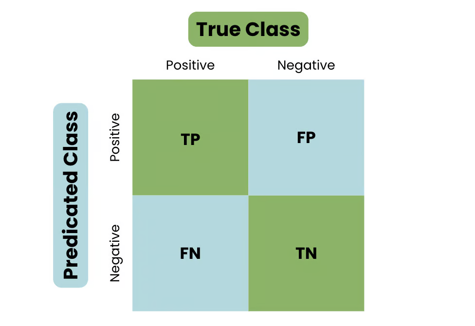
    </div>

- Bias/Variance [[ref](https://traintestsplit.com/bias-vs-variance-in-machine-learning/)]
    - [To be reviewed] For squared-error regression, bias at an input is the difference between the estimator's average prediction over repeated training samples and the true regression function. Squared bias is one component of expected prediction error; it is not simply the number of modeling assumptions.

    - [To be reviewed] Variance measures the spread of fitted predictions across repeated training datasets at a fixed input. It depends on data, model class, regularization, and fitting procedure. High variance can contribute to overfitting, but parameter count alone does not determine it.

    - [To be reviewed] Under squared loss with suitable finite moments, expected test error decomposes into noise, squared bias, and variance. The textbook complexity trade-off is useful but not a universal monotone law; modern interpolating models can display double descent. Evaluate held-out behavior rather than inferring it from parameter count. [Double-descent study](https://arxiv.org/abs/1812.11118)

    <div align="center">
        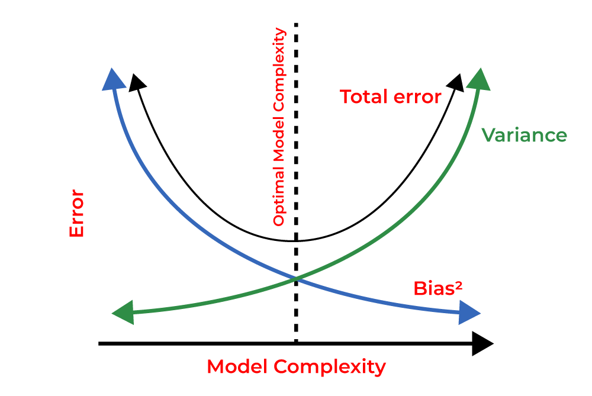
    </div>

    - Underfitting/overfitting
        - Underfitting occurs when the model is too simple to capture underlying data trends. Solution:Increase model complexity (e.g., add features, use more complex models, reduce regularization).
        - Overfitting occurs when the model captures noise or random fluctuations (memorize every single detail) in training data. Solution: Reduce model complexity (e.g., remove features, apply regularization, use simpler models); Increase training data size; Early stopping.
    - Regularization: Regularization, such as L1 (LASSO) or L2 (Ridge), can be used to control model complexity to prevent overfitting and tackle high variance. They work by adding a penalty term to the magnitude of the coefficients.
        General form of regularized loss function:

        $`\operatorname{Loss}(w)=\operatorname{Loss}_{\text{original}}(w)+\lambda\cdot{R}(w)`$


        - L0 is a technique in ML to encourage sparsity in a model's parameters. It penalizes the number of **non-zero parameters** in a model.

            $`\|\mathbf{w}\|_0=\sum_{i=1}^n \mathbf{1}\left[w_i \neq 0\right]`$

            Use case: Feature Selection: L0 regularization is particularly useful in scenarios where the number of features is large, and only a small subset is expected to be relevant. It helps to automatically select a subset of features that contribute significantly to the model's performance.

        - L1 penalizes **absolute magnitude** of weight:

            $`R(w)=\sum\left|w_i\right|`$.

            Encourages sparsity through geometry.

        - L2 penalizes **square magnitude** of weights:

            $`R(w)=\sum\left(w_i^2\right)`$

            Penalizes large weights heavily, encourges smaller, diffuse weigths. Handles correlated features better.

        - L-infinity penalizes the **largest absolute weight** (maximum norm):

            $`R(w)=\max \left|w_i\right|`$

            It's used when you need to control the model's sensitivity to prevent any one feature from dominating the predictions.

        - When prefer L1 over L2? For explicit feature selection or interpretability
        - When prefer L2 over L1? L2 (Ridge) shrinks correlated features toward each other, effectively managing correlated features.
        - [To be reviewed] As $`\lambda\to\infty`$, penalized coefficients typically approach zero under the stated objective, while an unpenalized intercept need not. L1 can make coefficients exactly zero at finite penalty values; L2 generally shrinks them continuously. There is no parameterization-independent sense in which L1 always reaches zero “faster.”
        - Is L0 convex? Why does it matter? No, it's non-convex. This matters due to optimization difficulty and computational complexity.


    - [To be reviewed] Feature selection can reduce variance or computation but can increase bias by discarding useful information. Fit the selection procedure inside each training fold; selecting features on all data before cross-validation leaks evaluation information. Use task-appropriate held-out selection criteria.
        - Backward Elimination: Start with all features, then iteratively remove the least significant feature.
        - Forward Selection: Start with no features, then teratively add the most significant feature until no improvement.
        - Recursive Feature Elimination (RFE): Iteratively fits a model and removes least important features based on coefficients or importance metrics.
        - Embedded Methods (L1 Regularization / Lasso):
            - Feature selection happens simultaneously with model fitting

- Data
    - Missing data
        - [To be reviewed] MICE iterates conditional imputation models and, in a proper multiple-imputation workflow, generates multiple plausible completed datasets to represent uncertainty. A deterministic chained-regression fill produces one completion, not multiple-imputation uncertainty by itself. Check missingness assumptions and pool downstream uncertainty appropriately. [MICE reference](https://www.jstatsoft.org/article/view/v045i03)
    - [To be reviewed] Imbalance means class frequencies differ; its consequences depend on the objective, prevalence, sampling, and error costs. Assess per-class metrics, precision-recall behavior, and calibration. Fit resampling only on training folds and account for altered class priors when interpreting probabilities. [Resampling leakage](https://imbalanced-learn.org/stable/common_pitfalls.html)
        - Oversampling: Duplicate minority examples
            - SMOTE (Synthetic Minority Oversampling Technique): 1. Chooses a random minority instance; 2. Finds k nearest minority neighbors; 3. Creates synthetic points along the line segments joining neighbors.
            - ADASYN (Adaptive Synthetic Sampling): Generates more synthetic data for harder-to-classify minority instances (closer to majority class boundary).
        - Undersampling: Remove majority examples strategically.
            - ENN (Edited Nearest Neighbor): Removes majority samples misclassified by a k-NN classifier (noisy or ambiguous instances).

    - Distribution shifts: A distribution shift happens when the data seen during training differs from the data encountered during deployment or testing. It breaks the core assumption that train and test data come from the same distribution.
        - Covariate Shift (X changed): This occurs when the input distribution $`P(x)`$ changes, but the conditional distribution $`P(y \mid x)`$ stays the same. Example: A spam detection model trained on emails from last year might see different phrasing this year, even if what qualifies as spam hasn’t changed.

        - Label Shift (Y changed): Here, the label distribution $`P(y)`$ changes, but the distribution of features given the label $`P(x \mid y)`$ remains the same. Example: In medical data, the proportion of patients with a certain condition may increase in a new population.
        - Concept Drift (f changed): The conditional distribution $`P(y \mid x)`$ itself changes. Example: A recommendation model may degrade as user preferences evolve.

- Sampling
    - [To be reviewed] Uniform sampling without replacement selects a subset with equal inclusion probabilities. `random.sample(data, k)` requires a suitable population representation; its cost depends on population type, size, and implementation. Do not assign a universal $`O(k)`$ bound including access or materialization of the input.
    - [To be reviewed] Negative sampling replaces an expensive all-candidate computation with sampled comparisons. In Word2Vec it uses a binary discrimination objective, not an unbiased exact-softmax replacement. With $`k`$ sampled negatives and embedding width $`d`$, update arithmetic is roughly $`O(kd)`$ rather than $`O(Vd)`$ for a full vocabulary comparison. The sampling distribution changes the learned objective. [Word2Vec negative sampling](https://arxiv.org/abs/1310.4546)
    - Reservoir sampling: Technique to uniformly sample $`k`$ items from a stream or large unknown-size dataset in one pass.
        - Use Cases: Sampling from streaming data or very large files/databases.
        - Algorithm: Maintain a reservoir of size $`k`$. For first $`k`$ items: directly fill reservoir. For each subsequent item $`i>k`$ : With probability $`k / i`$, randomly replace an item in the reservoir.
        - Time: $`O(N)`$, single pass.
        - Memory: $`O(k)`$, fixed space.
    - Stratified sampling: Technique where the dataset is divided into distinct subgroups (strata) based on certain attributes (e.g., age, gender, class), and samples are drawn from each subgroup proportionally or with specific representation.
        - Code: df.groupby(stratify_col, group_keys=False).apply(lambda x: x.sample(frac=frac))
    - Questions
        - When would you prefer reservoir sampling over uniform random sampling? If you're sampling tweets from a live Twitter stream (which is continuously updating and has unknown total size), reservoir sampling is the ideal method to guarantee uniformity while using fixed memory.
        - How does stratified sampling reduce variance? If you're conducting a survey on voting preferences and you stratify by age groups (young, middle-aged, elderly), each subgroup's responses tend to be more similar internally than across the entire population. This homogeneity decreases the variance of estimates significantly compared to simple random sampling.


- Model Selection
    - K-fold Cross-validation is a resampling procedure used to evaluate machine learning models and tune hyperparameters.
    - $`K=5`$ or $`K=10`$ are most common.
    - Trade-off (Bias vs. Variance):
        - Large $`K`$ :
            - [To be reviewed] More folds train each model on a larger fraction of the data, often reducing training-size bias in the performance estimate.
            - [To be reviewed] Computation grows with the number of fitted models. Validation errors across folds are dependent; the variance of a cross-validation estimate is not universally increasing in $`K`$.
        - Small $`K`$ :
            - [To be reviewed] Fewer folds generally reduce the number of fits and computational cost.
            - [To be reviewed] Each fit uses less training data, which can increase training-size bias. The estimator's variability depends on the dataset, learner, split design, and metric; it cannot be ordered by fold count alone.
    - How to handle imbalanced datasets in K-fold CV? Use Stratified K-fold, ensuring each fold maintains the proportion of classes from the original dataset.
    - Does K-fold cross-validation prevent overfitting? No, it helps evaluate and select models accurately but doesn't inherently prevent overfitting. Use regularization, early stopping, or simpler models to control overfitting.
    - [To be reviewed] Ordinary shuffled K-fold can leak future information in temporal data. Use forward/blocked time splits, group-aware splits, and gaps when required by the deployment task. Cross-validation itself is not inherently incompatible with time series. [Cross-validation design](https://scikit-learn.org/stable/modules/cross_validation.html)

- Hyper-Parameter Tuning
    - Grid search: Exhaustively evaluates all possible combinations of hyper-parameters provided in a predefined grid.
    - Random search: Randomly samples hyper-parameter values within predefined ranges.
    - Bayesian optimization: Uses past evaluation results to model the hyper-parameter space.
        - Popular libraries: `Hyperopt`, `Optuna`, `BayesSearchCV`.
    - Other autoML packages: `auto-sklearn`, `h2o`.


### ML Algorithms
<a id="algorithm-categories"></a>
#### Algorithm Categories [[Super Quick Overview](https://www.youtube.com/watch?v=E0Hmnixke2g)]
- Types by (labeled) data
    - **Supervised Learning** is a type of machine learning where the algorithm is trained on a labeled dataset. Labeled data consists of input-output pairs, meaning the algorithm learns to map input data to corresponding output labels. The goal is for the algorithm to generalize from the training data and make accurate predictions on new, unseen data.
        - Classification: Predicts categorical outputs (e.g., spam detection, image recognition). Algorithms: Logistic regression, Decision tree, RF,KNN, SVM.
            - Loss function [[YouTube](https://www.youtube.com/watch?v=v_ueBW_5dLg)]: These losses measure how correctly and confidently a model classifies examples into categories.
                - logistic loss/ binary cross entropy: Used for binary classification problems. For a predicted probability $`p`$ and ground truth label $`y \in\{0,1\}`$ : $`\mathrm{BCE}=-[y \log (p)+(1-y) \log (1-p)]`$.
                    - [To be reviewed] A sigmoid output parameterizes a binary probability in [0, 1]; binary cross-entropy is the loss, not the operation that produces probabilities. A fused loss on logits is usually numerically preferable.
                    - Penalizes confident but wrong predictions heavily.
                    - Works well when used with sigmoid activation in the output layer.

                - categorial cross entropy: Extends cross-entropy loss to multi-class classification problems. For a ground truth one-hot encoded vector $`\mathbf{y}`$ and a prediction vector $`\hat{\mathbf{y}}`$ : $`\mathrm{CCE}=-\sum_{c=1}^C y_c \log \left(\hat{y}_c\right)`$.
                    - Used together with a softmax activation in the output layer.
                    - Encourages the model to assign high probability to the correct class.

                - [To be reviewed] KL divergence

                    - For discrete distributions, $`D_{\mathrm{KL}}(p\|q)=\sum_i p_i\log(p_i/q_i)`$. It is nonnegative but asymmetric; if $`p_i>0`$ and $`q_i=0`$, the divergence is infinite. Cross-entropy satisfies $`H(p,q)=H(p)+D_{\mathrm{KL}}(p\|q)`$, so minimizing it over $`q`$ with fixed targets minimizes forward KL.
                    - **Example:** knowledge distillation uses the teacher's full soft distribution, preserving distinctions that a one-hot label discards. State the direction of KL explicitly; reversing it changes which distribution supplies the expectation and can change optimization behavior. [Distillation paper](https://arxiv.org/abs/1503.02531)


                - hinge loss: Commonly used for Support Vector Machines (SVMs) and for certain deep learning tasks that involve margin-based classification. For a prediction score $`s`$ and a true label $`y \in\{-1,1\}`$ : $`\text { Hinge Loss }=\max (0,1-y \cdot s)`$.
                    - Focuses on the margin between classes.
                    - Can also be adapted for multi-class classification with variations like multi-class hinge loss.

        - Regression: Predicts continuous numerial outputs. (e.g., house price prediction, stock market forecasting). Algorithms: Linear regression, RF.
            - Loss function:These losses measure how close predicted values are to true values numerically.
                - [To be reviewed] MSE

                    - $`\operatorname{MSE}=n^{-1}\sum_i (y_i-\hat y_i)^2`$. Its population minimizer is the conditional mean when the second moment exists. Squaring residuals makes large errors disproportionately influential.
                    - **Example:** residuals 1 and 10 contribute 1 and 100. MSE is appropriate for expected squared error, but an extreme corrupted label can dominate an otherwise clean batch. Gaussian observation noise with fixed variance gives the same optimum as maximum likelihood. [Regression losses](https://scikit-learn.org/stable/modules/model_evaluation.html#regression-metrics)

                - [To be reviewed] RMSE

                    - $`\operatorname{RMSE}=\sqrt{\operatorname{MSE}}`$ has the target's units. On one fixed evaluation set, it ranks models identically to MSE because the square root is monotone.
                    - **Pitfall:** averaging fold RMSEs is not the same as taking the square root of pooled squared errors. For unequal fold sizes, aggregate squared-error totals and observation counts before taking the square root when the desired estimand is sample-level RMSE. The globally coupled square root also changes gradient scaling if optimized directly.

                - [To be reviewed] MAE

                    - $`\operatorname{MAE}=n^{-1}\sum_i |y_i-\hat y_i|`$. Its population minimizer is a conditional median; its residual gradient has constant magnitude away from zero. A Laplace observation model with fixed scale yields an equivalent maximum-likelihood objective.
                    - **Example:** with targets 0, 0, and 100 for the same features, squared loss prefers the mean 33.33, while absolute loss prefers 0. Choose the loss from the cost of mistakes and the intended conditional statistic, rather than assuming robustness is always desirable.

                - [To be reviewed] Huber Loss

                    - For residual $`r=\hat y-y`$, Huber loss is $`\ell_\delta(r)=r^2/2`$ when $`|r|\leq\delta`$, and $`\delta(|r|-\delta/2)`$ otherwise. It has a quadratic center and linear tails with a continuous first derivative.
                    - **Example:** choose the transition scale relative to standardized target residuals, then tune it on held-out data. A threshold of 1 has completely different meaning for errors measured in dollars and millions of dollars. Huber limits the influence of large residuals but cannot repair systematically biased labels. [Huber loss reference](https://docs.pytorch.org/docs/stable/generated/torch.nn.HuberLoss.html)

                - [To be reviewed] Log-Cosh Loss

                    - $`\ell(r)=\log\cosh(r)`$ behaves like $`r^2/2`$ near zero and $`|r|-\log 2`$ for large magnitude. Its derivative $`\tanh(r)`$ is bounded, providing smooth robust optimization.
                    - **Implementation:** use $`|r|+\log(1+e^{-2|r|})-\log 2`$ to avoid overflow from computing `cosh` directly. An explicit residual scale is needed when units vary. Like other symmetric robust losses, it does not generally estimate the conditional mean under asymmetric noise. [TensorFlow LogCosh reference](https://www.tensorflow.org/api_docs/python/tf/keras/losses/LogCosh)


    - **Unsupervised Learning** is a type of machine learning that learns from data without human supervision. Unlike supervised learning, unsupervised machine learning models are given unlabeled data and allowed to discover patterns and insights without any explicit guidance or instruction. (e.g., Customer segmentation, dimensionality reduction)
        - **Clustering** is a technique for exploring raw, unlabeled data and breaking it down into groups (or clusters) based on similarities or differences. It is used in a variety of applications, including customer segmentation, fraud detection, and image analysis. Clustering algorithms split data into natural groups by finding similar structures or patterns in uncategorized data.
            - [To be reviewed] K-means

                - Partition observations by nearest centroid and minimize squared Euclidean reconstruction error; choose feature scaling and multiple initializations deliberately. See the detailed K-means section below. Example: grouping customers by annual spend without scaling can effectively ignore a purchase-frequency feature measured on a much smaller numerical scale.

            - [To be reviewed] DBSCAN

                - Identify density-connected regions and label unsupported points as noise. Unlike K-means, DBSCAN does not require a prespecified number of clusters, but its distance metric and density thresholds strongly influence the answer. A single global threshold can struggle when genuine clusters have very different densities. See the detailed DBSCAN section below.

            - [To be reviewed] Hierarchical clustering.

                - Construct a nested grouping represented by a dendrogram, then choose a cut using the task and a stated linkage criterion. The same data can yield different hierarchies under single, complete, average, or Ward linkage; the linkage is part of the model, rather than a plotting option.

        - Association rule mining is a rule-based approach to reveal interesting relationships between data points in large datasets. Unsupervised learning algorithms search for frequent if-then associations—also called rules—to discover correlations and co-occurrences within the data and the different connections between data objects.

        It is most commonly used to analyze retail baskets or transactional datasets to represent how often certain items are purchased together. These algorithms uncover customer purchasing patterns and previously hidden relationships between products that help inform recommendation engines or other cross-selling opportunities. You might be most familiar with these rules from the “Frequently bought together” and “People who bought this item also bought” sections on your favorite online retail shop.

        [To be reviewed] Association rules identify observed co-occurrence patterns. In clinical datasets, a rule's confidence is an empirical conditional frequency under the sampled population, not automatically a calibrated diagnostic probability or causal relationship. Diagnostic claims require supervised validation and appropriate sampling assumptions.

        [To be reviewed] Apriori, Eclat, and FP-growth are common frequent-pattern mining approaches. Their relative suitability depends on support thresholds, sparsity, and implementation; avoid an unsupported universal popularity ranking.

        - Dimensionality  Reduction is an unsupervised learning technique that reduces the number of features, or dimensions, in a dataset.
            - [To be reviewed] PCA

                - PCA finds orthogonal directions of maximal variance after centering. It is useful for compression and conditioning, but a low-variance direction can still contain the discriminative signal. See the detailed PCA entry under Dimension reduction techniques.

            - [To be reviewed] t-SNE

                - t-SNE is primarily a local-neighborhood visualization method. Use multiple seeds and perplexities; do not infer class counts or quantitative global distances solely from separated islands. See the detailed t-SNE entry under Dimension reduction techniques.

    - **Semi-supervised Learning** falls between unsupervised learning (without any labeled training data) and supervised learning (with completely labeled training data). It combines small amounts of labeled data with large amounts of unlabeled data. Useful when labeling data is expensive or difficult. The model leverages labeled data to guide learning, while also making use of unlabeled data to generalize better and improve performance.
    - [To be reviewed] **Reinforcement Learning** optimizes decisions under rewards in an environment or a specified decision process. Online RL collects new interactions; offline RL learns from an existing interaction dataset, so new environment interaction is not part of every RL training run.
    - [To be reviewed] **Self-supervised Learning** constructs training targets from the observed data, such as masked tokens, next tokens, or augmented-view correspondence. This differs from pseudo-labeling, where a model predicts labels for otherwise unlabeled examples; both can appear in one pipeline.

- Parametric vs non-parametric algorithms (if we assume a fixed functional form or not)

    (Functional form = Mathematical shape or structure that the model assumes to represent how the input relates to the output.)
    - [To be reviewed] **Parametric models** use a parameterization whose dimension is fixed for a specified model as sample size grows; examples include fixed-architecture neural networks and logistic regression. This does not guarantee simplicity, interpretability, few parameters, or protection against overfitting.

    - [To be reviewed] **Nonparametric model families** permit effective complexity to grow with available data, for example unconstrained trees or neighbor-based estimators. They still impose assumptions through metrics, kernels, smoothness, partition rules, and regularization. Fixed-size restrictions can bound a particular implementation's capacity; “nonparametric” does not mean assumption-free.

- Linear vs Nonlinear algorithms
    - [To be reviewed] Linear regression is linear in its coefficients; logistic regression makes the log-odds linear in the supplied features. Fixed nonlinear feature maps can make either model nonlinear in raw inputs. A linear SVM has a linear decision function in its chosen feature representation.
    - Nonlinear algorithms (Decision Trees, Random Forest, Neural Networks, Kernel SVM) capture more complex patterns and relationships, offering flexibility but potentially at the cost of interpretability and efficiency.


#### Supervised Learning
- K-Nearest Neighbors (KNN) [[Code](https://www.youtube.com/watch?v=ngLyX54e1LU&list=PLqnslRFeH2Upcrywf-u2etjdxxkL8nl7E&index=1)]
    - Nature: non-parametric, instance-based, lazy :smile:. It directly predicts the output for a new instance by identifying the k closest data points in the training set, using a suitable distance metric (typically Euclidean distance for continuous features).
    - Curse of Dimensionality: High-dimensional spaces reduce the discriminative power of distance metrics, often leading to performance degradation unless accompanied by dimensionality reduction techniques.
    - Time Complexity: Prediction requires computing distances to many or all training samples, which can be computationally expensive for large datasets.

- Linear Algorithms
    - **Linear Regression** [[Code](https://www.youtube.com/watch?v=4swNt7PiamQ&list=PLqnslRFeH2Upcrywf-u2etjdxxkL8nl7E&index=2)]  is a supervised statistical model to predict dependent variable quantity based on independent variables. Linear regression is a parametric model and the objective of linear regression is that it has to learn coefficients using the training data and predict the target value given only independent values.
        - Assumptions:
            - [To be reviewed] Specify a conditional-mean model such as $`\mathbb{E}[y\mid X]=X\beta`$ and the exogeneity assumption $`\mathbb{E}[\epsilon\mid X]=0`$ when claiming unbiased OLS coefficients.
            - [To be reviewed] Dependence across observations affects standard errors and effective sample size. Independent errors are a common textbook condition; clustered or serial dependence requires suitable covariance estimators or an explicit dependence model.
            - [To be reviewed] Homoscedasticity is required for the usual Gauss-Markov efficiency statement and conventional covariance formula, not for computing OLS. Heteroscedasticity-robust inference can be appropriate under its own assumptions.
            - [To be reviewed] Gaussian errors support exact small-sample t/F inference under the classical linear model. Normality is not needed to compute OLS or to establish unbiasedness given exogeneity; asymptotic inference has separate conditions.
            - [To be reviewed] Full column rank identifies a unique unregularized coefficient vector. Strong collinearity can inflate coefficient uncertainty; it does not by itself make predictions impossible. Perfect collinearity requires constraints, a generalized inverse, or regularization. [Linear-model reference](https://www.statsmodels.org/stable/regression.html)
        - Formulation: Linear regression models the relationship between a dependent variable $`y`$ and one or more independent variables $`X`$ as a linear combination: $`y=X \beta+\epsilon,`$, where $`\beta`$ is a vector of coefficients and $`\epsilon`$ is the error term.
        - Regularization: Extensions such as Ridge (L2) and Lasso (L1) regression add penalty terms to handle multicollinearity and promote sparsity.

    - Logistic Regression
        - Formulation: Logistic regression models the probability of a binary outcome by applying the logistic (sigmoid) function to a linear combination of input features: $`P(y=1 \mid X)=\frac{1}{1+e^{-X \beta}} .`$
        - [To be reviewed] Parameters can be fitted by minimizing negative log-likelihood, often with regularization. Under complete separation, unregularized logistic regression need not have a finite MLE; solver convergence and penalty choice matter.
        - Interpretability: Coefficients can be interpreted in terms of odds ratios, offering intuitive insights into feature effects.

        - The cost for a single training example using the binary cross-entropy (log-loss) is: $`\ell(w, b)=-[y \log (\hat{y})+(1-y) \log (1-\hat{y})]`$.
        - For $`m`$ training examples, the overall cost is: $`J(w, b)=\frac{1}{m} \sum_{i=1}^m \ell^{(i)}(w, b)=-\frac{1}{m} \sum_{i=1}^m\left[y^{(i)} \log \left(\hat{y}^{(i)}\right)+\left(1-y^{(i)}\right) \log \left(1-\hat{y}^{(i)}\right)\right]`$
        - Derivation of gradients
            - The cost for one sample is: $`\ell(w, b)=-[y \log (\hat{y})+(1-y) \log (1-\hat{y})], \quad \text { with } \hat{y}=\sigma(z) \text { and } z=w^T x+b`$.
            - Compute the derivative of the cost with respect to $`\hat{y}`$ : $`\frac{\partial \ell}{\partial \hat{y}}=-\left(\frac{y}{\hat{y}}-\frac{1-y}{1-\hat{y}}\right)`$
            - The derivative of the sigmoid is: $`\frac{d \hat{y}}{d z}=\hat{y}(1-\hat{y}) .`$
            - Then by the chain rule: $`\frac{\partial \ell}{\partial z}=\frac{\partial \ell}{\partial \hat{y}} \cdot \frac{d \hat{y}}{d z}`$. When you work through the algebra, the product simplifies to: $`\frac{\partial \ell}{\partial z}=\hat{y}-y`$.
            - Since $`z=w^T x+b`$, the derivative of $`z`$ with respect to $`w_j`$ is: $`\frac{\partial z}{\partial w_j}=x_j`$. Then: $`\frac{\partial \ell}{\partial w_j}=\frac{\partial \ell}{\partial z} \cdot \frac{\partial z}{\partial w_j}=(\hat{y}-y) x_j`$.
            - Similarly, $`\frac{\partial \ell}{\partial b}=\frac{\partial \ell}{\partial z} \cdot \frac{\partial z}{\partial b}=(\hat{y}-y)`$.


    - Support Vector Machines
        - Formulation: SVMs seek a hyperplane that maximally separates classes with the greatest margin. For linearly separable data, the optimization problem is: $`\min _{w, b} \frac{1}{2}\|w\|^2 \quad \text { s.t. } y_i\left(w^T x_i+b\right) \geq 1, \quad \forall i`$.
        - [To be reviewed] Soft-margin SVM introduces nonnegative slack for margin violations, which include correctly classified points inside the margin as well as misclassifications. The regularization parameter balances margin and total violation penalty.
        - Kernel Trick: For nonlinear classification, kernel functions (e.g., Gaussian, polynomial) implicitly map input data to a higher-dimensional space where linear separation is feasible.
        - Dual Formulation: The Lagrange dual formulation and application of Karush-Kuhn-Tucker (KKT) conditions are central to SVM theory, providing insights into support vectors and decision boundaries.
        - The optimization is convex, ensuring global optimum, but can be computationally challenging for large datasets.


    - Naive Bayes
        [[Coding](https://www.youtube.com/watch?v=TLInuAorxqE)]
        - Foundational Principle: Based on Bayes' theorem: $`P(C \mid x)=\frac{P(x \mid C) P(C)}{P(x)}`$, Naive Bayes assumes conditional independence among features given the class label.
            - $`P(C)`$ is the prior probability of class $`C`$.
            - $`P(x \mid C)`$ is the likelihood of observing features $`x`$ under class $`C`$.
            - $`P(C \mid x)`$ is the posterior probability: what we want.
            - Because $`P(x)`$ is the same across classes when comparing them, we only need $`\arg \max _C P(x \mid C) P(C)`$.

        - Choosing a Model
            - Multinomial NB: features are non‑negative counts (e.g. word counts in text).
            - Bernoulli NB: binary features (presence/absence).
            - Gaussian NB: continuous features, modeled with class‑conditional Gaussians.

        - Why naive? The term "naive" in Naive Bayes refers to the algorithm's assumption that all features (predictor variables) used for classification are mutually independent given the class label. This assumption is considered "naive" because, in real-world scenarios, features often exhibit some degree of dependency, and assuming independence can be an oversimplification of the true underlying relationships. Despite the “naive” assumption being seldom true in practice, the method often performs well due to its simplicity and effectiveness in high-dimensional settings.

    - Linear discriminant analysis (LDA)
        - Concept & Assumptions: LDA models class conditional densities as multivariate Gaussians with equal covariance matrices for all classes. Under this assumption, the discriminant function is linear in the features: $`\delta_k(x)=x^T \Sigma^{-1} \mu_k-\frac{1}{2} \mu_k^T \Sigma^{-1} \mu_k+\log \pi_k`$. Here, $`\mu_k`$ is the mean vector, $`\Sigma`$ the common covariance matrix, and $`\pi_k`$ the prior probability of class $`k`$.
        - [To be reviewed] With the true Gaussian class parameters and priors known, the LDA rule is Bayes-optimal for 0–1 classification loss under its assumptions. A finite-sample fitted plug-in classifier is an estimate of that rule, not a guarantee of Bayes-optimal performance.
        - Dimensionality Reduction: LDA also serves as a dimensionality reduction technique by projecting data onto a subspace that maximizes between-class variance while minimizing within-class variance (related to Fisher’s Linear Discriminant).
        - Applications: Particularly effective when the Gaussian assumption holds and when class covariances are similar.

- Decision Trees

    - Structure: Decision trees recursively partition the input feature space by selecting splits that maximize a certain criterion (e.g., information gain, Gini impurity for classification, or mean squared error reduction for regression).
    - Algorithm details
        - Recursive Partitioning: At each node, the algorithm selects the feature and threshold that best “purifies” the subsets.
        - Stopping Criteria & Pruning: Trees can easily overfit; thus, criteria such as maximum depth, minimum samples per leaf, or post-pruning (e.g., cost-complexity pruning) are essential.
        - Interpretability: Decision trees produce models that are easily interpretable; however, their hierarchical nature can also be sensitive to small changes in data (high variance).
    - Decision trees are highly flexible non-parametric models. Their analysis often involves bias–variance trade-offs: while they are low bias (fit complex relationships well), they can suffer from high variance if unpruned.

    - [To be reviewed] Leaves

        - A leaf stores the fitted response for a region of feature space: typically class proportions for classification and a mean for squared-error regression. These are piecewise-constant estimates, so a regression tree cannot extrapolate a linear trend beyond its observed leaf values.
        - **Example:** a leaf containing eight positive and two negative training examples predicts a positive-class probability of 0.8 before any smoothing or calibration. A leaf containing one positive example also predicts 1.0, but carries much greater estimation uncertainty. Minimum leaf size controls this variance. [Decision trees](https://scikit-learn.org/stable/modules/tree.html)

    - [To be reviewed] Training algorithm+stop criteria

        - CART greedily chooses the feature and threshold maximizing weighted impurity reduction. It does not jointly optimize the entire tree. Classification commonly uses Gini impurity or entropy; squared-error regression minimizes within-node variance.
        - Stop using maximum depth, minimum split/leaf counts, or minimum impurity decrease. Fit these choices inside cross-validation. **Example:** a split isolating one mislabeled point may improve training purity while harming held-out performance; a minimum leaf-size constraint prevents that particular memorization pattern.

    - [To be reviewed] Inference

        - Route an example from the root to one leaf by applying its feature-threshold comparisons. Prediction cost is proportional to path depth, not the number of training observations. A balanced depth-10 tree uses about ten comparisons; a badly unbalanced tree can be much deeper.
        - Record the decision path for debugging. Missing-value routing and categorical support are implementation-specific; training and serving must apply the same feature encoding and missing-data semantics.

    - [To be reviewed] Pruning

        - Minimal cost-complexity pruning trades training impurity against leaf count: $`R_\alpha(T)=R(T)+\alpha |\mathcal{L}(T)|`$. Increasing $`\alpha`$ favors smaller subtrees. Select it on validation folds rather than the final test set.
        - **Example:** compare a deep tree and its pruned subtrees using mean validation score and variability across folds. A tiny training improvement from a rare branch may disappear under resampling. [Cost-complexity pruning](https://scikit-learn.org/stable/modules/tree.html#minimal-cost-complexity-pruning)


- Ensemble methods [[Wiki](https://en.wikipedia.org/wiki/Ensemble_learning)] [[Document](https://scikit-learn.org/stable/modules/ensemble.html)]
    - Definition: Ensemble methods aim to combine the predictions of multiple base learners to achieve improved generalization performance and robustness compared to single models.

    - Bagging: Variance Reduction through Bootstrap Aggregation
        - Concept: A set of base learners (often decision trees) is trained on different bootstrap samples of the data. Their predictions are then aggregated (by averaging or voting).
        - Bagging primarily focuses on reducing variance. It typically employs complex base learners (e.g., deep decision trees) which have low bias but high variance. By training these models on different bootstrap samples of the data and then averaging their predictions, Bagging smooths out the predictions and reduces the overall variance of the ensemble, often without significantly affecting the bias.
        - [To be reviewed] **Random Forest**

            - Combine bootstrap-trained trees with random feature subsets at each split to reduce correlation between trees. For $`M`$ equal-variance predictors with pairwise correlation $`\rho`$, their average has variance $`\sigma^2[\rho+(1-\rho)/M]`$: adding trees cannot remove the correlated component.
            - **Example:** if one highly predictive feature is always available, many trees can choose similar early splits. Feature subsampling encourages alternative partitions. Tune leaf size and feature subsampling; more trees mainly reduce Monte Carlo variation. Out-of-bag evaluation does not replace a time-based split when deployment predicts the future. [Random forests](https://scikit-learn.org/stable/modules/ensemble.html#forests-of-randomized-trees)

    - Boosting: Sequential Learning for Bias Reduction
        - Boosting represents a family of ensemble algorithms that construct a strong predictive model by iteratively training a sequence of base learners (typically weak learners), where each new learner focuses on correcting the errors made by the ensemble built so far. Unlike Bagging's parallel approach, Boosting is inherently sequential.
        - [To be reviewed] Boosting can reduce approximation bias by adding learners sequentially, but its bias/variance and noise sensitivity depend on loss, base learners, shrinkage, subsampling, and stopping. There is no universal ordering that boosting overfits more than bagging.
        - [To be reviewed] **Adaboost**

            - In binary AdaBoost with labels in $`\{-1,+1\}`$, a weak learner with weighted error $`\epsilon_t`$ receives coefficient $`\alpha_t=\tfrac12\log[(1-\epsilon_t)/\epsilon_t]`$. Update example weights proportionally to $`w_i\exp[-\alpha_t y_i h_t(x_i)]`$; mistakes gain weight.
            - **Example:** error 0.2 gives coefficient about 0.693 under this convention. Persistently mislabeled examples may absorb increasing weight, so inspect label noise. State the binary formulation explicitly: multiclass variants use different coefficients and conditions. [AdaBoost reference](https://scikit-learn.org/stable/modules/ensemble.html#adaboost)

        - [To be reviewed]  [[**Gradient Boosting**](https://www.youtube.com/watch?v=en2bmeB4QUo)]

            - At stage $`t`$, fit a base learner to negative loss gradients and update $`F_t(x)=F_{t-1}(x)+\eta\gamma_t h_t(x)`$. Residual fitting is exactly the squared-loss case; for logistic loss the targets are functional gradients rather than ordinary residuals.
            - **Example:** with squared loss, a prediction of 7 for a target of 10 leaves a residual of 3 for the next learner. Learning rate, number of iterations, tree complexity, and subsampling jointly control fit. Use validation-based early stopping. [Friedman's gradient boosting paper](https://doi.org/10.1214/aos/1013203451)

        - [To be reviewed] **XGBoost**

            - XGBoost optimizes a regularized boosting objective using first- and second-order loss information. With leaf gradient sum $`G_j`$, Hessian sum $`H_j`$, and L2 penalty $`\lambda`$, the unconstrained optimum is $`w_j^*=-G_j/(H_j+\lambda)`$. Split gain balances the child and parent scores against a leaf-complexity penalty.
            - Sparse-aware split search and default directions handle missing entries; a missing value is not automatically the numerical value zero. **Example:** for sparse purchase features, distinguish “no observed purchase” from an unavailable measurement in the data contract. [XGBoost paper](https://arxiv.org/abs/1603.02754)


    - Stacking
        - Concept: Stacking (or stacked generalization) involves training a meta-learner to combine the outputs of several base models, allowing for more flexible aggregation methods that can capture dependencies between predictions. In stacking, a model learns the optimal way to combine predictions.
        - Architecture
            - Base level (Level 0):Multiple heterogeneous models (different algorithms). Each trained on the same training data. Examples: Random Forests, SVMs, Neural Networks, Gradient Boosting.
            - Meta level: A model that takes base models' predictions as inputs. Learns to combine these predictions optimally. Can be any algorithm (logistic regression is common for simplicity and interpretability)

                - [To be reviewed] **Leakage control:** train the meta-model on out-of-fold predictions. Each training row's level-0 prediction must come from a model that did not train on that row. Then refit the base estimators on all development data for deployment. In time series, out-of-fold construction must also respect chronology. Otherwise the meta-model learns from unrealistically optimistic base predictions. [Stacking implementation](https://scikit-learn.org/stable/modules/generated/sklearn.ensemble.StackingClassifier.html)

    - Voting
        - Voting is one of the simplest ensemble techniques where multiple models make predictions independently, and the final prediction is determined by combining these individual predictions. The key idea is that different models may excel in different regions of the input space, so combining them can lead to better overall performance.
        - [To be reviewed] Hard Voting (Majority Voting)

            - Choose the class receiving the most votes, optionally with predefined weights. Hard voting discards confidence: probabilities 0.51 and 0.99 both become one vote for the same class.
            - **Example:** three binary classifiers voting positive, positive, negative produce a positive decision. An ensemble of nearly identical models offers little diversity, and shared training leakage is not repaired by voting.

        - [To be reviewed] Soft Voting (Weighted Average)

            - Average predicted class probabilities, then choose a class or apply an application-specific threshold. Comparable probability scales matter; assess calibration on held-out data before averaging.
            - **Example:** probabilities 0.51, 0.51, and 0.01 average to approximately 0.343, so equal-weight soft voting chooses negative even though hard voting chooses positive. [Voting classifier](https://scikit-learn.org/stable/modules/generated/sklearn.ensemble.VotingClassifier.html)

        - [To be reviewed] Weighted Voting

            - Assign nonnegative model weights and normalize by their sum for probability averaging. Tune weights on validation data or learn a regularized stacking model; never choose them from test-set performance.
            - **Example:** a domain-specialist model can receive higher weight on a validated target population, but its advantage may disappear under distribution shift. Report individual-model and ensemble results to show whether the additional inference cost buys a reproducible improvement.


- While we can also divide the supervised learning classification algorithms by Training Methods into **Generative vs. Discriminative Models**
    - Discriminative models[[wiki](https://en.wikipedia.org/wiki/Discriminative_model)], also referred to as conditional models, are a class of models frequently used for classification.
        - Discriminative models learn the conditional distribution $`P(y \mid x)`$ (or decision boundary), focusing solely on predicting labels from observed inputs.
        - [To be reviewed] Discriminative models support binary, multiclass, structured, and continuous-output prediction. The defining distinction is conditional prediction or decision modeling, not a restriction to binary classification.
        - logistic regression (LR), Support Vector Machines (SVMs), Decision Trees & Random Forests, KNN, conditional random fields (CRFs).
    - [To be reviewed] In classification, a generative model may learn $`p(x,y)`$ or class-conditional densities with class priors. More generally, generative models learn a distribution or sampling process over observations, possibly with latent variables or conditioning; an unconditional GAN or VAE need not model labeled $`p(x,y)`$.
        - Naive Bayes, Gaussian Mixture Models (GMMs), Hidden Markov Models (HMMs), Latent Dirichlet Allocation (LDA), Boltzmann Machines / RBMs, Variational Autoencoders (VAEs), Generative Adversarial Networks (GANs), Normalizing Flows, Diffusion Models

----


#### Unsupervised Learning

 [[Unsupervised learning](https://en.wikipedia.org/wiki/Unsupervised_learning)] is a framework in machine learning where, in contrast to supervised learning, algorithms learn patterns exclusively from unlabeled data.

- Clustering
    - K-means
        - [To be reviewed] K-means minimizes $`J=\sum_{j=1}^k\sum_{x_i\in S_j}\|x_i-\mu_j\|^2`$, where $`\mu_j=|S_j|^{-1}\sum_{x_i\in S_j}x_i`$. It favors compact groups under a shared Euclidean metric, but does not impose equal cluster sizes. Unequal density, scale, anisotropy, and outliers can make the induced partition scientifically misleading. [K-means reference](https://scikit-learn.org/stable/modules/clustering.html#k-means)
        - Algorithm details
            - [To be reviewed] Initialization of centroids

                - K-means++ selects the first center randomly and subsequent centers with probability proportional to squared distance from the nearest existing center. It reduces poor starts but does not guarantee the globally optimal clustering in each run.
                - **Example:** compare multiple initializations at a fixed $`k`$, using final inertia and cluster stability. Standardize features when Euclidean distance should not be dominated by a feature's measurement units. [K-means++ paper](https://theory.stanford.edu/~sergei/papers/kMeansPP-soda.pdf)

            - Assignment Step (E-step): Assign each data point $`x_i`$ to the cluster $`S_j`$ whose centroid $`\mu_j`$ is nearest (typically using squared Euclidean distance).
            - [To be reviewed] Update step

                - Replace each center with the mean of its assigned points. Assignment and update steps do not increase the squared-distance objective, but convergence can reach a local optimum.
                - **Example:** points 1, 2, and 6 assigned to one one-dimensional cluster move its center to 3. Empty clusters need an explicit reinitialization policy. A lower training inertia at larger $`k`$ is expected and alone does not establish a better scientific explanation.

            - Iteration: Repeat steps 2 and 3 until convergence criteria are met.
            - WCSS - elbow method for k optimization.
        - Evaluation Metrics
            - Silhouette Score: Measures how similar a point is to its own cluster (cohesion) compared to other clusters (separation). For a point $`i`$, let $`a(i)`$ be the average distance to other points in its cluster, and $`b(i)`$ be the minimum average distance to points in another cluster. The score is $`s(i)=(b(i)-a(i)) / \max (a(i), b(i))`$. Scores range from -1 (misclassified) to +1 (well-clustered), with 0 indicating points near cluster boundaries. The overall score is the average $`s(i)`$ over all points. Higher scores are better.
    - [To be reviewed] Hierarchical clustering

        - Agglomerative clustering starts with individual points and repeatedly merges clusters according to a linkage criterion. Single linkage uses the nearest pair and can create chains; complete linkage uses the farthest pair; average linkage averages cross-cluster distances. Ward linkage minimizes the increase in within-cluster squared error and requires Euclidean geometry.
        - **Example:** a narrow bridge of points can join two groups under single linkage while complete linkage keeps them apart. A dendrogram exposes the hierarchy, but its heights depend on linkage and feature scaling. Check sensitivity before treating a cut as a natural taxonomy. [Clustering documentation](https://scikit-learn.org/stable/modules/clustering.html#hierarchical-clustering)

    - [[DBSCAN](https://www.youtube.com/watch?v=4AW_5nYQkuc&ab_channel=KilianWeinberger)] is a density-based clustering algorithm that groups together points that are closely packed, marking points in low-density regions as outliers (noise).
        - Parameters
            - eps ( $`\epsilon`$ ): The maximum distance (radius) between two points for one to be considered as in the neighborhood of the other.
            - min_samples (MinPts): The minimum number of points required within the e-neighborhood (including the point itself) for a point to be considered a core point.
        - [To be reviewed] A core point has at least `min_samples` observations, including itself, within $`N_\epsilon(p)=\{q\in D:\operatorname{dist}(p,q)\leq\epsilon\}`$. A border point can join a cluster without itself being a core point.
        - Algorithm
            - 1. Start with an arbitrary unvisited point $`p`$.
            - 2. Mark $`p`$ as visited.
            - [To be reviewed] 3. Retrieve the $`\epsilon`$-neighborhood $`N_\epsilon(p)`$.
            - [To be reviewed] 4. If $`|N_\epsilon(p)|<\mathrm{min\_samples}`$, mark $`p`$ as noise provisionally; later expansion can relabel it as a border point.
            - [To be reviewed] 5. If $`|N_\epsilon(p)|\geq\mathrm{min\_samples}`$, create a cluster, add $`p`$, and initialize its expansion set with the neighborhood.
            - 6. Expand the cluster: For each point q in the seed set:
                - [To be reviewed] If $`q`$ is unvisited, mark it visited and retrieve $`N_\epsilon(q)`$. If $`q`$ is core, add its neighbors to the expansion set; avoid repeated processing. Border-point assignment can depend on traversal order when it touches multiple clusters.
                - If q is not yet a member of any cluster, add q to cluster C.
            - 7. Repeat step 6 until the seed set is empty.
            - 8. Go back to step 1 and pick another unvisited point, until all points are visited.
        - [[Interview Questions](https://www.youtube.com/watch?v=cCw1yqqvOCI&ab_channel=UnfoldDataScience)]
    - [To be reviewed] Gaussian Mixture Models ([[GMMs](https://www.youtube.com/watch?v=hJLaHWaLsyg&ab_channel=AtifAdib)])

        - A GMM models $`p(x)=\sum_{k=1}^K\pi_k\mathcal{N}(x;\mu_k,\Sigma_k)`$. EM alternates posterior responsibilities with weighted updates to component parameters. Unlike K-means, assignments are soft and full covariance matrices permit elliptical components.
        - **Example:** a point between two overlapping customer populations can have responsibilities 0.6 and 0.4. Multiple restarts and covariance regularization matter: unconstrained likelihood can diverge when a component collapses onto one observation. Select covariance structure and component count using held-out density and appropriate model-selection criteria. [Gaussian mixtures](https://scikit-learn.org/stable/modules/mixture.html)


- [To be reviewed] Latent Mixture Models

    - Introduce an unobserved component variable $`z`$: $`p(x)=\sum_k p(z=k)p(x\mid z=k)`$. Gaussian mixtures are one choice of emission family; mixtures of Bernoulli or multinomial distributions suit other observations. EM exploits tractable conditional responsibilities, whereas more complicated latent models may need variational inference or sampling.
    - **Example:** a mixture of two coin biases can describe heterogeneous users, but one binary observation per user cannot identify both biases and their mixture weight. Mixture labels are interchangeable, so interpret identifiable distributions and predictions before attaching semantic names to components.

- Hidden Markov Models(HMMs)
    - [To be reviewed] Markov processes

        - In a first-order HMM, the latent state satisfies $`p(z_t\mid z_{1:t-1})=p(z_t\mid z_{t-1})`$. Observations are conditionally independent given their corresponding states. This is a modeling assumption, not a property guaranteed by sequential data.
        - **Example:** a latent “active” or “inactive” customer state can persist across days while observed event counts fluctuate. A standard HMM implies geometric state-duration distributions; use explicit-duration models when dwell times have different structure. [HMM reference](https://hmmlearn.readthedocs.io/en/stable/tutorial.html)

    - [To be reviewed] Transition probability and emission probability

        - The transition matrix $`A_{ij}=p(z_t=j\mid z_{t-1}=i)`$ has rows summing to one; an emission distribution specifies $`p(x_t\mid z_t=j)`$. Include an initial-state distribution. Forward-backward inference computes marginal state probabilities, and Baum-Welch applies EM to estimate parameters.
        - **Example:** “active” may transition to itself with probability 0.95 while emitting a Poisson event count. Do not confuse a noisy low count with a definite state transition; posterior inference combines emissions with temporal persistence.

    - [To be reviewed] Viterbi algorithm

        - Viterbi finds the highest-probability complete state sequence using dynamic programming: $`\delta_t(j)=\log p(x_t\mid j)+\max_i[\delta_{t-1}(i)+\log A_{ij}]`$, with backpointers. Dense transitions give time complexity $`O(TK^2)`$.
        - **Distinction:** the most probable complete path need not equal the sequence of marginally most probable states from forward-backward. Use log-space arithmetic or scaling to avoid numerical underflow on long sequences.

- Dimension reduction techniques
    - Linear/Subspace Methods
        - [To be reviewed] PCA

            - Center the training matrix and retain the leading right singular vectors. PCA solves a rank-constrained squared reconstruction problem; projected coordinates preserve directions of maximal sample variance, which need not be the most predictive directions.
            - **Example:** a large nuisance variation in sensor brightness can dominate the first component while a small diagnostic signal is discarded. Fit centering, scaling, and components on training folds only. Whitening changes the metric by rescaling component variances, so treat it as a separate modeling decision. [PCA documentation](https://scikit-learn.org/stable/modules/decomposition.html#pca)

        - [To be reviewed] Independent Component Analysis (ICA)

            - ICA assumes observations are linear mixtures of statistically independent sources and seeks an unmixing transform. Independence is stronger than PCA's decorrelation. Under the standard identifiable model, sources are non-Gaussian with at most one Gaussian source; their order and scale remain ambiguous.
            - **Example:** two microphones record mixtures of two speakers. PCA can whiten the observations, but ICA uses higher-order distributional structure to separate candidate sources. If sources are strongly dependent, the interpretation can fail. [FastICA reference](https://scikit-learn.org/stable/modules/generated/sklearn.decomposition.FastICA.html)

    - Nonlinear/ Manifold Methods
        - [To be reviewed] Isomap

            - Build a neighborhood graph, estimate geodesic distances by shortest paths, then apply multidimensional scaling. This aims to preserve manifold distances rather than straight-line distances in the ambient space.
            - **Example:** on a rolled “Swiss roll,” nearby points across different layers may be close in Euclidean distance but far along the surface. Too many neighbors can create shortcuts across folds; too few can disconnect the graph. [Isomap documentation](https://scikit-learn.org/stable/modules/manifold.html#isomap)

        - [To be reviewed] T-SNE

            - t-SNE matches local similarity distributions by minimizing $`D_{\mathrm{KL}}(P\|Q)`$, with a heavy-tailed low-dimensional distribution. Perplexity controls a notion of neighborhood size; initialization and optimization affect the result.
            - **Example:** a plot can show separated islands even when the original distribution has continuous structure. Cluster area, inter-island distance, and empty space are not automatically faithful quantitative summaries. Vary seeds and perplexity, and verify conclusions in the original representation. [t-SNE paper](https://www.jmlr.org/papers/v9/vandermaaten08a.html)

        - [To be reviewed] UMAP

            - UMAP constructs a weighted neighborhood graph and optimizes a low-dimensional representation to preserve its fuzzy connectivity. `n_neighbors` controls neighborhood scale; `min_dist` influences how tightly embedded points can pack.
            - **Example:** use a fitted transform to visualize new examples, but monitor changes in the original feature distribution: a plausible-looking projection is not evidence that a new example is in-distribution. Check neighborhood preservation and parameter sensitivity; neither UMAP nor t-SNE establishes the number of real-world classes from a plot alone. [UMAP paper](https://arxiv.org/abs/1802.03426)

    - [To be reviewed] Autoencoders

        - Learn an encoder and decoder minimizing reconstruction loss with a bottleneck or another constraint. A sufficiently expressive unconstrained network can memorize the identity map; useful representations depend on the inductive bias and training distribution.
        - **Example:** a denoising autoencoder reconstructs a clean image from a corrupted input. Evaluate frozen embeddings on a downstream task and compare against PCA at a comparable representation size. Reconstruction quality and semantic usefulness are different evaluation targets; probabilistic generation requires additional assumptions, as in VAEs.


----
### XAI
<a id="feature-importance"></a>
#### [To be reviewed] Feature importance

- Separate **global reliance** from **local attribution**. Permutation importance measures the drop in held-out score when a feature is shuffled; impurity importance measures accumulated training split improvements and favors some high-cardinality features.
- **Example:** two nearly duplicate predictors can each have low permutation importance because the other substitutes for it. Shuffle a meaningful feature group, or use conditional perturbations if the scientific question requires dependence to be preserved. Report the metric, evaluation split, perturbation distribution, and uncertainty across repetitions. These methods explain fitted-model behavior; they do not identify intervention effects. [Permutation importance](https://scikit-learn.org/stable/modules/permutation_importance.html)

<a id="shap"></a>
#### [To be reviewed] SHAP

- SHAP represents a prediction as $`f(x)=\phi_0+\sum_i\phi_i`$, with Shapley allocations of marginal contributions under a specified coalition-value function. The background distribution and the treatment of missing features determine what the attribution means.
- **Example:** a baseline log-odds of -1 plus contributions 1.5 and -0.2 yields log-odds 0.3, not a probability of 0.3. State the output scale. Correlated features can receive very different allocations under conditional and interventional formulations; local additivity does not resolve causal identification. Check stability to background sampling and feature grouping. [SHAP paper](https://arxiv.org/abs/1705.07874)

<a id="attention-based"></a>
#### [To be reviewed] Attention-based

- Attention weights describe how a particular module mixes representations. They are not sufficient evidence of an input feature's causal effect: values, residual paths, other heads, and later nonlinearities also affect the output.
- **Example:** a high attention weight on a token with a near-zero value vector may have little effect on the final prediction. Compare attention visualizations with controlled ablations, output sensitivity, and adversarially altered attention patterns. Faithfulness depends on the architecture and explanation question. [Attention is not Explanation](https://arxiv.org/abs/1902.10186)

- [To be reviewed] RETAIN

    - RETAIN applies reverse-time attention at two levels: scalar visit weights and vector-valued variable weights. Its context is $`c=\sum_t\alpha_t(\beta_t\odot v_t)`$. With linear visit embeddings and a linear output logit, one can decompose the logit into additive contributions of observed variables, conditional on the computed attention weights.
    - **Example:** a recent diagnosis code may receive a larger contribution than an older visit. This supports auditing the model's prediction; it does not imply that changing the diagnosis code would change the patient's underlying outcome. [RETAIN paper](https://arxiv.org/abs/1608.05745)


## Deep Learning

### DL Basic

- Feedforward NNs [[Youtube](https://www.youtube.com/watch?v=AsyPA69QBks)]
    - Feedforward Neural Networks are the simplest form of artificial neural networks where data flows only in one direction—from the input layer, through one or more hidden layers, to the output layer. They are typically used for tasks where the mapping from input to output is straightforward and static (e.g., classification or regression).
    - Architecture: Input layer + hidden layers + output layer in only one direction - forward - with no cycles or loops.
        - For each neuron,  output = activation(weights inputs + bias).
        - For each layer, $`\mathbf{y}=f(\mathbf{W} \mathbf{x}+\mathbf{b})`$.
        - [To be reviewed] A composition of affine layers without intervening nonlinearities is still affine. Extra linear hidden layers can change the parameterization, rank constraints, and optimization, but do not create a general nonlinear decision function.
    - Depth vs width
        - Deeper networks can learn more complex hierarchical representations. But face challenges like vanishing gradients and increased computational cost.
        - Wider layers can capture more information per layer. May require more training data to avoid overfitting.

    - Why we need bias parameters? By incorporating a bias, each neuron can adjust its threshold independently of the input data. This means that even if the inputs are all zero or symmetrically distributed, the network can still make non-trivial predictions. The bias allows the network to represent a wider range of functions.


- Activation functions [[ref](https://www.v7labs.com/blog/neural-networks-activation-functions)]
    - **Sigmoid (1980s)** and its limitations: $`\sigma(x)=\frac{1}{1+e^{-x}}`$, which outputs to the range (0, 1) and is useful for probabilistic interpretations.
        - Limitations
            - Vanishing Gradients: In regions where the input is very positive or very negative, the output saturates close to 1 or 0. This can lead to extremely small gradients, slowing or even halting the training process in deep networks.
            - Non Zero-Centered: The sigmoid function’s outputs being always positive can lead to inefficient gradient updates, as the activations are not centered around zero.
    - **Tanh (The hyperbolic tangent) (1980s)**: $`\tanh (z)=\frac{e^z-e^{-z}}{e^z+e^{-z}}=\frac{2}{1+e^{-2 z}}-1`$.
        - It's the improvement based on Sigmoid. It produces outputs in the range (-1, 1) and tends to center the data (0) better compared to the sigmoid.

    [To be reviewed] Sigmoid gates take values in (0, 1), while tanh supplies signed bounded candidate/state transformations. Tanh outputs are not probabilities. ReLU is useful in many hidden layers but is not a direct bounded-probability parameterization.

    - **ReLU (2010) family (Rectified Linear Unit) (ReLU, Leaky ReLU, PReLU, ELU, SELU)**: $`f(x)=\max (0, x)`$ ReLU outputs zero for negative inputs and linear (identity) for positive values; it is popular due to computational efficiency and reduced likelihood of vanishing gradients.
        - Dying issue: In some cases during training, a significant number of neurons can end up outputting zero for all inputs. This happens when the weights and biases of these neurons adjust in such a way that the input to ReLU is consistently negative. Once a neuron falls into this state, its gradient becomes zero for any input value (since the derivative of ReLU is zero for negative inputs). And Because it outputs zero consistently, the neuron effectively "dies," meaning it no longer contributes to the learning process.
        - Solution-Leaky ReLU (2013): Instead of outputting zero for negative inputs, Leaky ReLU allows a small, non-zero gradient (e.g., $`f(x)=\alpha x`$ for $`x<0`$ with $`\alpha`$ being a small constant such as 0.01 ). This helps prevent neurons from dying.
        - Parametric ReLU (PReLU) (2015): Similar to Leaky ReLU, but the coefficient $`\alpha`$ is learned during training.
        - ELU (Exponential Linear Unit) （2015） and SELU (Scaled ELU) （2017）: These functions introduce an exponential factor for negative inputs which can improve learning dynamics and sometimes contribute to self-normalizing properties in deeper networks.

    [To be reviewed] Centering activations can improve some optimization conditions, but it is not a universal requirement for stable or fast training. Signal/gradient scales, nonlinearities, initialization, residual structure, and normalization interact; zero mean alone does not prevent saturation.

    - **GELU （2016）** uses the Gaussian cumulative distribution function to weight the inputs, often defined approximately as: $`f(x)=0.5 x\left(1+\tanh \left[\sqrt{\frac{2}{\pi}}\left(x+0.044715 x^3\right)\right]\right)`$.
        - GELU provides a smooth output which can help gradient flow.
        - [To be reviewed] GELU is a deterministic activation $`x\Phi(x)`$ using the standard normal CDF; the CDF factor motivates its weighting interpretation. It does not sample a neuron-activation event during the usual forward pass. [GELU](https://arxiv.org/abs/1606.08415)
    - **Swish/SiLU (2017)**: The Swish, also known as SiLU (Sigmoid-weighted Linear Unit), is defined as: $`f(x)=x \cdot \sigma(x)`$, where $`\sigma(x)`$ is the sigmoid function.
        - The function is differentiable everywhere and its non-monotonicity can sometimes lead to better performance in deep networks.
        - Swish has been shown to outperform ReLU on deeper models in certain cases, due to its ability to maintain non-zero gradients across a wider range of inputs.

    - **GLU (Gated Linear Unit)**
        - Given an input $`x \in \mathbb{R}^d`$, two learned projections $`W, V \in \mathbb{R}^{d \times h}`$. $`\text{GLU}(x)=(x W) \otimes \sigma(x V)`$, where $`\otimes`$ is elementwise product.
        - Intuition: One projection $`(x W)`$ carries "content," the other $`(x V)`$ gates it via a sigmoid. Allows the network to learn when to pass or suppress information.


    - **Mish (2019)**: Mish is defined as: $`f(x)=x \cdot \tanh (\text{softplus}(x))`$, where $`\text{softplus}(x)=\ln \left(1+e^x\right)`$.
        - Mish provides a smooth activation that has continuous derivatives, aiding optimization.
        - It has been reported to offer improvements in generalization and training stability compared to ReLU and some of its variants.

    - **SwiGLU (Swish with Gating)**: SwiGLU combines the Swish activation with a gating mechanism, which allows the network to control the flow of information dynamically.
        - [To be reviewed] SwiGLU uses a SiLU gate in place of GLU's sigmoid gate; with one naming convention, $`\operatorname{SwiGLU}(x)=\operatorname{SiLU}(xW)\odot(xV)`$. Swapping names of the two learned projections gives an equivalent convention. A complete Transformer MLP usually includes an output projection as well. [GLU variants](https://arxiv.org/abs/2002.05202)
        - By incorporating gating, SwiGLU can further improve the representation power and stability of gradient propagation.
        - Often applied in transformer and language models, where dynamic control over activations can benefit deeper network architectures.

    - **Softmax**: The softmax function converts a vector of raw scores (logits) into a probability distribution: $`\text{Softmax}\left(z_i\right)=\frac{e^{z_i}}{\sum_j e^{z_j}}`$
        - Each output value represents a probability (all outputs sum to 1), making it ideal for multi-class classification tasks.
        - [To be reviewed] Softmax gives a normalized categorical distribution, not automatically calibrated confidence. Assess probability calibration and use the output distribution appropriate to the task; independent multilabel outputs typically use separate sigmoid probabilities.

    - Properties and selection criteria
        - Computational Efficiency: Functions like ReLU are extremely efficient compared to those that require computing exponentials, such as sigmoid or tanh.
        - Gradient Propagation: Avoid functions prone to vanishing or exploding gradients. For example, while sigmoid and tanh can suffer from gradient saturation, variants like ReLU, Leaky ReLU, and GELU help preserve gradient flow.
        - Output Range and Interpretability: Functions like sigmoid and softmax are helpful when outputs need a probabilistic interpretation, while others are more suited for hidden layers.


    <div align="center">
        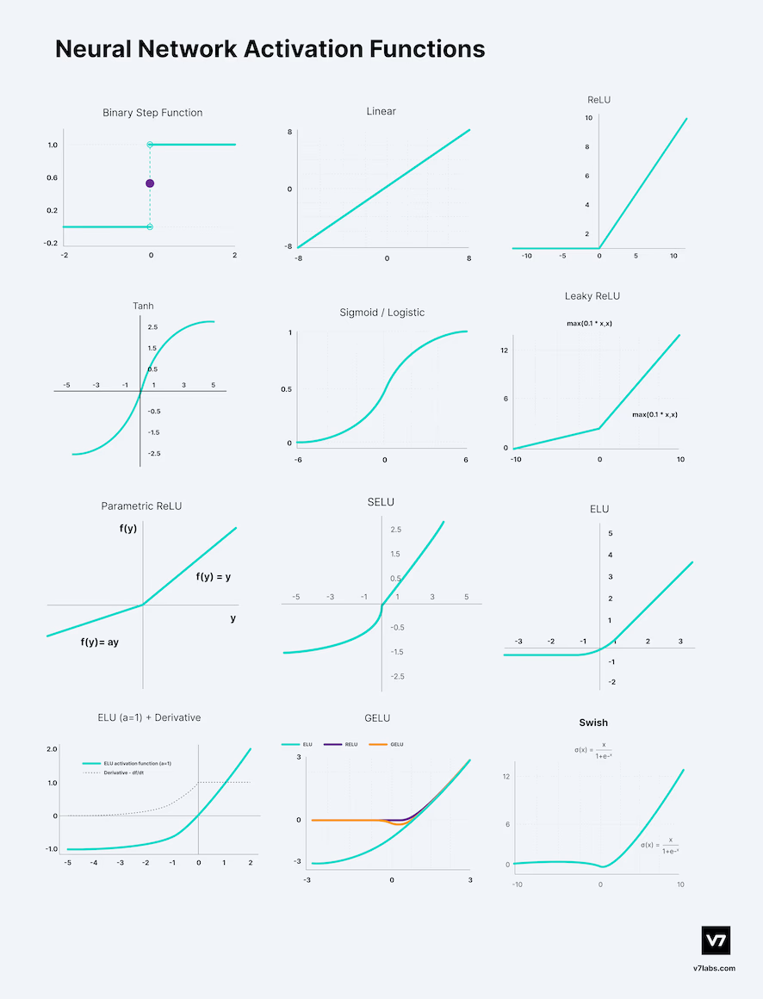
    </div>


- Weight initialization [[YouTube](https://www.youtube.com/watch?v=tYFO434Lpm0)]

    Weight initialization is a critical aspect of neural network training that can significantly impact convergence speed and overall performance.
    - Why weight initialization matters?
        - Symmetry breaking: Initializing all weights to the same value (for example, zeros) would lead to symmetry where neurons learn identical features, effectively reducing the model’s capacity. Random initialization helps ensure that neurons evolve differently during training.
        - Maintaining signal flow: As data passes through layers, improper initialization can cause the variance of activations to either diminish (vanishing gradients) or grow uncontrollably (exploding gradients). A good initialization strategy maintains a balanced flow of gradients during backpropagation.
        - Convergence Speed: Appropriate weight initialization can help reduce the number of training iterations needed for the loss to converge by starting the optimization process in a "good" region of the parameter space.
        - Avoiding saturation: Keep neurons in active regions of their activation functions

    - **Random initialization**

        The simplest form of weight initialization involves drawing weights from a random distribution.
        - Uniform Distribution: Weights are sampled uniformly from an interval $`[-a, a]`$. The choice of $`a`$ is critical—a too-large range can lead to activations exploding, whereas a too-small range can stall learning.
        - Gaussian (Normal) Distribution: Weights are sampled from a normal distribution $`\mathcal{N}\left(0, \sigma^2\right)`$. Here, $`\sigma`$ must be chosen carefully to control the variance of the activations.

        Regardless of the distribution, it is important that the initialization breaks symmetry and starts the network in a regime where the gradients are neither too large nor too small.

    - **Xavier/Glorot initialization** (by Xavier Glorot and Yoshua Bengio in 2010)

        Xavier initialization was designed to keep the scale of the gradients roughly the same in all layers.
        - The initialization maintains the variance of the activations across layers. For a weight matrix $`W`$ connecting layers with fan_in (number of input units) and fan_out (number of output units), the variance is balanced by considering both quantities.
        - When to use? Xavier initialization is most appropriate when using activation functions that are symmetric around zero (like **tanh**) or where the derivative saturates (**sigmoid**).
        - weights can be drawn from a normal distribution with: $`W \sim \mathcal{N}\left(0, \frac{2}{\text { fan } \_ \text {in }+ \text { fan } \_ \text {out }}\right)`$.


    - **He initialization**, proposed by Kaiming He et al., is tailored for networks that use **ReLU** or its variants. ReLU activations are not symmetric and have a different behavior, particularly because they zero out negative inputs.
        - Weights are drawn from a normal distribution: $`W \sim \mathcal{N}\left(0, \frac{2}{\text { fan } \_ \text {in }}\right)`$.
        - [To be reviewed] For the standard ReLU assumptions, the factor 2 compensates for the change in the second moment. Leaky ReLU with negative slope a instead uses a gain such as sqrt(2 / (1 + a*a)); the same factor is not exact for all activation variants.

    - **LeCun initialization** is a weight initialization strategy designed to help maintain a consistent variance of activations as data flows through a network.
        - [To be reviewed] LeCun-normal initialization uses variance $`1/\mathrm{fan\_in}`$. SELU's self-normalization result additionally assumes a suitable feed-forward architecture, activation constants, input/weight conditions, and compatible regularization such as alpha dropout; initialization alone is insufficient. [Self-normalizing networks](https://arxiv.org/abs/1706.02515)
        - weights can be drawn from a normal distribution with: $`W \sim \mathcal{N}\left(0, \frac{1}{\text { fan } \_ \text {in }}\right)`$.

    - [To be reviewed] Orthogonal initialization uses an orthogonal square matrix or a semi-orthogonal rectangular matrix. Only a compatible orientation satisfies $`W^TW=I`$; a wide matrix can instead satisfy $`WW^T=I`$. A linear orthogonal transform preserves the relevant norm, but nonlinear activations and an entire recurrent trajectory need not. [Initialization API](https://docs.pytorch.org/docs/stable/nn.init.html)

    - [To be reviewed] Implementations

        - In PyTorch, apply `torch.nn.init.xavier_uniform_(linear.weight)` for a chosen Xavier scheme, or `torch.nn.init.kaiming_normal_(linear.weight, mode="fan_in", nonlinearity="relu")` for a ReLU-oriented Kaiming scheme. Initialize supported biases explicitly, commonly to zero.
        - **Check the convention:** PyTorch linear layers store a matrix shaped `(fan_out, fan_in)` and apply its transpose in the forward computation. Passing a transposed custom matrix without accounting for this reverses fan-in and fan-out. Initialization should match the activation, residual scaling, and architecture; inspect activation and gradient statistics over a few batches. [Initialization reference](https://docs.pytorch.org/docs/stable/nn.init.html)


    <div align="center">
        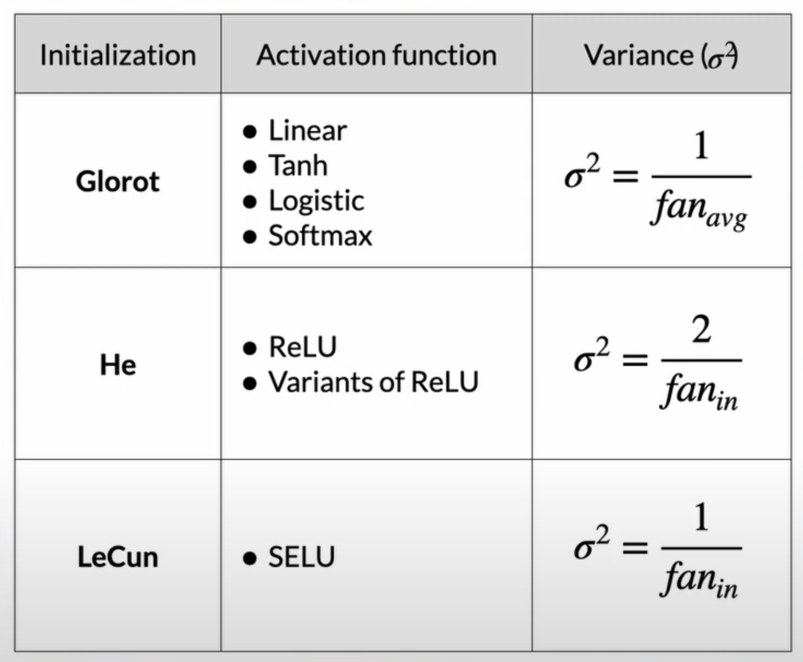
    </div>


- Backpropagation [[YouTube](https://www.youtube.com/watch?v=SmZmBKc7Lrs)] [[YouTube](https://www.youtube.com/watch?v=1GnfvhBUs_E&list=PLgPbN3w-ia_PeT1_c5jiLW3RJdR7853b9&index=8)]
    - The chain rule in calculus is a method for computing the derivative of a composite function. If you have a function defined as a composition of several functions, for example:$`z=f(g(h(x)))`$, then the derivative with respect to $`x`$ is computed as: $`\frac{d z}{d x}=\frac{d z}{d f} \cdot \frac{d f}{d g} \cdot \frac{d g}{d h} \cdot \frac{d h}{d x}`$. This principle is essential in backpropagation because deep neural networks are, by nature, compositions of many nested functions.
    - Forward vs. backward pass
        - Forward pass: The forward pass is the process of feeding input data through the network and computing the output. Here, each node (or layer) processes the input it receives and passes on its output to subsequent nodes according to the network’s architecture. During this pass, the computational graph is effectively created, and intermediate values (activations) are stored because they will be needed during backpropagation.
        ```python
        import numpy as np

        def forward_pass(X, W1, b1, W2, b2):
            # Hidden layer
            Z1 = np.dot(W1, X) + b1  # Pre-activation
            A1 = np.maximum(0, Z1)   # ReLU activation

            # Output layer
            Z2 = np.dot(W2, A1) + b2
            A2 = np.exp(-np.logaddexp(0.0, -Z2))  # [To be reviewed] stable sigmoid

            # Store intermediate values for backprop
            cache = {"Z1": Z1, "A1": A1, "Z2": Z2, "A2": A2}

            return A2, cache

        def compute_loss(logits, Y):
            # [To be reviewed] Pass cache["Z2"]; BCE from logits avoids log(0).
            m = Y.shape[1]
            loss = np.sum(np.logaddexp(0.0, logits) - Y * logits) / m
            return loss
        ```

        - [To be reviewed] Backpropagation computes gradients by reverse traversal of the computation graph. Applying those gradients to weights is a separate optimizer step. Keeping those phases distinct matters for accumulation, clipping, mixed precision, and distributed synchronization.

        ```python
        def backward_pass(X, Y, cache, W1, W2):
            m = X.shape[1]
            A1 = cache["A1"]
            A2 = cache["A2"]
            Z1 = cache["Z1"]

            # Output layer gradients
            dZ2 = A2 - Y
            dW2 = 1/m * np.dot(dZ2, A1.T)
            db2 = 1/m * np.sum(dZ2, axis=1, keepdims=True)

            # Hidden layer gradients
            dA1 = np.dot(W2.T, dZ2)
            dZ1 = dA1 * (Z1 > 0)  # ReLU derivative
            dW1 = 1/m * np.dot(dZ1, X.T)
            db1 = 1/m * np.sum(dZ1, axis=1, keepdims=True)

            return {"dW1": dW1, "db1": db1, "dW2": dW2, "db2": db2}

        def update_parameters(W1, b1, W2, b2, grads, learning_rate):
            W1 = W1 - learning_rate * grads["dW1"]
            b1 = b1 - learning_rate * grads["db1"]
            W2 = W2 - learning_rate * grads["dW2"]
            b2 = b2 - learning_rate * grads["db2"]

            return W1, b1, W2, b2
        ```
        - This two-phase process (forward and backward) ensures that each weight update is informed by the contribution of every parameter to the overall error.
    - Gradient flow refers to how error gradients propagate backward through the network during training. Effective gradient flow is essential because:
        - It ensures that all layers—regardless of depth—receive meaningful updates.
        - It affects how quickly and effectively the network converges to a minimum of the loss function.
    - Automatic differentiation [[YouTube-DL System](https://www.youtube.com/watch?v=56WUlMEeAuA)]: Automatic differentiation is a set of techniques to compute derivatives automatically and efficiently. Deep learning frameworks (e.g., TensorFlow, PyTorch) rely on autodiff to handle the complexities of differentiating networks with millions of parameters without manual intervention.
    - Vanishing/exploding gradient problems
        - Root causes
            - Deep Architectures:In networks with many layers, the product of a large number of derivative terms (each typically less than or greater than one) can lead to vanishing or exploding gradients.
            - Activation Functions: Functions such as sigmoid or tanh saturate (i.e., their gradients approach zero) for extreme values, contributing to vanishing gradients.
            - Improper Weight Initialization: Weights that are too small or too large can respectively dampen or amplify gradients during backpropagation.
        - Detection methods
            - Monitoring Gradient Norms: By tracking the norm (or magnitude) of the gradients during training, you can detect when they are trending toward zero or growing uncontrollably.
            - Layer-wise Analysis: Evaluating the gradient distribution across layers can help diagnose whether early layers receive significantly diminished signals compared to later layers.
            - [To be reviewed] Activation histograms can reveal saturation or excessive scales, but small activations alone do not prove vanishing gradients. Inspect actual layerwise gradients, Jacobian sensitivity when feasible, and the activation's derivative.
            - [To be reviewed] A plateau or nonfinite loss is a symptom with multiple possible causes, including data errors, numerical overflow, a bad objective, or optimization instability. Diagnose gradients and intermediate values before assigning the cause.
        - Solutions
            - Proper Weight Initialization.
            - Normalization Techniques
            - Residual Connections: Introduce shortcuts that allow gradients to flow more directly through the network. This helps mitigate the vanishing gradient problem, particularly in very deep networks.
            - Gradient Clipping[[YouTube](https://www.youtube.com/watch?v=KrQp1TxTCUY)]: Helps control exploding gradients by capping the gradients’ magnitude during backpropagation.


- Learning Rate Strategies
    - Fixed learning rates: A fixed learning rate remains constant during the entire training process.
    - [To be reviewed] Power/exponential scheduling

        - Exponential decay uses $`\eta_t=\eta_0\gamma^{t/s}`$; inverse-power decay can use $`\eta_t=\eta_0(1+t/\tau)^{-p}`$. Define whether $`t`$ counts optimizer steps, epochs, or tokens. The schedule's time unit matters when batch size or gradient accumulation changes.
        - **Example:** doubling accumulation halves optimizer updates for a fixed number of microbatches. An unchanged step-based schedule then decays at a different point in the data stream. Log learning rate against consumed tokens as well as steps. [Scheduler reference](https://docs.pytorch.org/docs/stable/optim.html#how-to-adjust-learning-rate)

    - [To be reviewed] Piecewise constant scheduling

        - Hold the learning rate fixed within intervals, then reduce it at chosen boundaries. Abrupt reductions can support a final refinement phase but may be poorly placed if the total training budget changes.
        - **Example:** multiply learning rate by 0.1 after each specified milestone and compare against a smooth schedule at the same number of updates. Milestones are hyperparameters and belong in the development protocol.

    - Adaptive learning rates
        - Adaptive methods automatically adjust the learning rate during training, often on a per-parameter basis.
        - AdaGrad, RMSprop, Adam.
    - Scheduling strategies
        - [To be reviewed] step decay

            - A common step schedule is $`\eta_t=\eta_0\gamma^{\lfloor t/s\rfloor}`$. Use it when known training phases justify discrete changes. A milestone-based schedule generalizes fixed-period decay to explicitly selected update counts.

        - [To be reviewed] exponential decay

            - Multiply learning rate by a constant factor at each scheduler interval. Derive the factor from the desired endpoint and total number of intervals rather than selecting it without reference to the run length. For an endpoint ratio of 0.01 over 100 intervals, the factor is $`0.01^{1/100}`$.

        - [To be reviewed] power scheduling

            - A polynomial-to-zero schedule can use $`\eta_t=\eta_0(1-t/T)^p`$ over $`0\leq t\leq T`$. This differs from an inverse-power schedule, which approaches zero asymptotically. State the exact function because “power decay” is ambiguous.

        - [To be reviewed] cosine annealing

            - A single cosine decay is $`\eta_t=\eta_{\min}+\tfrac12(\eta_{\max}-\eta_{\min})[1+\cos(\pi t/T)]`$. Warmup is a separate initial phase; restarts are a separate design choice.
            - **Example:** use linear warmup for an explicitly budgeted number of updates, then decay over the remaining updates. A resumed run must restore scheduler state; resetting the cosine silently changes the optimization trajectory. [SGDR paper](https://arxiv.org/abs/1608.03983)

        - [To be reviewed] cyclical learning rates

            - Cyclical schedules vary learning rate repeatedly between bounds, often using triangular cycles. A one-cycle policy instead increases and then decreases learning rate over one training run, frequently with a coupled momentum schedule.
            - **Failure mode:** an upper bound suitable for one optimizer, batch size, or architecture may destabilize another. Compare at matched update budgets and report the actual schedule. [Cyclical learning rates](https://arxiv.org/abs/1506.01186)


- Regualization and Normalization [[YouTube-Regualization](https://www.youtube.com/watch?v=EehRcPo1M-Q)]

    [To be reviewed] Regularization constrains a model or fitting procedure according to a chosen inductive bias. Weight magnitude is parameterization-dependent; a large individual weight does not by itself prove overfitting or excessive influence of one training example.

    - Solutions: L1/L2 regularization (Alpha: how much attention to pay to this penalty), dropout, early stopping; Data augmentation(adding more info)

    - Beyond traditional methods
        - [To be reviewed] Label smoothing can define $`\tilde y_k=(1-\epsilon)\mathbf{1}[k=y]+\epsilon/K`$ for $`K`$ classes. For binary classification this convention gives $`1-\epsilon/2`$ to the target class and $`\epsilon/2`$ to the other. Some implementations distribute smoothing only over nontarget classes; state the convention. It changes targets and confidence incentives, not the inference-time label definition. [Cross-entropy API](https://docs.pytorch.org/docs/stable/generated/torch.nn.CrossEntropyLoss.html)
        - [To be reviewed] Dropout

            - During training, inverted dropout multiplies an activation by $`m/(1-p)`$ with $`m\sim\operatorname{Bernoulli}(1-p)`$, preserving its conditional expectation. At evaluation, disable this stochastic masking for the usual deterministic prediction path.
            - **Example:** dropping half the activations scales retained values by two. Forgetting evaluation mode leaves predictions stochastic and can impair reproducibility. Dropout placement matters: masking attention probabilities, residual branches, and feed-forward activations are different interventions. [Dropout paper](https://jmlr.org/papers/v15/srivastava14a.html)

            - [To be reviewed] How to apply dropout to LSTM

                - Distinguish dropout between stacked recurrent layers from dropout on recurrent state transitions. Some variational formulations reuse a mask across time steps so temporal memory is not disrupted by independently sampled recurrent noise at every step.
                - **Implementation pitfall:** the built-in PyTorch LSTM `dropout` argument applies between stacked LSTM layers, excluding the last layer; it does not implement arbitrary recurrent-state dropout and has no between-layer effect for a single-layer LSTM. [LSTM API](https://docs.pytorch.org/docs/stable/generated/torch.nn.LSTM.html), [variational recurrent dropout](https://arxiv.org/abs/1512.05287)

        - [To be reviewed] Early stopping

            - Monitor a prespecified validation quantity, save the best checkpoint, and stop after a defined patience without sufficient improvement. Choose whether lower loss or higher task score is the actual objective.
            - **Example:** validation loss can increase while classification accuracy is unchanged because confidence becomes worse calibrated. Repeated checkpoint selection adapts to the validation set; retain an untouched final evaluation set and report the selection rule.

        - Mixup and CutMix: Data augmentation techniques that form new training samples by combining pairs of images (and their labels) either through interpolation (Mixup) or by cutting and pasting regions (CutMix).
        - Weight constraints: Imposes restrictions (e.g., max-norm constraints) on the weights, ensuring they do not become too large during training.

    - Normalization [[Medium](https://medium.com/techspace-usict/normalization-techniques-in-deep-neural-networks-9121bf100d8)]
        - **Batch normalization** (2015) [[YouTube](https://www.youtube.com/watch?v=yXOMHOpbon8)] is a method that normalizes activations in a network across the mini-batch of definite size. For each feature, batch normalization computes the mean and variance of that feature in the mini-batch. It then subtracts the mean and divides the feature by its mini-batch standard deviation. Good for CNN.
        - Problems
            - [To be reviewed] Small normalization groups make batch statistics noisy. For convolutional BatchNorm, statistics use batch and spatial dimensions, so batch size 1 can still supply multiple values per channel. A training configuration with only one value per channel is degenerate. Distributed replicas can share affine parameters while observing different local statistics; SyncBatchNorm synchronizes the chosen statistics. Equal local batch sizes are not required to make gamma/beta equal. [BatchNorm2d](https://docs.pytorch.org/docs/stable/generated/torch.nn.BatchNorm2d.html)
            - [To be reviewed] Recurrent normalization must account for sequence length and changing state distributions. Time-specific statistics are one design, not a universal requirement. LayerNorm computes per-example/time-step feature statistics and avoids dependence on batch composition. [LayerNorm](https://arxiv.org/abs/1607.06450)

        - [To be reviewed] Weight normalization parameterizes $`w=g\,v/\|v\|`$, separating a weight vector's magnitude from direction. It reparameterizes weights rather than normalizing minibatch activation statistics, so it should not be equated with BatchNorm's variance computation. [Weight normalization](https://arxiv.org/abs/1602.07868)

        - **Layer normalization** (2016) [[YouTube](https://www.youtube.com/watch?v=2V3Uduw1zwQ)] normalizes input across the features instead of normalizing input features across the batch dimension in batch normalization. Good for RNN.
            - $`\mathrm{y}=\frac{\mathrm{x}-\mathrm{E}(\mathrm{x})}{\sqrt{\mathrm{V} \text{ar}(\mathrm{x})+\epsilon}} * \gamma+\beta`$.
            - [To be reviewed] Post-LN: $`x_{i+1}=\operatorname{LayerNorm}(x_i+\operatorname{Sublayer}(x_i))`$. BERT and the original Transformer use post-normalization forms; **T5 uses a pre-normalization RMS-style variant**, so it is not a Post-LN example. [T5](https://jmlr.org/papers/v21/20-074.html)
            - Pre-layerNorm: $`x_{i+1}=x_i+\text{Sublayer}\left(\text{LayerNorm}\left(x_i\right)\right)`$. Normalize before the sublayer (e.g., attention or MLP). Residual connection happens after the sublayer.  (GPT, LLaMa)
            - [To be reviewed] **Pre-LN versus Post-LN:** Pre-LN often improves initialization-time gradient behavior and training stability; final quality depends on the architecture, optimizer, depth, schedule, and tuning. Neither is universally superior. [Normalization analysis](https://arxiv.org/abs/2002.04745)
                - [To be reviewed] The residual stream and normalized branch can have different relative scales as depth grows; assess those scales under the actual parameterization.
                - [To be reviewed] Claims that deep Pre-LN layers contribute less describe specific analyses or settings, not proof that every Pre-LN model is functionally shallow.
                - [To be reviewed] Compare held-out quality, gradient norms, update scales, and training failures at matched compute instead of inferring effective depth from normalization placement alone.
                - [To be reviewed] DeepNet motivates DeepNorm using its theoretical assumptions and translation experiments; those results do not establish a universal quality ranking for modern LLMs.
            - DeepNet introduces **DeepNorm** to merge the high performance of Post‑LN with the stability of Pre‑LN, enabling reliable training of ultra‑deep Transformers .
                - [To be reviewed] DeepNorm uses $`x_{l+1}=\operatorname{LayerNorm}(\alpha x_l+G_l(x_l;\theta_l))`$: **alpha scales the residual/skip term** in this formulation, not the sublayer output. [DeepNet / DeepNorm](https://arxiv.org/abs/2203.00555)
                - [To be reviewed] Its beta factor rescales selected initialization matrices; alpha/beta depend on encoder/decoder configuration and depth. Reproduce the paper's initialization and assumptions together rather than transplanting one constant into an arbitrary architecture.

        - [To be reviewed] RMSNorm uses $`\operatorname{RMSNorm}(x)=g\odot x/\sqrt{d^{-1}\sum_i x_i^2+\epsilon}`$ in a common implementation convention. It omits mean subtraction and usually the additive bias of standard LayerNorm. Placement of epsilon and affine options are implementation choices. [RMSNorm](https://arxiv.org/abs/1910.07467)
        - [To be reviewed] **pRMSNorm** estimates the RMS from a selected subset of feature coordinates, reducing the work under the method's assumptions.
            - [To be reviewed] For a specified subset $`S`$, one form uses $`x/\sqrt{|S|^{-1}\sum_{i\in S}x_i^2+\epsilon}`$ followed by a learned scale. Do not identify ordinary RMSNorm in a model such as Mistral or Yi as partial RMSNorm without implementation evidence. [pRMSNorm paper](https://arxiv.org/abs/1910.07467)

        - [To be reviewed] **Instance normalization** normalizes spatial positions separately within each sample/channel. A common configuration uses input statistics during both training and evaluation; running-statistics options also exist. Its use in style transfer does not make it equivalent to normalization over all features of a sample. [InstanceNorm2d](https://docs.pytorch.org/docs/stable/generated/torch.nn.InstanceNorm2d.html)
        - [To be reviewed] GroupNorm normalizes spatial positions and channel subsets within each sample. One group shares the normalization axes of LayerNorm over the full channel/spatial volume, but affine parameter sharing can differ. One group per channel shares InstanceNorm's input-statistics axes, again subject to affine/running-statistics choices. [GroupNorm](https://docs.pytorch.org/docs/stable/generated/torch.nn.GroupNorm.html)
        - [To be reviewed] (**Spectral normalization**: for GAN)

            - Normalize a weight matrix by an estimate of its largest singular value: $`\bar W=W/\sigma_{\max}(W)`$. Power iteration provides an efficient estimate and limits the layer's operator norm under the chosen matrix representation.
            - **Example:** constrain the discriminator or critic to reduce excessive sensitivity to input perturbations. A layerwise spectral constraint is not a universal proof that an entire architecture is exactly 1-Lipschitz; nonlinearities, residual additions, and convolution parameterization also matter. [Spectral normalization](https://arxiv.org/abs/1802.05957)


        - **Understanding**: Imagine a stack of N (batch) books, each with C (channels) pages, every page has H lines, and each line contains W characters.
            - BN: It's like averaging across the same page in different books. For example, all the 36th pages from all N books are added together, and the average is computed over all characters on those pages (total of N×H×W characters).
            - [To be reviewed] LN: normalize the explicitly selected feature axes. For an image tensor, a LayerNorm over C×H×W normalizes a whole book; a Transformer usually normalizes hidden features separately at each token, not the whole token sequence.
            - IN: It averages all characters on a single page of a book. Each page is treated separately, averaging over H×W characters.
            - GN: Each book (with C pages) is split into G groups of pages. Each group (C/G pages) is treated like a mini-book, and normalization is done within each group.


        <div align="center">
            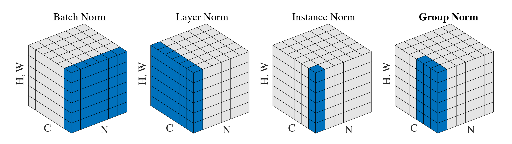
        </div>

----

### DL Algorithms
#### CNN
[[YouTube](https://www.youtube.com/watch?v=oGpzWAlP5p0)] [[Code](https://www.youtube.com/watch?v=pDdP0TFzsoQ&list=PLqnslRFeH2UrcDBWF5mfPGpqQDSta6VK4&index=15)]

In a typical CNN architecture, a few convolutional layers are connected in a cascade style. Each convolutional layer is followed by a Rectified Linear Unit (ReLU) layer or other activation function, then a pooling layer*, then one or more convolutional layers (+ReLU), then another pooling layer.

[To be reviewed] A convolutional output channel is formed by one filter spanning the input channels; its parameters are shared across spatial positions. Stacking two stride-1 3×3 layers gives a 5×5 receptive field under ordinary assumptions, but does not equal one 5×5 convolution: intermediate channels and nonlinearities change expressiveness and cost. Smaller kernels are a design choice, not guaranteed to extract the same features faster.

[To be reviewed] A CNN may flatten activations for a dense head or use global pooling and another task head. Softmax is appropriate for a categorical output; binary, multilabel, regression, detection, and dense-prediction tasks use different heads and losses.

[To be reviewed] Depth, width, stride, padding, kernel size, and pooling affect capacity, receptive fields, cost, and inductive bias. More layers do not mechanically imply a fixed requirement for more labeled data; pretraining, augmentation, regularization, and optimization also matter.

- Pooling: it is a way to reduce the number of features by choosing a number to represent its neighbor. And it has many types max-pooling, average pooling, and global average.
- Max pooling: it takes the max number of window 2×2 as an example and represents this window by using the max number in it then slides on the image to make the same operation.
- Average pooling: it is the same as max-pooling but takes the average of the window.

    <div align="center">
        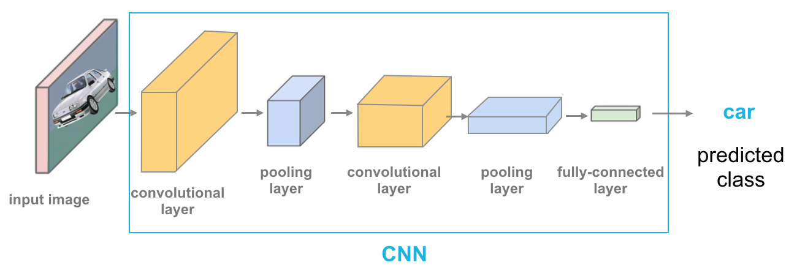
    </div>

#### RNN
[[YouTube](https://www.youtube.com/watch?v=LHXXI4-IEns)]
- Architecture: RNNs are designed to process sequences by recursively updating a hidden state. At each time step $`t`$, the network takes an input $`x_t`$ and the previous hidden state $`h_{t-1}`$ to produce a new hidden state $`h_t`$ : $`h_t=f\left(W_x x_t+W_h h_{t-1}+b\right)`$, where $`W_x`$ and $`W_h`$ are weight matrices, $`b`$ is a bias term, and $`f`$ is a nonlinear activation function (commonly tanh or ReLU). The same set of weights is used at every time step, which makes the network well-suited for variable-length sequences but also introduces challenges during training.
- BPTT: BPTT is an extension of the standard backpropagation algorithm. The network is “unrolled” along the time axis, and gradients are computed for each time step, then aggregated to update the shared weights.
    - Unrolling over long sequences can be both memory-intensive and computationally heavy.
    - The repeated multiplication of gradients across many time steps often results in extremely small (vanishing) or large (exploding) gradients.


#### LSTM & GRU
[[YouTube](https://www.youtube.com/watch?v=8HyCNIVRbSU)]
- **LSTM** networks were introduced specifically to address the vanishing gradient problem inherent in basic RNNs. They do this by incorporating a memory cell that can maintain information over long periods.
    - Architecture
        - Cell State $`\left(C_t\right)`$ : Acts as the "memory" of the network.
        - Hidden State $`\left(h_t\right)`$ : Carries output information.

        <div align="center">
            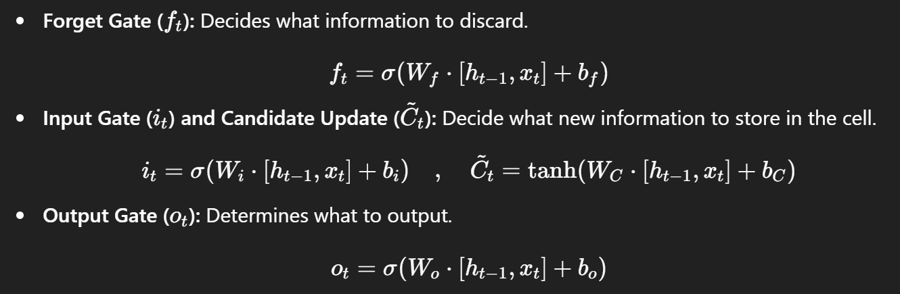
        </div>

        - Update Equations:
            - Cell State Update: $`C_t=f_t \odot C_{t-1}+i_t \odot \tilde{C}_t`$
            - Hidden State Update: $`h_t=o_t \odot \tanh \left(C_t\right)`$ Here, $`\odot`$ denotes element-wise multiplication and $`\sigma`$ is the sigmoid activation.

    <div align="center">
        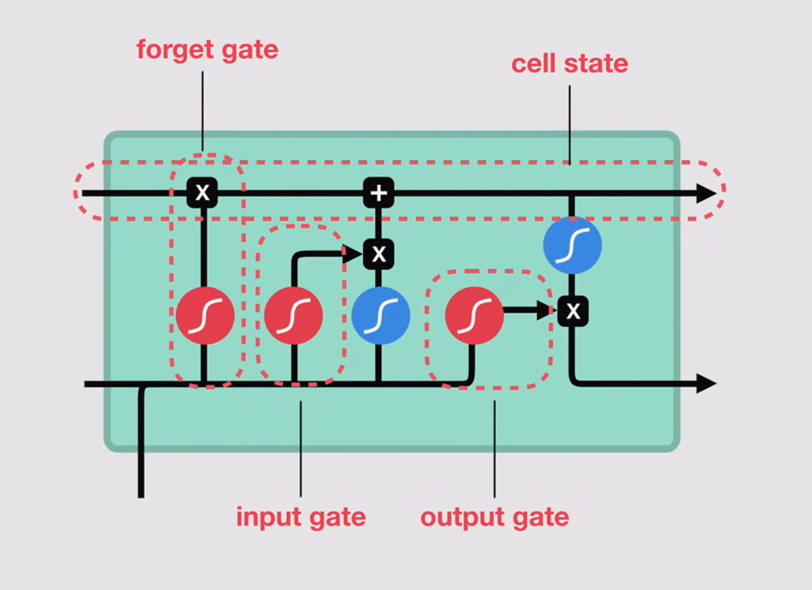
    </div>

    - Advantages
        - Long-Term Dependency Capture: The cell state allows LSTM to preserve information over extended sequences.
        - Mitigation of Vanishing Gradients: Gating mechanisms help maintain stable gradients even for long sequences.
    - Trade-offs
        - Computational Complexity: LSTMs have more parameters (due to multiple gates) compared to basic RNNs, leading to increased computational cost and memory usage.
        - Overfitting Potential: The increased model capacity might require more data and careful regularization to prevent overfitting.

- **GRU** are designed to offer similar capabilities to LSTMs but with a simplified structure. They aim to capture long-term dependencies with fewer gates and parameters, potentially yielding faster training and inference.
    - Architecture: GRUs combine the functionalities of the input and forget gates into a single update gate and use a reset gate to control the combination of past and new information.
        <div align="center">
            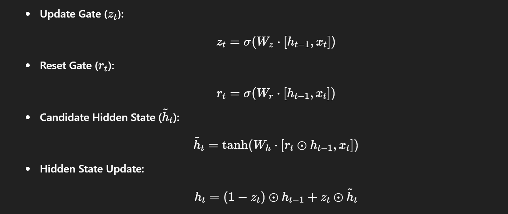
        </div>

        - [To be reviewed] **GRU equation conventions:** the illustration omits biases and uses z as the fraction of the candidate written to state. PyTorch's GRU uses z as a retention gate: $`h_t=(1-z_t)\odot n_t+z_t\odot h_{t-1}`$. Its candidate is $`n_t=\tanh(W_{in}x_t+b_{in}+r_t\odot(W_{hn}h_{t-1}+b_{hn}))`$; applying reset after the hidden affine map differs from multiplying the old hidden state before that map. Match the equations to the implementation rather than mixing these conventions. [PyTorch GRU](https://docs.pytorch.org/docs/stable/generated/torch.nn.GRU.html)

    <div align="center">
        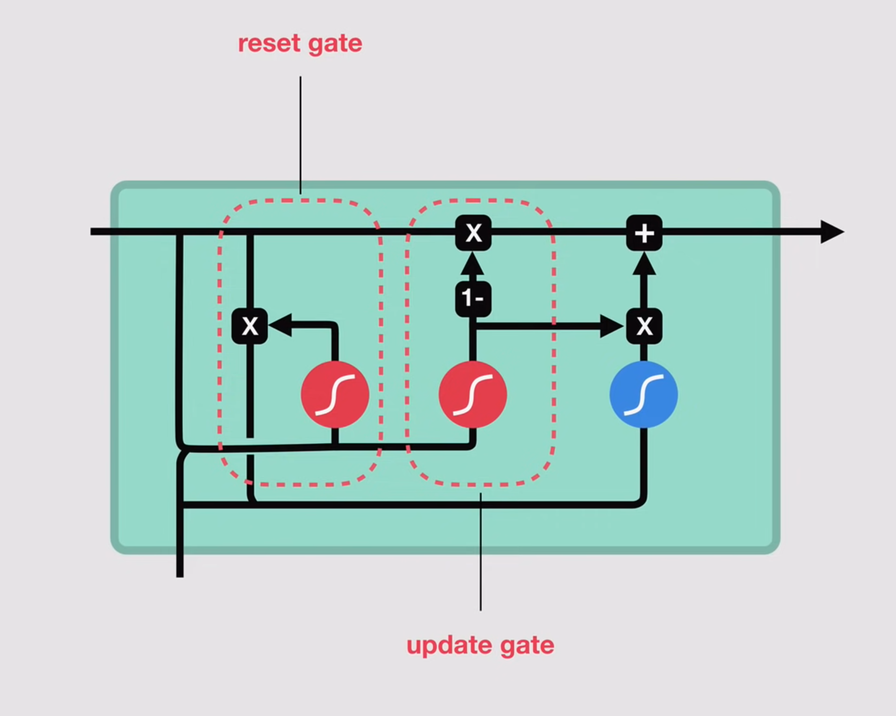
    </div>

    - [To be reviewed] GRU maintains one hidden state rather than separate LSTM hidden/cell states. With matched input/hidden sizes it usually has fewer gate parameters; observed training or inference speed depends on kernels, sequence shapes, hardware, and implementation. Fewer gates do not guarantee lower latency or equal task performance.
    - Advantages
        - Simplicity: Fewer gating mechanisms lead to a more straightforward architecture.
        - Efficiency: Fewer parameters often mean faster training and potentially less risk of overfitting.
        - Comparable Performance: In many tasks, GRUs perform on par with LSTMs despite their simpler structure.
    - Trade-offs
        - Expressiveness: With fewer gates, some nuances of long-term dependencies might be less finely controlled compared to LSTMs.
        - Task-Dependence: The performance benefits of GRUs versus LSTMs can vary; some tasks might benefit from the additional gating complexity of LSTMs.


- **Comparison Among These Models**

[To be reviewed] **Illustrative recurrent-model comparison; compare matched dimensions and implementations.**

| **Aspect**                | **Standard RNN**                                          | **LSTM**                                                      | **GRU**                                                       |
|---------------------------|-----------------------------------------------------------|---------------------------------------------------------------|---------------------------------------------------------------|
| **Architecture**          | Simple recurrence using a single hidden state             | Memory cell with three gates: input, forget, and output gates  | Streamlined design with two gates: update and reset           |
| **Handling of Long-Term Dependencies** | Struggles due to vanishing/exploding gradients            | Can retain information through gated cell-state paths; no general long-range guarantee      | Good; mitigates gradient issues with a simpler gating mechanism |
| **Parameter Complexity**  | Fewer parameters                                          | More parameters due to complex gate structure                  | Fewer parameters compared to LSTM                              |
| **Computational Cost**    | Lower, faster computation for short sequences             | Higher, computationally intensive due to extra gates           | Often fewer gate operations at matched width; benchmark actual kernels  |
| **Usage Considerations**  | Best for short sequences; limited long-range memory       | A candidate for long dependencies; compare against alternatives    | Suitable when speed and simplicity are needed, with competitive performance |


#### (Generative Models: GANs & Autoencoders)
- Generative Adversarial Networks (GAN)
    - Fundamental Concepts
        - [To be reviewed] Architecture: Generator vs. Discriminator

            - Sample latent noise $`z\sim p(z)`$ and generate $`G(z)`$. The discriminator estimates whether an input is drawn from the data or generator. Sampling requires a forward pass through the generator, while a normalized explicit data likelihood is generally unavailable. [GAN paper](https://arxiv.org/abs/1406.2661)

        - [To be reviewed] Game theory perspective: adversarial training process

            - The original objective is $`\min_G\max_D\ \mathbb{E}_{x\sim p_{\mathrm{data}}}\log D(x)+\mathbb{E}_{z}\log(1-D(G(z)))`$. For a fixed generator and unrestricted discriminator, the optimum is $`D^*(x)=p_{\mathrm{data}}(x)/(p_{\mathrm{data}}(x)+p_G(x))`$.
            - **Interpretation:** the equilibrium statement assumes idealized function classes and optimization. Alternating finite neural-network updates need not reach it; a discriminator accuracy of 50% can indicate either successful matching or an untrained discriminator.

    - Key Components & Dynamics
        - [To be reviewed] Loss formulations for both generator and discriminator

            - The discriminator maximizes the real/fake log-likelihood; a common non-saturating generator objective minimizes $`-\mathbb{E}_z\log D(G(z))`$. It preserves the desired equilibrium while providing a stronger learning signal when generated samples are initially easy to reject.
            - **Example:** if $`D(G(z))`$ is near zero, the original saturating generator formulation can yield a weak useful gradient. State the actual training loss, rather than saying only “adversarial loss.”

        - [To be reviewed] Training challenges (e.g., mode collapse, vanishing gradients)

            - **Mode collapse** means the generator represents too little of the target distribution, potentially producing individually convincing but repetitive samples. Other failures include oscillating game dynamics and an overly strong discriminator that provides poor gradients.
            - **Example:** a model trained on ten classes may generate high-quality samples from only two. Evaluate both quality and coverage; a scalar discriminator loss does not measure either reliably. Use held-out data and inspect diversity within and across relevant subgroups. [GAN training techniques](https://arxiv.org/abs/1606.03498)

        - [To be reviewed] Strategies to stabilize training (e.g., feature matching, Wasserstein GAN)

            - WGAN replaces the original divergence-driven formulation with a Wasserstein-1 dual objective over 1-Lipschitz critics. The original method uses weight clipping; WGAN-GP instead penalizes deviation of gradient norms from one on sampled interpolations.
            - Feature matching asks the generator to match statistics of discriminator features, providing a different training signal. These approaches address different aspects of training and do not guarantee the elimination of collapse. Compare seeds and matched compute, rather than selecting one attractive sample grid. [WGAN](https://arxiv.org/abs/1701.07875), [WGAN-GP](https://arxiv.org/abs/1704.00028)


- Autoencoders
    - Basic Autoencoders
        - [To be reviewed] Encoder and decoder structure

            - An encoder maps $`x`$ to $`z=f_\phi(x)`$ and a decoder reconstructs $`\hat x=g_\theta(z)`$. Train with a likelihood-appropriate reconstruction objective: squared error corresponds to a particular Gaussian observation model, while binary cross-entropy corresponds to Bernoulli observations.
            - The bottleneck dimension and regularization constrain information transfer. An overcomplete unconstrained autoencoder can copy inputs without discovering a useful semantic representation.

        - [To be reviewed] Applications: dimensionality reduction, noise reduction

            - Compression uses the latent code; denoising learns to reconstruct clean data from corrupted inputs. For anomaly detection, compare reconstruction behavior on representative held-out anomalies and normal examples.
            - **Counterexample:** an expressive decoder may also reconstruct an unfamiliar anomaly well. A high reconstruction score is therefore a task-dependent signal, not a calibrated probability of abnormality.

    - Variational autoencoders (VAE)
        - [To be reviewed] Theory: probabilistic generative modeling, latent variable models

            - A VAE learns a generative model $`p_\theta(x,z)=p(z)p_\theta(x\mid z)`$ and an approximate posterior $`q_\phi(z\mid x)`$. For Gaussian posteriors, reparameterize $`z=\mu_\phi(x)+\sigma_\phi(x)\odot\epsilon`$, with $`\epsilon\sim\mathcal{N}(0,I)`$, enabling pathwise gradients.
            - Unlike a deterministic autoencoder, its latent variables and decoder define a sampling model. The prior's high-probability regions should decode sensibly for prior sampling to work. [VAE paper](https://arxiv.org/abs/1312.6114)

        - [To be reviewed] Loss components: Reconstruction loss and KL-divergence

            - Maximize the evidence lower bound $`\mathcal{L}=\mathbb{E}_{q_\phi(z\mid x)}\log p_\theta(x\mid z)-D_{\mathrm{KL}}(q_\phi(z\mid x)\|p(z))`$. The reconstruction term rewards fitting observations; the KL term regularizes the posterior toward the prior. The gap to log evidence is $`D_{\mathrm{KL}}(q_\phi(z\mid x)\|p_\theta(z\mid x))`$.
            - **Failure mode:** a powerful decoder may ignore $`z`$, producing posterior collapse. Monitor KL per latent dimension and the effect of changing latent codes, rather than reconstruction loss alone.

        - [To be reviewed] Extensions such as Beta-VAE for disentanglement

            - A beta-VAE weights the KL term by $`\beta`$. Larger values can strengthen compression and encourage some factor separation, at the cost of reconstruction detail. For $`\beta>1`$, the objective remains bounded above by the ordinary ELBO when the reconstruction term is unchanged; for $`\beta<1`$, it is not generally a lower bound on log evidence.
            - **Caveat:** disentanglement is not identifiable from arbitrary observational data without inductive biases or supervision. Test factor-specific interventions when ground-truth factors are available. [beta-VAE](https://openreview.net/forum?id=Sy2fzU9gl), [identifiability limitations](https://arxiv.org/abs/1811.12359)


----
<a id="transformer"></a>
#### [To be reviewed] Transformer: Architecture and Computation

The diagram separates the **original encoder–decoder Transformer** from one **common modern decoder-only design**. The original uses Post-LayerNorm and a decoder cross-attention sublayer; the illustrated modern block uses Pre-RMSNorm, RoPE, grouped-query attention, and SwiGLU. These are specific configurations, not features required of every Transformer. Read the data flow from bottom to top; each dashed enclosure is a repeated layer, while embeddings and output heads sit outside that repetition.

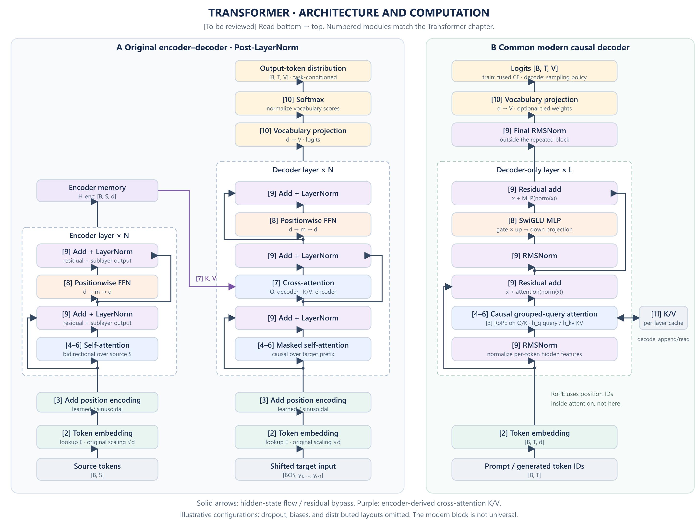

[Editable SVG](figs/transformer-architecture.svg). This original schematic omits dropout, projection biases, and implementation-specific distributed layouts for readability. The following sections specify the operations and assumptions behind each box.

<a id="tf-shapes"></a>
##### [To be reviewed] 1. Tensor Shapes and the Residual Stream

Use batch size $`B`$, source length $`S`$, target length $`T`$, model width $`d`$, query-head count $`h_q`$, KV-head count $`h_{kv}`$, head width $`d_h`$, MLP width $`m`$, vocabulary size $`V`$, and layer count $`L`$. In the common head layout, $`h_qd_h=d`$; other parameterizations are possible. The residual stream keeps shape $`[B,T,d]`$ through a decoder layer, permitting elementwise skip additions. It is a changing contextual representation, not a table of independently meaningful neuron labels.

| Quantity | Common shape | Role |
| --- | --- | --- |
| Token IDs | [B, T] | Integer indices, not floating-point hidden states |
| Residual stream | [B, T, d] | Shared interface between attention and MLP sublayers |
| Q | [B, h_q, T, d_h] | Queries at target/query positions |
| K / V in self-attention | [B, h_kv, T, d_h] | Keys and content at permitted sequence positions |
| Attention scores, MHA | [B, h_q, T, T] | Query-to-key comparisons before softmax |
| Encoder memory | [B, S, d] | Source states supplied to decoder cross-attention |
| Vocabulary logits | [B, T, V] | Unnormalized next-token scores |

**Shape check:** in cross-attention, query length is T and key/value length is S, so scores are [B, h_q, T, S]. Confusing those axes can create a numerically valid but semantically wrong softmax. Normalize over **keys for each query**, not over the query dimension. [MultiheadAttention shape reference](https://docs.pytorch.org/docs/stable/generated/torch.nn.MultiheadAttention.html)

<a id="tf-embedding"></a>
##### [To be reviewed] 2. Token Embeddings: IDs to a Learned Coordinate System

An embedding matrix $`E\in\mathbb{R}^{V\times d}`$ maps token ID $`x_t`$ to row $`E[x_t]`$. A lookup is equivalent to multiplying a one-hot token vector by E without materializing that vector. Repeated occurrences share input parameters; their **contextual hidden states** can diverge after attention. The embedding is trained through the downstream objective, not by assigning a fixed semantic definition to each coordinate. [Embedding API](https://docs.pytorch.org/docs/stable/generated/torch.nn.Embedding.html)

**Example:** “bank” near “river” and “bank” near “loan” may begin with the same token embedding but acquire different contextual states. A rare identifier can be split across several subwords; tokenization determines both the alphabet and the amount of context consumed. See [tokenization](#tokenization) and [retrieval representations](#embedding) for the separate question of obtaining a useful sentence-level vector.

The original Transformer multiplies token embeddings by $`\sqrt d`$ before adding sinusoidal positions. Many modern models use another scaling convention. Match the trained model; adding this factor to an arbitrary checkpoint changes activation scales. A tied output head can share E with the vocabulary projection, reducing parameter storage while coupling input/output learning. [Original architecture](https://arxiv.org/abs/1706.03762), [weight tying](https://arxiv.org/abs/1608.05859)

<a id="tf-position"></a>
##### [To be reviewed] 3. Position Information: Addition, Relative Bias, and RoPE

Without position-dependent information or masks, self-attention is permutation-equivariant: permuting input positions permutes the outputs. This is different from a permutation-invariant pooled representation. A causal mask already introduces order constraints; positional mechanisms supply additional position/distance structure.

**Absolute addition.** A learned table supplies $`P_t`$ and the layer input becomes $`E[x_t]+P_t`$. A fixed sinusoidal alternative uses $`P_{t,2i}=\sin(t/10000^{2i/d})`$ and $`P_{t,2i+1}=\cos(t/10000^{2i/d})`$. A learned lookup has a configured position range; a computable sinusoid can be evaluated beyond training lengths, but that mathematical extension does not establish useful extrapolation. [Original positional encoding](https://arxiv.org/abs/1706.03762)

**Relative score bias.** Add a position-dependent quantity $`b_{ij}`$ to the attention score for query i and key j. T5 uses learned distance buckets; ALiBi uses head-specific linear distance penalties. This changes comparison scores rather than simply adding a vector to token inputs. Bucketing sacrifices some distance resolution, and a bias's formula alone does not guarantee long-context retrieval. [T5](https://jmlr.org/papers/v21/20-074.html), [ALiBi](https://arxiv.org/abs/2108.12409)

**RoPE.** Apply position-dependent rotations to query/key coordinate pairs: $`q_i'=R_iq_i`$, $`k_j'=R_jk_j`$. For a shared frequency system, $`(q_i')^Tk_j'=q_i^TR_i^TR_jk_j=q_i^TR_{j-i}k_j`$. The dot product therefore contains relative-position structure even though rotations use absolute position indices. A rotation preserves each pair's Euclidean norm; it does not make all attention scores depend only on distance because content vectors also matter. Values are commonly left unrotated. [RoFormer](https://arxiv.org/abs/2104.09864)

**Implementation example:** if a cached key was already rotated at absolute position 127, appending token 128 should not rotate that old key again. Preserve the position convention across prefill, cache reuse, padding, and sequence packing. Partial-RoPE dimensions, frequency scaling, and long-context adaptation are checkpoint-specific. Recurrent/ODE-generated encodings and multiplicative input encodings are additional families, rather than interchangeable names for RoPE. Validate changed position mechanisms using length and evidence-position sweeps, as discussed in [mid-training](#mid-training).

<a id="tf-attention"></a>
##### [To be reviewed] 4. Q, K, V and Scaled Dot-Product Attention

For a self-attention input X, the projected matrices are $`Q=XW_Q`$, $`K=XW_K`$, and $`V=XW_V`$. After splitting heads, one head computes $`A=\operatorname{softmax}(QK^T/\sqrt{d_h}+M)`$ and $`O=AV`$. Q determines what the current position compares, K determines how candidate positions are addressed, and V supplies the content being mixed. Key/value roles need not coincide with literal words or human-defined facts. [Scaled dot-product implementation](https://docs.pytorch.org/docs/stable/generated/torch.nn.functional.scaled_dot_product_attention.html)

Under independent, zero-mean, unit-variance Q/K coordinates, a dot product's variance is $`d_h`$. Division by $`\sqrt{d_h}`$ controls the initial scale before softmax. For probability vector a, the softmax Jacobian is $`\operatorname{diag}(a)-aa^T`$; highly saturated probabilities can make changes in some logits have little effect. Learned dependence and normalization alter the simple variance assumptions, so this is a motivating calculation rather than a universal initialization theorem.

**Numerical example:** scaled allowed logits [ln 3, 0] produce weights [0.75, 0.25]. With value vectors (1, 0) and (0, 2), the output is (0.75, 0.5). The **comparison scores** choose the mixture, while the **values** determine what is mixed. Changing only V changes the output without changing those attention weights. This also explains why a heatmap is not by itself a causal explanation of the model's final prediction; later transformations and residual paths remain active. See [attention-based explanation](#attention-based).

<a id="tf-masking"></a>
##### [To be reviewed] 5. Visibility Masks, Padding, and Teacher Forcing

A causal query at position i may attend only to permitted keys at positions $`j\leq i`$. An additive mask contributes zero for allowed positions and a suppressing value, conceptually negative infinity, for blocked ones. Padding masks remove invalid **keys**; loss masks independently choose which target tokens contribute to training. Packed examples may also require document/segment boundaries so one example cannot read another.

**Teacher forcing** supplies known input tokens at all positions, so a causal training pass can compute many next-token predictions in parallel. It does not reveal the target being predicted: the logits at input position t predict the next token at t+1 under the usual shifted-label convention. A correct mask and a correct label shift solve different leakage problems. The [pre-training loss example](#causal-loss-example) shows the shift explicitly.

**Cached decode pitfall:** for a query appended after P cached tokens, its absolute index is P, not zero. A generic lower-triangular mask built as if query/key axes both started at zero can incorrectly block valid history in rectangular attention. Derive visibility from the actual position indices. Avoid rows with no allowed key; softmax of all negative infinities is undefined in the reference formulation. Library conventions differ: PyTorch SDPA boolean masks use **True for allowed positions**, while some other attention APIs use True for blocked entries. [SDPA mask semantics](https://docs.pytorch.org/docs/stable/generated/torch.nn.functional.scaled_dot_product_attention.html)

<a id="tf-heads"></a>
##### [To be reviewed] 6. Multi-Head Attention, MQA, and GQA

MHA computes several head outputs, concatenates them, and applies an output projection: $`\operatorname{MHA}(X)=\operatorname{Concat}(O_1,\ldots,O_{h_q})W_O`$. W_O mixes head coordinates back into the residual width d; concatenation alone is not the complete sublayer. With ordinary square MHA projections and no biases, Q/K/V/O contain approximately $`4d^2`$ weights. Multiple heads enable different learned addressing/content subspaces, but they do not guarantee a clean human-readable role per head.

| Design | Query heads | KV heads | Main structural change |
| --- | --- | --- | --- |
| MHA | h_q | h_q | Distinct K/V per query head |
| MQA | h_q | 1 | One shared K/V head |
| GQA | h_q | h_kv between 1 and h_q | Groups of query heads share K/V |

For the common grouped layout, h_q is divisible by h_kv. Q retains all query heads, while K/V projections and cache shrink. **Example:** 32 query heads with 8 KV heads share each KV head among four query heads. Relative to 32-KV-head MHA, that cache has one quarter the K/V entries at the same layer count, length, dtype, and head width. It does not imply a fourfold speedup: attention computation, other weights, batching, and hardware still matter. The GQA paper also studies converting existing MHA checkpoints by additional training; changing head counts in a saved checkpoint is not a free tensor-layout operation. [GQA](https://arxiv.org/abs/2305.13245)

<a id="tf-cross-attention"></a>
##### [To be reviewed] 7. Encoder Memory and Decoder Cross-Attention

In the original encoder–decoder model, encoder self-attention processes the source bidirectionally, while decoder self-attention is causal over the target. Cross-attention takes queries from decoder states and keys/values from encoder memory: $`Q=H_{\mathrm{dec}}W_Q`$, $`K=H_{\mathrm{enc}}W_K`$, $`V=H_{\mathrm{enc}}W_V`$. Its source dimension is S rather than target length T. The source need not be causally masked if it is fully provided; source padding still matters. [Encoder/decoder reference implementation](https://nlp.seas.harvard.edu/annotated-transformer/)

**Translation example:** while generating a target verb, the decoder can select source positions that appeared anywhere in the supplied sentence. Its decoder Q changes as the target prefix grows, but a layer's encoder-derived K/V can be projected once and reused while the source is unchanged. Each decoder layer may have its own cross-attention projections. This differs from a single shared bidirectional prefix stack, whose representations and parameter-sharing pattern are different.

A conventional decoder-only block has no separate encoder-memory cross-attention. Prompt tokens and generated tokens occupy the causal stream together. Multimodal or retrieval systems may insert extra cross-attention or other fusion modules; the presence of external information does not determine a unique architecture.

<a id="tf-mlp"></a>
##### [To be reviewed] 8. Positionwise MLP, SwiGLU, and MoE

A standard MLP transforms each position independently, $`\operatorname{FFN}(x)=\phi(xW_1+b_1)W_2+b_2`$, with widths $`d\to m\to d`$. Its shared weights perform nonlinear feature computation at every token; the MLP itself does not directly mix sequence positions. Attention supplies context-dependent token mixing, and repeated attention/MLP composition changes both addressing and representations. Viewing FFNs as learned key/value memories can be a useful mechanistic hypothesis, not an exact semantic interpretation of every neuron. [Feed-forward analysis](https://arxiv.org/abs/2012.14913)

One common bias-free SwiGLU form is $`\operatorname{FFN}(x)=[\operatorname{SiLU}(xW_g)\odot(xW_u)]W_d`$. The gate/up matrices map d to m and the down matrix maps m to d. Its matrix weight count is $`3dm`$, compared with $`2dm`$ for a two-matrix MLP at the **same** m. Consequently, replacing a 4d-width ordinary FFN with a gated FFN often adjusts m toward $`8d/3`$ for similar parameter count, rounded to implementation-friendly sizes; the ratio is a budget calculation, not a universal optimal width. [GLU variants](https://arxiv.org/abs/2002.05202)

**Example:** at d = 4,096, a 4d ordinary MLP has about 134.2 million matrix weights; a gated MLP with that same hidden width has about 201.3 million. Reporting equal hidden width does not establish equal model capacity or compute.

MoE replaces a dense FFN with a router and several expert FFNs, often activating a small selected subset per token. Total parameter storage, activated computation, routing communication, and load balance are separate quantities. A top-2 router does not mean all experts fit into memory at the cost of two experts. See [expert parallelism](#distributed-training) for training layout. [Switch Transformers](https://jmlr.org/papers/v23/21-0998.html)

<a id="tf-norm"></a>
##### [To be reviewed] 9. Residual Paths, LayerNorm, RMSNorm, and Dropout

The original Post-LN sublayer is $`x'=\operatorname{LN}(x+F(x))`$, omitting dropout in this notation. A common Pre-LN/RMSNorm sublayer is $`x'=x+F(\operatorname{Norm}(x))`$, usually followed by a final normalization outside the repeated decoder stack. Residual addition requires compatible shapes; neither attention nor the MLP can silently change the residual width.

For a simplified Pre-LN block, the Jacobian contains a direct identity path: $`J=I+J_FJ_{\mathrm{Norm}}`$. Post-LN instead has $`J=J_{\mathrm{Norm}}(I+J_F)`$. This helps explain different initialization/optimization behavior, but cancellation, depth, scale, and the full architecture still matter. Neither formula proves gradients are always stable or that one placement always yields better final quality. [Normalization placement](https://arxiv.org/abs/2002.04745)

LayerNorm typically normalizes **hidden features within each token** using a mean and variance. A common RMSNorm computes $`\operatorname{RMSNorm}(x)=g\odot x/\sqrt{d^{-1}\sum_i x_i^2+\epsilon}`$, omitting mean subtraction and usually an additive bias. Epsilon, reductions, dtype, and affine settings affect numerical behavior. RMSNorm is not normalization across batch or sequence length. [RMSNorm](https://arxiv.org/abs/1910.07467)

Dropout may act on attention probabilities, sublayer outputs, embeddings, or residual branches depending on the recipe; these placements are different regularizers. Training/inference settings must match the implementation. Some modern LLMs use little or no dropout in particular configurations. The diagram omits it so that the two normalization orders remain legible; production code must specify it explicitly.

<a id="tf-readout"></a>
##### [To be reviewed] 10. Vocabulary Projection, Loss, and Decoding

After the final hidden state, a vocabulary head produces $`z_t=h_tW_{\mathrm{vocab}}+b`$ with $`W_{\mathrm{vocab}}\in\mathbb{R}^{d\times V}`$. Weight tying may use $`W_{\mathrm{vocab}}=E^T`$. Logits are scores, while softmax converts them to a categorical distribution. Fused cross-entropy commonly consumes logits directly; applying softmax first and then passing probabilities to a logits-based loss changes the computation. [CrossEntropyLoss API](https://docs.pytorch.org/docs/stable/generated/torch.nn.CrossEntropyLoss.html)

For the input `[BOS, A, B]`, the three aligned next-token labels can be `[A, B, EOS]`. Training on the current input token at the same position instead would teach a different, often trivial copying task if the token is already visible. In a chat example, the causal mask still protects visibility while a separate loss mask may exclude system/user targets. Padding and masked targets must be excluded from the denominator of the desired mean.

At generation time, select from the final available position's logits using the specified policy: greedy selection, temperature scaling, top-k, top-p, or another rule. Selecting a token, appending it, and updating the cache defines the next state. Temperature zero is a greedy limiting convention, not division by zero. Sampling parameters affect outputs, measured benchmark scores, and the rollout distribution used in [RL/OPD](#sft-rl-opd-comparison).

<a id="tf-cache"></a>
##### [To be reviewed] 11. Prefill, Incremental Decode, and KV Caching

**Prefill** computes states for a known prompt, usually in parallel over positions under the chosen mask. **Decode** computes new-token queries/keys/values and attends to cached earlier keys/values. Earlier causal hidden states are unchanged by appending a future token, so their K/V do not need to be recomputed. K/V are layer-specific; the cache is not just a copy of the input embeddings. [Cache conventions](https://huggingface.co/docs/transformers/cache_explanation)

For an attention-only step with a cache of length P, a common layout has Q [B, h_q, 1, d_h] and K/V [B, h_kv, P+1, d_h]. New keys must use the correct positional transformation before storage. Encoder–decoder generation can additionally reuse fixed source cross-attention K/V. A bidirectional prefix may be cached for unchanged-prefix continuation, but modifying that prefix can require recomputation.

**What caching buys:** a new token attends to about P previous positions rather than recomputing every earlier token's layer projections. It does not eliminate attention's growing history reads or the sequential dependence of exact ordinary autoregressive generation. Cache memory grows with active tokens and concurrency; [LLM inference](#llm-inference) gives the memory formula, a 1-GiB-per-sequence example, paging, and speculative decoding.

**Correctness experiment:** compare full causal attention with incremental cached attention using identical projected Q/K/V, positions, weights, and disabled dropout. Then change a future input token and verify that earlier causal outputs stay unchanged. Compare within appropriate floating-point tolerances; speed or a plausible generated sentence is not a cache-correctness test.

<a id="tf-cost"></a>
##### [To be reviewed] 12. Parameter, Arithmetic, and Memory Costs

For ordinary MHA and a two-matrix FFN, one layer has approximately $`4d^2+2dm`$ matrix weights; with m = 4d this is $`12d^2`$, excluding norms, biases, embeddings, and the vocabulary head. A decoder layer with an additional ordinary cross-attention sublayer adds roughly another $`4d^2`$ at equal source/target widths. GQA and gated MLPs require their actual projection sizes; do not reuse this coefficient indiscriminately.

In **multiply-accumulate operations (MACs)**, ordinary dense MHA prefill uses roughly $`4BTd^2`$ for Q/K/V/O projections plus $`2BT^2d`$ for QK and AV; an ordinary FFN adds $`2BTdm`$. One MAC is often counted as two FLOPs. Masks, causal kernels, precision, and implementation details change constants. Small-T workloads can be projection/MLP dominated; long sequences increase attention's relative cost. These are arithmetic estimates, not wall-clock latency predictions.

**Memory example:** a single explicitly materialized score matrix at B = 1, h = 32, T = 8,192 and two bytes per score occupies 4 GiB. That is one tensor, not the full training peak. FlashAttention tiles operations and uses online softmax/recomputation to reduce memory traffic and avoid storing the full score matrix in high-bandwidth memory. Its dense exact attention still has quadratic sequence-length arithmetic, up to kernel/mask constants. “Exact” means the attention operator rather than a sparse/low-rank approximation; floating-point reduction order can differ. [FlashAttention](https://arxiv.org/abs/2205.14135)

Decode performance often depends on weight/cache bandwidth, batch size, and concurrency as well as arithmetic. Report time to first token, inter-token latency, throughput, and peak memory under specified prompt/output distributions. A fourfold reduction in one attention tensor does not imply a fourfold reduction in total model cost.

<a id="tf-architecture-families"></a>
##### [To be reviewed] 13. Architecture Families and Historical Examples

| Family | Visibility / modules | Typical objective and task fit |
| --- | --- | --- |
| Encoder-only, e.g. BERT/RoBERTa | Bidirectional self-attention; no causal generation head required | Masked-token representations, tagging/classification/extractive QA |
| Encoder–decoder, e.g. original Transformer/T5/BART | Source encoder, causal decoder, source cross-attention | Conditional generation such as translation or summarization; objectives vary |
| Decoder-only, e.g. GPT-style/Llama-style models | Causal stream; commonly no separate source cross-attention | Continuation, instruction generation, tool-use trajectories |
| Single-stack prefix LM | Bidirectional supplied prefix plus causal continuation | Prefix-conditioned generation with a specified target-loss mask |

BERT uses MLM and the original NSP objective; RoBERTa changes the recipe, including removal of NSP, more training/data, and dynamic masking. XLNet's permutation-factorization objective and two-stream attention are another historical design, rather than a universal improvement over a causal decoder. T5 uses a pre-normalization RMS-style variant despite the original 2017 figure's Post-LN blocks. Compare architectures with specified objectives/data and compute. [BERT](https://aclanthology.org/N19-1423/), [RoBERTa](https://arxiv.org/abs/1907.11692), [XLNet](https://arxiv.org/abs/1906.08237), [T5](https://jmlr.org/papers/v21/20-074.html)

<a id="tf-reference"></a>
##### [To be reviewed] 14. Minimal Attention Reference and Failure Checks

This educational implementation exposes score/mask/softmax behavior; it materializes scores and is not a replacement for an optimized attention kernel. Inputs already contain projected heads and any required positional transform. The function supports matching head counts; GQA requires an explicit grouping layout or a supported kernel.

```python
import math
import torch

def reference_attention(q, k, v, allowed=None):
    # q: [B, H, Tq, Dh]; k/v: [B, H, Tk, Dh]. True means ALLOWED.
    scores = q @ k.transpose(-2, -1) / math.sqrt(q.size(-1))
    if allowed is not None:
        if allowed.dtype != torch.bool:
            raise TypeError("allowed must be a boolean mask")
        if not allowed.any(dim=-1).all():
            raise ValueError("Each query must have at least one allowed key")
        scores = scores.masked_fill(~allowed, float("-inf"))
    softmax_dtype = (torch.float32 if scores.dtype in
                     (torch.float16, torch.bfloat16) else scores.dtype)
    weights = torch.softmax(scores, dim=-1, dtype=softmax_dtype).to(v.dtype)
    return weights @ v, weights

def causal_allowed(query_length, key_length, past_length=0, device=None):
    # Append-only self-attention with query indices starting after the cache.
    if key_length != past_length + query_length:
        raise ValueError("Expected cached prefix plus current query block")
    q_positions = past_length + torch.arange(query_length, device=device)
    k_positions = torch.arange(key_length, device=device)
    return k_positions[None, :] <= q_positions[:, None]
```

**Test the mechanisms separately:** (1) changing future K/V must not change past causal outputs; (2) cached and full causal results should agree; (3) masked-key probability should be zero under the chosen reference formulation; (4) unmasked rows should sum to one before attention dropout; (5) RoPE should preserve rotated-pair norms and relative-angle identities; (6) label-shift and padding tests should compare the actual valid target set. Fused implementations can differ in precision and mask conventions, so establish the intended operator first.

Original study resources: [Attention Is All You Need](https://arxiv.org/abs/1706.03762), [Annotated Transformer](https://nlp.seas.harvard.edu/annotated-transformer/), [original lecture reference](https://www.youtube.com/watch?v=nzqlFIcCSWQ). For optimization and distributed execution, continue with [shared training systems](#llm-engineering).

## NLP (Pre-LLM Era)

Natural Language Processing (NLP) encompasses the interaction between computers and human languages, enabling machines to understand, interpret, and produce human text and speech. From basic tasks such as text parsing to more advanced ones like sentiment analysis and translation, NLP is integral to various applications, including virtual assistants, content classification, and information retrieval systems.

### Rule-Based Era (1960s-1980s)
- Key Innovation: Handcrafted linguistic rules.
- Core Techniques
    - Pattern matching & templates. Ex. ELIZA (1966): Pattern‑matching “therapist” bot.
    - Heuristic grammars (e.g. keyword spotting + script rules)
- Strengths & Limitations
    - ✅ Transparent, easy to debug.
    - ❌ Brittle, no real “understanding,” poor scalability.

### Statistical & ML Era

Statistical models learned parameters from data—first n‑grams, then classical ML.

- Text Pre‑processing
    - Tokenization is the process of breaking longer text into discrete units, or tokens, which could be words, n-grams, or characters. Common tokenization strategies include splitting by whitespace, punctuation, or specific vocabularies. Tokenization is a foundational step for various text processing tasks and is crucial for tasks like neural network for NLP.
    - Stemming vs. Lemmatization: Both lemmatization and stemming are methods for reducing inflected words to their root forms.
        - **Stemming** uses an algorithmic, rule-based approach to cut off word endings, producing the stem. This process can sometimes result in non-real words, known as "raw" stems. Example: The stem of "running" is "run."
            - Code:
                ```Python
                from nltk.stem import PorterStemmer
                stemmer = PorterStemmer()
                stem = stemmer.stem("running")
                ```
        - [To be reviewed] **Lemmatization** maps inflected forms to dictionary lemmas using morphological information; handling ambiguity may require POS and context. NLTK WordNetLemmatizer with a supplied POS does not itself infer the full sentence context.
            - Code:
                ```Python
                from nltk.stem import WordNetLemmatizer
                # Requires WordNet data: nltk.download("wordnet") once after importing nltk.
                lemmatizer = WordNetLemmatizer()
                lemma = lemmatizer.lemmatize("running", pos="v")  # Need to specify part of speech (pos)
                ```
        - When to choose?
            - Stemming: Useful for tasks like text classification when speed is a priority. The technique is simpler and quicker than lemmatization, but it may sacrifice precision and produce non-real words.
            - [To be reviewed] Lemmatization can help a sparse lexical pipeline when preserving dictionary forms improves retrieval or interpretability, but its benefit is task/language dependent. Evaluate it against unchanged text.
            [To be reviewed] Modern pretrained neural tokenizers generally expect text processed according to their original normalization rules. Adding stemming or lemmatization can remove tense, negation-related structure, or entity distinctions and induce distribution shift.


    - [To be reviewed] Stopword removal can reduce sparse-feature dimensionality, but words such as negation and function words can carry crucial task information. Preserve them when needed and compare on validation data. Do not automatically apply a bag-of-words stopword policy to a pretrained language model.

- Shallow Text Representations
    - Bag‑of‑Words (BoW): The Bag of Words model, or BoW, is a fundamental technique in Natural Language Processing (NLP). This model disregards the word order and syntax within a text, focusing instead on the presence and frequency of words.
        - Working Mechanism
            - Text Collection: Gather a set of documents or a corpus.
            - Tokenization: Split the text into individual words, known as tokens.
            - Vocabulary Building: Identify unique tokens, constituting the vocabulary.
            - Vectorization: Represent each document as a numerical vector, where each element reflects word presence or frequency in the vocabulary.
        - Code
            ```python
            from sklearn.feature_extraction.text import CountVectorizer

            # Sample data
            corpus = [
                'This is the first document.',
                'This document is the second document.',
                'And this is the third one.',
            ]

            # Create BoW model
            vectorizer = CountVectorizer()
            X = vectorizer.fit_transform(corpus)

            # Visualize outputs
            print(vectorizer.get_feature_names_out())
            print(X.toarray())
            ```
            The output shows the unique feature names (vocabulary) and the BoW representations of each document.

        - Limitations
            - Loss of Word Order: Disregarding word dependencies and contextual meanings can hinder performance.
            - Loss of word meaning: Fails to distinguish meanings of polysemous words (words with multiple meanings) or homonyms.
            - Dimensionality: The vector's length equals the vocabulary size, getting unwieldy with large corpora.
            - Out-of-Vocabulary Words: Struggles to handle new words or spelling variations.

    - TF–IDF [[YouTube](https://www.youtube.com/watch?v=zLMEnNbdh4Q)] (Term Frequency-Inverse Document Frequency) is a numerical statistic used in natural language processing and information retrieval to indicate the importance of a word in a document relative to a collection of documents (corpus).
        - Term Frequency (TF): The term frequency measures how often a term appears in a document. $`\text{TF}(t, d)=\frac{f_{t, d}}{\sum_{t^{\prime} \in d} f_{t^{\prime}, d}}`$, $`f_{t, d}`$ represents the raw count of term $`t`$ in document $`d`$. The denominator sums the raw counts for all terms in document $`d`$ to normalize the frequency.
        - [To be reviewed] One common smoothed IDF convention is $`\operatorname{idf}(t)=\log[(1+N)/(1+\operatorname{df}(t))]+1`$, as used by scikit-learn when smoothing is enabled. Other systems use different formulas. State the convention, TF weighting, and vector normalization rather than mixing formulas across implementations. [TF-IDF reference](https://scikit-learn.org/stable/modules/feature_extraction.html#tfidf-term-weighting)
        - $`\text{TF}-\text{IDF}(t, d, D)=\text{TF}(t, d) \times \text{IDF}(t, D)`$. This formulation ensures that if **a term is very frequent in a document but rare in the corpus**, it gets a high TF-IDF score.

- Language Modeling
    - N-grams are sequential word or character sets, with "n" indicating the number of elements in a particular set. They play a crucial role in understanding context and text prediction, especially in statistical language models.
        - Types: Unigrams: Single words $`w_i`$; Bigrams: Pairs of words $`w_{i-1}, w_i`$; Trigrams: Three-word sequences $`w_{i-2}, w_{i-1}, w_i`$.
        - Code
        ```python
        # In a notebook, first install NLTK with: %pip install nltk
        import nltk
        nltk.download('punkt_tab')

        from nltk import ngrams, word_tokenize
        # Define input text
        text = "This is a simple example for generating n-grams using NLTK."

        # Tokenize the text into words
        tokenized_text = word_tokenize(text.lower())

        # Generate different types of N-grams
        unigrams = ngrams(tokenized_text, 1)
        bigrams = ngrams(tokenized_text, 2)
        trigrams = ngrams(tokenized_text, 3)

        # Print the generated n-grams
        print("Unigrams:", [gram for gram in unigrams])
        print("Bigrams:", [gram for gram in bigrams])
        print("Trigrams:", [gram for gram in trigrams])
        ```

    - Smoothing: In n‑gram language models, maximum likelihood estimation often assigns a zero probability to n‑grams that do not occur in the training data. Smoothing techniques redistribute some probability mass from frequent (observed) n‑grams to those unseen in order to: Prevent zero probabilities (which can cause issues in probability chains or likelihood computations); Improve the model’s generalizability when encountering new text.
        - Laplace (Add‑One) Smoothing is one of the simplest methods available. It adds one to every count in the frequency table, ensuring no event has a zero probability. Despite its simplicity, this method can be overly naive—especially when the vocabulary size is large, since it tends to overestimate the probability of rare (or unseen) events.
            - For an n-gram $`w_1, \ldots, w_n`$ with count $`c\left(w_1, \ldots, w_n\right)`$, the smoothed probability is: $`P\left(w_n \mid w_1, \ldots, w_{n-1}\right)=\frac{c\left(w_1, \ldots, w_n\right)+1}{c\left(w_1, \ldots, w_{n-1}\right)+V}`$
                where:
                - $`c\left(w_1, \ldots, w_n\right)`$ is the count of the n-gram.
                - $`c\left(w_1, \ldots, w_{n-1}\right)`$ is the count of the ( $`\mathrm{n}-1`$ )-gram context.
                - $`V`$ is the vocabulary size.
            - Laplace smoothing is computationally simple but may not be optimal for larger vocabularies where its additive nature overly penalizes higher-frequency events.
        - Good–Turing Smoothing focuses on adjusting the probability estimates based on the frequency of frequencies—or counts‑of‑counts. The key observation is that the probability mass “lost” to unseen events can be estimated by how many events have been seen once, twice, etc.
        - Kneser–Ney smoothing is regarded as one of the most effective and sophisticated smoothing methods for n‑gram models. Its power lies in two key aspects:
            - Absolute Discounting: Subtract a constant discount $`D`$ from each nonzero n-gram count.
            - Continuation Probability: Instead of backing off to the raw frequency of lower-order n-grams, Kneser-Ney considers how likely it is that a word appears as a novel continuation. This is captured by the "continuation probability," which is the proportion of contexts in which a word appears.


- Supervised Learning for NLP
    - Text Classification (Multinomial Naïve Bayes, Logistic Regression on TF–IDF, SVM).
    - Sequence Labeling & NER (Hidden Markov Models (HMM), Conditional Random Fields (CRF), Rule‑based de‑identification).
        - Output: BIO tagging scheme.
- Unsupervised Learning for NLP
    - [To be reviewed] Similarity Metrics: Cosine, Jaccard

        - Cosine similarity measures vector direction and is insensitive to positive rescaling; Jaccard measures set overlap as intersection size divided by union size. Neither is a universal notion of semantic equivalence.
        - **Example:** two documents with the same set of words have Jaccard similarity one even if negation and ordering reverse the meaning. State the tokenization, normalization, and weighting used to define the representation.

    - [To be reviewed] Document Retrieval (vector space, BM25)

        - Rank documents with a sparse vector-space score or BM25, which combines query-term matches with term-frequency saturation and document-length normalization. Sparse matching is especially useful for exact identifiers, rare entities, and terminology.
        - **Example:** the exact error code `E137` can be decisive even if a semantic encoder treats it as an opaque string. Evaluate retrieval with relevance judgments rather than assuming lexical overlap implies relevance. [Stanford IR textbook](https://nlp.stanford.edu/IR-book/html/htmledition/okapi-bm25-a-non-binary-model-1.html)

    - Topic Modeling
        - [To be reviewed] LSA

            - Latent Semantic Analysis applies a truncated SVD to a term-document matrix, often TF-IDF weighted, to obtain a low-rank approximation. Nearby coordinates reflect shared corpus co-occurrence structure rather than explicit symbolic topics.
            - **Example:** “car” and “automobile” can become similar when they occur in similar documents despite little direct lexical overlap. Component signs and rotations within degenerate subspaces have no intrinsic semantic interpretation. [Truncated SVD](https://scikit-learn.org/stable/modules/decomposition.html#lsa)

        - LDA
            - [To be reviewed] Generative intuition

                - Here LDA means **Latent Dirichlet Allocation**, distinct from Linear Discriminant Analysis. Each document draws topic proportions; each token draws a topic and then a word from that topic's distribution. Dirichlet priors control document-topic and topic-word concentration.
                - **Example:** a document about AI in hospitals can mix machine-learning and clinical topics. The bag-of-words assumption discards word order; “topic” labels are analyst interpretations of statistical word distributions. [Original LDA paper](https://jmlr.org/papers/v3/blei03a.html)

            - [To be reviewed] Gibbs sampling overview

                - Collapsed Gibbs sampling integrates out topic proportions and word distributions, then repeatedly resamples each token's topic conditional on the other assignments. The conditional combines a smoothed document-topic count with a smoothed topic-word probability.
                - **Practice:** assess convergence across chains and initialization choices; a plausible top-word list is not a convergence diagnostic. Compare held-out predictive fit and topic stability, and keep vocabulary construction within the training protocol.


### Embedding & Deep‑Learning Era

Neural nets brought continuous representations and end‑to‑end learning.

- [To be reviewed] Word embeddings represent lexical items by dense vectors learned from a specified objective and corpus. Similarity depends on training, context definitions, and geometry; nearby words may be related or even antonyms rather than substitutable synonyms.
    - Word2Vec (2013) [[知乎](https://zhuanlan.zhihu.com/p/61635013)]
        - [To be reviewed] Word2Vec demonstrated useful distributional and analogy regularities in particular trained embeddings. Vector offsets such as king − man + woman can retrieve queen in some models, but success depends on corpus, vocabulary, scoring, and relations; it is not a guaranteed algebra of meaning.

        [To be reviewed] CBOW and skip-gram simplify the hidden computation used in earlier neural language models to make word-representation training efficient at large corpus scale. Their particular prediction objectives and approximation schemes determine what similarities the learned vectors capture. [Word2Vec](https://arxiv.org/abs/1301.3781)
        - CBOW: predicts the current word based on the context.

        - Skip-gram predicts surrounding words given the current word.
            - Objective function: Maximize the probability of any context word given the current center word.

        - [To be reviewed] Hierarchical softmax computes a word's probability along a tree path. A balanced tree gives $`O(\log V)`$ path length; a frequency-based Huffman tree makes common words cheap on average, but does not guarantee logarithmic worst-case depth for every word. Include embedding width when comparing arithmetic cost.
        - In the follow-up work, negative sampling is purposed.


    - [To be reviewed] GloVe

        - GloVe learns word vectors from global word-word co-occurrence statistics using a weighted regression objective on log counts. A common fitted relation is $`w_i^T\tilde w_j+b_i+\tilde b_j\approx\log X_{ij}`$ for observed co-occurrences.
        - **Example:** related context profiles can make “ice” and “snow” similar. A single static vector still merges different senses of “bank.” Analogy arithmetic is an empirical phenomenon, not a general algebra of meaning. [GloVe paper](https://aclanthology.org/D14-1162/)

    - [To be reviewed] fastText

        - This entry refers to **fastText**: represent a word using learned character n-gram vectors in addition to word-level information. Shared subword structure improves estimates for rare forms and can construct vectors for unseen strings with supported character n-grams.
        - **Example:** “walk,” “walked,” and “walking” share subword features. Morphological similarity is not guaranteed semantic equivalence; spelling errors and domain-specific identifiers still require evaluation. [fastText paper](https://arxiv.org/abs/1607.04606)

    - [To be reviewed] Evaluation: analogy tests, semantic similarity

        - Intrinsic evaluation tests analogy completion or agreement with human similarity judgments. Control vocabulary coverage, frequency, and relation type; cosine similarity may be dominated by anisotropy or frequent shared contexts.
        - **Example:** good performance on geographic analogies need not predict medical entity retrieval. Use a downstream task with frozen embeddings and matched training budgets to test utility, and inspect performance across relevant demographic or domain slices.

    - [To be reviewed] Contextual Embeddings (early): ELMo

        - ELMo forms context-dependent word representations from learned combinations of layers in a bidirectional language model. Its forward and backward recurrent language models are trained with directional objectives; downstream features can combine both directions.
        - **Example:** “bank” near “river” and “bank” near “loan” receive different representations. This addresses static word-vector polysemy but does not remove corpus bias or guarantee that all senses are separated. [ELMo](https://aclanthology.org/N18-1202/)

- Neural Architectures
    - [To be reviewed] Recurrent Nets: RNN → LSTM → GRU.

        - Recurrent encoders update a state sequentially. LSTM and GRU gates create controlled paths for retaining and updating information, improving long-range credit assignment relative to simple recurrent cells.
        - **Trade-off:** sequential time dependence constrains parallelism. Bidirectional encoders can use future input positions for tagging, but a deployed causal predictor must avoid that information leakage.

    - [To be reviewed] Encoder–Decoder & Seq2Seq (2014).

        - An encoder maps a variable-length source into a representation; an autoregressive decoder models a conditional output sequence. The original fixed-vector bottleneck can lose information on long inputs, motivating attention over encoder states.
        - **Example:** translation trains with ground-truth output prefixes but generates with model-produced prefixes, creating a train-generation mismatch often called exposure bias. Evaluate complete generated sequences. [Seq2Seq](https://arxiv.org/abs/1409.3215)

    - [To be reviewed] Attention Mechanism (2015).

        - Additive attention scores each encoder state against the current decoder state, normalizes the scores, and forms a weighted context. It makes relevant source information available at each output step instead of compressing everything into one vector.
        - **Example:** successive target words can attend to different source spans. Attention weights alone do not establish causal explanations of the final output. [Neural translation with alignment](https://arxiv.org/abs/1409.0473)

    - [To be reviewed] Transformer (2017)

        - Replace recurrence with self-attention and positionwise transformations, permitting parallel computation across known token positions during training. Positional information and masks specify ordering and visibility.
        - **Complexity:** dense self-attention compares all token pairs; training parallelism does not mean autoregressive decoding becomes fully parallel. See the Transformer section above for scaled attention and memory-efficient implementations.

- Subword Tokenization
    - [To be reviewed] Byte‑Pair Encoding (BPE)

        - BPE iteratively merges frequent adjacent symbol pairs to construct a subword vocabulary. It balances reusable small units against shorter token sequences.
        - **Example:** a rare inflected form can be represented by several known pieces rather than one unknown-word symbol. Byte-level coverage requires a byte-level design; it is not guaranteed by every character-based BPE tokenizer. [Subword BPE](https://aclanthology.org/P16-1162/)

    - [To be reviewed] WordPiece / SentencePiece

        - WordPiece is a subword vocabulary/segmentation approach associated with models such as BERT. SentencePiece is a tokenizer implementation supporting algorithms including BPE and unigram language-model tokenization, trained directly from raw text with explicit normalization behavior.
        - **Example:** two tokenizers with equal vocabulary size may split Chinese, source code, and whitespace very differently. Record the tokenizer artifact and normalization rules along with model weights; token IDs are meaningful only relative to that vocabulary. [SentencePiece](https://aclanthology.org/D18-2012/)


## Large Language Models

<a id="llm-basic"></a>
<a id="llm-concept"></a>
### [To be reviewed] LLM Foundations

An LLM combines an architecture, tokenizer, learned weights, training history, and a runtime policy. Distinguish the model's raw conditional distribution from a chat template, decoding rule, retrieval system, or external tool wrapper. The training chapters below follow pre-training, mid-training, and post-training; architecture and inference mechanisms have their own canonical explanations.

<a id="architecture"></a>
#### [To be reviewed] Architecture and Visibility

The [Transformer chapter](#transformer) explains encoder-only, encoder–decoder, decoder-only, and prefix-LM designs. Architecture family, attention visibility, and training objective are separate choices. A causal model predicts continuations, a prefix LM can expose its supplied prefix bidirectionally, and an encoder–decoder supplies source memory through cross-attention. BERT, RoBERTa, T5, XLNet, and GPT-style models are historical examples of these choices, not a ranking of current frontier models.

Decoder-only models offer a uniform next-token training/generation interface. They do not have a universal zero-shot advantage over encoder–decoder systems, and bidirectional attention does not inherently force an unusable low-rank matrix. Compare objectives, data, scale, compute, and deployment workload. The [cache discussion](#tf-cache) covers both causal self-attention and source cross-attention reuse.

<a id="embedding"></a>
#### [To be reviewed] Representations: Token States and Retrieval Vectors

A [token embedding](#tf-embedding) is a learned input lookup; a contextual token state incorporates the permitted surrounding sequence. A sentence/document embedding additionally specifies pooling, padding masks, layer selection, normalization, and possibly query/document instructions. Raw `[CLS]` or mean-pooled causal states do not automatically have a useful retrieval geometry. Position encodings and their length-generalization limits are explained once in [position information](#tf-position).

For paired queries and positive passages, a contrastive retrieval objective can minimize $`-\log\frac{\exp(s(q,d^+)/\tau)}{\sum_{d\in\mathcal{B}}\exp(s(q,d)/\tau)}`$. In-batch and mined hard negatives teach different distinctions; exclude known alternative positives where possible. The objective differs from ordinary next-token prediction. [Sentence-BERT](https://aclanthology.org/D19-1410/), [DPR](https://arxiv.org/abs/2004.04906)

**Example:** “treatment failed” and “treatment succeeded” share vocabulary but should not be interchangeable answers. Evaluate real retrieval with difficult negatives, and keep query/index encoders and preprocessing compatible. [Embedding model evaluation](#embedding-models) covers index versioning, task-specific choices, recall definitions, and operational trade-offs.

<a id="tokenization"></a>
#### [To be reviewed] Tokenization
- [To be reviewed] Types

    - Tokenization defines the model's discrete alphabet and its mapping to text. BPE learns merge rules; WordPiece uses a subword vocabulary and segmentation procedure; unigram tokenization scores candidate segmentations under a learned token distribution. A tokenizer library and a tokenization algorithm are separate concepts.
    - **Example:** SentencePiece can implement BPE or a unigram model. “SentencePiece versus BPE” therefore does not specify two disjoint algorithms. Freeze normalization, whitespace handling, special-token IDs, and chat serialization with the tokenizer artifact. [SentencePiece](https://aclanthology.org/D18-2012/)

- [To be reviewed] Vocabulary choice implications

    - With vocabulary size $`V`$ and hidden width $`d`$, an embedding table has $`Vd`$ parameters; an untied output matrix adds another $`Vd`$. Increasing vocabulary can shorten sequences but raises embedding/softmax storage and changes rare-token estimation.
    - **Illustrative calculation:** at width 4,096, adding 10,000 vocabulary entries adds 40.96 million parameters to one table. Compare token fertility by language and domain, inference cost per user-visible character, and quality at a matched training budget; vocabulary size alone is not an efficiency metric.

- [To be reviewed] Tokenization impact on model perfromance (OOV handling, multilingual scenarios)

    - Unknown-word behavior depends on the base alphabet and fallback rules. Byte-level coverage can represent arbitrary byte sequences, but it does not ensure economical segmentation, semantic understanding, or easy copying of an unfamiliar identifier.
    - **Example:** one tokenizer might use 5 tokens for an identifier while another uses 20, changing context occupancy and generation cost. Compare multilingual and domain slices. Per-token perplexities from different tokenizers are not directly comparable; use a shared unit such as bits per byte when the text encoding and evaluation protocol support it.

<a id="stages"></a>
<a id="llm-training-lifecycle"></a>
<a id="stage-map"></a>
### [To be reviewed] Training Overview: Three Stages

The main progression is **pre-training → mid-training → post-training**. Boundaries are conventions: late data annealing or context extension may be called continued pre-training in one report and mid-training in another. Identify the **starting checkpoint, data distribution, objective, trainable parameters, and evaluation target** before assigning a name. A model can revisit an earlier kind of training and then restore its downstream behavior. [Qwen3 stages](https://arxiv.org/html/2505.09388v1), [adaptation/restoration case study](https://thinkingmachines.ai/blog/on-policy-distillation/)

| Stage | Primary question | Typical supervision | Stage-specific evidence |
| --- | --- | --- | --- |
| Pre-training | What broad representations and capabilities can be learned from the chosen corpus and compute budget? | Causal, masked, denoising, FIM, or auxiliary token-prediction targets | Domain/language loss, capability tests, contamination controls, optimization stability |
| Mid-training | How should an existing model adapt to a domain, capability emphasis, modality, or context regime? | Often continued LM learning on a changed mixture; transition-specific objectives can differ | Target gain versus matched additional training, general retention, length/position sweeps |
| Post-training | How should the model behave or choose actions/responses for the intended tasks? | Demonstrations, preference labels, rewards, teacher feedback | Independent task success, generalization, retention, feedback validity, total cost |

There is one detailed home for each topic below. [Pre-training](#pre-training) owns corpus preparation and the base LM objective; [mid-training](#mid-training) owns adaptation/retention; [post-training](#post-training) owns SFT, RL, preferences, and OPD. [Shared training systems](#llm-engineering) owns PEFT, precision, sharding, accumulation, and checkpoint execution; these controls can apply in several stages. [Inference](#llm-inference), [RAG](#rag), and [evaluation](#evaluation-and-monitoring) support deployment and measurement rather than defining additional training stages.

<a id="pre-training"></a>
### [To be reviewed] Pre-training

#### [To be reviewed] Objective Families and Loss

**Objective.** A causal LM commonly minimizes $`\mathcal{L}_{\mathrm{CLM}}(\theta)=-\mathbb{E}_{x\sim D}\sum_{t\in\mathcal{M}(x)}\log p_\theta(x_t\mid x_{<t})`$, with an explicit target mask $`\mathcal{M}`$ and normalization convention. Masked/span-denoising objectives use different visibility and targets. Next-token prediction, document packing, and loss masking must agree: accidental cross-document attention or training on unintended padding changes the problem. [Llama 3 training report](https://arxiv.org/abs/2407.21783)

**Objective branches.** Fill-in-the-middle (FIM) training serializes a code prefix and suffix before asking the model to generate the missing middle, typically as a mixture with ordinary causal examples. Multi-token prediction adds training targets or modules for more than one future token; specify whether those predictions are independent auxiliary heads or a sequential dependency design. Neither method implies that arbitrary full outputs can be generated in parallel without an appropriate decoding algorithm. [FIM](https://arxiv.org/abs/2207.14255), [multi-token prediction](https://arxiv.org/abs/2404.19737)

<a id="causal-loss-example"></a>
#### [To be reviewed] Causal Next-token Loss Example

For an unshifted labeled sequence, the following example aligns each logit with its next-token target. It assumes at least one valid target; a model returning its own causal-LM loss may already perform this shift. General MLE is covered in [Statistics](#mle).

```python
import torch.nn.functional as F
# [To be reviewed] logits: [B, T, V]; labels: unshifted [B, T].
# labels use -100 for ignored targets; require at least one valid target.
# Do not shift again if the model's built-in loss already shifts labels.
loss = F.cross_entropy(
    logits[:, :-1, :].reshape(-1, logits.size(-1)),
    labels[:, 1:].reshape(-1),
    ignore_index=-100,
)
loss.backward()

```

#### [To be reviewed] Corpus Preparation and Mixture Design

**Data is part of the model specification.** Record provenance and permissions, extraction, language/domain identification, exact and near deduplication, filtering, mixture weights, and benchmark decontamination. Prefer source- or time-separated evaluations; randomly separating duplicated web pages does not test independent generalization. Filtering for “educational quality” can improve a chosen capability while changing domain coverage, so inspect both retained and rejected slices. [FineWeb data ablations](https://arxiv.org/abs/2406.17557)

Normalize encodings, remove extraction boilerplate, inspect malformed records, and preserve meaningful code, tables, equations, and whitespace. Store transform versions and sample rejected data. Split by original document/source before producing chunks or paraphrases; leakage control and benchmark decontamination are part of the data protocol, not an opportunity to tune on benchmark answers. A filter can improve average cleanliness while removing dialects or specialist topics. [RefinedWeb](https://arxiv.org/abs/2306.01116)

#### [To be reviewed] Scaling, Budget, and Recovery

**Compute/data trade-off.** The approximation $`C\approx6ND`$ for training a dense Transformer with $`N`$ parameters on $`D`$ tokens is a rough parameter-matmul FLOP model; attention, vocabulary work, context length, recomputation, and implementation overhead matter. It is not a complete model for sparse MoE systems. Compute-optimal scaling results describe a specified training budget and empirical regime. Training a smaller model for more tokens may be preferable when lifetime inference cost matters; a single tokens-per-parameter rule is not universally optimal. [Chinchilla scaling study](https://arxiv.org/abs/2203.15556)

**Execution and recovery.** Record the optimizer, learning-rate/token schedule, global batch, sequence-length schedule, precision, parallelism, and packing policy. A training-resume checkpoint may need optimizer/scheduler/scaler state, random-number states, and data-sampler position in addition to weights. A weights-only restart changes the optimization/data trajectory. Exact reproduction can additionally depend on hardware, kernels, and deterministic execution settings.

**Example experiment.** Compare two domain-mixture policies using the same architecture, tokenizer, number of processed tokens, and optimization budget. Report weighted aggregate loss *and* each domain's loss, contamination-resistant capability evaluations, and useful tokens/second. Changing the evaluation mixture can create an apparent improvement without improving any model conditional distribution. Do not assign a fixed “99% of all training compute” share to this stage: report the actual accounting, including post-training rollouts and teacher/judge inference where applicable.

<a id="mid-training"></a>
### [To be reviewed] Mid-training

Mid-training commonly continues from a pretrained checkpoint while changing the data mixture, context regime, or capability emphasis. The objective can remain causal LM loss; the scientific distinction is the distribution and capability being adapted. **Domain-adaptive pre-training (DAPT)** uses domain text; **task-adaptive pre-training (TAPT)** uses a task's unlabeled input distribution. Their names do not imply supervised response training. The original DAPT/TAPT results concern particular encoder models and classification tasks; extrapolating to a modern decoder requires a new experiment. [DAPT/TAPT](https://arxiv.org/abs/2004.10964)

- **Data annealing / specialization:** increase high-quality code, mathematics, multilingual, or target-domain exposure while controlling forgetting. Compare the reweighted mixture against simply training longer at the old mixture. DeepSeekMath provides a concrete continued-pretraining example, rather than proof that every model needs the same recipe. [DeepSeekMath](https://arxiv.org/abs/2402.03300)
- **Long-context adaptation:** change sequence lengths, position encoding/scaling, and the training mixture together when needed. Merely increasing an advertised context limit does not establish reliable long-range use. Evaluate evidence retrieval at multiple positions, multi-document synthesis, code dependencies, short-context retention, and memory/latency. Synthetic needle tests measure a limited subproblem. [Long-context model report](https://arxiv.org/abs/2407.21783), [Lost in the Middle](https://arxiv.org/abs/2307.03172)
- **Other transitions:** adding modalities, token vocabularies, or architectural components changes more than data distribution. Initialize and align new components, specify which weights train, and budget the required adaptation. Such runs may be called additional pre-training, mid-training, or multimodal alignment in different reports.

**Example.** Continue an instruction-tuned model on internal technical manuals using LM loss. Domain prediction can improve while conversation behavior degrades because document continuation and assistant response generation induce different training distributions. Compare the original checkpoint, continued-pretraining checkpoint, and a checkpoint with behavior-restoring SFT/OPD. Evaluate held-out manual questions with independent evidence; memorizing a document is not the same as updating a retrieval corpus. The published OPD case study illustrates this adaptation/behavior-restoration pattern. [Case study](https://thinkingmachines.ai/blog/on-policy-distillation/)

#### [To be reviewed] Retention, Replay, and Behavior Restoration

- **Retention protocol:** mixing general-domain examples is one option, alongside replay, regularization toward a reference, or task-isolated adapters. There is no universal replay ratio: tune the target/general mixture under a fixed token budget and evaluate both domains. Report the chosen replay ratio and its validation protocol.
- **Example:** adapt a model to specialist terminology while retaining a held-out general instruction and language-understanding suite. A ratio that preserves average score can still harm rare capabilities; inspect slices and compare to the unchanged base model. [Continual-learning forgetting study](https://arxiv.org/abs/1312.6211)


<a id="post-training"></a>
<a id="adaptation-and-preference-methods"></a>
### [To be reviewed] Post-training

Post-training changes task behavior using demonstrations, preferences, rewards, teacher feedback, or a mixture. **SFT, online RL, and OPD answer different questions about supervision and the states visited during learning.** They are compatible components, not three mandatory consecutive steps. Full tuning and PEFT specify which parameters can change; either can implement a suitable SFT, RL, or distillation objective.

<a id="sft-rl-opd-comparison"></a>
#### [To be reviewed] SFT, RL, and OPD: Relationships and Differences

| Dimension | SFT on demonstrations | Online RL, e.g. PPO/GRPO | On-policy distillation (OPD) |
| --- | --- | --- | --- |
| Prefixes used for the update | Prefixes in the supplied demonstration dataset | Prefixes/actions from policy/environment rollouts, subject to the algorithm's lag/correction policy | Prefixes generated by the rollout student |
| Feedback | A desired target token/response; human or synthetic origin | Rewards from a verifier, humans/AI-derived reward model, or environment | Teacher conditionals or a derived token-level teacher signal on student states |
| Typical objective | Demonstration negative log-likelihood | Expected reward with the chosen advantage estimator, clipping, and optional regularization | Specified conditional-divergence or teacher-feedback objective; KL direction varies |
| Main mismatch or failure | Student-generated states can differ from demonstration states; incorrect labels are imitated | Reward misspecification, exploration/credit assignment, variance, stale rollouts | Unreliable teacher on student states, token/support mismatch, teacher cost, estimator bias |
| What it does not require by definition | A separately fitted reward model or fresh policy rollouts for each update | A teacher next-token distribution | A human preference pair or scalar correctness reward |

**Same-task example: implementing `inc(x)`.** SFT imitates a verified demonstration such as `return x + 1`. Online RL samples candidate programs and uses test outcomes to prefer successful behavior; the reward says which behavior succeeds, not necessarily which next token to write. OPD samples the student's partial program and asks the teacher how to continue **that exact partial program**, possibly using dense distributional feedback. The teacher may favor a plausible continuation that still fails a test, so evaluate correctness independently.

**How they combine:** SFT can initialize a policy before RL or OPD; RL can produce a stronger teacher or additional verified demonstrations; OPD can transfer behavior into another student or restore behavior after [mid-training](#mid-training). Rejection-sampled successful rollouts can become a later SFT dataset. Once that dataset is fixed, its cross-entropy training remains SFT, even though its data came from an earlier policy. [GKD and RL integration](https://arxiv.org/abs/2306.13649), [multi-stage example](https://arxiv.org/abs/2501.12948)

**DPO belongs alongside these methods as a direct preference objective.** Its basic offline formulation trains on preferred/rejected response pairs without requiring an online rollout loop or a fitted reward model. RLHF/RLAIF identify feedback provenance and a pipeline family; PPO/GRPO identify update algorithms. Keeping these axes separate prevents labels such as “AI feedback,” “synthetic data,” “LoRA,” and “RL” from being treated as interchangeable stages.

<a id="post-sft"></a>
#### [To be reviewed] SFT and Instruction Tuning

SFT is supervised adaptation to target outputs; instruction fine-tuning is its instruction-conditioned subset. Classification labels, translations, structured records, and tool-use demonstrations can all define supervised targets. A typical response objective is $`\mathcal{L}_{\mathrm{SFT}}=-\mathbb{E}_{(x,y)\sim D}\sum_t m_t\log\pi_\theta(y_t\mid x,y_{<t})`$. State the target mask and whether reduction weights tokens, responses, or examples: equal weighting of two response means is different from a global token mean when lengths differ. [Instruction tuning](https://arxiv.org/abs/2109.01652), [SFT trainer](https://huggingface.co/docs/trl/sft_trainer)

**Data and serialization.** Validate roles, chat templates, tool boundaries, EOS, padding, and the intended assistant-turn masks. Include difficult valid examples, grounded answers, appropriate abstentions, and realistic multi-turn trajectories. A teacher-written tool observation is not proof that a real tool would return it. When packing samples, specify whether attention can cross example boundaries. The [causal-loss example](#causal-loss-example) explains the distinct label-shift requirement.

**Splits and labels.** Separate source problems, documents, templates, users, or time periods as appropriate before generating paraphrases or chunks. Check synthetic tasks and their answers, not only surface fluency. A random row split can leak equivalent math problems into evaluation. Maintain task/length/language coverage rather than improving only the most frequent easy template.

**Concrete evaluation.** For evidence-grounded support, verify every cited training answer against its source and include answerable and unanswerable questions. Compare task correctness, citation support, format validity, and abstention on an untouched evaluation set. Decreasing demonstration loss can coexist with worse unsupported-answer behavior. Compare a prompted base model, frozen-backbone baseline when applicable, and the fine-tuned model with matched development effort.

**Reasoning demonstrations.** Correct solution traces can teach useful patterns, but a convincing rationale is not a correctness certificate or a faithful description of internal computation. Compare answer-only and trace-conditioned training under clearly accounted token budgets, and keep hidden tests or independent solution checks outside the training feedback loop.

##### [To be reviewed] Task and Provider Examples

- [To be reviewed] BERT Fine-Tuning

    - Attach a task head or span-prediction head, then fine-tune the encoder with task-appropriate supervision. Classification typically uses a pooled or designated-token representation; extractive QA predicts start/end positions with an explicit no-answer design when needed.
    - **Example:** for document classification, split at the document or author level and assess truncation sensitivity. Report a frozen-encoder baseline, learning-rate sensitivity, and variability across seeds. Encoder weights pretrained on generic text do not remove domain shift. [BERT paper](https://aclanthology.org/N19-1423/)

[[YouTube](https://www.youtube.com/watch?v=ujubwa_oa-0&t=129s)]

- [To be reviewed] GPT Fine-tuning

    - **Evaluation-first workflow:** define a representative held-out set and a prompted base-model baseline, prepare schema-valid examples with desired responses, train a customized model when supported, and compare on the untouched evaluation set. Keep the inference instructions and formatting compatible with training. [Official OpenAI SFT guide](https://developers.openai.com/api/docs/guides/supervised-fine-tuning)
    - **Example:** for support-ticket classification, track per-class precision/recall, invalid-label rate, and performance on new product categories. A lower training loss does not establish better deployment performance. Inspect label quality and distribution coverage before adding more epochs. [Fine-tuning best practices](https://developers.openai.com/api/docs/guides/fine-tuning-best-practices)
    - **Dated availability note, 2026-10-26:** the official SFT guide states that the fine-tuning platform is winding down and is closed to new users. The original model version listed below is historical context; verify account eligibility, base-model lifecycle, and the documented retirement timeline before attempting a provider-hosted run.

    - Version: gpt-4o-2024-08-06
- [To be reviewed] Claude Fine-Tuning

    - The linked historical example concerns **Claude 3 Haiku fine-tuning through Amazon Bedrock**. Scope any reproduction to the exact base-model revision, hosting platform, region, data schema, and supported customization path. A model-family name alone does not establish which weights or parameters a managed service updates. [Anthropic's historical announcement](https://claude.com/resources/articles/fine-tune-claude-3-haiku)
    - **Example:** compare a customized domain classifier with the same base model using an optimized prompt, keeping the held-out examples and output schema fixed. Report correctness, calibration where meaningful, latency, and total inference cost. Retain the training-data version and service configuration; current availability must be established from the relevant platform documentation.

[[Claude 3 Haiku](https://www.youtube.com/watch?v=BfURFJbEQLA)]

<a id="rl-feedback-comparison"></a>
#### [To be reviewed] RLHF, RLAIF, RLVR, and RLCD: A Side-by-Side Comparison

These labels describe different parts of a feedback pipeline. **RLHF/RLAIF emphasize who supplies judgments; RLVR emphasizes how outcomes are verified; RLCD specifies how synthetic preference pairs are constructed.** They are not four mutually exclusive policy-gradient algorithms. In this section, RLCD means **Reinforcement Learning from Contrastive Distillation**, following Yang et al., rather than contrastive decoding. [RLCD paper](https://arxiv.org/abs/2307.12950)

| Dimension | RLHF | RLAIF | RLVR | RLCD, original recipe |
| --- | --- | --- | --- | --- |
| Full name | Reinforcement Learning from Human Feedback | Reinforcement Learning from AI Feedback | Reinforcement Learning with Verifiable Rewards | Reinforcement Learning from Contrastive Distillation |
| Source of the learning signal | Human preferences, ratings, or corrections | AI-judge preferences or scores under a rubric | Executable outcome/constraint checks against a specification | Positive/negative prompting generates a pair; the positive-prompt output is labeled preferred |
| Typical route to an RL reward | Human comparisons → fitted reward model → policy optimization | AI comparisons → fitted reward model; direct-RLAIF can instead query the judge during RL | Policy rollout → verifier → reward | Contrastive pairs → fitted preference/reward model → PPO |
| Separate learned reward model required? | Used in the canonical comparison-based pipeline; not required by every human-feedback RL design | Used in canonical RLAIF; omitted in direct-RLAIF | Unnecessary for a pure verifier reward; hybrids can add learned rewards | Yes in the original pipeline |
| Natural application | Open-ended helpfulness and preferences requiring human judgment | Rubric-based evaluation when an AI judge is reliable enough | Testable code, checkable answers/proofs, explicit instruction constraints | A desired attribute that contrastive prompts can reliably separate |
| Main scaling cost | Annotation, adjudication, reward fitting, and rollouts | Judge inference, reward fitting when used, and rollouts | Rollouts, execution/proof-checking, and verifier construction | Two response-generation conditions, reward fitting, and rollouts |
| Characteristic failure | Annotator disagreement; reward-model extrapolation and preference proxies | Judge errors, position/style bias, or judge-directed reward hacking | Incomplete specifications, weak tests, parser exploits, sparse successes | Prompt polarity fails to establish the intended preference; shortcut learning |

The RLHF column describes the canonical [InstructGPT pipeline](https://arxiv.org/abs/2203.02155). The AI-feedback distinction follows [RLAIF and direct-RLAIF](https://arxiv.org/abs/2309.00267); the verifier route follows [Tülu 3, Section 6](https://arxiv.org/html/2411.15124v5#S6). RLCD follows its [original method, Section 3](https://arxiv.org/html/2307.12950v3#S3). These are pipeline descriptions; they do not establish a universal ranking of performance or total cost.

##### [To be reviewed] What Changes Mathematically, and What Can Be Shared?

In a hard-label pairwise reward-model formulation, a preferred/rejected pair can train the scalar score using $`\mathcal{L}_{\mathrm{RM}}=-\mathbb{E}_{(x,y_w,y_l)\sim D}\log\sigma(r_\phi(x,y_w)-r_\phi(x,y_l))`$. Human labeling, AI judging, and contrastive construction change **D and the validity of its labels**, even when this fitting loss is shared. Soft-label variants use an appropriate cross-entropy target instead. [Comparison-based reward modeling](https://arxiv.org/html/2203.02155v1#S3), [RLAIF soft-label formulation](https://arxiv.org/html/2309.00267v3#S2.SS2.SSS1)

RLVR can replace that learned score with, for example, $`R_{\mathrm{verify}}(x,y)=\mathbf{1}\{\text{the specified checker accepts }(x,y)\}`$. This illustrative binary reward certifies acceptance by that checker, not arbitrary real-world correctness. A final-answer check also does not certify every reasoning step. Continuous/partial-credit rewards and learned-verifier variants need their own definitions and validation. [Tülu 3 verifier formulation](https://arxiv.org/html/2411.15124v5#S6)

**The update algorithm is a separate choice.** Tülu 3 uses PPO for RLVR; DeepSeek-R1-Zero uses GRPO with rule-based rewards. Neither “RLVR = GRPO” nor “RLHF = PPO by definition” is correct. The [online RL section](#online-rl) specifies policy objectives and estimators. [Tülu 3](https://arxiv.org/html/2411.15124v5#S6), [DeepSeek-R1-Zero](https://arxiv.org/html/2501.12948v1#S2.SS2)

##### [To be reviewed] Same-task Example: A Code Assistant

Consider a function that must sort a list while preserving the original input. This is an illustrative comparison, not a reported experiment:

- **RLHF:** reviewers compare answers for correctness, clarity, and adherence to the nonmutation requirement. Those comparisons can supervise a reward model; human judgments still need checks on difficult code.
- **RLAIF:** a judge compares the same candidates under the same rubric. Specify whether RL uses a fitted reward model or fresh judge scores, and audit both factual mistakes and preference bias.
- **RLVR:** execute checks for sorted output, permutation preservation, nonmutation, and edge cases. An incomplete suite that ignores input mutation can accept an implementation that sorts the input in place and returns it, despite the task requirement.
- **RLCD:** generate one candidate under an instruction encouraging compliance and another under a contrasting instruction; assign the first the preferred label by construction. The label is wrong if the supposed positive candidate violates the requirement. Audit actual outputs rather than trusting prompt polarity.

##### [To be reviewed] Relationships, Hybrids, and Evaluation

As a design inference from these definitions, a coding assistant can combine human-rated communication, AI-rated rubric compliance, and executable correctness rewards. Record each component, scale, and aggregation rule: a weighted sum can trade correctness against style, whereas a hard correctness gate imposes a different objective. Human-written rubrics, tests, and contrastive prompts remain human design inputs even when individual outputs are labeled automatically.

**Keep the supervision axes separate.** RLCD constructs response-level preferences; [OPD](#distillation-and-opd) instead queries teacher guidance on student-generated states. RLCD is also different from contrastive decoding at inference. Training DPO on human-, AI-, or contrastively generated pairs is a direct-preference variant; pair provenance alone does not make that update an online RL loop or the original RLCD procedure. See [DPO](#preference-optimization) and the [SFT/RL/OPD comparison](#sft-rl-opd-comparison).

For a fair comparison, hold the starting checkpoint, prompt splits, evaluation decoding, and resource accounting fixed where the causal question permits. Report human annotation, judge calls, verifier execution, reward-model training, and rollout costs separately. Evaluate using independent human judgments and unseen executable tests, inspect disagreement slices, and measure correctness separately from style. A method's own training reward cannot serve as the sole evidence that it is better.

<a id="online-rl"></a>
#### [To be reviewed] Online RL: Objectives, PPO, and GRPO

An illustrative sequence-level objective is $`J(\theta)=\mathbb{E}_{x,y\sim\pi_\theta}[R(x,y)]-\beta\,\mathbb{E}_x D_{\mathrm{KL}}(\pi_\theta(\cdot\mid x)\|\pi_{\mathrm{ref}}(\cdot\mid x))`$. A particular algorithm may approximate, clip, omit, or differently implement the KL regularizer. Separate the **current policy**, **rollout/old policy**, **reference policy**, **reward model/verifier**, and an optional **value estimator**. Conflating these roles leads to incorrect loss implementations. [PPO](https://arxiv.org/abs/1707.06347), [RLHF pipeline](https://arxiv.org/abs/2203.02155)

Choose and validate the reward source using the [RLHF/RLAIF/RLVR/RLCD comparison](#rl-feedback-comparison). For multi-step tool environments, rewards may also include terminal success, intermediate events, cost, and invalid-action penalties; these choices change behavior.

**GRPO.** Sample a group of responses to a prompt and form group-relative advantages, for example $`A_i=(r_i-\bar r)/(s_r+\epsilon)`$ under one explicit normalization convention. This can remove the need for a separately learned value model. Define the standard-deviation convention, zero-variance behavior, token/sequence reduction, clipping, and any KL term. Equal-reward groups provide no relative learning signal; group normalization also changes how prompts contribute, so it is not an unbiased universal replacement for a critic. [DeepSeekMath / GRPO](https://arxiv.org/abs/2402.03300)

**Failure modes and instrumentation.** Track reward components, independent correctness, entropy, length/truncation, advantage distribution, clipping frequency, policy/reference KL, rollout age, and useful samples per unit compute. A rising learned reward with flat independent accuracy suggests proxy exploitation or poor generalization. Old rollouts need a justified off-policy correction or controlled policy lag; merely computing a likelihood ratio does not guarantee stability. [DAPO systems/optimization study](https://arxiv.org/abs/2503.14476)

**Example.** A code model gets reward 1 for passing a visible test suite. Keep a separate suite of unseen edge cases and track syntax errors, timeouts, and sandbox violations as well as pass rate. Compare SFT, best-of-N sampling, PPO/GRPO, and a no-update baseline at a matched rollout and evaluation budget. RL's additional search cost belongs in the comparison.

##### [To be reviewed] PPO Update Details

- PPO uses an importance ratio $`r_t(\theta)=\pi_\theta(a_t\mid s_t)/\pi_{\mathrm{old}}(a_t\mid s_t)`$ and a clipped surrogate $`\mathbb{E}[\min(r_t A_t,\operatorname{clip}(r_t,1-\epsilon,1+\epsilon)A_t)]`$. In language generation, actions are tokens and states are prefixes.
- A language-model RLHF implementation also needs rollout generation, advantage estimation, masking, and a chosen reference-policy regularization scheme. Clipping limits parts of the surrogate objective; it is not a hard guarantee on policy KL. **Example:** reward gain accompanied by collapsing output diversity signals the need to examine optimization and the reward proxy. [PPO](https://arxiv.org/abs/1707.06347)

<a id="preference-optimization"></a>
#### [To be reviewed] Preferences, Reward Models, and AI Feedback

Preference labels and reward signals are measurements with a specified population and rubric. Direct preference objectives and online reward optimization use them differently; the collection/judging process must be evaluated independently of the policy update.

##### [To be reviewed] Direct Preference Optimization (DPO)

- DPO directly optimizes preferred/rejected response pairs without fitting an explicit reward model or performing on-policy rollouts in its basic form. Let $`\Delta_\theta=\log\frac{\pi_\theta(y_w\mid x)}{\pi_{\mathrm{ref}}(y_w\mid x)}-\log\frac{\pi_\theta(y_l\mid x)}{\pi_{\mathrm{ref}}(y_l\mid x)}`$; its loss is $`-\log\sigma(\beta\Delta_\theta)`$ under the standard formulation.
- **Example:** the update changes relative likelihoods rather than maximizing the preferred response's likelihood in isolation. Sequence length, reference choice, label noise, and offline pair coverage affect behavior. DPO uses preference labels; it does not by itself improve how human feedback is collected. [DPO](https://arxiv.org/abs/2305.18290)

##### [To be reviewed] Feedback Collection and Reward-model Evaluation

- Collect comparisons on policy-relevant prompts with an explicit rubric and multiple annotators where ambiguity matters. Randomize presentation order, account for ties and disagreement, and inspect whether length, style, or answer position predicts labels independently of correctness.
- **Example:** a longer answer can win superficial preference comparisons while adding factual errors. Include adversarial counterexamples and independently validated correctness labels. Synthetic preferences can expand coverage but inherit the judge's limitations; periodically audit them against held-out human judgments.

- Evaluate held-out pairwise reward accuracy and calibration, then measure policy quality independently after optimization. Group splits by prompt family reduce leakage from near-duplicate comparisons. Reward accuracy averaged over easy pairs can hide poor discrimination among strong candidate responses.
- **Example:** a reward model can score 90% on obviously good/bad pairs while systematically favoring verbose hallucinations among near-ties. Track policy win rates, task correctness, response length, disagreement slices, and reward-versus-human divergence. [RewardBench](https://arxiv.org/abs/2403.13787)

##### [To be reviewed] RLAIF and Judge Bias

- RLAIF replaces or supplements human preference labels with feedback from an AI judge. Constitutional AI combines a principle-guided critique/revision stage with AI-generated preference comparisons for a later reinforcement-learning stage.
- **Example:** a judge scores candidate responses against a written rubric, and a policy learns from those scores or comparisons. Record the judge model, rubric, prompt, and sampling settings: “AI feedback” is a family of data-generation procedures, not one optimization algorithm. [Constitutional AI](https://arxiv.org/abs/2212.08073)

- Automated judging can scale annotation and improve consistency with an explicit rubric, but systematic judge errors can also scale. Assess position bias, preference for verbosity or its own style, and agreement on difficult subgroups.
- **Example:** swap candidate order and paraphrase equivalent answers; a large preference reversal suggests a measurement artifact. Keep independent human audits and task-specific verifiers for claims the judge cannot reliably establish. Strong agreement with one judge is not evidence of universal human preference.

##### [To be reviewed] Unresolved Terminology: KPO

- **Terminology to verify:** `KPO` is not uniquely identified by the surrounding outline. Keep the original label until a paper title or implementation establishes its intended expansion; do not treat it as a synonym for PPO, DPO, KTO, or GRPO.
- If **KTO** was intended, it uses a prospect-theory-inspired objective with desirable/undesirable examples rather than requiring paired preferences. If **GRPO** was intended, group-relative rewards provide an advantage baseline for sampled outputs. These are different methods with different data and rollout requirements. [KTO](https://arxiv.org/abs/2402.01306), [DeepSeekMath / GRPO](https://arxiv.org/abs/2402.03300)

<a id="distillation-and-opd"></a>
#### [To be reviewed] Distillation: Offline Traces and On-policy Distillation (OPD)

Distillation transfers supervision from a teacher, which need not always be larger: a stronger checkpoint, privileged-context model, ensemble, or task-specialist can supply a useful teacher signal. State what additional information or compute makes that teacher helpful.

| Procedure | Prefix distribution used in training | Supervision | Main limitation to test |
| --- | --- | --- | --- |
| Offline trace SFT / sequence distillation | Fixed teacher/reference responses | Teacher-produced target tokens or validated solutions | Student mistakes can lead to prefixes absent from the dataset |
| Offline logit distillation | Fixed dataset prefixes | Teacher conditional probabilities or logits | Better targets on the same fixed states do not remove state-distribution mismatch |
| OPD | Refreshed student-generated prefixes | Teacher probabilities, local divergences, or sampled-token feedback | Teacher reliability on student states, support/serialization mismatch, rollout cost |

OPD addresses exposure to **the student's own states**: generate a response using the student and evaluate the teacher at those exact prompt-plus-prefix states. This differs from asking the teacher to produce a separate ideal answer and applying SFT to it. Both can be useful and can be combined. [Generalized Knowledge Distillation](https://arxiv.org/abs/2306.13649)

##### [To be reviewed] OPD Objectives and the Gradient Distinction

At a fixed prefix $`s`$, let $`p_\theta(\cdot\mid s)`$ be the student distribution and $`p_T(\cdot\mid s)`$ a fixed teacher. **Forward KL**, $`D_{\mathrm{KL}}(p_T\|p_\theta)`$, gives soft-target cross-entropy up to a teacher-only constant. **Reverse KL**, $`D_{\mathrm{KL}}(p_\theta\|p_T)=\sum_v p_\theta(v\mid s)\log[p_\theta(v\mid s)/p_T(v\mid s)]`$, weights discrepancies by the student's probabilities. KL direction alone does not define whether the prefix data are on-policy. [GKD objective family](https://arxiv.org/abs/2306.13649)

An illustrative local objective is $`\mathcal{L}_{\mathrm{local}}(\theta;\theta_{\mathrm{old}})=\mathbb{E}_{s\sim d_{\pi_{\mathrm{old}}}}D_{\mathrm{KL}}(p_\theta(\cdot\mid s)\|p_T(\cdot\mid s))`$, where the sampled prefix distribution is held fixed during the update. Refreshing rollouts makes the state collection on-policy relative to the rollout student, subject to policy lag and the actual sampler.

**Do not equate the local update with the exact gradient of sequence-level reverse KL.** The chain rule for KL decomposes the sequence-level *value* into expected conditional KLs, but the current-policy prefix distribution also depends on $`\theta`$. Detaching sampled prefixes omits that occupancy-distribution gradient. Sequence-policy-gradient treatments include downstream effects through returns; local token-feedback recipes deliberately make a different credit-assignment/variance trade-off. This distinction matters when interpreting claims that two implementations “minimize reverse KL.” [OPD implementation case study](https://thinkingmachines.ai/blog/on-policy-distillation/), [2026 analysis of OPD bias and variance](https://arxiv.org/abs/2603.25562)

**Implementation trap.** Sampling discrete token IDs and naively differentiating only their mean `log p_student - log p_teacher` is not a complete reverse-KL gradient estimator. Use an explicitly derived policy-gradient surrogate with the appropriate detached feedback, or differentiate a full conditional-distribution KL at fixed states. State the estimator, masking, baseline, and normalization; these choices are not interchangeable.

**Illustrative state.** The student generates an arithmetic intermediate result that is already wrong. OPD queries the teacher's next-token distribution *conditioned on that erroneous prefix*. The teacher may suggest recovery, continue an incorrect pattern, or become unreliable off its typical support. Dense feedback helps only when that conditional guidance is useful; it does not certify a correct final answer.

##### [To be reviewed] OPD Implementation and Evaluation

1. Select prompts with source-separated development/test splits and freeze a versioned teacher. Document whether it has privileged solutions or additional context.
2. Generate student rollouts and record the actual behavior probabilities, temperature, top-p/top-k settings, EOS, and truncation masks. Sampling filters change the behavior distribution; raw-model likelihoods cannot silently stand in for filtered behavior probabilities when a correction requires the latter.
3. Score teacher conditionals on each selected student prefix with correct next-token alignment. Direct tokenwise comparison requires matching token semantics/IDs and serialization, not merely equal vocabulary sizes. Different tokenizers require an explicit alignment or sequence-level approach.
4. Choose a local full-distribution, truncated-support, or sampled-feedback objective. Teacher top-k responses are not a full vocabulary distribution: document residual mass and any renormalization, because truncation changes the objective and support. Mask padding and define how EOS/truncated responses contribute.
5. Update the student and refresh rollouts at a justified cadence. Measure teacher entropy/reliability, policy lag, response length, gradient statistics, retained capabilities, and **teacher-inclusive** GPU time or API cost. Keep teacher computation outside the student gradient graph unless joint training is explicitly intended.

**Evaluation example.** Compare verified teacher-trace SFT, offline soft-target distillation, OPD, and reward-based RL from the same student checkpoint. Match prompts, data access, target evaluation decoding, and a clearly defined compute budget; report both student-update and total rollout/teacher cost. Judge final correctness independently of the teacher and test new problem families. A smaller student can outperform its teacher on a particular benchmark after additional training or selection, but this is an empirical result, not a guarantee of distillation. Recent analyses document teacher-support and tokenizer/special-token failures. [OPD failure-mode study](https://arxiv.org/abs/2603.25562)

#### [To be reviewed] Synthetic Data, Rejection Sampling, and Iterative Recipes

Synthetic data describes **how examples are obtained**. Rejection sampling retains candidates using a specified verifier or judge, after which SFT may train on the retained responses. Online RL instead updates from rewarded policy samples using a chosen policy objective; OPD supplies teacher guidance on student states. A system can iterate all three.

**Example.** Generate eight solutions per source problem, execute a checker, retain valid solutions, and SFT the next checkpoint. This changes the training distribution toward solutions accepted by that checker; easy problems may dominate because they produce more accepted samples. Cap or reweight per-problem contributions, inspect diversity and contamination, and compare to training on the same accepted-token budget without another iteration. Verification reduces some label errors but cannot fix an incomplete specification. [Iterative rejection sampling and preference optimization in Llama 3](https://arxiv.org/abs/2407.21783)

Keep model-generated training content, on-policy rollouts, teacher/student roles, and feedback labels versioned. “Self-improvement” is a claim to test against a frozen checkpoint and independent evaluation, rather than an explanation of why a method works.

#### [To be reviewed] Stage Gates and Reproducible Comparisons

At each transition, save a checkpoint and evaluate **target capability, general retention, calibration/abstention where relevant, data contamination, and deployment cost**. Use matched evaluation prompts and decoding. Track the full lineage: model/tokenizer revisions, mixture schedules, optimizer resets, trainable modules, sampling policy, teacher/judge/verifier versions, and tool/environment definitions.

**Ablation plan:** (a) original checkpoint, (b) additional tokens at the old mixture, (c) mid-training at the new mixture, (d) behavior-restoring SFT, (e) OPD, and (f) RL when justified by the task. Match the budgets appropriate to the causal question: fixed tokens for a data-mixture comparison, and total compute/cost for a practical pipeline comparison. An equal number of gradient steps is insufficient when sequence lengths, teacher inference, or rollout multiplicities differ.


<a id="llm-engineering"></a>
### [To be reviewed] Shared Training Systems

<a id="mixed-precision"></a>
#### [To be reviewed] Mixed Precision

- **Numerics:** FP16 and BF16 both use 16 bits, but FP16 has a narrower exponent range and more fraction bits; BF16 has FP32-like exponent range with fewer fraction bits. FP16 is more prone to gradient underflow and overflow. Precision choices apply separately to weights, activations, accumulation, and optimizer states. [Mixed precision training](https://arxiv.org/abs/1710.03740)
- **Implementation:** automatic mixed precision selects operator dtypes; numerically sensitive reductions often retain higher precision. FP16 training commonly uses loss scaling, then unscales gradients before clipping and stepping. BF16 generally avoids the FP16-style need for loss scaling, but its larger range does not eliminate rounding error or instability. Check hardware support. [PyTorch AMP](https://docs.pytorch.org/docs/stable/amp.html)
- **Memory example:** 7 billion weights at two bytes each occupy about 14 GB in decimal units, before gradients, optimizer states, activations, or allocator overhead. Full training memory cannot be inferred from weight dtype alone. Validate a short run against a higher-precision baseline using losses, gradient norms, nonfinite counts, and throughput.

[[arXiv](https://arxiv.org/abs/1710.03740)]


<a id="distributed-training"></a>
#### [To be reviewed] Distributed Training

[[Playbook](https://huggingface.co/spaces/nanotron/ultrascale-playbook)][[Multi-GPU Training](https://www.youtube.com/watch?v=gXDsVcY8TXQ)] [[ANLP-Parallelism and Scaling](https://www.youtube.com/watch?v=Mpg1YJfAEH0)] [[知乎](https://zhuanlan.zhihu.com/p/598714869)]
- Data parallel [[Distributed Data Parallel (DDP) using PyTorch](https://www.youtube.com/watch?v=-K3bZYHYHEA&list=PL_lsbAsL_o2CSuhUhJIiW0IkdT5C2wGWj&index=1)] [[Collective Operation](https://en.wikipedia.org/wiki/Collective_operation)]
    - [To be reviewed] `torch.nn.DataParallel` is a single-process replicated-module wrapper. PyTorch recommends DDP for multi-GPU training; avoid the unsupported claim that no one uses DP or that it cannot participate in any manually partitioned model.
        - [To be reviewed] DP scatters inputs, replicates the module, gathers outputs, and reduces replica gradients to the original module. The loss location depends on what is wrapped; a fixed “output gather → loss scatter” sequence is not its general definition. [DataParallel](https://docs.pytorch.org/docs/stable/generated/torch.nn.DataParallel.html)
        - Drawbacks
            - Main GPU is a bottleneck.
            - Heavy memory and communication load on cuda:0.
            - Not scalable across machines

    - PyTorch DDP: `torch.nn.DistributedDataParallel`
        - [To be reviewed] DDP synchronizes gradients during backward, but can also communicate during construction and forward, for example parameter verification/initial synchronization and configured buffer broadcasts. SyncBatchNorm or custom distributed modules can add forward collectives. [DDP design](https://docs.pytorch.org/docs/stable/notes/ddp.html)
        - [To be reviewed] DDP reduces gradient buckets across its process group, normally averaging gradients. Identical initial parameters, synchronized updates, and compatible optimizer state are needed to keep replicas aligned. Unequal local valid-token counts require correct weighting for a global token-mean objective.
        - Gradient all-reduce is the core operation that enables DDP to synchronize gradients across GPUs. After local backpropagation, it aggregates gradients (sums them), averages them, and ensures all GPUs update their model in the same way. It uses high-performance communication backends like NCCL and scales efficiently to large GPU clusters.

        ```python

        # [To be reviewed] Single-node Linux CUDA/NCCL example.
        import os
        import torch
        import torch.distributed as dist

        def ddp_setup(rank, world_size):
            """Here rank is also the local GPU index; use global/local ranks separately on multiple nodes."""
            if not dist.is_nccl_available() or not torch.cuda.is_available():
                raise RuntimeError("This example requires CUDA and an NCCL-enabled PyTorch build.")
            os.environ.setdefault("MASTER_ADDR", "localhost")
            os.environ.setdefault("MASTER_PORT", "12355")
            torch.cuda.set_device(rank)
            dist.init_process_group(backend="nccl", rank=rank, world_size=world_size)

        ```

    - ZeRO (Zero Redundancy Optimizer) is a memory optimization technique for large-scale model training developed by Microsoft’s DeepSpeed team. Its goal is to eliminate memory redundancy across GPUs during distributed training, so you can train much larger models without running out of memory. ZeRO removes redundancy by sharding (splitting) model states across GPUs. Different ZeRO stages define how much is sharded:
        - ZeRO-1: Sharding Optimizer States. Only optimizer states are sharded across GPUs. Model parameters and gradients are still fully replicated. (All reduce)
        - [To be reviewed] ZeRO-2 partitions optimizer states and gradients. Implementations can use reduce-scatter or related collectives, then exchange updated parameter shards as required. The ownership/sharding semantics, not one mandatory “reduce then broadcast” sequence, define the stage.
        - [To be reviewed] ZeRO-3 additionally shards parameters and gathers the needed parameter groups around computation. Persistent states are sharded, but temporary gathered parameters and buffers still consume memory. This is parameter/state sharding in a data-parallel training scheme, distinct from tensor or layer partitioning. [ZeRO](https://arxiv.org/abs/1910.02054)
            - [To be reviewed] Reduce-scatter followed by all-gather can implement an all-reduce over the same participants and compatible partitioning. A reduce-to-one operation is a different collective.

        <div align="center">
            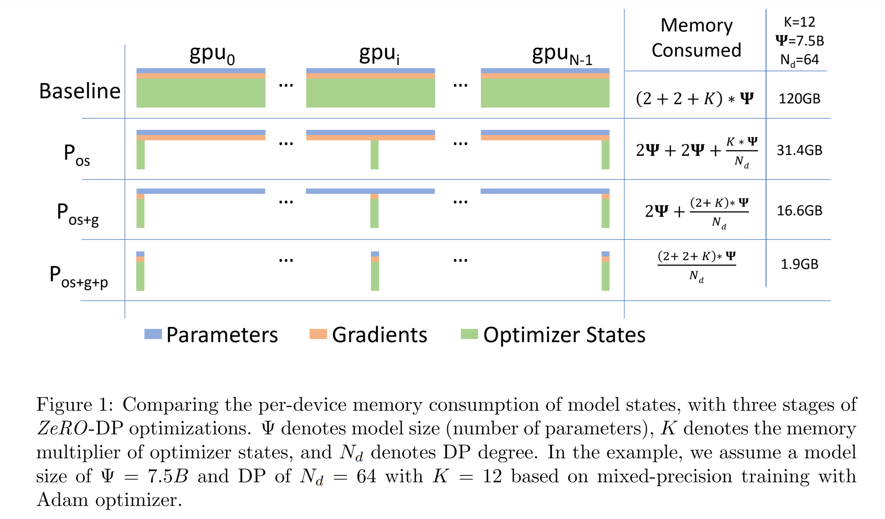
        </div>

        - [To be reviewed] The ZeRO figure estimates persistent model-state bytes for its stated mixed-precision Adam assumptions. It excludes activations, temporarily gathered parameters, communication buffers, and allocator overhead; its numbers are not a peak-memory guarantee for a current implementation.

    - [To be reviewed] **FSDP** supplies PyTorch-native fully sharded data-parallel training with configurable resharding and precision behavior. Activation checkpointing and CPU offload are separate memory/computation choices; neither is equivalent to full state sharding. Profile their combined behavior under the actual configuration.

    - [To be reviewed] Ordinary replicated data parallelism processes different local data on each replica and synchronizes gradients; it should not be confused with the persistent-state layout of fully sharded training.

- Model parallel
    - [To be reviewed] Pipeline (horizontal) parallel [[GPipe](https://arxiv.org/abs/1811.06965)]: split layers across multi-GPUs when model is too large.

        - Split consecutive layers into stages and send microbatch activations between them. A simple synchronous fill/drain schedule with $`p`$ balanced stages and $`m`$ microbatches has idealized utilization about $`m/(m+p-1)`$, ignoring communication and imbalance.
        - **Example:** four stages and eight microbatches yield about 8/11 utilization in that simplified model. More microbatches reduce the fractional bubble but can increase activation storage or reduce per-microbatch kernel efficiency. 1F1B schedules trade scheduling complexity and memory against idle time; they are not unique to one model family. [GPipe](https://arxiv.org/abs/1811.06965), [Megatron schedules](https://arxiv.org/abs/2104.04473)

        - [To be reviewed] Pipeline bubbles arise from schedule fill/drain, dependencies, and imbalance. 1F1B schedules predate DeepSeek and are not the defining novelty of DualPipe or another particular pipeline schedule.
    - [To be reviewed] Tensor (vertical) parallel

        - Shard individual linear transformations or attention heads across devices. Column- and row-parallel matrix multiplications place collectives at chosen points so the composed operation matches the unsharded mathematical computation.
        - **Example:** split an MLP expansion across four GPUs, then combine partial outputs in its contraction. Tensor parallelism saves per-device weight/activation memory but adds frequent communication, so fast interconnects are valuable. A dimension must satisfy the implementation's partitioning requirements. [Megatron-LM](https://arxiv.org/abs/1909.08053)

        - [To be reviewed] Sequence(Activation) parallel

            - In Megatron-style sequence parallelism, shard sequence-dimension activations for operations such as normalization and dropout around tensor-parallel layers, using appropriate collectives to transition layouts. This reduces replicated activation storage.
            - Distinguish this from **context parallelism**, which partitions long-context attention work and communicates K/V information across sequence partitions. **Example:** merely slicing a sequence and performing independent attention on each slice changes the model by deleting cross-slice dependencies. [Activation-memory analysis](https://arxiv.org/abs/2205.05198)


    - [To be reviewed] Expert (MoE) parallel

        - Place different MoE experts on different devices, route token representations to the selected experts, then return and combine their outputs. The all-to-all routing pattern and expert load balance are central systems costs.
        - **Example:** a top-2 router can select two experts per token while many other expert weights remain resident. Active parameter count describes selected computation, while total expert count still affects storage and communication. Track routing imbalance, capacity handling, and tokens dropped or rerouted. [Switch Transformers](https://jmlr.org/papers/v23/21-0998.html), [DeepSeek-V3](https://arxiv.org/abs/2412.19437)


- [To be reviewed] Hybrid parallel

    - Combine orthogonal partition axes. For a dense setup with independent data, tensor, and pipeline groups, a simple device-count decomposition is $`N=d\times t\times p`$. Context or expert axes require the implementation's specific grouping semantics.
    - **Example:** on 64 GPUs, $`d=8,t=4,p=2`$ is one feasible topology, not a performance recommendation. Match tensor-parallel communication to the fastest links, balance pipeline stages, and profile whether data-parallel communication overlaps computation. [Large-scale parallel training](https://arxiv.org/abs/2104.04473)

- [To be reviewed] Choosing the right parallelism strategy (memory, efficiency, complexity trade-offs)

    - Estimate memory by component: weights, gradients, optimizer states, activations, temporary buffers, and communication buffers. Then locate the bottleneck: capacity, memory bandwidth, compute, interconnect bandwidth, or pipeline imbalance.
    - **Example:** if optimizer state dominates, state sharding can help without introducing tensor collectives inside every layer. If one layer cannot fit on a GPU, layer-level partitioning or another memory strategy is needed. Compare tokens/second, step time, peak memory, communication fraction, and recovery cost at the same global batch and sequence lengths.


| Method                     | What is Split?                  | Type of Parallelism             |
|----------------------------|---------------------------------|---------------------------------|
| **Tensor Parallelism**     | Weights/tensors                 | Model parallelism               |
| **Pipeline Parallelism**   | Layers                          | Model parallelism               |
| **Expert Parallelism (MoE)** | Experts (modules)               | Model parallelism (MoE)         |
| **Data Parallelism**       | Input data batches              | **NOT** model parallelism       |
| **ZeRO Parallelism**       | Optimizer states, gradients, and/or parameters by stage | State/parameter sharding |

<a id="fine-tuning"></a>
<a id="update-parameterization"></a>
#### [To be reviewed] Update Parameterization and PEFT

Choose an update parameterization independently of the stage/objective. The mechanisms below can support suitable SFT, RL, or distillation training; compare quality, trainable-state memory, activation cost, checkpoint management, and serving integration.

- Types
    - [To be reviewed] Full fine-tuning vs Parameter-efficient fine-tuning

        - Full fine-tuning updates the backbone; PEFT constrains adaptation to a smaller parameter set. The relevant trade-off includes optimization freedom, data scale, trainable-state memory, checkpoint management, and inference integration.
        - **Example:** a small domain dataset may favor a constrained adapter for regularization and maintainability, while a broad distribution change may justify full adaptation. Compare with matched hyperparameter-search effort and inspect both target performance and retained general capabilities.

    - Parameter-efficient fine-tuning (PEFT) [[paper](https://arxiv.org/pdf/2110.04366)]
        - [To be reviewed] Prompt/Prefix Tuning

            - Prompt tuning learns continuous input prompt embeddings with a frozen backbone. Prefix tuning learns additional continuous prefix states, commonly supplied to attention across layers. Their parameters are not ordinary human-readable prompt text.
            - **Example:** one shared backbone can switch tasks by loading different learned prefixes. Prefix length affects attention work and context usage, and effectiveness depends on model/task scale. [Prefix tuning](https://arxiv.org/abs/2101.00190), [prompt tuning](https://arxiv.org/abs/2104.08691)

        - [To be reviewed] Adapters

            - Insert trainable bottleneck modules inside a frozen model, often with a residual form $`h'=h+W_{\mathrm{up}}\,\sigma(W_{\mathrm{down}}h)`$. The bottleneck limits trainable parameters while permitting nonlinear adaptation.
            - **Example:** maintain separate adapters for legal and biomedical tagging over one encoder. Added modules can add runtime work unless the implementation can fuse or otherwise optimize them. Choose insertion locations and bottleneck size through held-out evaluation. [Adapter paper](https://arxiv.org/abs/1902.00751)

        - [To be reviewed] LORA [[YouTube](https://www.youtube.com/watch?v=eC6Hd1hFvos&t=959s)]

            - Parameterize a frozen matrix's update as $`\Delta W=(\alpha/r)BA`$, with $`A\in\mathbb{R}^{r\times d_{\mathrm{in}}}`$ and $`B\in\mathbb{R}^{d_{\mathrm{out}}\times r}`$. This trains $`r(d_{\mathrm{in}}+d_{\mathrm{out}})`$ parameters rather than $`d_{\mathrm{in}}d_{\mathrm{out}}`$ for that matrix.
            - **Illustrative calculation:** a 4,096-by-4,096 matrix has 16,777,216 entries; rank 16 adds 131,072 entries, about 0.78%. Rank, scaling, target modules, initialization, and data all matter. A merge can remove adapter matmul overhead when precision and deployment constraints permit it. [LoRA](https://arxiv.org/abs/2106.09685)

        - [To be reviewed] QLoRA trains adapters through a frozen four-bit base representation; its original recipe includes NF4, double quantization, and paged optimizers to manage some memory spikes. Paging is not a guarantee against every OOM, and dequantized computation/activations still consume memory. [QLoRA](https://arxiv.org/abs/2305.14314)
        - [To be reviewed] BitFit tunes existing bias parameters in the studied architecture. A bias-free Transformer may expose few or none of those parameters; apply the method only after inspecting the actual parameterization. [BitFit](https://arxiv.org/abs/2106.10199)
- [To be reviewed] When and why to freeze layers

    - Freezing removes parameter updates and optimizer states for selected weights, but gradients may still need to pass through a frozen operation to reach an earlier trainable component. Activation savings depend on the resulting computation graph.
    - **Example:** training only a classifier on fixed encoder features can cache the features; training input-side prompts through a frozen encoder still requires backpropagation through that encoder. Decide based on adaptation needs, available data, and measured memory, rather than trainable-parameter count alone.

- [To be reviewed] Layer-wise learning rates & layer freezing strategies

    - Layerwise learning-rate decay assigns smaller steps to selected lower layers, while gradual unfreezing changes which layers train over time. These are separate controls over plasticity.
    - **Example:** begin with a task head, then unfreeze upper encoder blocks if the representation is insufficient. Evaluate against a uniform-learning-rate baseline; the assumption that lower layers should move less can fail under a large domain change. Restore optimizer/scheduler behavior correctly when adding newly trainable parameters.

<a id="llm-quantization"></a>
#### [To be reviewed] Quantization and Storage Precision

- Quantization maps high-precision values into a lower-bit representation with scales and sometimes zero points. Distinguish weight-only from weight-and-activation quantization, post-training quantization from quantization-aware training, and per-tensor from finer-grained scaling.
- QLoRA stores a frozen base in a low-bit representation and trains higher-precision adapters; it does not directly optimize every four-bit base weight. Quantization metadata, adapters, activations, and caches add memory beyond the nominal bit count. **Example:** compare downstream accuracy and rare-token behavior after quantization, plus throughput on the actual kernels. [QLoRA](https://arxiv.org/abs/2305.14314)

#### [To be reviewed] Training Toolchains

- TRL supplies training workflows for language-model post-training, including supervised and preference/RL objectives. Select a trainer based on the actual data and objective: demonstration records, preferred/rejected pairs, and online reward functions are not interchangeable inputs.
- **Reproducibility:** record library versions, model and tokenizer revisions, chat template, loss masks, reward code, and checkpoint-resume state. A supported trainer does not validate the correctness of the training data or reward. [TRL documentation](https://huggingface.co/docs/trl/index)

State/parameter sharding is described once in [Distributed Training](#distributed-training); it can be combined with full tuning or PEFT. Use the actual model/tokenizer revisions, loss masks, sampler, reward/verifier code, and framework versions to define a run.

<a id="optimization-and-efficiency"></a>
#### [To be reviewed] Accumulation, Checkpointing, and Communication
- [To be reviewed] Gradient accumulation

    - Accumulate gradients across microbatches before an optimizer step. For equal-sized microbatches, scale each mean loss by the number of accumulation steps to recover the large-batch mean gradient. With variable valid-token counts, normalize by the total relevant token count instead.
    - **Example:** averaging a 10-token microbatch loss and a 100-token microbatch loss weights their tokens differently from a global token mean. Dropout, batch normalization, clipping frequency, and floating-point accumulation can also prevent exact equivalence to one physical large batch. [AMP accumulation example](https://docs.pytorch.org/docs/stable/notes/amp_examples.html#gradient-accumulation)

- [To be reviewed] Activation checkpointing
    - Activation checkpointing/ Activation recomputation: Recompute some activations during the backward pass. Store some activations during the forward pass as checkpoints. Discard other activations and recompute them during the backward pass.
        - Save memory but take longer to compute.
    - [To be reviewed] For equal microbatches, global batch size is $`B_{\mathrm{global}}=B_{\mathrm{micro}}\,A\,D`$, where $`A`$ is accumulation steps and $`D`$ is data-parallel replicas. Normalize gradients/loss by the intended total example or valid-token count. “Average gradients” needs that explicit weighting when microbatch lengths differ.
        - could be combined with multi-GPU techniques.
        - [To be reviewed] Overlap + bucketing

            - Launch communication for ready gradient buckets while backward computation continues. Bucket size trades launch overhead against how early overlap begins. Some distributed implementations can suppress repeated synchronization during accumulation and synchronize on the final microbatch.
            - **Example:** if every microbatch synchronizes despite eight-step accumulation, communication cost can be much larger than expected. Verify traces and framework semantics; excessive communication buffers can also raise peak memory. [DDP design notes](https://docs.pytorch.org/docs/stable/notes/ddp.html)

<a id="llm-inference"></a>
### [To be reviewed] Inference and Serving

- [To be reviewed] Inference Framework

    - Separate **prefill**, which processes known prompt tokens, from **decode**, which appends generated tokens while reading cached keys/values. KV caching removes repeated projection/computation for prior tokens but its storage grows with active sequence length and concurrency.
    - For a conventional cache with $`L`$ layers, $`B`$ sequences, $`T`$ cached tokens, $`H_{\mathrm{KV}}`$ KV heads, head width $`d_h`$, and $`b`$ bytes per element, storage is approximately $`2LBTH_{\mathrm{KV}}d_hb`$. This excludes metadata and temporary buffers; compressed-cache architectures need their own model.
    - **Illustrative calculation:** 32 layers, 8 KV heads, width 128, two-byte cache, and 8,192 tokens consume 1 GiB per sequence. At 32 such concurrent sequences, that alone reaches 32 GiB. GQA reduces cache head count; paged allocation reduces fragmentation. [GQA](https://arxiv.org/abs/2305.13245), [PagedAttention](https://arxiv.org/abs/2309.06180)
    - Speculative decoding drafts several tokens and verifies them with a target model. Exact speculative-sampling algorithms preserve the target distribution under their acceptance/correction rules; accepting arbitrary drafts does not. Speedup depends on acceptance, draft cost, and hardware. [Speculative decoding](https://arxiv.org/abs/2211.17192)


- [To be reviewed] Model Serving

    - Continuous batching admits new requests as others finish, improving utilization for variable-length generation. Admission control should budget prompt work, active KV cache, and expected output work; a fixed request count does not characterize load.
    - **Example:** a few 100k-token prompts can monopolize prefill and harm short-request latency. Compare time to first token, inter-token latency, end-to-end latency, and throughput under specified prompt/output length distributions and arrival rates. Report p50/p95/p99 and the fraction meeting a latency objective, not only peak tokens/second.
    - Prefix caching requires exact compatibility of token prefix, model state, and cache semantics. Quantization and parallelism change both capacity and numerical behavior; benchmark quality as well as latency. Record model/tokenizer versions, sampling settings, cache policy, and error/timeout rates. [Serving system design](https://arxiv.org/abs/2309.06180)

<a id="evaluation-and-monitoring"></a>
### [To be reviewed] Evaluation and Monitoring
- Evaluation metrics
    - [To be reviewed] Perplexity

        - Perplexity is $`\exp[-N^{-1}\sum_{t=1}^N\log p_\theta(x_t\mid x_{<t})]`$ for a specified tokenization and context protocol. Use valid target tokens only; masking, document boundaries, and truncation change the quantity being measured.
        - **Example:** lower held-out perplexity may coexist with worse instruction following. Compare like-for-like tokenizers and corpora, and pair perplexity with task metrics. If tokenizers differ, report a common text-normalized likelihood measure with explicit conventions.

    - [To be reviewed] Human-evaluated metrics (helpfulness, harmlessness, alignment)

        - Define rubrics for correctness, groundedness, instruction adherence, usefulness, and relevant harm categories. Blind and randomize model identity and response order; allow ties and report annotator disagreement.
        - **Example:** evaluate whether a cited answer is supported by the supplied source separately from whether its claim happens to be true. Use paired uncertainty estimates clustered by prompt when multiple samples share a question. Preference scores depend on the judge population and rubric. [Evaluation practices](https://arxiv.org/abs/2211.09110)

    - [To be reviewed] Automated evaluation metrics (ROUGE, BLEU, BERTScore)

        - BLEU measures modified n-gram precision with a brevity penalty; ROUGE variants emphasize lexical overlap or subsequences; BERTScore aligns contextual token embeddings. Their scoring conventions differ, and they are not direct measures of factual correctness.
        - **Example:** “the treatment increased mortality” and “the treatment decreased mortality” share most words. A high overlap score can miss the consequential error. For verifiable tasks, add execution, exact symbolic checks, or evidence-based factual assessment, and correlate any automated judge with human audits. [BLEU](https://aclanthology.org/P02-1040/), [ROUGE](https://aclanthology.org/W04-1013/), [BERTScore](https://arxiv.org/abs/1904.09675)

- Monitoring and Logging
    - [To be reviewed] wandb

        - Track data/model/configuration versions, optimizer and scheduler state, loss by task and length, gradient norms, nonfinite events, throughput, and memory. A run dashboard is useful only if its logged quantities have stable definitions.
        - **Example:** a sudden loss jump can come from a changed data mixture rather than optimizer instability. Log consumed-token distributions and checkpoints around transitions. Avoid putting private training examples into a shared dashboard unless the data policy permits it. [W&B experiment tracking](https://docs.wandb.ai/models/track)

    - [To be reviewed] TensorBoard

        - Use scalar series for losses and learning rates, histograms for diagnostic distributions, and a profiler for operator, memory, and communication behavior. Tag experiments consistently and preserve raw configuration alongside plots.
        - **Example:** two runs can have the same training loss but very different useful tokens/second because one spends time on padding or synchronization. A wall-clock and profiler comparison distinguishes the bottleneck. [TensorBoard guide](https://www.tensorflow.org/tensorboard/get_started)

### RAG

[[ANLP](https://www.youtube.com/watch?v=KfQaYk4k9eM)]
<a id="retrieval"></a>
#### [To be reviewed] Retrieval

- **Sparse retrieval:** BM25 uses exact term matches with term-frequency saturation and length normalization. Preserve identifiers and important terminology during tokenization. **Dense retrieval:** a bi-encoder scores separately encoded queries and passages, enabling precomputed passage vectors and approximate nearest-neighbor search. Dense models can recover paraphrases but can miss exact constraints. [BM25 textbook](https://nlp.stanford.edu/IR-book/html/htmledition/okapi-bm25-a-non-binary-model-1.html), [DPR](https://arxiv.org/abs/2004.04906)
- **Hybrid retrieval:** take the union of sparse and dense candidates, deduplicate, and fuse rankings. Reciprocal rank fusion uses $`\operatorname{RRF}(d)=\sum_r 1/(c+\operatorname{rank}_r(d))`$ over rankings containing the document; $`c`$ is a chosen damping constant. Rank fusion avoids directly averaging incompatible BM25 and cosine score scales. [Original RRF paper](https://doi.org/10.1145/1571941.1572114)
- **Example:** for “E137 after firmware 2.1,” sparse matching preserves the exact code/version while dense search finds a paraphrased troubleshooting description. Filter by the applicable product/version and access permissions. A relevant passage for a different version is a retrieval error even if its semantic score is high.
- **Diagnosis:** separately measure representation quality, ANN search loss against exact vector search, filtering correctness, and candidate recall. A reranker cannot recover a passage absent from its candidate pool. For evidence-required QA, candidate evidence recall constrains grounded answer coverage. Evaluate no-retrieval, sparse, dense, and hybrid baselines on the same corpus snapshot.

- Sparse retrieval (BM25, TF-IDF based retrival)
- Dense retrieval (Embedding-based retrieval)
- Hybrid retrieval

<a id="embedding-models"></a>
#### [To be reviewed] Embedding models

- A retriever embedding is trained for a scoring geometry, often contrastive similarity between queries and relevant documents. Model labels such as “SentenceTransformers,” E5, and GTE describe families or tooling; actual checkpoint, training data, task instructions, normalization, and maximum length matter.
- **Selection protocol:** create domain-specific query/relevance pairs; evaluate multilingual slices, rare entities, negation, exact constraints, and hard negatives. Sentence similarity and document retrieval test different capabilities. Choose vector dimension and quantization jointly with recall, memory, indexing time, and query latency. [Sentence-BERT](https://aclanthology.org/D19-1410/), [BEIR](https://arxiv.org/abs/2104.08663)
- **Example:** a query asking for an exception to a policy should not retrieve only the general rule because the two are semantically similar. Include the general-rule passage as a hard negative when it does not answer the exception question; check for alternative valid positives before labeling negatives.
- If the encoder, tokenizer, instructions, pooling, or normalization changes, treat the embedding index as versioned derived data and assess whether re-embedding is required. Compare providers using measured retrieval quality and operational constraints; avoid assuming a product's current model name or dimensionality from a historical note.
- **Metric definition:** for a query with a known relevant set $`R_q`$, $`\operatorname{Recall@k}=|\operatorname{TopK}(q)\cap R_q|/|R_q|`$. Some QA benchmarks instead report the fraction of queries with at least one answer-bearing passage in the top k; name that hit-rate definition explicitly. Incomplete judgments limit both interpretations.

- Open-source models (SentenceTransformers, E5, GTE)
- Commericial APIs (OpenAI Embedding, Cohere embedding)
- How to choose embedding models
    - Semantic vs lexical relevance
    - Embedding dimension, speed, accuracy trade-offs
- Evaluation
    - Retrieval accuracy metrics(Recall@k, MRR)
    - Semantic similarity tasks (STS benchmarks)

<a id="chunking-and-vectorization"></a>
#### [To be reviewed] Chunking and Vectorization

- Chunking defines the retrieval unit, not merely a preprocessing convenience. Small chunks can sharpen matching but omit definitions and qualifiers; large chunks preserve context but dilute relevance and consume the generator's budget. Overlap reduces boundary loss while increasing duplication and index size.
- Start with structure-aware boundaries such as headings, paragraphs, code blocks, and table rows, then enforce token limits. Fixed-size, recursive, and semantic splitters should be compared against the same evidence set; semantic boundaries can also be wrong. Keep parent-document identity, offsets, dates, and section paths. [Document-structure partitioning reference](https://docs.unstructured.io/open-source/core-functionality/partitioning)
- **Example:** a policy says “coverage lasts 90 days” in one paragraph and “except refurbished units: 30 days” in the next. Splitting between them can retrieve a fluent but incorrect answer. Retrieve a small child chunk for matching, then expand to a bounded parent span for generation when appropriate.
- **Experiment:** sweep chunk length and overlap under a fixed total context budget, deduplicate overlapping hits, and measure evidence coverage plus grounded answer accuracy. Also measure index size and latency. There is no universal optimal chunk size or overlap ratio. [Retrieval-augmented generation](https://arxiv.org/abs/2005.11401)
- Do not allow chunks from the same source document to leak across development and test splits. Preserve tables and equations as coherent units where possible; a token budget that truncates a table's header can change its meaning.

- Importance of chunking
    - Optimal chunk size
    - Overlapping vs non-overlapping chunking
- Chunking strategies
    - Semantic chunking vs fixed-size chunking
    - Recursive chunking methods
- Impact of chunking strategy on retrieval quality and generation accuracy

<a id="re-ranking"></a>
#### [To be reviewed] Re-ranking

- A cross-encoder jointly processes a query and candidate passage to estimate relevance; it captures token interactions that independent single-vector encoding compresses away. Its pairwise computation makes it suitable for a shortlist rather than an entire large corpus. Late-interaction retrievers such as ColBERT offer another trade-off by retaining token-level representations. [Cross-encoder reranking](https://arxiv.org/abs/1901.04085), [ColBERT](https://arxiv.org/abs/2004.12832)
- Score normalization and rank fusion combine retrieval systems; query expansion changes the query or candidate set. They are not automatically learned rerankers. Define the stage and candidate pool precisely when reporting an improvement.
- **Example:** rerank the top 100 retrieved passages into 10 context candidates, then remove redundant overlapping spans. A passage with the correct entity but wrong effective date should be a difficult negative. Train and evaluate with negatives representative of first-stage retrieval, not only random unrelated passages.
- **Metrics:** reciprocal rank is $`1/r`$ for the first relevant result, with zero if none appears; average precision averages precision at relevant ranks and divides by the number of known relevant items under the chosen protocol. Precision@k emphasizes top-k cleanliness; graded NDCG can reward strongly relevant evidence more than marginally useful passages. State truncation and judgment conventions.
- **Toy example:** relevance sequence [1, 0, 1] with exactly two relevant items gives AP $`(1+2/3)/2=5/6`$ and reciprocal rank 1. These metrics capture different properties. Report evidence recall before reranking and final answer performance to locate the source of any gain.

- Importance
- Methods of re-ranking
    - Cross-encoders (dense re-rankers)
    - Traditional re-ranking (score normalization ,query expansion)
    - Learned re-ranking (supervised methods)
- Evaluation
    - MAP
    - MRR
    - Precision @k

<a id="generation"></a>
#### [To be reviewed] Generation

- Construct an evidence package with clear document boundaries, source IDs, relevant metadata, and an explicit task. Require citations to refer to supplied source IDs and assess support at the claim level. Retrieved text is untrusted data; instructions embedded in documents should not override the application's task or permission boundaries.
- **Example:** when sources disagree about a warranty duration, compare product scope and effective date before answering. If the evidence cannot resolve the conflict, return the bounded uncertainty rather than silently selecting the more convenient passage.
- **Context budget:** reserve space for the system/task instructions, conversation, evidence, and output. Deduplicate and choose complementary passages. More context is not automatically better; measure sensitivity to distractors and evidence position. [Lost in the Middle](https://arxiv.org/abs/2307.03172)
- **Fusion-in-Decoder:** the published FiD architecture encodes question-passage pairs separately and lets a decoder attend to the combined encoder representations. This differs from concatenating all passages into a single decoder-only prompt. The former reduces cross-passage interaction in the encoder while retaining cross-passage aggregation in the decoder. [FiD](https://arxiv.org/abs/2007.01282)
- **Evaluation:** independently test retrieval relevance, evidence coverage, answer correctness, citation precision/coverage, and abstention on unanswerable queries. Use oracle-evidence and deliberately irrelevant-evidence ablations to separate retrieval failures from generation failures. Automated faithfulness judges need calibration against human-checked examples. [RAG evaluation framework](https://arxiv.org/abs/2309.15217)
- Retrieval makes knowledge easier to refresh and inspect; it cannot guarantee factuality when documents are false, stale, irrelevant, or misread by the generator.

- Incorporating retrieved context into generation
    - prompt engineering for RAG
    - context window management
- Handling large contexts effectively
    - Fusion-in-Decoder
    - Long-context Transformers
- Mitigating hallucinations through retrieval context management


### Q&A System
<a id="types-of-qa-systems"></a>
#### [To be reviewed] Types of QA Systems

- **Factoid versus explanatory** describes answer form; **extractive versus generative** describes how the answer is produced. These axes are not equivalent: a generated answer may be a one-word factoid, and an extracted passage may contain an explanation.
- **Open-domain versus closed-domain** describes the scope of questions or knowledge sources. RAG is a system architecture that retrieves evidence before generation, rather than a mutually exclusive alternative to an LLM-based system.
- **Example:** “What is the release date?” can be answered by an extractive span reader or a generative RAG model. “Why did the launch move?” may require synthesizing several dated documents. A corpus-bounded support assistant should be evaluated on whether its permitted sources support the answer, even when the base model remembers a plausible answer from elsewhere. [SQuAD task definition](https://arxiv.org/abs/1606.05250), [RAG architecture](https://arxiv.org/abs/2005.11401)

- Factoid (simple answer, extractive)
- Non-factoid (explanatory, abstractive)
- Open-domain vs Closed-domain Q&A
- Traditional Q&A vs RAG vs LLM-based Q&A

<a id="components-of-qa-systems"></a>
#### [To be reviewed] Components of QA Systems

- **Question processing:** resolve conversational references, classify required answer type, extract entities and constraints, and decide whether decomposition or clarification is needed. Preserve negation, units, dates, and access scope when rewriting a query.
- **Retrieval:** retrieve candidates, enforce corpus and permission constraints, rerank, and build a provenance-preserving evidence set. **Reading/generation:** either predict answer spans with a calibrated no-answer option or synthesize an answer constrained by the evidence. [DPR](https://arxiv.org/abs/2004.04906), [SQuAD 2.0](https://arxiv.org/abs/1806.03822)
- **Post-processing:** validate structured output, normalize units where justified, check citation support, merge duplicate claims, and decide whether confidence meets the task's threshold. Token probability is not automatically a calibrated probability that an entire answer is correct.
- **Example:** for “How much did revenue change from 2023 to 2024?”, retrieve both comparable figures, confirm currency and fiscal periods, compute $`(R_{2024}-R_{2023})/R_{2023}`$, and cite both values. A correct subtraction using mismatched fiscal scopes is still a wrong answer. Use a calculator or code for arithmetic and preserve the supporting evidence.
- Evaluate each interface separately: query-rewrite fidelity, evidence recall, reader accuracy given gold evidence, and complete-system answer quality. A single end-to-end score does not identify which component needs improvement.

- Question Processing
    - Question type classification (factoid, procedural, descriptive)
    - Query parsing and expansion

- Document/Passage Retrieval
    - Dense retrieval (embedding-based retrieval)
    - Sparse retrieval (BM25, TF-IDF)
    - Hybrid approaches
    - Re-ranking of retrieved passages

- Answer Extraction/Generation
    - Extractive Q&A (span-based)
    - Generative Q&A (abstractive, using LLMs)

- Answer Post-processing
    - Summarization, filtering irrelevant answers
    - Confidence scoring and answer ranking


<a id="evaluation"></a>
#### [To be reviewed] Evaluation

- **Extractive QA:** normalized exact match checks answer-string agreement; token F1 measures overlap with reference answer tokens under a specified normalization. Multiple valid reference spans may be needed. The evaluator's tokenizer and treatment of articles, punctuation, and aliases are part of the metric.
- **Example:** “NYC” and “New York City” can be semantically equivalent but score differently without alias handling. For unanswerable questions, assess both answer accuracy and the error/coverage trade-off of abstention. Select the abstention threshold on development data. [SQuAD evaluation](https://arxiv.org/abs/1606.05250), [unanswerable QA](https://arxiv.org/abs/1806.03822)
- **Generative QA:** report factual/task correctness, completeness of required claims, source support, citation quality, and usefulness. BLEU, ROUGE, and METEOR compare reference-text similarity; METEOR can align variants such as stems and synonyms under its resources. Similarity remains an imperfect proxy for supported correctness. [METEOR](https://aclanthology.org/W05-0909/)
- **Failure localization:** compare retrieved evidence with gold evidence, and the reader with oracle evidence. Group errors into missing evidence, wrong interpretation, unsupported generation, and inappropriate answer/abstention. Report uncertainty clustered by source or question family when examples are dependent.
- Keep a temporal or source-separated test set, include conflicting/outdated sources, and compare against a simple extractive or retrieval baseline. Human review should use a written rubric and blinded model identity.

- Extractive Q&A Evaluation
    - Exact Match
    - F1-score
- Generative Q&A Evalution
    - ROUGE
    - BLEU
    - METEOR score
    - Human evaluation


<a id="reasoning"></a>
### [To be reviewed] Reasoning

- **Reasoning setup:** specify the problem representation, allowed tools, answer verifier, and compute budget. Multi-step prompting can improve some tasks; a persuasive written rationale is not independent proof of a correct answer or a faithful account of internal computation. [Chain-of-thought prompting](https://arxiv.org/abs/2201.11903)
- **Search and selection:** sample multiple candidates, decompose a problem, or search over partial solutions. A useful verifier can turn additional computation into better answer selection; a biased verifier can instead amplify a systematic error. Compare search to ordinary resampling at matched generated-token and tool budgets. [Tree of Thoughts](https://arxiv.org/abs/2305.10601)
- **Supervision:** outcome rewards assess the final result; process supervision labels intermediate steps. Verifiable arithmetic, tests, or formal proof checking provide more direct feedback than a style preference, though each verifier has a limited specification. [Process supervision](https://arxiv.org/abs/2305.20050)
- **Example:** a generated program may pass visible tests while failing hidden edge cases. Keep evaluation tests out of the policy's feedback loop when claiming held-out generalization; otherwise the system is adapting to those tests.
- **Measurement:** report pass@1 and a specified sampling/selection protocol. With $`n`$ sampled candidates and $`c`$ successes, the common estimator is $`\widehat{\operatorname{pass@k}}=1-\binom{n-c}{k}/\binom{n}{k}`$ for $`n\geq k`$, using zero for impossible numerator combinations. Oracle pass@k is different from the success rate of a deployable selector that cannot see correctness labels. [Code-model evaluation](https://arxiv.org/abs/2107.03374)
- Sweep inference budgets, report latency and cost alongside correctness, and test transfer to new problem families. Additional tokens or a higher reward on the training distribution do not establish a general reasoning capability.

- [To be reviewed] Information seeking

    - Turn an information need into successive evidence-gathering actions: formulate a query, inspect sources, update the evidence state, and decide whether another query is useful. ReAct interleaves reasoning-oriented generation with environment actions and observations. [ReAct](https://arxiv.org/abs/2210.03629)
    - **Example:** answering a disputed release date may require the original announcement and a later correction. Track source dates and claim provenance, and stop when the available evidence resolves the question or a stated search budget is exhausted. Repeating equivalent searches is additional activity rather than additional evidence.


<a id="personalized-rec-system"></a>
### [To be reviewed] Personalized Rec-system

- **Problem definition:** estimate a user's preference conditional on their history, context, available items, and the exposure process. An unclicked item is not necessarily disliked; the user may never have seen it. Define the target utility explicitly, such as relevance, qualified watch time, or successful task completion.
- **Architecture:** use candidate generation to reduce a large catalog, a richer ranking stage to score candidates, and constrained reranking to enforce diversity, availability, or other product requirements. A two-tower retrieval model supports precomputed item embeddings; a ranking model can use query/user/item interactions that would be too expensive across the whole catalog. [YouTube recommendation architecture](https://research.google/pubs/deep-neural-networks-for-youtube-recommendations/)
- **Objectives:** matrix factorization can score $`s(u,i)=p_u^Tq_i+b_u+b_i`$. BPR uses observed positive/negative orderings with loss $`-\log\sigma(s(u,i)-s(u,j))`$ plus regularization. Sampled “negative” items reflect a training assumption; they are not verified dislikes. [BPR](https://arxiv.org/abs/1205.2618)
- **Sequence models:** a causal encoder of recent interactions can represent changing intent. SASRec uses self-attention over a user's sequence for next-item recommendation. Mask future interactions and keep training/evaluation time boundaries intact. **Example:** recent camera browsing may temporarily outweigh a user's older music history; a static user embedding can miss that shift. [SASRec](https://arxiv.org/abs/1808.09781)
- **Offline evaluation:** use chronological splits, prevent same-session leakage, and define the candidate set. Recall@k and NDCG@k under 100 sampled negatives can differ sharply from full-catalog ranking; report the negative-sampling protocol. Include cold-start users/items, popularity strata, catalog coverage, and latency.
- **Counterfactual issue:** logged feedback comes from an existing exposure policy. Inverse propensity weighting can correct certain selection effects only with valid propensities, overlap, and the relevant causal assumptions; tiny propensities create high variance. Randomized experiments or carefully designed exploration are often needed to test incremental utility. [Unbiased recommendation from logged feedback](https://arxiv.org/abs/1602.05352)
- **Illustrative experiment:** compare a popularity baseline, matrix factorization, and a sequential model under the same catalog/time split and serving budget. Then test the selected system online with predefined outcomes and guardrail metrics. Higher offline click prediction need not imply higher long-term user value.


<a id="recent-interesting-papers"></a>
### [To be reviewed] Recent interesting papers

This is a dated reading list selected on **2026-10-26**. Years indicate first public report dates. Reported results belong to each paper's model, data, hardware, and evaluation protocol; the questions below are suggested checks and experiments, not additional findings claimed by the papers.

| Paper | Main contribution to inspect | Research question / replication check |
| --- | --- | --- |
| [DeepSeek-V3 Technical Report](https://arxiv.org/abs/2412.19437) (2024) | A large MoE training system combining Multi-head Latent Attention, expert routing/load balancing, and multi-token prediction. | Separate active compute from total parameter storage. Which quality/throughput gains survive when data, training tokens, hardware topology, and inference budget are matched? Check what costs the reported training-compute accounting includes. |
| [DeepSeek-R1](https://arxiv.org/abs/2501.12948) (2025) | Studies reinforcement-learning-driven reasoning, an RL-only R1-Zero setup, and an R1 pipeline incorporating cold-start and other training stages. | Separate R1-Zero observations from the complete R1 recipe. Reproduce verifier definitions, sampling settings, output-length distributions, contamination checks, and gains at matched test-time compute. |
| [DAPO](https://arxiv.org/abs/2503.14476) (2025) | An openly described large-scale RL system emphasizing optimization and sampling details needed for reasoning-model training. | Ablate clipping, sampling, and length-handling changes under a fixed rollout-token budget. Does improved reward correspond to independently checked solution accuracy and transfer beyond the training-style benchmark? |
| [Qwen3 Technical Report](https://arxiv.org/abs/2505.09388) (2025) | Dense and MoE model families with integrated thinking/non-thinking behavior and inference-budget control. | Compare modes on the same questions and account for generated tokens, latency, and quality. Does a budget policy allocate effort to difficult examples, or simply produce longer outputs? |
| [Kimi K2.5: Visual Agentic Intelligence](https://arxiv.org/abs/2602.02276) (2026) | Joint text/vision training and an Agent Swarm framework for parallel task execution. | Separate modality-training gains from orchestration gains. Reevaluate with matched total tokens, tool calls, task permissions, and concurrency; distinguish reduced wall-clock latency from reduced total compute. |

For each paper, record **claim → assumptions → comparison baseline → ablation → uncertainty → failure cases**. Prefer the released implementation and the specific report revision used for reproduction; benchmark rank alone is insufficient to identify which mechanism caused an improvement.


## Reference
1. [Machine Learning/Data Science Interview Cheat sheets by Aqeel Anwar](https://sites.google.com/view/datascience-cheat-sheets#h.h40dwqqwv30w)


