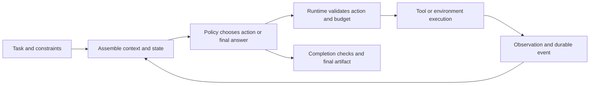

<a id="agents"></a>
# [To be reviewed] Agents

[Handbook contents](../README.md#table-of-contents) | [Previous: LLM Interpretability](llm-interpretability.md) | [Next: RSI & Harness](rsi-and-harness.md)

## Contents

- [Agent model and control loop](#agent-loop)
- [Tool use and action contracts](#agent-tools)
- [Planning and search](#agent-planning)
- [Memory and context](#agent-memory)
- [Workflows and orchestration](#agent-workflows)
- [Multi-agent systems](#agent-multi-agent)
- [Agent training](#agent-training)
    - [Supervised trajectories and preferences](#agent-sft)
    - [Online RL and credit assignment](#agent-rl)
    - [Distillation and execution/training interfaces](#agent-distillation)
- [Worked coding-agent example](#agent-example)
- [Evaluation and research comparisons](#agent-evaluation)

An LLM supplies a conditional distribution; an agent system uses a policy to choose actions, observes their consequences, and continues toward a task objective. Tools, environment state, memory, control flow, and execution limits all influence behavior. This chapter explains those mechanisms; [RSI & Harness](rsi-and-harness.md) covers their runtime implementation and improvement loops. [LLM training](large-language-models.md#post-training) and [Benchmarking & Evaluation](benchmarking-and-evaluation.md) provide the learning objectives and measurement framework. References were checked on **2026-10-27**; paper examples are scoped to their original setups.

<a id="agent-loop"></a>
## [To be reviewed] 1. An Agent Is a Policy in a Feedback Loop

A useful abstraction is a partially observed decision process. The environment has state s_t, the agent receives observation o_t, and the policy chooses an action from available history: $`a_t\sim\pi_\theta(\cdot\mid h_t)`$, where h_t includes the task, permitted observations, previous actions, and relevant memory. The environment produces a new state/observation after the action. A prompt transcript is a representation of history, not necessarily the complete environment state.

**Example:** a repository agent sees a test failure and a file excerpt. It does not know the whole dependency graph or filesystem merely because its context contains a confident summary. Reading another file is an information-gathering action; applying a patch changes the environment; running a test provides evidence about that change.



Separate **policy proposal**, **execution**, and **verification**. A model can propose a tool call without that call having run. A successful API response can establish one operation's result without establishing the overall task. A final answer can be fluent while its artifact fails validation. Maintain explicit evidence for each transition.

[ReAct](https://arxiv.org/abs/2210.03629) interleaves reasoning-oriented text and environment actions. Its observed benefits concern specified tasks and prompts; an agent need not expose a natural-language reasoning trace to implement the feedback loop. A written rationale is not a faithful record of all internal computation. See [Reasoning](reasoning.md).

<a id="agent-tools"></a>
## [To be reviewed] 2. Tool Use: From Predicted Arguments to Verified Effects

**Tool selection is a decision problem.** The policy chooses whether a tool is needed, which tool fits, valid arguments, and how to use the result. A lookup, calculator, search engine, database, shell, and browser supply different capabilities. Toolformer studies learning when/how to use APIs from tool-augmented data; it is a training method, whereas a function-call schema is an interface. [Toolformer](https://arxiv.org/abs/2302.04761)

| Contract component | Concrete example | Failure it helps expose |
| --- | --- | --- |
| Input meaning and schema | `read_file(path, start_line, end_line)` uses one-based inclusive lines | Correct JSON with incorrect units or argument meaning |
| Scope and preconditions | `apply_patch` checks repository and expected base revision | Stale edits or actions against the wrong target |
| Effect semantics | Search is read-only; a patch changes an artifact | Unsafe retry assumptions or misleading completion claims |
| Result / error schema | Return revision, exit status, output reference, and truncation metadata | Treating an exception, partial output, or timeout as success |
| Durable operation identity | A mutation has a request ID and queryable status | Duplicating an operation after an ambiguous timeout |
| Resource limits | Tool deadline, output cap, and permitted execution context | Infinite loops or a single call exhausting the task budget |

Here is an **illustrative event record**, not a universal tool protocol:

```json
{
  "run_id": "demo-run-17",
  "call_id": "patch-03",
  "tool": "apply_patch",
  "base_revision": "demo-rev-12",
  "status": "committed",
  "result_revision": "demo-rev-13",
  "artifact_ref": "patches/patch-03.diff"
}
```

The model should not invent this record from its intention. The executor supplies it after checking the actual outcome. A timeout can leave an operation's status unknown; inspect its durable status or resulting state before retrying a mutation. Idempotency keys help only when the backing tool implements appropriate deduplication and persistence.

**Schemas solve only part of the problem.** Structurally valid arguments can name the wrong account, file, or unit. The host enforces configured authorization, argument semantics, execution boundaries, and resource policies. Tool outputs and retrieved documents remain observations with provenance; their text does not automatically become control instructions. This distinction is central to [AgentDojo-style robustness evaluation](benchmarking-and-evaluation.md#eval-graders).

Tool protocols can standardize discovery and invocation. For example, the **2025-06-18 MCP tools specification** describes named tools and schemas; it does not, by itself, implement every server's domain semantics or an application's authorization decisions. Pin the protocol/implementation version when reproducing behavior. [MCP tools specification](https://modelcontextprotocol.io/specification/2025-06-18/server/tools)

The interface itself can affect capability: SWE-agent studies an agent-computer interface tailored to repository work. Compare interfaces with a fixed model and budget before attributing every gain to better planning or training. [SWE-agent](https://arxiv.org/abs/2405.15793)

<a id="agent-planning"></a>
## [To be reviewed] 3. Planning: Dependencies, Information Gathering, and Replanning

A useful plan specifies subgoals, dependencies, preconditions, observable completion conditions, and a resource allocation. A prose list alone does not establish that the next action is executable or that previous subgoals succeeded. Treat the plan as a revisable hypothesis about the environment.

| Pattern | Decision mechanism | Appropriate question / limitation |
| --- | --- | --- |
| Reactive action loop | Choose the next action from current evidence | Can local decisions recover from new information without extensive lookahead? |
| Plan then execute | Generate subgoals, execute, validate, and replan | Are dependencies stable enough for an initial decomposition? |
| Hierarchical planning | A controller delegates bounded subproblems to skills/workers | Can the subproblem contract be checked independently? |
| Search over alternatives | Expand candidate plans/actions and use feedback or a value estimate | Does better selection justify the extra simulator/tool cost? |

Tree of Thoughts searches over intermediate textual solution states; LATS combines tree search, actions, and environment feedback. Neither guarantees that a learned evaluator predicts real task success accurately. External API effects can be costly or irreversible, so arbitrary branch-and-undo search requires a simulator, isolated snapshots, or another explicit execution model. [Tree of Thoughts](https://arxiv.org/abs/2305.10601), [LATS](https://arxiv.org/abs/2310.04406)

**Coding example:** inspect the failing test before choosing a patch. Reading the date parser and checking the documented timezone contract are prerequisites; drafting release notes is independent only after the behavior change is known. A failed test may reveal a mistaken plan, an incorrect edit, or a broken test environment. Diagnose that distinction before asking the model to repeat the same plan more forcefully.

**Parallelism follows dependencies.** Independent file reads or independent experiments can overlap. A test of the new patch must wait for that patch; two uncoordinated writes to the same file can race. LLMCompiler is a representative study of dependency-aware parallel function execution. [LLMCompiler](https://arxiv.org/abs/2312.04511)

Specify a stopping rule: verified task completion, a resource/deadline limit, or an explicit unresolved blocker. Continuing to generate plans after the available evidence cannot resolve a blocker is additional work without demonstrated value. Compare planning strategies at matched total inference/tool budgets.

<a id="agent-memory"></a>
## [To be reviewed] 4. Memory: Stored Experience, Retrieved Context, and Authoritative State

| Memory form | Example | Update / retrieval question |
| --- | --- | --- |
| Working context | Current task, recent observations, pending actions | What must remain available for the next decision? |
| Episodic experience | A previous failed patch and its verified test outcome | Is the old episode relevant to this environment/version? |
| Semantic knowledge | A source-backed product or codebase fact | What source supports it, and when does it expire? |
| Procedural / skill memory | A tested script or reusable task routine | Are its assumptions and dependencies still valid? |
| External task state | Revision IDs, job status, completed artifacts | Which system is authoritative, and how is state reconciled? |

These are useful functional categories, not a uniquely standardized taxonomy. A vector store implements one retrieval mechanism; it does not make every stored statement accurate or every retrieved episode applicable. Parameter learning is another mechanism with different update and retention properties.

MemGPT explores movement between limited active context and external memory. Reflexion stores feedback/reflections for later trials without updating model weights; Voyager grows a library of executable skills in its Minecraft setup. Their distinct mechanisms should be evaluated separately. [MemGPT](https://arxiv.org/abs/2310.08560), [Reflexion](https://arxiv.org/abs/2303.11366), [Voyager](https://arxiv.org/abs/2305.16291)

**Context construction** selects instructions, tool definitions, observations, relevant memories, and unresolved constraints under a token budget. Retrieval and compaction can lose qualifiers, evidence, or pending operation status. Preserve exact artifact references and structured task fields alongside summaries; a summary saying “tests passed” should point to the tested revision and log. [Context-engineering discussion](https://www.anthropic.com/research/effective-context-engineering-for-ai-agents)

**Example:** an earlier episode says that a parser assumes UTC. The current version may have introduced a user-timezone parameter. Retrieve the episode as a lead, inspect current code/tests, and record whether it still applies. Storing an obsolete inference as a timeless fact can turn memory into a repeated-error mechanism.

Measure memory by downstream success, retrieval relevance, invalid/stale memories, and retention on unrelated tasks. Compare no memory, raw recent history, structured state, retrieved episodes, and a matched-token summary. More stored text or a longer context window is not itself evidence of better memory.

<a id="agent-workflows"></a>
## [To be reviewed] 5. Workflows: Explicit Control Flow Around Model Decisions

In a common engineering convention, a **workflow** places model/tool calls inside developer-defined control flow, while an **agent** dynamically chooses more of the sequence. This is a continuum: a fixed workflow can contain an agent node, and an agent can invoke a deterministic skill. Anthropic describes chaining, routing, parallelization, orchestrator/worker, and evaluator/optimizer patterns as composable designs. [Workflow patterns](https://www.anthropic.com/research/building-effective-agents)

**Example workflow:** classify a support request → retrieve the applicable policy → propose a resolution → validate required fields and constraints → execute the permitted action → verify the resulting state. The proposal can be model-driven while validation and execution rules remain explicit. For an unfamiliar request, route to a bounded investigation loop rather than forcing a prewritten branch to invent missing evidence.

Make state transitions durable. Track which step is ready, running, awaiting a result, completed, or failed; distinguish a model call retry from a tool-effect retry. A persisted transcript alone may omit external jobs and side effects. The [harness chapter](rsi-and-harness.md#harness-state) explains checkpointing, event logs, and recovery.

An evaluator/optimizer workflow needs a useful evaluator and a termination budget. A model that critiques and revises its own answer can improve an artifact in some settings, but repeated favorable critiques are not independent evidence of correctness. Prefer external tests or source-backed checks when available. [Self-Refine](https://arxiv.org/abs/2303.17651)

<a id="agent-multi-agent"></a>
## [To be reviewed] 6. Multi-Agent Systems: Decomposition and Coordination

Multiple agents can differ in task scope, context, tools, model, or learned policy. Naming several instances “planner,” “critic,” and “expert” establishes roles in software; it does not establish independent expertise. AutoGen studies configurable conversations among agents; MetaGPT studies structured collaborative roles/artifacts. Their results depend on their tasks and coordination protocols. [AutoGen](https://arxiv.org/abs/2308.08155), [MetaGPT](https://arxiv.org/abs/2308.00352)

| Organization | Useful structure | Characteristic failure |
| --- | --- | --- |
| Supervisor / workers | Decompose work and merge bounded results | Supervisor bottleneck; incomplete or misleading worker handoffs |
| Specialist pipeline | Pass artifacts through distinct checks | Cascading errors and incompatible artifact assumptions |
| Shared workspace / blackboard | Coordinate through persistent task artifacts | Conflicting edits, stale state, and unclear ownership |
| Debate / independent proposals | Compare candidate solutions or critiques | Correlated errors; agreement mistaken for verification |
| Decentralized peers | Allocate decisions across interacting policies | Communication overhead, cycles, and difficult credit assignment |

**Handoffs should carry a contract:** task scope, input revision/evidence, permitted tools, budget/deadline, output schema, and completion criteria. Reports should distinguish observed facts from hypotheses. For shared code, use isolated changes or explicit ownership and reconcile against a known revision before integration.

**Example:** one worker reproduces a bug, another inspects the date-parsing contract, and a third checks affected callers. These read-oriented investigations can proceed independently. Integrating their conclusions and editing the shared parser requires coordination. Three workers copying the same wrong documentation are not three independent confirmations.

Measure total cost as $`C_{\mathrm{team}}=\sum_j C_j+C_{\mathrm{coord}}`$. Latency depends on the dependency critical path plus communication and contention, rather than the sum alone. Under an idealized Amdahl model, speedup is bounded by $`1/(s+(1-s)/p)`$ for serial fraction s and p parallel workers. With s = 0.3 and p = 4, the ideal limit is about 2.11, before coordination overhead.

Compare against a single agent with the same total tokens/tool budget, independent sampling plus a selector, and a fixed workflow. Ablate worker count, model diversity, information isolation, and merge strategy. Anthropic's 2026 study of multi-agent coding explores coordination and shared-code problems; it is evidence from a particular workload, not a universal law that more agents help. [Multi-agent coordination study](https://www.anthropic.com/research/multiagent-systems)

<a id="agent-training"></a>
## [To be reviewed] 7. Agent Training: What Changes and What Supplies Feedback?

| Method | Updated object | Supervision / interaction | Main failure to measure |
| --- | --- | --- | --- |
| Prompt / workflow design | Instructions and control configuration | Development examples and evaluation feedback | Benchmark adaptation; hidden extra inference cost |
| Trajectory SFT | Model parameters or adapters | Demonstrated assistant actions and final outputs, conditioned on observations | Exposure mismatch; poor recovery coverage; serialization errors |
| Preference training | Model parameters or adapters | Ranked actions/trajectories under a stated rubric | Confounded trajectory comparisons or preference proxies |
| Online RL | Policy, and optionally value/reward components | New policy/environment trajectories with rewards | Exploration, sparse credit, reward exploits, stale rollouts |
| On-policy distillation | Student parameters | Teacher guidance on student-visited histories | Teacher reliability, policy lag, token/interface mismatch |
| Experience / skill accumulation | Memory or executable routines | Stored feedback, episodes, tested behaviors | Stale or incorrect experience; unrelated-task regressions |
| Automated harness search | Runtime code, tools, prompts, or orchestration | Candidate execution and selection feedback | Selection overfitting; verifier/harness coupling |

The [SFT/RL/OPD comparison](large-language-models.md#sft-rl-opd-comparison) supplies the objective distinctions; [RLHF/RLAIF/RLVR/RLCD](large-language-models.md#rl-feedback-comparison) distinguishes feedback construction. Agent training adds stateful interaction and delayed outcomes to those learning problems.

<a id="agent-sft"></a>
### [To be reviewed] Supervised Trajectories and Preferences

For demonstrated histories/actions, an action-imitation objective is $`\mathcal L_{\mathrm{SFT}}=-\mathbb E_{\tau\sim D}\sum_t m_t\log\pi_\theta(a_t\mid h_t)`$. In a tokenized implementation, specify which assistant/tool-call/final-answer tokens are targets, and how actions and examples are normalized. Tool responses can condition later actions while being excluded from an assistant-action loss; another explicit world-model objective could predict observations separately.

**Example:** history contains a failed test and an inspected function. The target is a valid patch call, followed by another test and a grounded final report. Do not fabricate a successful tool response to make a trajectory look complete. Include recoveries from wrong paths, invalid arguments, ambiguous output, and tests that fail after an edit. Successful-only traces may provide little training on the states reached by a struggling student. AgentTuning is a representative study of training on agent interaction trajectories. [AgentTuning](https://arxiv.org/abs/2310.12823)

Preference pairs need comparable starting tasks, environment access, and budgets. A longer successful trajectory and a short failed one can support an outcome preference, but cannot isolate verbosity preference or action efficiency without a defined rubric. Use the chosen [direct-preference objective](large-language-models.md#preference-optimization) with its actual sequence reductions and reference policy.

<a id="agent-rl"></a>
### [To be reviewed] Online RL and Long-Horizon Credit Assignment

An illustrative objective is $`J(\theta)=\mathbb E_{\tau\sim\pi_\theta,P}[\sum_{t=0}^{T-1}\gamma^t r_t]`$, with environment dynamics P and an explicit horizon/termination rule. Tool calls may span unequal real time and generated-token counts; define the action/discount unit. KL regularization, clipping, value estimates, and reward shaping are implementation choices, not consequences of calling a model an agent.

For reward 1 at action index 3, zero rewards elsewhere, and gamma = 0.9, the discounted returns measured from actions 0–3 are 0.729, 0.81, 0.9, and 1. This return does not prove which action caused success. Value baselines/advantages can reduce variance; causal attribution, counterfactual evaluation, and exploration remain difficult. Intermediate bonuses can also reward cheap activity instead of progress.

RAGEN studies multi-turn agent RL and training instability; Search-R1 studies learning to reason and invoke search. Their environment and reward designs are part of the method. An external search response is a sampled observation, not automatically a differentiable path through which ordinary backpropagation updates the environment. [RAGEN](https://arxiv.org/abs/2504.20073), [Search-R1](https://arxiv.org/abs/2503.09516)

[To be reviewed] For the estimator derivation, the worked GAE example, and why response-level normalization does not identify the responsible action, see [RL credit assignment](large-language-models.md#rl-credit-assignment). For agents that can affect evaluation files or reward channels, distinguish [reward hacking and tampering](large-language-models.md#rl-reward-hacking) from ordinary task failure; the [runtime/evaluator boundary](rsi-and-harness.md#harness-runtime) explains the corresponding execution separation.

For multiple learned agents, team rewards create shared credit-assignment and nonstationarity problems. Centralized training with decentralized execution is one family of approaches; it does not make every worker's contribution identifiable. MAPPO is a useful non-LLM multi-agent RL reference, rather than evidence that the same configuration is optimal for language agents. [MAPPO](https://arxiv.org/abs/2103.01955)

<a id="agent-distillation"></a>
### [To be reviewed] Distillation and the Execution–Training Interface

OPD queries a teacher on histories actually visited by the student. If the teacher sees privileged hidden state, a reference answer, or extra tools, record that advantage. Sampling a different ideal teacher trajectory and imitating it is a different data protocol. The local-divergence versus full sequence-gradient distinction remains important for agent histories. [OPD details](large-language-models.md#distillation-and-opd)

The execution layer must export the information required by the chosen trainer: policy/version, actual behavior probabilities when corrections need them, action/observation boundaries, masks, rewards, termination versus truncation, and environment revision. Agent Lightning studies decoupling execution from RL training and credit assignment. Its broad integration goal is not a guarantee that an arbitrary tool environment already has valid rewards or logging. [Agent Lightning](https://arxiv.org/abs/2508.03680)

Evaluate task generalization, tool/API changes, retained general behavior, recovery, and total rollout/teacher cost. Distinguish success achieved through more search from success at a fixed inference budget, and distinguish an experience-memory update from parameter learning. [Benchmarking protocol](benchmarking-and-evaluation.md#eval-protocol)

<a id="agent-example"></a>
## [To be reviewed] 8. Worked Example: A Repository Repair Assistant

**Illustrative task:** “Fix a timezone-boundary bug, add a regression test, and return a patch with evidence.” The target repository, function names, revisions, and outcomes below are fictional design examples.

| Step | Agent decision / artifact | Evidence or state update |
| --- | --- | --- |
| Establish baseline | Inspect task, repository revision, relevant test command | Record `demo-rev-12`; separate existing failures from the reported bug |
| Gather evidence | Read parser, callers, timezone contract, and failing test | Record source locations and a reproducible boundary input |
| Plan | Specify expected behavior and minimal affected components | Keep uncertain semantics explicit until resolved by evidence |
| Edit | Submit a patch against the known base revision | Executor reports committed revision or a conflict; intention is not success |
| Validate | Run regression and relevant existing tests | Associate exit status/logs with `demo-rev-13`; failed tests trigger diagnosis |
| Review | Compare the final diff with task scope and observed behavior | Check that the patch preserves unrelated behavior represented by the checks |
| Complete | Return the patch, commands/results, and remaining limitation | Final claims refer to executed checks and actual artifact state |

A workflow can fix the high-level stages while an agent chooses file inspections and edits within them. Memory stores the task's state and useful prior episodes; workers can investigate independent callers; SFT can teach the action protocol; RL can optimize independently verified task outcomes under a budget. The harness supplies execution and recovery. These are compatible layers of one system.

<a id="agent-evaluation"></a>
## [To be reviewed] 9. Evaluation and Research Comparisons

Measure **task success, effect correctness, policy adherence, recovery, repeatability, latency, and total cost**. Inspect environment failures separately from model failures under a predefined scoring rule. A plausible action trace, correct function name, or agreeable critic is a weaker measurement than independently checked completion.

Use [BFCL, tau-bench, SWE-bench, WebArena, OSWorld, and related suites](benchmarking-and-evaluation.md#eval-agent-benchmarks) according to the intended interface/task. Compare model-only, fixed workflow, single-agent, and multi-agent variants with controlled access and budgets. Include held-out tools/tasks, stale-memory tests, ambiguous tool outcomes, and interrupted-run recovery.

For a claimed improvement, identify whether the changed object was the model, tool interface, planner, memory, orchestration, or runtime. Factorial ablations and complete configuration lineage make that attribution reviewable. For systems that modify those components themselves, continue to [RSI & Harness](rsi-and-harness.md#rsi-evidence).

[To be reviewed] For placement in model development, [tool/agent SFT and RL are post-training routes](large-language-models.md#post-training-loop); later specialization and release work can reuse them. They do not define a universally separate fourth training objective. See the [lifecycle map](large-language-models.md#stages).
