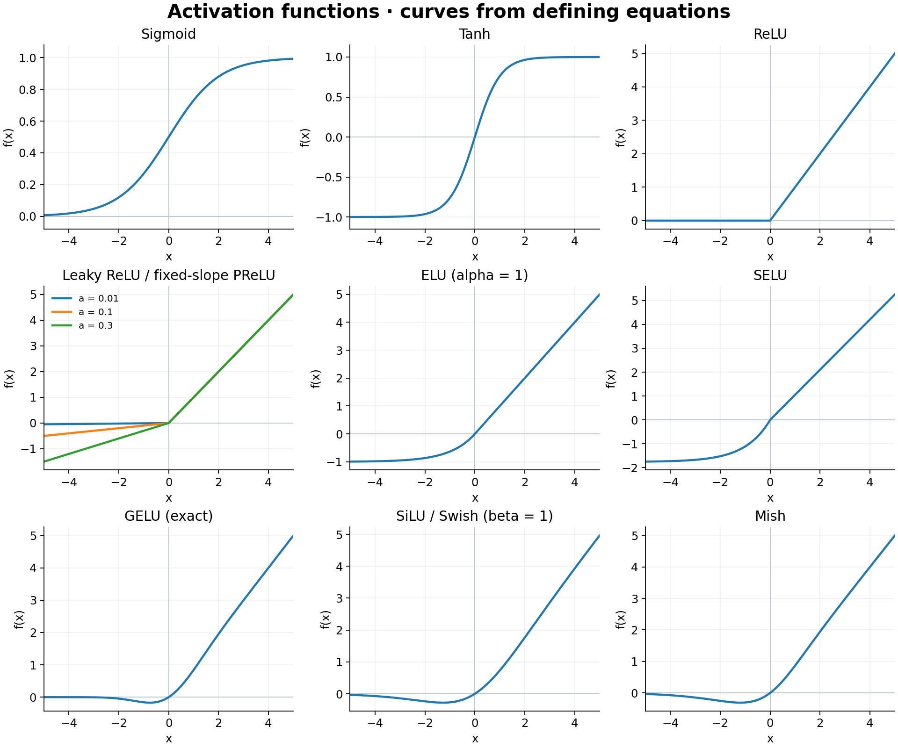

# Deep Learning

[Handbook contents](../README.md#table-of-contents) | [Previous: Machine Learning](machine-learning.md) | [Next: Transformer](transformer.md)

## Contents

- [DL Basic](#dl-basic)
- [DL Algorithms](#dl-algorithms)
    - [CNN](#cnn)
    - [RNN](#rnn)
    - [LSTM & GRU](#lstm--gru)
    - [(Generative Models: GANs & Autoencoders)](#generative-models-gans--autoencoders)


## DL Basic

- Feedforward NNs [[Youtube](https://www.youtube.com/watch?v=AsyPA69QBks)]
    - Feedforward Neural Networks are the simplest form of artificial neural networks where data flows only in one direction—from the input layer, through one or more hidden layers, to the output layer. They are typically used for tasks where the mapping from input to output is straightforward and static (e.g., classification or regression).
    - Architecture: Input layer + hidden layers + output layer in only one direction - forward - with no cycles or loops.
        - For each neuron,  output = activation(weights inputs + bias).
        - For each layer, $`\mathbf{y}=f(\mathbf{W} \mathbf{x}+\mathbf{b})`$.
        - [To be reviewed] A composition of affine layers without intervening nonlinearities is still affine. Extra linear hidden layers can change the parameterization, rank constraints, and optimization, but do not create a general nonlinear decision function.
    - Depth vs width
        - Deeper networks can learn more complex hierarchical representations. But face challenges like vanishing gradients and increased computational cost.
        - Wider layers can capture more information per layer. May require more training data to avoid overfitting.

    - Why we need bias parameters? By incorporating a bias, each neuron can adjust its threshold independently of the input data. This means that even if the inputs are all zero or symmetrically distributed, the network can still make non-trivial predictions. The bias allows the network to represent a wider range of functions.


- Activation functions [[ref](https://www.v7labs.com/blog/neural-networks-activation-functions)]
    - **Sigmoid** and its limitations: $`\sigma(x)=\frac{1}{1+e^{-x}}`$, which outputs to the range (0, 1) and is useful for probabilistic interpretations.
        - Limitations
            - Vanishing Gradients: In regions where the input is very positive or very negative, the output saturates close to 1 or 0. This can lead to extremely small gradients, slowing or even halting the training process in deep networks.
            - Non Zero-Centered: The sigmoid function’s outputs being always positive can lead to inefficient gradient updates, as the activations are not centered around zero.
    - **Tanh (hyperbolic tangent)**: $`\tanh (z)=\frac{e^z-e^{-z}}{e^z+e^{-z}}=\frac{2}{1+e^{-2 z}}-1`$.
        - It is related to sigmoid by $`\tanh(z)=2\sigma(2z)-1`$ and supplies signed outputs in (-1, 1). A symmetric output range does not ensure that arbitrary input distributions produce zero-mean activations.

    [To be reviewed] Sigmoid gates take values in (0, 1), while tanh supplies signed bounded candidate/state transformations. Tanh outputs are not probabilities. ReLU is useful in many hidden layers but is not a direct bounded-probability parameterization.

    - **ReLU family (Rectified Linear Unit, Leaky ReLU, PReLU, ELU, SELU)**: $`f(x)=\max (0, x)`$ ReLU outputs zero for negative inputs and linear (identity) for positive values; it is popular due to computational efficiency and reduced likelihood of vanishing gradients.
        - [To be reviewed] **Inactive ReLU:** if a unit's preactivation is negative for every example it currently sees, its local derivative and direct parameter-gradient contribution are zero on those examples. This can stall learning. It is not a statement about every possible input or an irreversible theorem: upstream changes, optimizer state, or new inputs can change the preactivations.
        - Solution-Leaky ReLU (2013): Instead of outputting zero for negative inputs, Leaky ReLU allows a small, non-zero gradient (e.g., $`f(x)=\alpha x`$ for $`x<0`$ with $`\alpha`$ being a small constant such as 0.01 ). This helps prevent neurons from dying.
        - Parametric ReLU (PReLU) (2015): Similar to Leaky ReLU, but the coefficient $`\alpha`$ is learned during training.
        - ELU (Exponential Linear Unit) and SELU (Scaled ELU) use exponential negative branches. SELU's self-normalization claim additionally requires its specified scale/constants and architectural/initialization conditions; ordinary ELU is not equivalent. See [initialization conditions](#dl-initialization).

    [To be reviewed] Centering activations can improve some optimization conditions, but it is not a universal requirement for stable or fast training. Signal/gradient scales, nonlinearities, initialization, residual structure, and normalization interact; zero mean alone does not prevent saturation.

    - **GELU （2016）** uses the Gaussian cumulative distribution function to weight the inputs, often defined approximately as: $`f(x)=0.5 x\left(1+\tanh \left[\sqrt{\frac{2}{\pi}}\left(x+0.044715 x^3\right)\right]\right)`$.
        - GELU provides a smooth output which can help gradient flow.
        - [To be reviewed] GELU is a deterministic activation $`x\Phi(x)`$ using the standard normal CDF; the CDF factor motivates its weighting interpretation. It does not sample a neuron-activation event during the usual forward pass. [GELU](https://arxiv.org/abs/1606.08415)
    - **Swish/SiLU (2017)**: The Swish, also known as SiLU (Sigmoid-weighted Linear Unit), is defined as: $`f(x)=x \cdot \sigma(x)`$, where $`\sigma(x)`$ is the sigmoid function.
        - The function is differentiable everywhere and its non-monotonicity can sometimes lead to better performance in deep networks.
        - Swish has been shown to outperform ReLU on deeper models in certain cases, due to its ability to maintain non-zero gradients across a wider range of inputs.

    - **GLU (Gated Linear Unit)**
        - Given an input $`x \in \mathbb{R}^d`$, two learned projections $`W, V \in \mathbb{R}^{d \times h}`$. $`\text{GLU}(x)=(x W) \odot \sigma(x V)`$, where $`\odot`$ is elementwise product.
        - Intuition: One projection $`(x W)`$ carries "content," the other $`(x V)`$ gates it via a sigmoid. Allows the network to learn when to pass or suppress information.


    - **Mish (2019)**: Mish is defined as: $`f(x)=x \cdot \tanh (\text{softplus}(x))`$, where $`\text{softplus}(x)=\ln \left(1+e^x\right)`$.
        - Mish provides a smooth activation that has continuous derivatives, aiding optimization.
        - It has been reported to offer improvements in generalization and training stability compared to ReLU and some of its variants.

    - **SwiGLU (Swish with Gating)**: SwiGLU combines the Swish activation with a gating mechanism, which allows the network to control the flow of information dynamically.
        - [To be reviewed] SwiGLU uses a SiLU gate in place of GLU's sigmoid gate; with one naming convention, $`\operatorname{SwiGLU}(x)=\operatorname{SiLU}(xW)\odot(xV)`$. Swapping names of the two learned projections gives an equivalent convention. A complete Transformer MLP usually includes an output projection as well. [GLU variants](https://arxiv.org/abs/2002.05202)
        - Compare gated and ordinary MLPs at matched parameter/compute budgets; gating alone guarantees neither stability nor quality. See the full [Transformer MLP and SwiGLU computation](transformer.md#tf-mlp).

    - **Softmax**: The softmax function converts a vector of raw scores (logits) into a probability distribution: $`\text{Softmax}\left(z_i\right)=\frac{e^{z_i}}{\sum_j e^{z_j}}`$
        - Finite logits define nonnegative probabilities summing to one, commonly used for mutually exclusive categorical outcomes. Use a stable implementation that subtracts the largest logit before exponentiating.
        - [To be reviewed] Softmax gives a normalized categorical distribution, not automatically calibrated confidence. Assess probability calibration and use the output distribution appropriate to the task; independent multilabel outputs typically use separate sigmoid probabilities.

    - Properties and selection criteria
        - Computational Efficiency: Functions like ReLU are extremely efficient compared to those that require computing exponentials, such as sigmoid or tanh.
        - Gradient Propagation: Avoid functions prone to vanishing or exploding gradients. For example, while sigmoid and tanh can suffer from gradient saturation, variants like ReLU, Leaky ReLU, and GELU help preserve gradient flow.
        - Output Range and Interpretability: Functions like sigmoid and softmax are helpful when outputs need a probabilistic interpretation, while others are more suited for hidden layers.


    <div align="center">
        
    </div>

    [To be reviewed] [Vector version](../figs/activation-functions.svg). These curves use the displayed parameters and exact GELU; tanh is bounded by -1 and 1. Leaky ReLU/PReLU share a functional form at a fixed slope, but PReLU learns that slope. GLU/SwiGLU are multivariate gated projections and are specified by equations rather than a single scalar curve.


- <a id="dl-initialization"></a> Weight initialization [[YouTube](https://www.youtube.com/watch?v=tYFO434Lpm0)]

    Weight initialization is a critical aspect of neural network training that can significantly impact convergence speed and overall performance.
    - Why weight initialization matters?
        - Symmetry breaking: identical initialization of interchangeable hidden units can keep their updates identical. Random asymmetric weights help break that symmetry. Zero biases are often valid; zero initialization is also valid for some convex models such as linear regression, so the prohibition is not universal.
        - Maintaining signal flow: As data passes through layers, improper initialization can cause the variance of activations to either diminish (vanishing gradients) or grow uncontrollably (exploding gradients). A good initialization strategy maintains a balanced flow of gradients during backpropagation.
        - Convergence Speed: Appropriate weight initialization can help reduce the number of training iterations needed for the loss to converge by starting the optimization process in a "good" region of the parameter space.
        - Avoiding saturation: Keep neurons in active regions of their activation functions

    - **Random initialization**

        The simplest form of weight initialization involves drawing weights from a random distribution.
        - Uniform Distribution: Weights are sampled uniformly from an interval $`[-a, a]`$. The choice of $`a`$ is critical—a too-large range can lead to activations exploding, whereas a too-small range can stall learning.
        - Gaussian (Normal) Distribution: Weights are sampled from a normal distribution $`\mathcal{N}\left(0, \sigma^2\right)`$. Here, $`\sigma`$ must be chosen carefully to control the variance of the activations.

        Regardless of the distribution, it is important that the initialization breaks symmetry and starts the network in a regime where the gradients are neither too large nor too small.

    - **Xavier/Glorot initialization** (by Xavier Glorot and Yoshua Bengio in 2010)

        Xavier initialization was designed to keep the scale of the gradients roughly the same in all layers.
        - The initialization balances forward/backward second moments under simplifying independence and activation assumptions; it does not guarantee constant variance through an arbitrary network. For a weight matrix $`W`$ connecting layers with fan_in (number of input units) and fan_out (number of output units), the variance is balanced by considering both quantities.
        - It is a common starting point for tanh/approximately linear regimes, with an activation-dependent gain. It does not eliminate sigmoid saturation; verify scales in the actual architecture. [Glorot and Bengio](https://proceedings.mlr.press/v9/glorot10a.html)
        - weights can be drawn from a normal distribution with: $`W \sim \mathcal{N}\left(0, \frac{2}{\mathrm{fan\_in}+ \mathrm{fan\_out}}\right)`$.


    - **He initialization**, proposed by Kaiming He et al., is tailored for networks that use **ReLU** or its variants. ReLU activations are not symmetric and have a different behavior, particularly because they zero out negative inputs.
        - Weights are drawn from a normal distribution: $`W \sim \mathcal{N}\left(0, \frac{2}{\mathrm{fan\_in}}\right)`$.
        - [To be reviewed] For the standard ReLU assumptions, the factor 2 compensates for the change in the second moment. Leaky ReLU with negative slope a instead uses a gain such as sqrt(2 / (1 + a*a)); the same factor is not exact for all activation variants.

    - **LeCun initialization** is a weight initialization strategy designed to help maintain a consistent variance of activations as data flows through a network.
        - [To be reviewed] LeCun-normal initialization uses variance $`1/\mathrm{fan\_in}`$. SELU's self-normalization result additionally assumes a suitable feed-forward architecture, activation constants, input/weight conditions, and compatible regularization such as alpha dropout; initialization alone is insufficient. [Self-normalizing networks](https://arxiv.org/abs/1706.02515)

    - [To be reviewed] Orthogonal initialization uses an orthogonal square matrix or a semi-orthogonal rectangular matrix. Only a compatible orientation satisfies $`W^TW=I`$; a wide matrix can instead satisfy $`WW^T=I`$. A linear orthogonal transform preserves the relevant norm, but nonlinear activations and an entire recurrent trajectory need not. [Initialization API](https://docs.pytorch.org/docs/stable/nn.init.html)

    - [To be reviewed] Implementations

        - In PyTorch, apply `torch.nn.init.xavier_uniform_(linear.weight)` for a chosen Xavier scheme, or `torch.nn.init.kaiming_normal_(linear.weight, mode="fan_in", nonlinearity="relu")` for a ReLU-oriented Kaiming scheme. Initialize supported biases explicitly, commonly to zero.
        - **Check the convention:** PyTorch linear layers store a matrix shaped `(fan_out, fan_in)` and apply its transpose in the forward computation. Passing a transposed custom matrix without accounting for this reverses fan-in and fan-out. Initialization should match the activation, residual scaling, and architecture; inspect activation and gradient statistics over a few batches. [Initialization reference](https://docs.pytorch.org/docs/stable/nn.init.html)


    [To be reviewed] **Initialization summary.** Variances below describe the sampled weights, before any additional architecture-specific scaling. These are starting conventions under their assumptions, not guarantees of signal preservation.

    | Scheme | Normal-distribution variance | Scope |
    | --- | --- | --- |
    | Xavier / Glorot | $`g^2\,2/(\mathrm{fan\_in}+\mathrm{fan\_out})`$ | Gain g depends on the chosen activation/convention; sigmoid saturation is not eliminated |
    | He / Kaiming, fan-in ReLU | $`2/\mathrm{fan\_in}`$ | For leaky ReLU with negative slope a, use $`2/[(1+a^2)\mathrm{fan\_in}]`$ under the corresponding assumptions |
    | LeCun normal | $`1/\mathrm{fan\_in}`$ | SELU self-normalization also requires its architectural and input assumptions |

    [PyTorch initialization and gain conventions](https://docs.pytorch.org/docs/stable/nn.init.html).


- Backpropagation [[YouTube](https://www.youtube.com/watch?v=SmZmBKc7Lrs)] [[YouTube](https://www.youtube.com/watch?v=1GnfvhBUs_E&list=PLgPbN3w-ia_PeT1_c5jiLW3RJdR7853b9&index=8)]
    - [To be reviewed] For scalar intermediates $`a=h(x)`$, $`b=g(a)`$, and $`z=f(b)`$, the chain rule gives $`dz/dx=f'(b)g'(a)h'(x)`$. For vector layers, compose Jacobians; reverse-mode autodiff efficiently accumulates vector–Jacobian products for a scalar loss. Derivatives are with respect to intermediate values, not function names.
    - Forward vs. backward pass
        - Forward pass: The forward pass is the process of feeding input data through the network and computing the output. Here, each node (or layer) processes the input it receives and passes on its output to subsequent nodes according to the network’s architecture. During this pass, the computational graph is effectively created, and intermediate values (activations) are stored because they will be needed during backpropagation.
        ```python
        import numpy as np

        def forward_pass(X, W1, b1, W2, b2):
            # Hidden layer
            Z1 = np.dot(W1, X) + b1  # Pre-activation
            A1 = np.maximum(0, Z1)   # ReLU activation

            # Output layer
            Z2 = np.dot(W2, A1) + b2
            A2 = np.exp(-np.logaddexp(0.0, -Z2))  # [To be reviewed] stable sigmoid

            # Store intermediate values for backprop
            cache = {"Z1": Z1, "A1": A1, "Z2": Z2, "A2": A2}

            return A2, cache

        def compute_loss(logits, Y):
            # [To be reviewed] Pass cache["Z2"]; BCE from logits avoids log(0).
            m = Y.shape[1]
            loss = np.sum(np.logaddexp(0.0, logits) - Y * logits) / m
            return loss
        ```

        - [To be reviewed] Backpropagation computes gradients by reverse traversal of the computation graph. Applying those gradients to weights is a separate optimizer step. Keeping those phases distinct matters for accumulation, clipping, mixed precision, and distributed synchronization.

        ```python
        def backward_pass(X, Y, cache, W1, W2):
            m = X.shape[1]
            A1 = cache["A1"]
            A2 = cache["A2"]
            Z1 = cache["Z1"]

            # Output layer gradients
            dZ2 = A2 - Y
            dW2 = 1/m * np.dot(dZ2, A1.T)
            db2 = 1/m * np.sum(dZ2, axis=1, keepdims=True)

            # Hidden layer gradients
            dA1 = np.dot(W2.T, dZ2)
            dZ1 = dA1 * (Z1 > 0)  # ReLU derivative
            dW1 = 1/m * np.dot(dZ1, X.T)
            db1 = 1/m * np.sum(dZ1, axis=1, keepdims=True)

            return {"dW1": dW1, "db1": db1, "dW2": dW2, "db2": db2}

        def update_parameters(W1, b1, W2, b2, grads, learning_rate):
            W1 = W1 - learning_rate * grads["dW1"]
            b1 = b1 - learning_rate * grads["db1"]
            W2 = W2 - learning_rate * grads["dW2"]
            b2 = b2 - learning_rate * grads["db2"]

            return W1, b1, W2, b2
        ```
        - The backward pass computes loss derivatives for differentiable paths in this graph; the optimizer then uses those derivatives and any state or regularization to update trainable parameters.
    - Gradient flow refers to how error gradients propagate backward through the network during training. Effective gradient flow is essential because:
        - Inspect whether layers receive useful updates; good gradient flow is a design goal, not a guarantee for every depth or input.
        - It affects how quickly and effectively the network converges to a minimum of the loss function.
    - Automatic differentiation [[YouTube-DL System](https://www.youtube.com/watch?v=56WUlMEeAuA)]: Automatic differentiation is a set of techniques to compute derivatives automatically and efficiently. Deep learning frameworks (e.g., TensorFlow, PyTorch) rely on autodiff to handle the complexities of differentiating networks with millions of parameters without manual intervention.
    - Vanishing/exploding gradient problems
        - Root causes
            - Deep Architectures:In networks with many layers, the product of a large number of derivative terms (each typically less than or greater than one) can lead to vanishing or exploding gradients.
            - Activation Functions: Functions such as sigmoid or tanh saturate (i.e., their gradients approach zero) for extreme values, contributing to vanishing gradients.
            - Improper Weight Initialization: Weights that are too small or too large can respectively dampen or amplify gradients during backpropagation.
        - Detection methods
            - Monitoring Gradient Norms: By tracking the norm (or magnitude) of the gradients during training, you can detect when they are trending toward zero or growing uncontrollably.
            - Layer-wise Analysis: Evaluating the gradient distribution across layers can help diagnose whether early layers receive significantly diminished signals compared to later layers.
            - [To be reviewed] Activation histograms can reveal saturation or excessive scales, but small activations alone do not prove vanishing gradients. Inspect actual layerwise gradients, Jacobian sensitivity when feasible, and the activation's derivative.
            - [To be reviewed] A plateau or nonfinite loss is a symptom with multiple possible causes, including data errors, numerical overflow, a bad objective, or optimization instability. Diagnose gradients and intermediate values before assigning the cause.
        - Solutions
            - Proper Weight Initialization.
            - Normalization Techniques
            - Residual Connections: Introduce shortcuts that allow gradients to flow more directly through the network. This helps mitigate the vanishing gradient problem, particularly in very deep networks.
            - Gradient Clipping[[YouTube](https://www.youtube.com/watch?v=KrQp1TxTCUY)]: Helps control exploding gradients by capping the gradients’ magnitude during backpropagation.


- Learning Rate Strategies
    - Fixed learning rates: A fixed learning rate remains constant during the entire training process.
    - [To be reviewed] Power/exponential scheduling

        - Exponential decay uses $`\eta_t=\eta_0\gamma^{t/s}`$; inverse-power decay can use $`\eta_t=\eta_0(1+t/\tau)^{-p}`$. Define whether $`t`$ counts optimizer steps, epochs, or tokens. The schedule's time unit matters when batch size or gradient accumulation changes.
        - **Example:** doubling accumulation halves optimizer updates for a fixed number of microbatches. An unchanged step-based schedule then decays at a different point in the data stream. Log learning rate against consumed tokens as well as steps. [Scheduler reference](https://docs.pytorch.org/docs/stable/optim.html#how-to-adjust-learning-rate)

    - [To be reviewed] Piecewise constant scheduling

        - Hold the learning rate fixed within intervals, then reduce it at chosen boundaries. Abrupt reductions can support a final refinement phase but may be poorly placed if the total training budget changes.
        - **Example:** multiply learning rate by 0.1 after each specified milestone and compare against a smooth schedule at the same number of updates. Milestones are hyperparameters and belong in the development protocol.

    - Adaptive learning rates
        - Adaptive methods automatically adjust the learning rate during training, often on a per-parameter basis.
        - AdaGrad, RMSprop, Adam.
    - Scheduling strategies
        - [To be reviewed] step decay

            - A common step schedule is $`\eta_t=\eta_0\gamma^{\lfloor t/s\rfloor}`$. Use it when known training phases justify discrete changes. A milestone-based schedule generalizes fixed-period decay to explicitly selected update counts.

        - [To be reviewed] exponential decay

            - Multiply learning rate by a constant factor at each scheduler interval. Derive the factor from the desired endpoint and total number of intervals rather than selecting it without reference to the run length. For an endpoint ratio of 0.01 over 100 intervals, the factor is $`0.01^{1/100}`$.

        - [To be reviewed] power scheduling

            - A polynomial-to-zero schedule can use $`\eta_t=\eta_0(1-t/T)^p`$ over $`0\leq t\leq T`$. This differs from an inverse-power schedule, which approaches zero asymptotically. State the exact function because “power decay” is ambiguous.

        - [To be reviewed] cosine annealing

            - A single cosine decay is $`\eta_t=\eta_{\min}+\tfrac12(\eta_{\max}-\eta_{\min})[1+\cos(\pi t/T)]`$. Warmup is a separate initial phase; restarts are a separate design choice.
            - **Example:** use linear warmup for an explicitly budgeted number of updates, then decay over the remaining updates. A resumed run must restore scheduler state; resetting the cosine silently changes the optimization trajectory. [SGDR paper](https://arxiv.org/abs/1608.03983)

        - [To be reviewed] cyclical learning rates

            - Cyclical schedules vary learning rate repeatedly between bounds, often using triangular cycles. A one-cycle policy instead increases and then decreases learning rate over one training run, frequently with a coupled momentum schedule.
            - **Failure mode:** an upper bound suitable for one optimizer, batch size, or architecture may destabilize another. Compare at matched update budgets and report the actual schedule. [Cyclical learning rates](https://arxiv.org/abs/1506.01186)


- Regularization and Normalization [[YouTube-Regularization](https://www.youtube.com/watch?v=EehRcPo1M-Q)]

    [To be reviewed] Regularization constrains a model or fitting procedure according to a chosen inductive bias. Weight magnitude is parameterization-dependent; a large individual weight does not by itself prove overfitting or excessive influence of one training example.

    - Solutions: L1/L2 regularization (Alpha: how much attention to pay to this penalty), dropout, early stopping; Data augmentation(adding more info)

    - Beyond traditional methods
        - [To be reviewed] Label smoothing can define $`\tilde y_k=(1-\epsilon)\mathbf{1}[k=y]+\epsilon/K`$ for $`K`$ classes. For binary classification this convention gives $`1-\epsilon/2`$ to the target class and $`\epsilon/2`$ to the other. Some implementations distribute smoothing only over nontarget classes; state the convention. It changes targets and confidence incentives, not the inference-time label definition. [Cross-entropy API](https://docs.pytorch.org/docs/stable/generated/torch.nn.CrossEntropyLoss.html)
        - [To be reviewed] Dropout

            - During training, inverted dropout multiplies an activation by $`m/(1-p)`$ with $`m\sim\operatorname{Bernoulli}(1-p)`$, preserving its conditional expectation. At evaluation, disable this stochastic masking for the usual deterministic prediction path.
            - **Example:** dropping half the activations scales retained values by two. Forgetting evaluation mode leaves predictions stochastic and can impair reproducibility. Dropout placement matters: masking attention probabilities, residual branches, and feed-forward activations are different interventions. [Dropout paper](https://jmlr.org/papers/v15/srivastava14a.html)

            - [To be reviewed] How to apply dropout to LSTM

                - Distinguish dropout between stacked recurrent layers from dropout on recurrent state transitions. Some variational formulations reuse a mask across time steps so temporal memory is not disrupted by independently sampled recurrent noise at every step.
                - **Implementation pitfall:** the built-in PyTorch LSTM `dropout` argument applies between stacked LSTM layers, excluding the last layer; it does not implement arbitrary recurrent-state dropout and has no between-layer effect for a single-layer LSTM. [LSTM API](https://docs.pytorch.org/docs/stable/generated/torch.nn.LSTM.html), [variational recurrent dropout](https://arxiv.org/abs/1512.05287)

        - [To be reviewed] Early stopping

            - Monitor a prespecified validation quantity, save the best checkpoint, and stop after a defined patience without sufficient improvement. Choose whether lower loss or higher task score is the actual objective.
            - **Example:** validation loss can increase while classification accuracy is unchanged because confidence becomes worse calibrated. Repeated checkpoint selection adapts to the validation set; retain an untouched final evaluation set and report the selection rule.

        - Mixup and CutMix: Data augmentation techniques that form new training samples by combining pairs of images (and their labels) either through interpolation (Mixup) or by cutting and pasting regions (CutMix).
        - Weight constraints: Imposes restrictions (e.g., max-norm constraints) on the weights, ensuring they do not become too large during training.

    - Normalization [[PyTorch APIs](https://docs.pytorch.org/docs/stable/nn.html#normalization-layers)]
        - **Batch normalization** (2015) [[YouTube](https://www.youtube.com/watch?v=yXOMHOpbon8)] is a method that normalizes activations in a network across the mini-batch of definite size. For each feature, batch normalization computes the mean and variance of that feature in the mini-batch. It then subtracts the mean and divides the feature by its mini-batch standard deviation. Good for CNN.
        - Problems
            - [To be reviewed] Small normalization groups make batch statistics noisy. For convolutional BatchNorm, statistics use batch and spatial dimensions, so batch size 1 can still supply multiple values per channel. A training configuration with only one value per channel is degenerate. Distributed replicas can share affine parameters while observing different local statistics; SyncBatchNorm synchronizes the chosen statistics. Equal local batch sizes are not required to make gamma/beta equal. [BatchNorm2d](https://docs.pytorch.org/docs/stable/generated/torch.nn.BatchNorm2d.html)
            - [To be reviewed] Recurrent normalization must account for sequence length and changing state distributions. Time-specific statistics are one design, not a universal requirement. LayerNorm computes per-example/time-step feature statistics and avoids dependence on batch composition. [LayerNorm](https://arxiv.org/abs/1607.06450)

        - [To be reviewed] Weight normalization parameterizes $`w=g\,v/\|v\|`$, separating a weight vector's magnitude from direction. It reparameterizes weights rather than normalizing minibatch activation statistics, so it should not be equated with BatchNorm's variance computation. [Weight normalization](https://arxiv.org/abs/1602.07868)

        - **Layer normalization** (2016) [[YouTube](https://www.youtube.com/watch?v=2V3Uduw1zwQ)] normalizes the explicitly selected feature axes separately for each sample/time position. It is common in RNNs and Transformers; the axes and affine parameter shape must be specified.
            - $`\operatorname{LN}(x)=\gamma\odot(x-\mu)/\sqrt{\sigma^2+\epsilon}+\beta`$, with mean and population variance over the configured normalization axes.
            - [To be reviewed] Post-LN: $`x_{i+1}=\operatorname{LayerNorm}(x_i+\operatorname{Sublayer}(x_i))`$. BERT and the original Transformer use post-normalization forms; **T5 uses a pre-normalization RMS-style variant**, so it is not a Post-LN example. [T5](https://jmlr.org/papers/v21/20-074.html)
            - Pre-layerNorm: $`x_{i+1}=x_i+\text{Sublayer}\left(\text{LayerNorm}\left(x_i\right)\right)`$. Normalize before the sublayer (e.g., attention or MLP). Residual connection happens after the sublayer.  (GPT-style models; Llama uses a pre-normalization RMSNorm variant)
            - [To be reviewed] **Pre-LN versus Post-LN:** Pre-LN often improves initialization-time gradient behavior and training stability; final quality depends on the architecture, optimizer, depth, schedule, and tuning. Neither is universally superior. [Normalization analysis](https://arxiv.org/abs/2002.04745)
                - [To be reviewed] The residual stream and normalized branch can have different relative scales as depth grows; assess those scales under the actual parameterization.
                - [To be reviewed] Claims that deep Pre-LN layers contribute less describe specific analyses or settings, not proof that every Pre-LN model is functionally shallow.
                - [To be reviewed] Compare held-out quality, gradient norms, update scales, and training failures at matched compute instead of inferring effective depth from normalization placement alone.
                - [To be reviewed] DeepNet motivates DeepNorm using its theoretical assumptions and translation experiments; those results do not establish a universal quality ranking for modern LLMs.
            - DeepNet introduces **DeepNorm**, combining residual scaling and initialization to stabilize the deep configurations studied in that paper.
                - [To be reviewed] DeepNorm uses $`x_{l+1}=\operatorname{LayerNorm}(\alpha x_l+G_l(x_l;\theta_l))`$: **alpha scales the residual/skip term** in this formulation, not the sublayer output. [DeepNet / DeepNorm](https://arxiv.org/abs/2203.00555)
                - [To be reviewed] Its beta factor rescales selected initialization matrices; alpha/beta depend on encoder/decoder configuration and depth. Reproduce the paper's initialization and assumptions together rather than transplanting one constant into an arbitrary architecture.

        - [To be reviewed] RMSNorm uses $`\operatorname{RMSNorm}(x)=g\odot x/\sqrt{d^{-1}\sum_i x_i^2+\epsilon}`$ in a common implementation convention. It omits mean subtraction and usually the additive bias of standard LayerNorm. Placement of epsilon and affine options are implementation choices. [RMSNorm](https://arxiv.org/abs/1910.07467)
        - [To be reviewed] **pRMSNorm** estimates the RMS from a selected subset of feature coordinates, reducing the work under the method's assumptions.
            - [To be reviewed] For a specified subset $`S`$, one form uses $`x/\sqrt{|S|^{-1}\sum_{i\in S}x_i^2+\epsilon}`$ followed by a learned scale. Do not identify ordinary RMSNorm in a model such as Mistral or Yi as partial RMSNorm without implementation evidence. [pRMSNorm paper](https://arxiv.org/abs/1910.07467)

        - [To be reviewed] **Instance normalization** normalizes spatial positions separately within each sample/channel. A common configuration uses input statistics during both training and evaluation; running-statistics options also exist. Its use in style transfer does not make it equivalent to normalization over all features of a sample. [InstanceNorm2d](https://docs.pytorch.org/docs/stable/generated/torch.nn.InstanceNorm2d.html)
        - [To be reviewed] GroupNorm normalizes spatial positions and channel subsets within each sample. One group shares the normalization axes of LayerNorm over the full channel/spatial volume, but affine parameter sharing can differ. One group per channel shares InstanceNorm's input-statistics axes, again subject to affine/running-statistics choices. [GroupNorm](https://docs.pytorch.org/docs/stable/generated/torch.nn.GroupNorm.html)
        - [To be reviewed] (**Spectral normalization**: for GAN)

            - Normalize a weight matrix by an estimate of its largest singular value: $`\bar W=W/\sigma_{\max}(W)`$. Power iteration provides an efficient estimate and limits the layer's operator norm under the chosen matrix representation.
            - **Example:** constrain the discriminator or critic to reduce excessive sensitivity to input perturbations. A layerwise spectral constraint is not a universal proof that an entire architecture is exactly 1-Lipschitz; nonlinearities, residual additions, and convolution parameterization also matter. [Spectral normalization](https://arxiv.org/abs/1802.05957)


        - **Understanding**: Imagine a stack of N (batch) books, each with C (channels) pages, every page has H lines, and each line contains W characters.
            - BN: It's like averaging across the same page in different books. For example, all the 36th pages from all N books are added together, and the average is computed over all characters on those pages (total of N×H×W characters).
            - [To be reviewed] LN: normalize the explicitly selected feature axes. For an image tensor, a LayerNorm over C×H×W normalizes a whole book; a Transformer usually normalizes hidden features separately at each token, not the whole token sequence.
            - IN: It averages all characters on a single page of a book. Each page is treated separately, averaging over H×W characters.
            - GN: Each book (with C pages) is split into G groups of pages. Each group (C/G pages) is treated like a mini-book, and normalization is done within each group.


        <div align="center">
            
        </div>

----

## DL Algorithms
### CNN
[[YouTube](https://www.youtube.com/watch?v=oGpzWAlP5p0)] [[Code](https://www.youtube.com/watch?v=pDdP0TFzsoQ&list=PLqnslRFeH2UrcDBWF5mfPGpqQDSta6VK4&index=15)]

In a typical CNN architecture, a few convolutional layers are connected in a cascade style. Each convolutional layer is followed by a Rectified Linear Unit (ReLU) layer or other activation function, then a pooling layer*, then one or more convolutional layers (+ReLU), then another pooling layer.

[To be reviewed] A convolutional output channel is formed by one filter spanning the input channels; its parameters are shared across spatial positions. Stacking two stride-1 3×3 layers gives a 5×5 receptive field under ordinary assumptions, but does not equal one 5×5 convolution: intermediate channels and nonlinearities change expressiveness and cost. Smaller kernels are a design choice, not guaranteed to extract the same features faster.

[To be reviewed] A CNN may flatten activations for a dense head or use global pooling and another task head. Softmax is appropriate for a categorical output; binary, multilabel, regression, detection, and dense-prediction tasks use different heads and losses.

[To be reviewed] Depth, width, stride, padding, kernel size, and pooling affect capacity, receptive fields, cost, and inductive bias. More layers do not mechanically imply a fixed requirement for more labeled data; pretraining, augmentation, regularization, and optimization also matter.

- Pooling: it is a way to reduce the number of features by choosing a number to represent its neighbor. And it has many types max-pooling, average pooling, and global average.
- Max pooling: it takes the max number of window 2×2 as an example and represents this window by using the max number in it then slides on the image to make the same operation.
- Average pooling: it is the same as max-pooling but takes the average of the window.

    <div align="center">
        
    </div>

### RNN
[[YouTube](https://www.youtube.com/watch?v=LHXXI4-IEns)]
- Architecture: RNNs are designed to process sequences by recursively updating a hidden state. At each time step $`t`$, the network takes an input $`x_t`$ and the previous hidden state $`h_{t-1}`$ to produce a new hidden state $`h_t`$ : $`h_t=f\left(W_x x_t+W_h h_{t-1}+b\right)`$, where $`W_x`$ and $`W_h`$ are weight matrices, $`b`$ is a bias term, and $`f`$ is a nonlinear activation function (commonly tanh or ReLU). The same set of weights is used at every time step, which makes the network well-suited for variable-length sequences but also introduces challenges during training.
- BPTT: BPTT is an extension of the standard backpropagation algorithm. The network is “unrolled” along the time axis, and gradients are computed for each time step, then aggregated to update the shared weights.
    - Unrolling over long sequences can be both memory-intensive and computationally heavy.
    - The repeated multiplication of gradients across many time steps often results in extremely small (vanishing) or large (exploding) gradients.


### LSTM & GRU
[[YouTube](https://www.youtube.com/watch?v=8HyCNIVRbSU)]
- **LSTM** networks were introduced specifically to address the vanishing gradient problem inherent in basic RNNs. They do this by incorporating a memory cell that can maintain information over long periods.
    - Architecture
        - Cell State $`\left(C_t\right)`$ : Acts as the "memory" of the network.
        - Hidden State $`\left(h_t\right)`$ : Carries output information.

        <div align="center">
            
        </div>

        - Update Equations:
            - Cell State Update: $`C_t=f_t \odot C_{t-1}+i_t \odot \tilde{C}_t`$
            - Hidden State Update: $`h_t=o_t \odot \tanh \left(C_t\right)`$ Here, $`\odot`$ denotes element-wise multiplication and $`\sigma`$ is the sigmoid activation.

    <div align="center">
        
    </div>

    - Advantages
        - Long-term dependency capture: gated cell paths can preserve information over extended sequences, subject to learned gates and optimization.
        - Gradient path: the direct cell-state derivative includes the forget gate; repeated gates below one can still attenuate gradients. LSTM mitigates some difficulties without guaranteeing long-range credit assignment.
    - Trade-offs
        - Computational Complexity: LSTMs have more parameters (due to multiple gates) compared to basic RNNs, leading to increased computational cost and memory usage.
        - Overfitting Potential: The increased model capacity might require more data and careful regularization to prevent overfitting.

- **GRU** are designed to offer similar capabilities to LSTMs but with a simplified structure. They aim to capture long-term dependencies with fewer gates and parameters, potentially yielding faster training and inference.
    - Architecture: GRUs combine the functionalities of the input and forget gates into a single update gate and use a reset gate to control the combination of past and new information.
        <div align="center">
            
        </div>

        - [To be reviewed] **GRU equation conventions:** the illustration omits biases and uses z as the fraction of the candidate written to state. PyTorch's GRU uses z as a retention gate: $`h_t=(1-z_t)\odot n_t+z_t\odot h_{t-1}`$. Its candidate is $`n_t=\tanh(W_{in}x_t+b_{in}+r_t\odot(W_{hn}h_{t-1}+b_{hn}))`$; applying reset after the hidden affine map differs from multiplying the old hidden state before that map. Match the equations to the implementation rather than mixing these conventions. [PyTorch GRU](https://docs.pytorch.org/docs/stable/generated/torch.nn.GRU.html)

    <div align="center">
        
    </div>

    - [To be reviewed] GRU maintains one hidden state rather than separate LSTM hidden/cell states. With matched input/hidden sizes it usually has fewer gate parameters; observed training or inference speed depends on kernels, sequence shapes, hardware, and implementation. Fewer gates do not guarantee lower latency or equal task performance.
    - Advantages
        - Simplicity: Fewer gating mechanisms lead to a more straightforward architecture.
        - Efficiency: Fewer parameters often mean faster training and potentially less risk of overfitting.
        - Task performance: compare GRU and LSTM at matched data, tuning effort, and suitable capacity; the gate count does not establish equivalent quality.
    - Trade-offs
        - Expressiveness: With fewer gates, some nuances of long-term dependencies might be less finely controlled compared to LSTMs.
        - Task-Dependence: The performance benefits of GRUs versus LSTMs can vary; some tasks might benefit from the additional gating complexity of LSTMs.


- **Comparison Among These Models**

[To be reviewed] **Illustrative recurrent-model comparison; compare matched dimensions and implementations.**

| **Aspect**                | **Standard RNN**                                          | **LSTM**                                                      | **GRU**                                                       |
|---------------------------|-----------------------------------------------------------|---------------------------------------------------------------|---------------------------------------------------------------|
| **Architecture**          | Simple recurrence using a single hidden state             | Memory cell with three gates: input, forget, and output gates  | Streamlined design with two gates: update and reset           |
| **Handling of Long-Term Dependencies** | Struggles due to vanishing/exploding gradients            | Can retain information through gated cell-state paths; no general long-range guarantee      | Good; mitigates gradient issues with a simpler gating mechanism |
| **Parameter Complexity**  | Fewer parameters                                          | More parameters due to complex gate structure                  | Fewer parameters compared to LSTM                              |
| **Computational Cost**    | Lower, faster computation for short sequences             | Higher, computationally intensive due to extra gates           | Often fewer gate operations at matched width; benchmark actual kernels  |
| **Usage Considerations**  | Best for short sequences; limited long-range memory       | A candidate for long dependencies; compare against alternatives    | Suitable when speed and simplicity are needed, with competitive performance |


### (Generative Models: GANs & Autoencoders)
- Generative Adversarial Networks (GAN)
    - Fundamental Concepts
        - [To be reviewed] Architecture: Generator vs. Discriminator

            - Sample latent noise $`z\sim p(z)`$ and generate $`G(z)`$. The discriminator estimates whether an input is drawn from the data or generator. Sampling requires a forward pass through the generator, while a normalized explicit data likelihood is generally unavailable. [GAN paper](https://arxiv.org/abs/1406.2661)

        - [To be reviewed] Game theory perspective: adversarial training process

            - The original objective is $`\min_G\max_D\ \mathbb{E}_{x\sim p_{\mathrm{data}}}\log D(x)+\mathbb{E}_{z}\log(1-D(G(z)))`$. For a fixed generator and unrestricted discriminator, the optimum is $`D^*(x)=p_{\mathrm{data}}(x)/(p_{\mathrm{data}}(x)+p_G(x))`$.
            - **Interpretation:** the equilibrium statement assumes idealized function classes and optimization. Alternating finite neural-network updates need not reach it; a discriminator accuracy of 50% can indicate either successful matching or an untrained discriminator.

    - Key Components & Dynamics
        - [To be reviewed] Loss formulations for both generator and discriminator

            - The discriminator maximizes the real/fake log-likelihood; a common non-saturating generator objective minimizes $`-\mathbb{E}_z\log D(G(z))`$. It preserves the desired equilibrium while providing a stronger learning signal when generated samples are initially easy to reject.
            - **Example:** if $`D(G(z))`$ is near zero, the original saturating generator formulation can yield a weak useful gradient. State the actual training loss, rather than saying only “adversarial loss.”

        - [To be reviewed] Training challenges (e.g., mode collapse, vanishing gradients)

            - **Mode collapse** means the generator represents too little of the target distribution, potentially producing individually convincing but repetitive samples. Other failures include oscillating game dynamics and an overly strong discriminator that provides poor gradients.
            - **Example:** a model trained on ten classes may generate high-quality samples from only two. Evaluate both quality and coverage; a scalar discriminator loss does not measure either reliably. Use held-out data and inspect diversity within and across relevant subgroups. [GAN training techniques](https://arxiv.org/abs/1606.03498)

        - [To be reviewed] Strategies to stabilize training (e.g., feature matching, Wasserstein GAN)

            - WGAN replaces the original divergence-driven formulation with a Wasserstein-1 dual objective over 1-Lipschitz critics. The original method uses weight clipping; WGAN-GP instead penalizes deviation of gradient norms from one on sampled interpolations.
            - Feature matching asks the generator to match statistics of discriminator features, providing a different training signal. These approaches address different aspects of training and do not guarantee the elimination of collapse. Compare seeds and matched compute, rather than selecting one attractive sample grid. [WGAN](https://arxiv.org/abs/1701.07875), [WGAN-GP](https://arxiv.org/abs/1704.00028)


- Autoencoders
    - Basic Autoencoders
        - [To be reviewed] Encoder and decoder structure

            - An encoder maps $`x`$ to $`z=f_\phi(x)`$ and a decoder reconstructs $`\hat x=g_\theta(z)`$. Train with a likelihood-appropriate reconstruction objective: squared error corresponds to a particular Gaussian observation model, while binary cross-entropy corresponds to Bernoulli observations.
            - The bottleneck dimension and regularization constrain information transfer. An overcomplete unconstrained autoencoder can copy inputs without discovering a useful semantic representation.

        - [To be reviewed] Applications: dimensionality reduction, noise reduction

            - Compression uses the latent code; denoising learns to reconstruct clean data from corrupted inputs. For anomaly detection, compare reconstruction behavior on representative held-out anomalies and normal examples.
            - **Counterexample:** an expressive decoder may also reconstruct an unfamiliar anomaly well. A high reconstruction score is therefore a task-dependent signal, not a calibrated probability of abnormality.

    - Variational autoencoders (VAE)
        - [To be reviewed] Theory: probabilistic generative modeling, latent variable models

            - A VAE learns a generative model $`p_\theta(x,z)=p(z)p_\theta(x\mid z)`$ and an approximate posterior $`q_\phi(z\mid x)`$. For Gaussian posteriors, reparameterize $`z=\mu_\phi(x)+\sigma_\phi(x)\odot\epsilon`$, with $`\epsilon\sim\mathcal{N}(0,I)`$, enabling pathwise gradients.
            - Unlike a deterministic autoencoder, its latent variables and decoder define a sampling model. The prior's high-probability regions should decode sensibly for prior sampling to work. [VAE paper](https://arxiv.org/abs/1312.6114)

        - [To be reviewed] Loss components: Reconstruction loss and KL-divergence

            - Maximize the evidence lower bound $`\mathcal{L}=\mathbb{E}_{q_\phi(z\mid x)}\log p_\theta(x\mid z)-D_{\mathrm{KL}}(q_\phi(z\mid x)\|p(z))`$. The reconstruction term rewards fitting observations; the KL term regularizes the posterior toward the prior. The gap to log evidence is $`D_{\mathrm{KL}}(q_\phi(z\mid x)\|p_\theta(z\mid x))`$.
            - **Failure mode:** a powerful decoder may ignore $`z`$, producing posterior collapse. Monitor KL per latent dimension and the effect of changing latent codes, rather than reconstruction loss alone.

        - [To be reviewed] Extensions such as Beta-VAE for disentanglement

            - A beta-VAE weights the KL term by $`\beta`$. Larger values can strengthen compression and encourage some factor separation, at the cost of reconstruction detail. For $`\beta>1`$, the objective remains bounded above by the ordinary ELBO when the reconstruction term is unchanged; for $`\beta<1`$, it is not generally a lower bound on log evidence.
            - **Caveat:** disentanglement is not identifiable from arbitrary observational data without inductive biases or supervision. Test factor-specific interventions when ground-truth factors are available. [beta-VAE](https://openreview.net/forum?id=Sy2fzU9gl), [identifiability limitations](https://arxiv.org/abs/1811.12359)

Continue with the [Transformer architecture and computation chapter](transformer.md#transformer).
