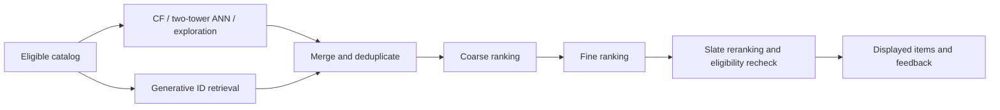

# [To be reviewed] Recommendation Systems

[Handbook contents](../README.md#table-of-contents) | [Previous: Large Language Models](large-language-models.md)

## Contents

- [Problem Definition, Exposure, and Training Data](#rec-problem-data)
- [Traditional Recommendation: Strong Baselines and Their Assumptions](#rec-traditional)
- [The Serving Funnel: Recall, Coarse Ranking, Fine Ranking, and Reranking](#rec-pipeline)
- [Two-Tower Retrieval: Objective, Negatives, and ANN Serving](#rec-two-tower)
- [Coarse and Fine Ranking: Interactions, Distillation, and Utility](#rec-ranking)
- [Slate Reranking: Redundancy, Diversity, and Constraints](#rec-reranking)
- [Sequential Interests and Cold Start](#rec-sequential)
- [Generative Recommendation: Four Related but Different Designs](#rec-generative)
    - [Semantic IDs and the Generative Retrieval Objective](#rec-semantic-ids)
    - [Decoding, Catalog Validity, and Freshness](#rec-generative-serving)
    - [HSTU: Generative Modeling of User Actions](#rec-hstu)
    - [OneRec: Session-wise Generation and Preference Alignment](#rec-onerec)
    - [LLM-based and Conversational Recommendation](#rec-language-models)
- [Offline Metrics, Exposure Bias, and Online Experiments](#rec-evaluation)
- [Architecture Comparison and a Concrete Research Plan](#rec-comparison)

Recommendation selects useful items or an ordered slate given a user's available history, current context, and an eligible catalog. The progression below connects traditional collaborative filtering, two-tower retrieval, coarse/fine ranking, slate reranking, and generative recommendation. These methods can coexist: a generative retriever can feed an ordinary ranker, and a sequence encoder can power either retrieval or ranking. Examples and system sizes below are illustrative designs, not reported production configurations.

## [To be reviewed] Problem Definition, Exposure, and Training Data

Let H be the history available before a request, c its context, and I(c) the currently eligible catalog. Specify whether the output is one item, a ranked list, a session continuation, or a conversational suggestion. Predicting a logged next click and maximizing incremental user value are different objectives. Define useful outcomes, such as a completed learning task or qualified listening, rather than treating every interaction as equally desirable.

**Observation is not preference.** A missing interaction can mean no exposure, an ignored impression, an unavailable item, or genuine disinterest. An observed click also reflects position and presentation. Keep impression-level records with candidate/displayed item IDs, positions, timestamps, model/feature versions, eligibility, and delayed outcomes. When exploration is randomized, record the actual assignment probabilities. User/content attributes must reflect what was available at request time. [Selection-bias formulation](https://arxiv.org/abs/1602.05352)

**Example:** a learner watches introductory probability lessons and then searches for causal inference. Older completion history, the new query, session events, course prerequisites, language, and item availability carry different signals. The goal is to recommend a useful next lesson; maximizing clicks alone may favor a sensational title over a lesson the learner can complete.

## [To be reviewed] Traditional Recommendation: Strong Baselines and Their Assumptions

| Family | What is estimated | Strength | Limitation to test |
| --- | --- | --- | --- |
| Popularity / recency | Aggregated recent engagement, optionally by locale/topic | Cheap baseline and fallback for sparse users | Exposure and popularity feedback loops; weak personalization |
| User-/item-neighborhood CF | Similar behavior profiles or co-interaction relationships | Useful local associations; item neighbors can be precomputed | Sparse overlap, popular-item domination, cold items |
| Content-based matching | Similarity between user interests and item attributes | Can represent new items with content | Similar content need not imply the same consumption utility |
| Matrix factorization | Low-dimensional user/item interaction structure | Efficient dot-product scoring and retrieval | Pure ID factors do not directly represent unseen users/items |
| Feature-based LR / GBDT / FM | Outcome from user, item, context, and their interactions | Competitive tabular baselines with explicit feature control | Feature freshness, sparse categories, limited sequence modeling |

**Matrix factorization.** A biased score is $`s(u,i)=p_u^Tq_i+b_u+b_i`$. Squared error on explicit ratings, confidence-weighted implicit fitting, and pairwise ranking are different learning problems even with this same score. A user-specific bias is constant across items and does not change that user's ranking. [Implicit-feedback factorization](https://yifanhu.net/PUB/cf.pdf)

For one implicit-MF formulation, set a binary preference indicator a from observed interaction counts and confidence w separately, and minimize $`\sum_{u,i}w_{ui}(a_{ui}-p_u^Tq_i)^2+\lambda(\sum_u\|p_u\|_2^2+\sum_i\|q_i\|_2^2)`$. Unobserved entries have low confidence rather than being confirmed dislikes. ALS alternates regularized least-squares user/item updates; ordinary truncated SVD of a zero-filled matrix is not the same estimator. [Hu, Koren, and Volinsky](https://yifanhu.net/PUB/cf.pdf)

**BPR.** Given a sampled observed-positive/unobserved pair (i,j), optimize $`-\log\sigma(s(u,i)-s(u,j))`$ plus regularization. This encourages an ordering rather than a calibrated click probability. The sampling scheme defines which comparisons matter; an unobserved j can be an unexposed future favorite. [BPR, UAI 2009](https://arxiv.org/abs/1205.2618)

**Factorization machines** generalize pair interactions to sparse feature vectors: $`\widehat y=w_0+\sum_a w_ax_a+\sum_{a<b}\langle v_a,v_b\rangle x_ax_b`$. Sharing factor vectors lets rare user/item/context crosses borrow statistical strength; it does not remove cold-start or exposure bias. A pure user/item one-hot construction recovers a matrix-factorization-style interaction. [Author's FM reference](https://libfm.org/)

**Graph CF** is another representation family. LightGCN propagates user/item embeddings over the interaction graph and combines layer representations without the usual feature transforms/nonlinearities at each propagation layer. Build the graph using training-time edges only; adding held-out interactions leaks the answer even when labels are not explicitly supplied to the loss. [LightGCN](https://arxiv.org/abs/2002.02126)

## [To be reviewed] The Serving Funnel: Recall, Coarse Ranking, Fine Ranking, and Reranking

The retrieve-and-rank separation allocates expensive computation to a manageable candidate set. A concrete historical example is YouTube's candidate-generation/ranking architecture; the four-stage funnel below is a general design, not a claim that every system has four separate models. [YouTube architecture](https://research.google/pubs/deep-neural-networks-for-youtube-recommendations/)

| Stage | Illustrative input → output | Main decision | Features / models | Stage-specific check |
| --- | --- | --- | --- | --- |
| Candidate generation / recall, 召回 | 10 million eligible items → 5,000 merged candidates | Which items deserve further computation? | CF neighbors, two-tower ANN, content/topic channels, fresh-item exploration, generative IDs | Relevant-item retention, incremental channel coverage, retrieval latency |
| Coarse ranking / pre-ranking, 粗排 | 5,000 → 500 | Which candidates survive a cheap score? | Small MLP, compact interaction model, distilled scorer, cached features | Retention of useful fine-ranker candidates, cost and distribution shift |
| Fine ranking, 精排 | 500 → 100 | What is the estimated request-specific utility? | Rich feature interactions, candidate-conditioned history, multitask predictions | Ranking quality, calibration, independent outcome quality |
| Slate reranking, 重排 | 100 → 20 displayed positions | Which ordered list works together? | Diversity/redundancy constraints, availability, learned listwise models | Slate utility, constraint violations, repetition, coverage |

**The candidate ceiling matters.** If stages only delete items, a relevant target lost in retrieval cannot be recovered by a later ranker. For one target, retrieval retention 0.8 and conditional downstream retention 0.5 imply total retention 0.4 by the probability chain rule; this is not an independence assumption. Replenishment channels change the candidate set and must be included in the accounting.

**Channel mixing** needs deduplication, per-channel contribution measurement, and eligibility checks. Returning the same popular items from three retrievers does not triple coverage. Filtering after ANN can underfill a request; overretrieve, apply supported filtered search, or replenish under the same latency budget. Recheck volatile availability at display time.

## [To be reviewed] Two-Tower Retrieval: Objective, Negatives, and ANN Serving

Encode the request as $`z_u=f_\theta(H,c)`$ and each item as $`z_i=g_\phi(i,\text{item features})`$, then score $`s(u,i)=z_u^Tz_i`$. The request tower can use a sequence model; the item tower can combine ID, text, image, and metadata features. Their separability permits item vectors to be computed before the request and searched with ANN. Candidate-dependent interactions inside the request tower would break that shared-request computation. [Two-tower recommendation](https://research.google/pubs/sampling-bias-corrected-neural-modeling-for-large-corpus-item-recommendations/)

With one positive per request and a batch of B candidate items, an uncorrected in-batch objective is $`\mathcal L=-B^{-1}\sum_a\log\frac{\exp(s(u_a,i_a)/\tau)}{\sum_{b=1}^{B}\exp(s(u_a,i_b)/\tau)}`$. Temperature, normalization, duplicate items, and accidental positives all affect the task. A known alternative positive should not silently become a negative simply because it belongs to another row. Several valid positives can use a specified multi-positive objective.

**Negative sampling is part of the objective.** In-batch items follow the batch's item-frequency distribution, not a uniform catalog distribution. Sampling-corrected softmax commonly uses a score adjustment involving minus log sampling probability, with exact correction determined by the sampler and positive inclusion scheme. This addresses the sampled training objective; it is not an exposure-propensity correction. Hard negatives from a prior retriever can sharpen discrimination but also introduce false negatives and stale-model bias. [Sampling-bias correction](https://research.google/pubs/sampling-bias-corrected-neural-modeling-for-large-corpus-item-recommendations/)

**Serving contract:** version both towers, preprocessing, embedding dimension, normalization, similarity metric, catalog snapshot, and ANN index together. Dot product and cosine are equivalent only under the appropriate normalization; normalizing vectors can change a model that uses norms as signal. Updating the item encoder without refreshing vectors/index entries produces a mixed representation space. New items need encodable features and an index insertion path; an unseen ID-only embedding is insufficient.

Separate **model retrieval quality** from **ANN approximation quality**. On an affordable sample, compare approximate retrieval with exact top-K under the same learned score. High ANN recall against exact model neighbors does not establish that those neighbors are useful recommendations. Measure feature freshness, item-update lag, p95/p99 latency, and memory along with relevant-item recall.

## [To be reviewed] Coarse and Fine Ranking: Interactions, Distillation, and Utility

**Coarse ranking** makes a budgeted selection decision. A small model can use cached item features, request embeddings, and a limited set of interactions. A teacher fine ranker can supply distillation targets, but imitating its average score is not the same as retaining its best candidates. Compare relevant-item retention and downstream utility at each cutoff; evaluate on the current merged retrieval distribution, not only on previously displayed items.

**Fine ranking** can afford candidate-conditioned computation. DeepFM combines FM-style low-order interactions and a deep component; DCN-V2 explicitly learns feature crosses. DIN builds an interest representation conditioned on the candidate, allowing different history events to matter for different items. Such pair-specific computation is useful after retrieval but is generally too costly to apply independently to every catalog item. [DeepFM](https://arxiv.org/abs/1703.04247), [DCN-V2](https://arxiv.org/abs/2008.13535), [DIN](https://arxiv.org/abs/1706.06978)

**Re-ranker is an overloaded name.** In search/RAG it often means a richer model that rescores each query-document pair. In a recommendation funnel, that operation may correspond to fine ranking. A slate reranker additionally conditions decisions on other selected items or list constraints; name the computation rather than inferring it from the label. See the separate [RAG reranking discussion](large-language-models.md#re-ranking).

**Loss versus serving utility.** Pointwise log loss estimates a specified outcome probability on a specified data distribution; pairwise losses compare items; listwise losses use a defined candidate list. Neither an improved AUC nor a lower pairwise loss guarantees better top-K utility or calibration. If negatives are subsampled, an uncorrected classifier learns the sampled class prior; restore appropriate weighting/calibration before treating its outputs as impression-level probabilities.

For a conversion-after-click task, the probability identity is $`P(C=1,V=1\mid x)=P(C=1\mid x)P(V=1\mid C=1,x)`$. This is a chain rule, not an independence assumption. A post-click conversion model trained only on clicked impressions faces a selected population. ESMM jointly models click and click-conversion outcomes over impressions; the factorization alone does not identify causal treatment effects or solve every selection problem. [ESMM](https://arxiv.org/abs/1804.07931)

**Multiple outcomes** need explicit trade-offs. Predicted clicks, qualified consumption, conversion, satisfaction, cost, and complaints have different units and observation windows. A weighted score requires justified scales; a hard constraint or an expected-value objective imposes another policy. Delayed conversions and unfinished sessions are censored labels, not immediate failures. Specify attribution windows, wait for label maturity or model delay, and inspect uncertainty for rare outcomes.

## [To be reviewed] Slate Reranking: Redundancy, Diversity, and Constraints

Independent item scores ignore interactions within the displayed list: five near-identical lessons can each score highly but collectively waste positions. Let S be the selected prefix. An illustrative MMR selection rule maximizes $`\lambda r(u,i)-(1-\lambda)\max_{j\in S}\operatorname{sim}(i,j)`$ over eligible unselected candidates, taking the redundancy term as zero for an empty S. Match relevance/similarity scales and tune the trade-off on actual user outcomes. MMR originally addressed retrieval/summarization; this use is an adaptation to recommendation. [Original MMR formulation](https://aclanthology.org/X98-1025/)

**Example:** A and B have relevance 0.90 and 0.88 and similarity 0.95; C has relevance 0.84 and similarity 0.10 to A. After choosing A, at lambda 0.7 the scores are 0.331 for B and 0.558 for C. The rule chooses C. That is a designed diversity trade-off, not proof that the user prefers C.

Separate soft preferences from hard rules such as regional availability, duplicate exclusion, prerequisite requirements, or a maximum number of items per creator. Greedy selection can encounter infeasible remaining slots; define fallback and replenishment behavior. A diverse set can still be poorly ordered, and equal exposure is not automatically the desired fairness criterion.

A learned listwise reranker can model candidate interactions or sequential slate decisions. Position-dependent feedback makes training tricky: using the displayed position as a feature without a valid counterfactual protocol can teach the old policy's decisions. Keep candidate-order conventions and supervision explicit; do not claim long-term improvement from a static listwise metric alone.

## [To be reviewed] Sequential Interests and Cold Start

**SASRec** uses causal self-attention over interaction history for next-item prediction. **BERT4Rec** masks items and uses bidirectional visible context in its Cloze training task; it is not simply a causal next-token model with a different name. At evaluation, construct examples only from events available before the request. Bidirectional attention within that available history is different from including future interactions. [SASRec](https://arxiv.org/abs/1808.09781), [BERT4Rec](https://arxiv.org/abs/1904.06690)

Action type, timing, session boundaries, repeated consumption, and event order affect meaning. A quick skip is not the same as a completed lesson; an old purchase can imply either stable interest or no need to recommend the same durable item again. A sequence encoder can supply the request tower, a candidate-conditioned ranker, or a generative next-item model. Sequence modeling is an axis of representation, not an additional mandatory serving stage.

**Cold start has several cases.** New users need available context, stated interests, contextual/popularity fallbacks, or measured exploration. New items can use content features and exposure opportunities; new domains can require adaptation despite having metadata. Content representations do not establish behavioral utility by themselves. Evaluate genuinely unseen users/items with time-valid metadata, rather than calling an infrequent but previously trained ID a cold-start item. [Content-based cold-item recommendation](https://research.google/pubs/content-based-related-video-recommendations/)

## [To be reviewed] Generative Recommendation: Four Related but Different Designs

| Design | What the model generates or predicts | How it reaches catalog items | Representative reference |
| --- | --- | --- | --- |
| Semantic-ID generative retrieval | A sequence of discrete item-identifier tokens | Decode an ID, resolve it to an item, optionally rank the candidates | [TIGER](https://arxiv.org/abs/2305.05065) |
| Generative behavior-sequence modeling | Next items/actions or engagement targets from an interaction stream | Task-specific retrieval/ranking output heads and serving system | [HSTU / Generative Recommenders](https://arxiv.org/abs/2402.17152) |
| Session-wise generative recommendation | A sequence of recommended items, with preference alignment | Decode a session/list of item IDs under a unified model | [OneRec](https://arxiv.org/abs/2502.18965) |
| Language-based recommendation | Task outputs, IDs/titles, explanations, or conversational actions | Catalog grounding/retrieval and an explicit output-to-item mapping | [P5](https://arxiv.org/abs/2203.13366) |

“Generative” does not specify a natural-language LLM, semantic IDs, a listwise objective, or the removal of every downstream ranker. State the output representation, supervision, candidate mechanism, and production constraints.

### [To be reviewed] Semantic IDs and the Generative Retrieval Objective

TIGER encodes item content and uses residual quantization to produce discrete semantic code tuples. At quantization level l, select a code vector nearest the current residual and subtract it before the next level. Nearby content can share code prefixes. Collisions require disambiguation: the paper appends an additional token so each catalog item has a unique ID. These are learned codes, not guaranteed human-readable category labels. [TIGER, Section 3](https://arxiv.org/html/2305.05065v3#S3)

Let an item have m-token ID c(i). Its modeled probability factors as $`p_\theta(c(i)\mid H)=\prod_{l=1}^m p_\theta(c_l(i)\mid H,c_{<l}(i))`$. Teacher-forced training minimizes $`\mathcal L_{\mathrm{ID}}=-\sum_{l=1}^m\log p_\theta(c_l(i^+)\mid H,c_{<l}(i^+))`$ for the observed next item. This learns next-item supervision from logs, not necessarily the best intervention. [Generative retrieval objective](https://arxiv.org/html/2305.05065v3#S3.SS2)

For illustration, two causal-inference lessons might map to (7,12,4,0) and (7,12,4,1), while an unrelated item has another prefix. Sharing codes permits parameter sharing but cannot guarantee useful distinctions between prerequisites, difficulty, or user intent. Evaluate relevance and code collisions separately.

### [To be reviewed] Decoding, Catalog Validity, and Freshness

The following are system-design consequences of generating IDs rather than exhaustive engineering claims about TIGER:

- **Constrained decoding:** use a catalog-aware prefix structure or validate completed IDs against the current catalog. Unused code combinations, unavailable items, and duplicate outputs need handling. Masking invalid continuations and locally renormalizing probabilities can change sequence rankings; specify whether final scores use original model likelihoods or the constrained distribution.
- **Search approximation:** beam search can prune a low-probability prefix whose eventual item would beat surviving alternatives. Beam width, code length, duplicate filtering, and candidate count jointly affect quality/latency. Exact ID validity does not imply exact top-K search or relevance.
- **Catalog updates:** version the content encoder, quantizer/codebooks, collision-disambiguation rules, ID dictionary, and generator. Encoding a new item and adding its valid ID does not guarantee the generator will recommend it. Changing old code assignments can invalidate historical sequences, cached states, and trained token meanings.
- **Cost accounting:** generating m tokens per identifier has multiple decoder steps and potentially many beam states. Compare complete candidate generation against ANN at matched useful-item recall, coverage, hardware, concurrency, and update cadence. Eliminating an ANN index does not eliminate catalog maps or validity structures.
- **Objective mismatch:** next-ID likelihood, final Recall@K, slate diversity, and long-term utility are distinct. A supervised generative retriever can be combined with conventional ranking or later preference/reward optimization; generative architecture does not require RL.

**Toy search example:** two valid items begin with branches of probability 0.6 and 0.4; their sole valid next codes have conditional probabilities 0.4 and 0.9. Original full-ID probabilities are 0.24 and 0.36. Width-one beam search drops the second branch too early. Locally renormalizing each branch's single allowed continuation instead gives scores 0.6 and 0.4, reversing the original ordering. Validity constraints, search approximation, and score definition are three separate choices.

### [To be reviewed] HSTU: Generative Modeling of User Actions

HSTU reformulates retrieval/ranking through sequential transduction of heterogeneous user events. Its design includes pointwise aggregated attention, gated feature interactions, relative attention biases, and efficiency techniques for variable-length histories and shared computation. Its attention is not simply the softmax Transformer operator explained in the [Transformer chapter](transformer.md#tf-attention). [HSTU, Sections 2–3](https://arxiv.org/html/2402.17152v3#S3)

This is a different design from autoregressively spelling out an item's semantic ID, and it need not generate natural-language descriptions. Distinguish history representation, retrieval heads, ranking targets, and serving execution. The paper's scaling/latency and online results belong to its measured workloads; they do not establish universal scaling laws or a fixed speedup over every Transformer recommender. Compare dense computation, embedding storage, history lengths, candidate counts, and hardware when assessing parameter/throughput claims.

### [To be reviewed] OneRec: Session-wise Generation and Preference Alignment

OneRec (2025) studies a unified retrieve/rank generative model with an encoder–decoder, sparse MoE, session-wise generation, and iterative preference alignment using DPO. Generating a session conditions later recommendations on earlier generated items, unlike independently predicting one next item repeatedly. Its alignment procedure uses a learned reward model and a sampling strategy to construct preferences when only one response slate is actually exposed to a user. Those simulated preferences are model feedback, not observed outcomes for both alternative slates. [Original OneRec paper](https://arxiv.org/abs/2502.18965)

The probability factorization over item IDs and items within a slate can support this richer output, but maximum-likelihood imitation of logged sessions still inherits the logging policy. Preference alignment changes the objective; it does not make a reward model an unbiased counterfactual user simulator. Inspect slate-label validity, reward exploitation, diversity, catalog constraints, and total serving cost. Refer to [DPO and reward-model evaluation](large-language-models.md#preference-optimization) for the underlying mechanisms.

**Dated follow-up, 2026-10-27:** OneReason (June 2026) studies item-token/language grounding, structured recommendation reasoning supervision, and RL. Its report notes that adding a thinking mode did not automatically beat non-thinking baselines in preliminary studies. Test reasoning against a no-reasoning model at matched training access, inference budget, and item-selection metrics; longer rationales alone do not establish better recommendations. [OneReason report](https://arxiv.org/abs/2606.06260)

### [To be reviewed] LLM-based and Conversational Recommendation

P5 expresses multiple recommendation tasks in a text-to-text framework using interactions, user/item information, and task prompts. This is broader than a semantic-ID retriever and can include explanation generation. [P5](https://arxiv.org/abs/2203.13366)

In an illustrative conversational system, an LLM extracts “advanced causal inference, no introductory material,” retrieves eligible catalog lessons, and selects from those IDs. Check availability/prerequisites with current catalog data, and ground the explanation in verified attributes. Fluent text is not evidence that an item exists, is available, or fits the user. An LLM can also enrich item features or rerank a small candidate set without replacing retrieval. Evaluate item-selection quality separately from explanation quality and conversational satisfaction.

## [To be reviewed] Offline Metrics, Exposure Bias, and Online Experiments

**Time-valid protocol:** choose chronological train/development/test windows, rebuild graph/index/codebooks with a declared data-access policy, and ensure each history and feature is available at that request's timestamp. If future catalog metadata is used transductively, state that setting rather than presenting it as prospective deployment. Report exclusions, repeat-item policy, target availability, and cold-item slices.

For a held-out relevant set R and returned list L, $`\operatorname{Recall@K}=|L_{1:K}\cap R|/|R|`$ when R is nonempty. With a single target it becomes a hit indicator. With relevance grade r_j at position j, define $`\operatorname{DCG@K}=\sum_{j=1}^K(2^{r_j}-1)/\log_2(j+1)`$ and divide by the ideal DCG for NDCG, specifying zero-gain handling. Macro-user and event-weighted averages answer different questions.

**Candidate sets matter.** Ranking against 100 sampled negatives is not the same evaluation as full-catalog retrieval. Report sampling distribution, exclusions, and whether targets were injected into a ranker's input. Evaluate the funnel end to end as well as each stage. Sampled metrics can change model ordering; do not compare results across incompatible candidate protocols. [On Sampled Metrics for Item Recommendation](https://research.google/pubs/on-sampled-metrics-for-item-recommendation/)

Track calibration/log loss for probability predictions, relevant-item retention at cutoffs, catalog coverage, novelty, creator/topic concentration, latency, update lag, and independent outcome quality. For generative systems also track valid-ID rate, post-filter fill rate, unique-item coverage, beam/decode cost, and new-item behavior. State denominators: validity before filtering and validity after dropping invalid outputs measure different things.

**Exposure correction requires assumptions.** Inverse propensity weighting can correct specified observation-selection effects when propensities, overlap, consistency, and the relevant ignorability assumptions hold. Small propensities create high variance; clipping trades variance for bias. Weighting observed interactions cannot identify outcomes for a catalog region with zero exposure. Item-inclusion propensities are not automatically sufficient for position- or slate-dependent outcomes. [Recommendations as Treatments](https://arxiv.org/abs/1602.05352)

**Online experiment:** predefine the randomization unit, primary outcome, observation horizon, minimum useful effect, and guardrails. Use suitable uncertainty estimates for repeated user events; inspect assignment/exposure balance and effects on cold users/items. A click gain can coexist with lower completion, satisfaction, or retention. Exploration changes future training data, and a contextual bandit objective does not by itself optimize a long-horizon user trajectory.

## [To be reviewed] Architecture Comparison and a Concrete Research Plan

| Approach | Expensive interaction occurs where? | Primary advantage | Important operational limit |
| --- | --- | --- | --- |
| MF / item-neighbor baseline | Precomputed factors or neighborhoods | Cheap, interpretable comparison point | Sparse/cold IDs and limited context |
| Two-tower + ANN | Separate request/item encoding, then vector match | Reusable item representations and large-catalog retrieval | Factorized score and index freshness |
| Rich fine ranker | Request-candidate feature/history interaction | Candidate-specific utility estimation | Computation only feasible for a reduced pool |
| Slate reranker | Interactions among displayed candidates | Redundancy, constraints, and list effects | Biased list feedback and feasibility |
| Semantic-ID generator | Conditional token decoding over item codes | Shared code structure and direct identifier prediction | Search pruning, mapping changes, validity, update cost |
| HSTU-style sequence model | Heterogeneous event-sequence transduction | Rich streaming history and shared computation | Task heads, caching, and workload-specific systems design |
| OneRec-style session generator | Autoregressive session/slate generation and preference alignment | Joint output dependencies within a unified generative pipeline | Simulated preferences, reward validity, and sequence decoding cost |
| Grounded conversational LLM | Request interpretation and candidate-conditioned generation | Flexible expressed preferences and explanations | Catalog grounding, latency, and evaluation of selection |

**Illustrative learning-platform experiment:** use a time-versioned lesson catalog, prerequisite/availability rules, and chronological user histories. Compare popularity, item-CF, implicit MF/BPR, and a sequence-based two-tower under the same evaluation catalog. Add a compact coarse scorer, a candidate-conditioned fine ranker, and a constrained diverse slate; measure the gain and loss at each boundary.

Next, replace only the learned retrieval channel with a semantic-ID generator, keeping the ranker and candidate budget fixed. Then compare complete pipelines under a matched total latency/compute budget, including item encoding, index/code maintenance, decoding, and fallbacks. Separately test a sequence-model upgrade or an LLM interface; changing retrieval, ranker, and UI simultaneously obscures attribution.

Use disjoint task/user/time slices appropriate to the question and report new-item, sparse-user, repeated-item, and prerequisite-sensitive results. An offline next-item gain justifies further investigation; demonstrate incremental user benefit with an independent online protocol before claiming a superior recommendation system.
