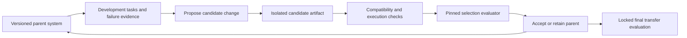

<a id="rsi-and-harness"></a>
# [To be reviewed] RSI & Harness

[Handbook contents](../README.md#table-of-contents) | [Previous: Agents](agents.md) | [Next: Benchmarking & Evaluation](benchmarking-and-evaluation.md)

## Contents

- [What changes in self-improvement?](#rsi-definitions)
- [Runtime versus evaluation harness](#harness-runtime)
- [State, persistence, and recovery](#harness-state)
- [Context and long-running work](#harness-context)
- [A bounded improvement loop](#rsi-loop)
- [Parameters, prompts, memory, and code](#rsi-learning)
- [Research map and evidence boundaries](#rsi-literature)
- [Evaluating a recursive improvement claim](#rsi-evidence)
- [Worked example: improving a coding harness](#rsi-example)
- [Failure modes and research questions](#rsi-failures)

Here **RSI means recursive self-improvement**. The term has multiple operationalizations, so specify the mutable system, improvement mechanism, and evidence before using it. A **harness** is the software infrastructure around a model or agent: it supplies context, executes tools, manages state/resources, and exposes outcomes. The runtime harness of an agent and the evaluation harness measuring it have related but distinct responsibilities. References and dated research notes were checked on **2026-10-27**.

Read [Agents](agents.md) for tool use, planning, memory, workflows, multi-agent systems, and training. [LLM post-training](large-language-models.md#post-training) explains parameter-learning objectives; [Benchmarking & Evaluation](benchmarking-and-evaluation.md) explains why improved selection scores need independent validation.

<a id="rsi-definitions"></a>
## [To be reviewed] 1. Improvement, Self-Modification, and Recursion

One can represent an agent system schematically as $`S=(\theta,H,M,C)`$: model parameters theta, harness/code H, persistent experience M, and configuration/prompts C. Tool implementations, environment, and evaluator versions must also be identified, even when held outside the mutable system. This decomposition is a proposed bookkeeping model, not a standardized mathematical definition of an agent.

| Process | What changes? | What additional claim would require evidence? |
| --- | --- | --- |
| Inference-time refinement | A candidate answer or plan within one task | That later independent tasks improve |
| Experience accumulation | Memories, examples, or reusable skills | That retention/retrieval improves relevant future decisions |
| Self-generated training | Parameters updated using generated/selected examples | That supervision is valid and transfers beyond the selection set |
| Prompt / harness optimization | Instructions, tools, orchestration, or runtime code | That the new configuration improves a controlled utility/cost target |
| Recursive system improvement | An accepted successor participates in subsequent improvement | That improvements persist across rounds and generalize under fair accounting |

For this chapter, the **recursive criterion** is operational: the accepted successor changes the system used in later improvement rounds, and the experiment records that dependency. The updated object can be agent code rather than foundation-model weights. A fixed external optimizer repeatedly generating candidates can still improve a system, but the stronger claim that its *improvement process itself* became better requires a comparison of that process.

**Example:** asking a model to critique one answer is inference-time refinement. Keeping an error checklist for later tasks is experience accumulation. Training on verified traces changes parameters. Letting an agent edit its own controller and using the accepted controller to propose/evaluate later edits creates a candidate recursive loop. Each process needs its own evidence; none alone establishes unlimited or accelerating capability growth.

<a id="harness-runtime"></a>
## [To be reviewed] 2. Runtime Harness and Evaluation Harness

| Component | Runtime responsibility | Evaluation responsibility |
| --- | --- | --- |
| Task entry / reset | Instantiate the user's task and permitted workspace | Select a declared task instance and clean starting state |
| Model interface | Serialize messages, schemas, observations, and context | Pin model/template/decoding and capture configuration |
| Tool executor | Validate and execute permitted actions; capture outcomes | Restrict access according to the benchmark protocol |
| State / persistence | Track jobs, artifacts, pending operations, and checkpoints | Associate results with the actual tested revision and state |
| Resource controller | Apply configured token, tool, time, and concurrency limits | Account for complete attempt/search/training cost |
| Completion / grading | Determine whether task completion evidence exists | Apply independent tests/rubrics and aggregate outcomes |

The model chooses from an interface implemented by the harness. Changing file-reading granularity, error messages, truncation behavior, test-result presentation, or tool availability can change the effective decision problem even with fixed weights. SWE-agent studies this interface effect for coding agents. [SWE-agent](https://arxiv.org/abs/2405.15793)

**Separation matters for improvement experiments.** Candidate code can legitimately change a planner or context policy within the experimental search space. The evaluator and final task-access policy must remain an independently specified reference. If candidates can redefine “passed,” remove failing tasks, or change their accounting denominator, the measured score no longer represents the same comparison.

An ordinary library that sends model requests can be part of a harness, but a long-running system also needs state/effect handling. An evaluation framework can run agent tasks without being the agent's production runtime. See the [evaluation protocol](benchmarking-and-evaluation.md#eval-protocol) for the artifacts required to reproduce both sides.

<a id="harness-state"></a>
## [To be reviewed] 3. State, Persistence, and Recovery

Maintain at least three distinct records: **event history**, **authoritative task/environment state**, and **context prepared for the next model call**. A transcript summary is useful context; it is not necessarily an authoritative transaction log. A tool's success status should identify the artifact/revision or external operation it actually changed.

| Operation state | Meaning | Recovery behavior |
| --- | --- | --- |
| Proposed | A policy emitted a request | Validate arguments, scope, and resources before execution |
| Accepted / running | The executor began work | Preserve operation identity and a queryable status |
| Committed / completed | The effect/result is durably known | Record the result reference and update task state |
| Failed without effect | A known failure occurred before any effect | Retry or revise under the stated retry policy |
| Outcome unknown | A timeout/crash obscures whether an effect occurred | Reconcile durable status or actual state before repeating a mutation |

**Example:** a patch request times out after the filesystem write but before its response arrives. Replaying the request as a new blind edit can apply a change twice or target an unexpected revision. A recovery routine checks the operation ID and repository/artifact state, then resumes from the observed result. Distributed tools require their own idempotency and persistence semantics; a local retry counter does not provide general exactly-once execution.

Checkpoints should identify model/configuration revision, workspace/environment revision, task progress, pending jobs, tool-result references, and remaining budgets. A new process must reconcile live jobs and durable effects before reconstructing its context. Replaying recorded observations tests the controller; rerunning real tools tests a larger system and can produce different observations or effects.

Useful recovery checks include interruption before/after a tool effect, partial/truncated outputs, stale revisions, duplicate responses, expired credentials, and environment restart. These are engineering tests of the runtime contract, separate from measuring the model's task competence. Specify how unresolved runs contribute to reported task success and cost.

<a id="harness-context"></a>
## [To be reviewed] 4. Context Management and Long-Running Work

Context assembly is an information-selection policy. Include the current objective, relevant constraints, tool contracts, verified task state, pending actions, and source-backed evidence within the available token budget. Preserve exact artifact references so a later session can inspect the underlying evidence instead of trusting a compressed narrative.

Anthropic's long-running-agent case study uses a distinct initialization phase and later work sessions with persistent progress artifacts and validation. Its design illustrates continuity across context windows; the reported application is not proof that every agent needs the same files or prompts. [Long-running harness case study](https://www.anthropic.com/research/effective-harnesses-for-long-running-agents)

**Example checkpoint:** “Regression test exists at this revision; it fails with the recorded boundary input; proposed patch has not been applied; test job is still running.” This is more actionable than “almost done.” A summary that changes a pending action into a completed action corrupts control state even if its prose sounds reasonable.

Separate persistent **facts**, **hypotheses**, **task-local observations**, and **reusable procedures**. Store origin/version/validity scope and update or retire stale memory. Context compaction, retrieval, and prompt instructions can then be ablated independently. [Context-engineering discussion](https://www.anthropic.com/research/effective-context-engineering-for-ai-agents), [agent memory](agents.md#agent-memory)

The runtime can also make planning economical: compact tool summaries reference full logs, read-only work can be parallelized when independent, and repeated unchanged evidence need not be reloaded every turn. Measure retained task quality alongside reduced tokens/latency; overly aggressive compaction can erase the evidence or constraints that made the task solvable.

<a id="rsi-loop"></a>
## [To be reviewed] 5. A Bounded and Inspectable Improvement Loop

An illustrative outer loop proposes a change to a versioned parent, evaluates the child, and selects a successor. Its scientific boundary is the declared search space, task distribution, and resource/evaluation protocol. The diagram is a proposed design, not a complete implementation of any cited paper.



For candidate S and fixed task environment E, an illustrative objective is $`J(S)=\mathbb E_{x\sim D}[R(S,x;E)]-\lambda\mathbb E_{x\sim D}[\operatorname{Cost}(S,x;E)]`$. Define success/reward, cost units, weights, and constraints in advance. Alternatively report a quality–cost frontier. A changed utility definition or a larger hidden inference budget is a different experiment.

The proposal can be a prompt edit, tool implementation, planner, memory rule, or parameter update. Identify which object changed, run compatibility checks, and preserve the candidate diff and lineage. On rejection, retain the tested parent state. On acceptance, subsequent rounds must actually use the child if the experiment claims a recursive dependency.

The **selection set** is an optimization resource. A final transfer/test set should be held outside repeated candidate selection; once its results guide revisions it becomes part of development and requires a new final test for a clean confirmation. “Hidden from the candidate” and “never used by the optimizer” describe different access boundaries.

An illustrative lineage record makes the dependency reviewable:

```json
{
  "candidate_id": "demo-child-08",
  "parent_id": "demo-parent-03",
  "mutable_component": "context_policy",
  "artifact_revision": "demo-rev-27",
  "evaluator_revision": "demo-eval-04",
  "selection_task_manifest": "demo-selection-v2",
  "accepted": true,
  "used_as_next_improver": true
}
```

This record documents a design claim; independent execution/configuration logs must establish that the child was truly used and evaluated as recorded. A model's self-report that it improved is not that evidence.

<a id="rsi-learning"></a>
## [To be reviewed] 6. Parameters, Prompts, Memory, and Code Are Different Search Spaces

| Mutable object | Example update | What may remain fixed | Scientific control |
| --- | --- | --- | --- |
| Answer / plan | Critique and revise a response | Weights, tools, runtime | Same task and total inference budget |
| Experience / skills | Store a verified failure lesson or tested routine | Weights | Memory budget, retrieval policy, retention, transfer tasks |
| Prompt / demonstrations | Optimize instructions or examples | Base model | Development access and proposal/evaluation compute |
| Runtime code | Improve file editing, scheduling, recovery, or context assembly | Base model parameters | Tool access, grader, tested artifacts, and execution limits |
| Parameters / adapters | SFT, RL, or distillation on selected trajectories | Some runtime components | Full data/rollout/teacher cost and retained capabilities |
| Improvement procedure | Change how candidates are proposed, tested, or selected | External measurement protocol | Compare descendant optimizer with a fixed optimizer at equal resources |

Self-generated data needs independent quality evidence and diversity/coverage checks. Iterating a biased judge or repeatedly imitating selected successes can reinforce an error or narrow the task distribution. STaR studies bootstrapping reasoning training from selected/rationalized examples; it is a concrete learning procedure rather than a guarantee that arbitrary synthetic recursion improves models. [STaR](https://arxiv.org/abs/2203.14465)

Likewise, Reflexion updates an experience buffer without weight training, while code-editing systems can improve runtime behavior around a fixed foundation model. Use the actual updated object when describing results. [Reflexion](https://arxiv.org/abs/2303.11366), [agent-training comparison](agents.md#agent-training)

<a id="rsi-literature"></a>
## [To be reviewed] 7. Research Map: Mechanisms and Evidence Boundaries

| Reference / first report | Mechanism to inspect | Boundary on interpretation |
| --- | --- | --- |
| [Gödel machines](https://arxiv.org/abs/cs/0309048) (2003) | Self-referential changes justified through proof search under a formal utility/axiom system | Formal claims depend on those assumptions and proof/computational conditions; they are not an empirical guarantee for arbitrary LLM edits |
| [Self-Refine](https://arxiv.org/abs/2303.17651) (2023) | Iterative output feedback and revision | Improvement of an output does not establish improvement of the future optimizer |
| [DSPy](https://arxiv.org/abs/2310.03714) (2023) | Declarative LM pipelines with optimization/compilation of components | Inspect which prompts/examples/parameters are optimized and on which data |
| [SICA](https://arxiv.org/abs/2504.15228) (2025) | A coding agent edits its own agent-system code and measures resulting task performance | Non-gradient agent-system adaptation; benchmark/scaffold evidence remains setup-specific |
| [Darwin Gödel Machine / DGM](https://arxiv.org/abs/2505.22954) (2025) | Agent-code modification, empirical evaluation, and an archive for open-ended exploration | Empirical selection replaces the formal proof requirement; branching search and frozen-model contributions need separate accounting |
| [AlphaEvolve](https://deepmind.google/blog/alphaevolve-a-gemini-powered-coding-agent-for-designing-advanced-algorithms/) (2025) | LM-generated programs, automated evaluators, and evolutionary selection | Optimizing target algorithms/codebases is distinct from demonstrating that the entire agent's improvement process recursively improves |
| [GEPA](https://arxiv.org/abs/2507.19457) (2025) | Reflective prompt evolution using execution feedback | Compare search/data budgets and task scope before generalizing a comparison with RL |
| [AIDE² / research-agent RSI](https://arxiv.org/abs/2609.26457) (2026) | Accepted agent-code rewrites become the agents edited in subsequent rounds | Inspect the recursive dependency, selection access, research-efficiency objective, and held-out transfer protocol |

This table groups related work by mechanism, not a single formal definition of RSI or a ranking of current systems. In particular, the Gödel-machine name does not make DGM's empirical improvements theorem-backed. DGM and SICA provide concrete code-adaptation experiments; compare their tasks, scaffolds, search branches, and resource accounting before comparing headline gains. [DGM](https://arxiv.org/abs/2505.22954), [SICA](https://arxiv.org/abs/2504.15228)

**Dated evaluation caveat:** several historical coding-agent studies report SWE-bench Verified results. The benchmark's later contamination/test-design audit and newer revisions discussed in [Benchmarking & Evaluation](benchmarking-and-evaluation.md#eval-version-changes) limit direct extrapolation to current frontier capability. Preserve the original experimental claim while testing current claims on independently appropriate tasks.

<a id="rsi-evidence"></a>
## [To be reviewed] 8. Evidence for Improvement and for Recursion

Use a comparison matrix that separates the improvement mechanism from extra computation and benchmark adaptation:

| Comparison | What it isolates |
| --- | --- |
| Frozen parent versus selected child, identical task/interface budget | Net effect of the accepted change on that distribution |
| Fixed parent with more attempts versus improved system at matched total cost | Search scaling versus a more effective policy/runtime |
| Fixed proposal generator versus descendant-controlled proposal generation | Whether updating the improvement process contributes |
| Linear accept/reject loop versus archive/branching search | Exploration/selection structure |
| Prompt-only, memory-only, code-only, and parameter-only changes | Which mutable component produces gains |
| Selection distribution versus new sources/tasks/environments | Transfer beyond repeated benchmark feedback |

Keep task/scaffold/evaluator revisions and seeds aligned when asking a causal question, then separately measure the best practical system at a deployment budget. Include unsuccessful candidate generation, evaluation, teacher calls, environment setup, and retained-model training cost. A cheaper deployment policy can still require an expensive discovery process; report both.

**Selection bias compounds with search.** In an illustrative independent-null setting, testing M useless candidates at false-positive rate alpha gives $`P(\text{at least one false positive})=1-(1-\alpha)^M`$. At M = 20 and alpha = 0.05, this is about 0.642. Adaptive candidates are often correlated, so this numeric formula is not a universal RSI error estimate. It illustrates why repeated local “significant” gains need a declared selection protocol and independent confirmation.

Use paired outcomes, uncertainty at the correct task/source level, predefined acceptance criteria, and a final held-out evaluation. Track regressions and quality–cost trade-offs rather than selecting only a favorable aggregate. [Statistical comparisons](benchmarking-and-evaluation.md#eval-statistics), [contamination and adaptation](benchmarking-and-evaluation.md#eval-contamination)

Evidence of several accepted improvements establishes a bounded empirical trajectory. Establishing accelerating improvement requires a defined efficiency/capability scale, complete resource accounting, enough independent rounds, and credible transfer. Extrapolating to indefinite growth is an additional hypothesis, not an implication of a rising selection curve.

<a id="rsi-example"></a>
## [To be reviewed] 9. Worked Example: Improving a Coding-Agent Harness

Suppose the [coding agent](agents.md#agent-example) often rereads long files, loses pending-test status during compaction, and retries edits after ambiguous timeouts. These are illustrative observations for a proposed experiment; the values below are not measured results from this repository.

| Candidate change | Hypothesis | Development check | Independent outcome / regression check |
| --- | --- | --- | --- |
| Structured task-state checkpoint | Preserve unfinished jobs and tested revisions across sessions | Interrupt a run before and after a tool result | Correct recovery on unseen interruption points/tasks |
| Bounded file reads with full-log references | Reduce irrelevant context without losing needed evidence | Check whether requested lines and truncation are represented | Matched-budget repair success, tokens, and missing-context errors |
| Durable mutation identity | Avoid duplicate/stale edits after an ambiguous timeout | Simulate response loss after a committed patch | Artifact correctness and recovery with unseen failure timing |
| Dependency-aware parallel reads | Reduce time spent on independent inspections | Confirm that dependent writes/tests still wait | End-to-end latency and success at fixed total tool/model cost |

An illustrative child might solve 72 of 100 selection tasks while its parent solves 68. That four-point aggregate difference does not reveal paired disagreements, uncertainty, or transfer. Compare the actual task outcomes, repeat stochastic trials as justified, and check the resource/constraint differences before accepting the change.

If accepted, record the exact child revision and use it for the next proposal round. Preserve the unchanged external grader and a locked final task set. On that final set, report success, recovery, quality, and total cost; if it informs another edit, relabel it as development access. This makes the difference between a promising selection result and a confirmed improvement visible.

<a id="rsi-failures"></a>
## [To be reviewed] 10. Failure Modes and Open Research Questions

- **Verifier exploitation or metric drift:** did behavior improve under the intended objective, or did the candidate change the meaning of success, the task set, or the recorded artifact?
- **Budget amplification:** did the policy become more effective, or did it silently gain retries, tools, context, workers, or model access?
- **Memory and context regressions:** does a locally helpful summary/skill remain valid across versions, unrelated tasks, and long interruption chains?
- **Search overfitting:** do gains persist on untouched sources and environments after many candidates and evaluation-driven choices?
- **Recursive attribution:** is a descendant actually used in the improvement process, and does that contribute beyond a fixed improver with equal resources?
- **System drift:** which changed dependency, API, model snapshot, tool implementation, or grader explains a change in the measured curve?
- **Retention and stability:** can the system preserve valuable earlier capabilities and recover a known-good version when a promising child fails elsewhere?

The research problem is to build systems that improve under a clear external objective with reproducible evidence, while understanding where the improvement comes from. Runtime engineering supplies reliable execution; learning/search supplies candidate changes; evaluation supplies bounded evidence. Their interaction is the subject to measure.
